<h2 align="center">Spatial Intelligence: Foundations, Architectures, Methodologies, Applications and Challenges</h2>
<!-- <h1 align="center">Awesome-Spatial-Intelligence</h1> -->
<div align="center">

[](#)
[](#)
[](https://github.com/spatial-agi/awesome-spatial-intelligence/issues)
[](CONTRIBUTING.md)

</div>

<p align="center">
  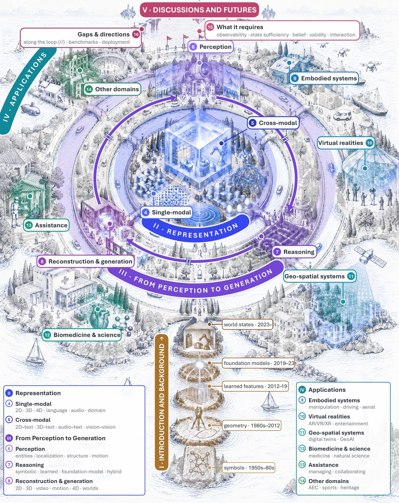
</p>
<p align="center"><sub><b>Figure 1.</b> The handbook as one world. The map is laid out like the book: representation (Part II) at the center, the loop from perception through reasoning to generation (Part III) on the inner ring, and the application domains (Part IV) along the coast. The stepping stones below trace the five eras of Part I, the horizon above holds the open questions of Part V, and each chapter is pinned where it lives in this world.</sub></p>

# 🎇 Introduction

Spatial intelligence lies at the core of human cognition. We perceive our surroundings, remember places, plan routes, manipulate objects, and coordinate with one another in shared physical and virtual spaces, and we do all of this by building and continuously revising internal models of the world. Machines are only now acquiring the rudiments of this ability. Today’s AI systems write fluent prose and reason impressively over text, yet they still struggle to judge whether a sofa will fit through a doorway, to keep a scene coherent while moving through it, or to anticipate what happens when an object is pushed. That gap has become one of the central open problems of contemporary AI. Advances in vision-language models, 3D and 4D perception, generative modeling, and interactive world models are now converging from different directions on the same goal: machines that perceive, reason, and act in space. This handbook is our attempt to give that convergence a coherent shape.

The immediate motivation is a long-standing fragmentation. Research on space in AI has been carried out in largely separate communities, spanning SLAM and state estimation, 3D vision and neural rendering, spatial language grounding, geographic information science, embodied navigation and manipulation, and the psychology and neuroscience of spatial cognition, each with its own representations, benchmarks, and vocabulary. Progress in one thread has rarely been legible to the others. We set out to organize the field as a whole. The organizing commitment of this handbook is representation-centric: spatial intelligence is the ability of a system to ***construct, maintain, and manipulate spatial representations of the world*** in support of perception, reasoning, prediction, and embodied action. Reading the field through this single lens, from the symbolic maps of early AI, through probabilistic geometry and learned features, to today’s foundation models and executable world states, is what allows historically disjoint literatures to be placed on common ground.

The volume proceeds in five parts. [Part I](#-part-i--introduction-and-background) lays the foundation: why spatial intelligence has risen to prominence now, how the idea evolved across five representational eras from symbolic spatial computing to world-centered intelligence, and how we define and formalize the concept itself. [Part II](#-part-ii--spatial-aware-representation-building-blocks-of-space) examines spatial-aware representation, covering single modalities (2D, 3D, 4D, language, and audio), domain-specific representations, and the cross-modal alignment and fusion that bind them. [Part III](#-part-iii--spatial-intelligence-from-perception-to-generation) follows the full functional pipeline from perception, through reasoning in its rule-based, learning-based, foundation-model-driven, and hybrid forms, to spatial reconstruction and generation. [Part IV](#-part-iv--applications) turns to applications, where these capabilities are assembled into working systems: embodied agents and robots, virtual and extended realities, geo-spatial systems, biomedicine and the natural sciences, intelligent assistants, and a range of further domains. [Part V](#-part-v--discussions-and-futures) closes with open discussions, unresolved challenges, and the directions we believe will matter most in the coming years.

This repository lists the papers cited in the handbook, arranged by its parts and sections.

---

### News
> 2026-11-12: We release the paper list of the Handbook of Spatial Intelligence with 1419 papers.

---
# 📕 Table of Contents

- [🏛 Part I · Introduction and Background](#-part-i--introduction-and-background)
  - [1. Spatial Intelligence: A Rising AI Paradigm](#1-spatial-intelligence-a-rising-ai-paradigm)
    - [1.2. Historical Evolution and Milestones](#12-historical-evolution-and-milestones)
      - [1.2.1. Era 1: Symbolic and Cognitive Spatial Computing (1950s–1980s)](#121-era-1-symbolic-and-cognitive-spatial-computing-1950s1980s)
      - [1.2.2. Era 2: Geometric and Probabilistic Spatial Modeling (1980s–2012)](#122-era-2-geometric-and-probabilistic-spatial-modeling-1980s2012)
      - [1.2.3. Era 3: Learning-based Spatial Modeling (2012–2019)](#123-era-3-learning-based-spatial-modeling-20122019)
      - [1.2.4. Era 4: Large Foundation Spatial Modeling (2019–2023)](#124-era-4-large-foundation-spatial-modeling-20192023)
      - [1.2.5. Era 5: World-Centered Spatial Intelligence (2023–Present)](#125-era-5-world-centered-spatial-intelligence-2023present)
  - [2. A Definition in Motion: Revisiting Spatial Intelligence](#2-a-definition-in-motion-revisiting-spatial-intelligence)
- [🧱 Part II · Spatial-aware Representation: Building Blocks of Space](#-part-ii--spatial-aware-representation-building-blocks-of-space)
  - [4. Single-Modal Spatial Representation](#4-single-modal-spatial-representation)
    - [4.1. 2D](#41-2d)
    - [4.2. 3D](#42-3d)
      - [4.2.1–4.2.4. RGB-D Images, Voxel Grids, Point Clouds and Meshes](#421424-rgb-d-images-voxel-grids-point-clouds-and-meshes)
      - [4.2.5–4.2.8. Implicit Representations, Neural Radiance Fields, 3D Gaussian Splatting and Hybrid Methods](#425428-implicit-representations-neural-radiance-fields-3d-gaussian-splatting-and-hybrid-methods)
    - [4.3. 4D](#43-4d)
    - [4.4. Language](#44-language)
    - [4.5. Audio](#45-audio)
    - [4.6. Domain-Specific Representations](#46-domain-specific-representations)
  - [5. Cross-Modal Spatial Representation](#5-cross-modal-spatial-representation)
    - [5.1–5.2. Overview and 2D-text](#5152-overview-and-2d-text)
    - [5.3. 3D-text](#53-3d-text)
    - [5.4. Audio-text](#54-audio-text)
    - [5.5. Vision-vision](#55-vision-vision)
- [🧠 Part III · Spatial Intelligence: From Perception to Generation](#-part-iii--spatial-intelligence-from-perception-to-generation)
  - [6. Spatial Perception](#6-spatial-perception)
    - [6.1. Spatial Entity Recognition](#61-spatial-entity-recognition)
      - [6.1.1. Object Detection](#611-object-detection)
      - [6.1.2. Segmentation](#612-segmentation)
      - [6.1.3. Keypoint and Landmark Detection](#613-keypoint-and-landmark-detection)
      - [6.1.4. Scene Classification](#614-scene-classification)
    - [6.2. Spatial Localization and Position Estimation](#62-spatial-localization-and-position-estimation)
      - [6.2.1. Depth Estimation](#621-depth-estimation)
      - [6.2.2. Surface Normal Estimation](#622-surface-normal-estimation)
      - [6.2.3. Height and Distance Estimation](#623-height-and-distance-estimation)
      - [6.2.4. Visual Odometry and Camera Pose Estimation](#624-visual-odometry-and-camera-pose-estimation)
      - [6.2.5. Pose Estimation](#625-pose-estimation)
    - [6.3. Spatial Structure Construction](#63-spatial-structure-construction)
      - [6.3.1. Spatial Relation Extraction](#631-spatial-relation-extraction)
      - [6.3.2. Scene Graph Generation](#632-scene-graph-generation)
      - [6.3.3. Layout Estimation and Room Parsing](#633-layout-estimation-and-room-parsing)
      - [6.3.4. Action Detection](#634-action-detection)
      - [6.3.5. Mapping and SLAM](#635-mapping-and-slam)
    - [6.4. Spatio-Temporal Perception](#64-spatio-temporal-perception)
      - [6.4.1. Scene Flow Estimation](#641-scene-flow-estimation)
      - [6.4.2. Object Tracking](#642-object-tracking)
      - [6.4.3. Temporal Localization](#643-temporal-localization)
    - [6.5. Multimodal Spatial Perception](#65-multimodal-spatial-perception)
      - [6.5.1. Audio-Visual Spatial Localization](#651-audio-visual-spatial-localization)
      - [6.5.2. Vision-Language Grounding](#652-vision-language-grounding)
  - [7. Spatial Reasoning](#7-spatial-reasoning)
    - [7.1. Rule-based Symbolic Spatial Reasoning](#71-rule-based-symbolic-spatial-reasoning)
      - [7.1.1. Geometric and Algebraic Reasoning](#711-geometric-and-algebraic-reasoning)
      - [7.1.2. Physical Reasoning](#712-physical-reasoning)
      - [7.1.3. Topological and Graph-based Reasoning](#713-topological-and-graph-based-reasoning)
      - [7.1.4. Constraint-based Spatial Solving](#714-constraint-based-spatial-solving)
      - [7.1.5. Rule-based and Programmatic Reasoning](#715-rule-based-and-programmatic-reasoning)
      - [7.1.6. Causal Reasoning](#716-causal-reasoning)
    - [7.2. Learning-based Spatial Reasoning](#72-learning-based-spatial-reasoning)
      - [7.2.1. Implicit Neural Spatial Reasoning](#721-implicit-neural-spatial-reasoning)
      - [7.2.2. Explicit Structured Neural Reasoning](#722-explicit-structured-neural-reasoning)
      - [7.2.3. Geometry-aware Neural Spatial Reasoning](#723-geometry-aware-neural-spatial-reasoning)
      - [7.2.4. Differentiable Optimization Layers for Spatial Reasoning](#724-differentiable-optimization-layers-for-spatial-reasoning)
      - [7.2.5. Reinforcement Learning with Spatial Inductive Biases](#725-reinforcement-learning-with-spatial-inductive-biases)
      - [7.2.6. Multi-agent Spatial Reasoning](#726-multi-agent-spatial-reasoning)
    - [7.3. Foundation Model-driven Spatial Reasoning](#73-foundation-model-driven-spatial-reasoning)
      - [7.3.1. LLM/VLM-centric Spatial Reasoning](#731-llmvlm-centric-spatial-reasoning)
      - [7.3.2. VLA-based Spatial Reasoning](#732-vla-based-spatial-reasoning)
      - [7.3.3. Chain-of-Thought for Spatial Reasoning](#733-chain-of-thought-for-spatial-reasoning)
      - [7.3.4. Code/DSL Generation for Spatial Reasoning](#734-codedsl-generation-for-spatial-reasoning)
      - [7.3.5. Tool-augmented Reasoning](#735-tool-augmented-reasoning)
      - [7.3.6. Retrieval- & Memory-augmented Spatial Reasoning](#736-retrieval---memory-augmented-spatial-reasoning)
      - [7.3.7. Agentic Spatial Reasoning](#737-agentic-spatial-reasoning)
      - [7.3.8. World-Model-based Spatial Reasoning](#738-world-model-based-spatial-reasoning)
    - [7.4. Hybrid Spatial Reasoning](#74-hybrid-spatial-reasoning)
    - [7.5. Spatial Reasoning Benchmarks](#75-spatial-reasoning-benchmarks)
  - [8. Spatial Reconstruction and Generation](#8-spatial-reconstruction-and-generation)
    - [8.1. 2D Spatial Generation](#81-2d-spatial-generation)
      - [8.1.1. Text-to-image Generation](#811-text-to-image-generation)
      - [8.1.2. 2D Spatial-aware Image Generation](#812-2d-spatial-aware-image-generation)
      - [8.1.3. 2D Spatial Inpainting & Editing](#813-2d-spatial-inpainting--editing)
    - [8.2. 3D Spatial Reconstruction and Generation](#82-3d-spatial-reconstruction-and-generation)
      - [8.2.1. 3D Object Synthesis](#821-3d-object-synthesis)
      - [8.2.2. 3D Scene Synthesis](#822-3d-scene-synthesis)
      - [8.2.3. 3D Scene Reconstruction](#823-3d-scene-reconstruction)
      - [8.2.4. 3D Panorama Synthesis](#824-3d-panorama-synthesis)
      - [8.2.5. 3D Scene Editing](#825-3d-scene-editing)
    - [8.3. Video Spatial Generation](#83-video-spatial-generation)
      - [8.3.1. Text-to-Video Generation](#831-text-to-video-generation)
      - [8.3.2. Spatial Controlled Video Generation](#832-spatial-controlled-video-generation)
      - [8.3.3. Temporal Controlled Video Generation](#833-temporal-controlled-video-generation)
      - [8.3.4. Other Controlled Video Generation](#834-other-controlled-video-generation)
      - [8.3.5. Video Editing](#835-video-editing)
    - [8.4. Motion Generation](#84-motion-generation)
      - [8.4.1. Human Motion Generation](#841-human-motion-generation)
      - [8.4.2. Animal Motion Generation](#842-animal-motion-generation)
      - [8.4.3. Vehicle Motion Planning](#843-vehicle-motion-planning)
      - [8.4.4. Motion Editing](#844-motion-editing)
    - [8.5. 4D Spatial Generation](#85-4d-spatial-generation)
      - [8.5.1. Text-to-4D Generation](#851-text-to-4d-generation)
      - [8.5.2. Image-to-4D Generation](#852-image-to-4d-generation)
      - [8.5.3. Video-to-4D Generation](#853-video-to-4d-generation)
      - [8.5.4. 3D-to-4D Generation](#854-3d-to-4d-generation)
      - [8.5.5. Multi-conditional 4D Generation](#855-multi-conditional-4d-generation)
    - [8.6. World Modeling](#86-world-modeling)
      - [8.6.1. Representation World Model](#861-representation-world-model)
      - [8.6.2. Generative World Model](#862-generative-world-model)
      - [8.6.3. Mental World Modeling](#863-mental-world-modeling)
    - [8.7. Programmatic and Symbolic Spatial Generation](#87-programmatic-and-symbolic-spatial-generation)
- [🤖 Part IV · Applications](#-part-iv--applications)
  - [9. Spatial Intelligence for Embodied Systems](#9-spatial-intelligence-for-embodied-systems)
    - [9.1. Robotic Manipulation](#91-robotic-manipulation)
    - [9.2. Autonomous Driving](#92-autonomous-driving)
    - [9.3. Wearable AI System](#93-wearable-ai-system)
    - [9.4. Aerial Agents](#94-aerial-agents)
    - [9.5. Warehouse and Industrial Logistics](#95-warehouse-and-industrial-logistics)
  - [10. Spatial Intelligence for Virtual Realities](#10-spatial-intelligence-for-virtual-realities)
    - [10.1. AR/VR/XR](#101-arvrxr)
    - [10.2. Entertainment](#102-entertainment)
  - [11. Spatial Intelligence for Geo-spatial Systems](#11-spatial-intelligence-for-geo-spatial-systems)
    - [11.1. Digital Twins](#111-digital-twins)
    - [11.2. GeoAI](#112-geoai)
    - [11.3. Aerospace Engineering](#113-aerospace-engineering)
  - [12. Spatial Intelligence for Biomedicine and Natural Sciences](#12-spatial-intelligence-for-biomedicine-and-natural-sciences)
    - [12.1. Medicine and Clinical Healthcare](#121-medicine-and-clinical-healthcare)
    - [12.2. Natural Science](#122-natural-science)
  - [13. Spatial Intelligence for Intelligent Assistance](#13-spatial-intelligence-for-intelligent-assistance)
    - [13.1. Assistant](#131-assistant)
  - [14. Spatial Intelligence for Others](#14-spatial-intelligence-for-others)
- [🔮 Part V · Discussions and Futures](#-part-v--discussions-and-futures)
  - [15. Foundations: What Spatial Intelligence Requires](#15-foundations-what-spatial-intelligence-requires)
    - [15.1. Spatial Observability and Identifiability](#151-spatial-observability-and-identifiability)
    - [15.2. Representation and State Sufficiency](#152-representation-and-state-sufficiency)
    - [15.3. Persistent World States and Belief Updating](#153-persistent-world-states-and-belief-updating)
    - [15.4. Predictive Validity and Physical Grounding](#154-predictive-validity-and-physical-grounding)
    - [15.5. Situated and Interactive Spatial Intelligence](#155-situated-and-interactive-spatial-intelligence)
  - [16. Research Gaps and Future Directions](#16-research-gaps-and-future-directions)
    - [16.1. Research Gaps along the Loop](#161-research-gaps-along-the-loop)
    - [16.2. Benchmarking Gaps](#162-benchmarking-gaps)
    - [16.3. Deployment Bottlenecks](#163-deployment-bottlenecks)
    - [16.4. Future Directions](#164-future-directions)
- [🚀 Useful Links](#-useful-links)
- [❤️ Citation](#%EF%B8%8F-citation)

---

# 🏛 Part I · Introduction and Background
This part lays the conceptual ground for treating spatial intelligence as a paradigm.

<p align="center">
  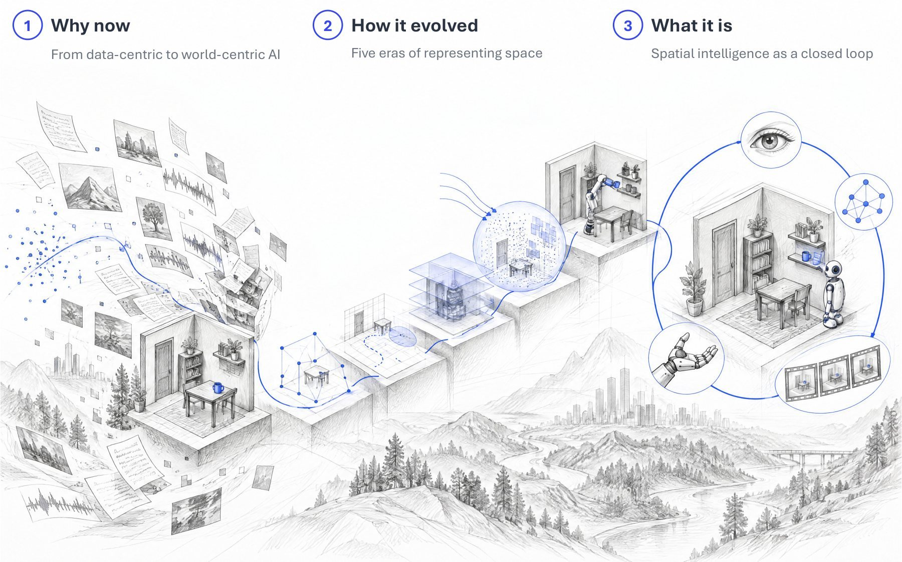
</p>
<p align="center"><sub><b>Figure 2.</b> Part I in one view: (1) why now, as scattered data condense into a grounded world; (2) how it evolved, one room in each of five eras; (3) what it is, a loop of perceiving, reasoning, predicting, and acting.</sub></p>

## 1. Spatial Intelligence: A Rising AI Paradigm
### 1.2. Historical Evolution and Milestones
The history of spatial intelligence is best understood as a sequence of shifts in how space is represented and what that representation is expected to support. Over decades, the field has repeatedly shifted among explicit structure and learned abstraction, offline reconstruction and online interaction, and local geometry and world-level state.

<p align="center">
  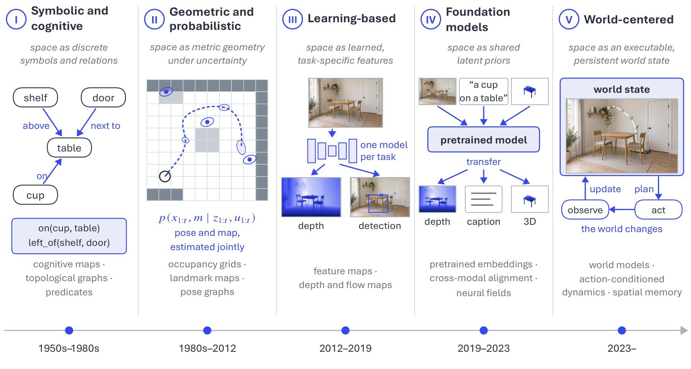
</p>
<p align="center"><sub><b>Figure 3.</b> The historical evolution of spatial intelligence across five representation-centric eras, from explicit symbolic structure, through estimated geometry and learned features, to executable world states. The visual examples highlight the dominant representation and its role in each era. Dates indicate approximate shifts in emphasis, not exclusive boundaries; earlier paradigms remain in use.</sub></p>

<p align="center"><sub><b>Table 1.</b> The five eras of spatial intelligence compared along six dimensions: how each treated space, its core representations, what the representation was for, its characteristic methods, the fields that drove it, and what it left unsolved for the next era.</sub></p>

| | **I. Symbolic and cognitive**<br>1950s–1980s | **II. Geometric and probabilistic**<br>1980s–2012 | **III. Learning-based**<br>2012–2019 | **IV. Foundation models**<br>2019–2023 | **V. World-centered**<br>2023– |
|:--|:--|:--|:--|:--|:--|
| **Space treated as** | discrete symbols and relations | metric geometry under uncertainty | learned, task-specific features | shared latent priors | an executable, persistent world state |
| **Core representations** | cognitive maps, topological graphs, predicates | occupancy grids, landmark maps, pose graphs | feature maps, depth and flow maps, point and voxel features | pretrained embeddings, cross-modal alignment, neural fields | world models, action-conditioned dynamics, spatial memory |
| **What it is for** | planning and inference by symbol manipulation | a consistent pose and map from noisy sensing | perception objectives: detection, depth, motion | transfer across tasks, modalities, and environments | long-horizon prediction, planning, and interaction |
| **Characteristic methods** | heuristic search, rule-based planning, logic | Bayesian filtering, nonlinear least squares, multi-view geometry | supervised and self-supervised deep networks | large-scale pretraining, contrastive alignment, instruction tuning | action-conditioned prediction, memory, closed-loop learning |
| **Main fields** | cognitive science, classical AI, early robotics | robotics, photogrammetry and vision, GIS | computer vision, autonomous driving | multimodal AI, neural rendering, embodied AI | embodied AI, simulation and digital twins, AR/VR |
| **Left unsolved** | meaning asserted by rules, not inferred from noisy sensing | features and pipelines engineered by hand | one model per task; no persistent world model | no persistent state that action updates | open: long-horizon consistency under motion and partial observability |

The tables below list the representative works of the handbook's milestone figure (Figure 1.3), grouped by era.

#### 1.2.1. Era 1: Symbolic and Cognitive Spatial Computing (1950s–1980s)

| Year | Milestone | Field | Paper |
|:----:|:----------|:------|:------|
| 1948 | cognitive maps | Cognition & symbolic AI | [Cognitive maps in rats and men.](https://doi.org/10.1037/h0061626) |
| 1956 | Dartmouth workshop | Cognition & symbolic AI | [A Proposal for the Dartmouth Summer Research Project on Artificial Intelligence, August 31, 1955](https://doi.org/10.1609/aimag.v27i4.1904) |
| 1959 | Dijkstra | Cognition & symbolic AI | [A note on two problems in connexion with graphs](https://doi.org/10.1007/BF01386390) |
| 1966 | Shakey (1966–72) | Robotics & mapping | Shakey the robot |
| 1968 | A* search | Cognition & symbolic AI | [A Formal Basis for the Heuristic Determination of Minimum Cost Paths](https://doi.org/10.1109/TSSC.1968.300136) |
| 1971 | mental rotation | Cognition & symbolic AI | [Mental Rotation of Three-Dimensional Objects](https://doi.org/10.1126/science.171.3972.701) |
| 1971 | STRIPS | Cognition & symbolic AI | [STRIPS: A New Approach to the Application of Theorem Proving to Problem Solving](https://doi.org/10.1016/0004-3702%2871%2990010-5) |
| 1972 | SHRDLU | Cognition & symbolic AI | [Understanding natural language](https://doi.org/10.1016/0010-0285%2872%2990002-3) |
| 1974 | frames | Cognition & symbolic AI | [A Framework for Representing Knowledge](https://dspace.mit.edu/handle/1721.1/6089) |
| 1978 | TOUR model | Cognition & symbolic AI | [Modeling Spatial Knowledge](https://doi.org/10.1207/s15516709cog0202_3) |
| 1978 | hippocampal map | Cognition & symbolic AI | [The hippocampus as a cognitive map](https://doi.org/10.1093/acprof:oso/9780199210862.003.0006) |

#### 1.2.2. Era 2: Geometric and Probabilistic Spatial Modeling (1980s–2012)

| Year | Milestone | Field | Paper |
|:----:|:----------|:------|:------|
| 1981 | RANSAC | Geometry & 3D vision | [Random Sample Consensus: A Paradigm for Model Fitting with Applications to Image Analysis and Automated Cartography](https://doi.org/10.1145/358669.358692) |
| 1981 | 8-point algorithm | Geometry & 3D vision | [A computer algorithm for reconstructing a scene from two projections](https://doi.org/10.1038/293133a0) |
| 1982 | Lucas–Kanade | Geometry & 3D vision | [An Iterative Image Registration Technique with an Application to Stereo Vision](https://ijcai.org/Proceedings/81-2/Papers/017.pdf) |
| 1982 | Marr, Vision | Geometry & 3D vision | [Vision: A Computational Investigation into the Human Representation and Processing of Visual Information](https://doi.org/10.7551/mitpress/9780262514620.001.0001) |
| 1983 | interval algebra | Cognition & symbolic AI | [Maintaining Knowledge about Temporal Intervals](https://doi.org/10.1145/182.358434) |
| 1983 | Frames of Mind | Cognition & symbolic AI | [Frames of Mind: The Theory of Multiple Intelligences](https://doi.org/10.2307/3332707) |
| 1985 | occupancy grids | Robotics & mapping | [High resolution maps from wide angle sonar](https://doi.org/10.1109/ROBOT.1985.1087316) |
| 1986 | stochastic map | Robotics & mapping | [On the Representation and Estimation of Spatial Uncertainty](https://doi.org/10.1177/027836498600500404) |
| 1986 | subsumption | Robotics & mapping | [A robust layered control system for a mobile robot](https://doi.org/10.1109/JRA.1986.1087032) |
| 1987 | marching cubes | Geometry & 3D vision | [Marching cubes: A high resolution 3D surface construction algorithm](https://doi.org/10.1145/37401.37422) |
| 1992 | ICP | Geometry & 3D vision | [A Method for Registration of 3-D Shapes](https://doi.org/10.1109/34.121791) |
| 1992 | RCC | Cognition & symbolic AI | A Spatial Logic based on Regions and Connection |
| 1992 | Tomasi–Kanade | Geometry & 3D vision | [Shape and motion from image streams under orthography: a factorization method](https://doi.org/10.1007/BF00129684) |
| 1993 | GIScience | Geometry & 3D vision | [Geographical information science](https://doi.org/10.1080/02693799208901893) |
| 1996 | volumetric fusion | Geometry & 3D vision | [A Volumetric Method for Building Complex Models from Range Images](https://doi.org/10.1145/237170.237269) |
| 1997 | pose graphs | Robotics & mapping | [Globally Consistent Range Scan Alignment for Environment Mapping](https://doi.org/10.1023/A:1008854305733) |
| 1999 | MCL | Robotics & mapping | [Monte Carlo Localization for Mobile Robots](https://doi.org/10.1109/ROBOT.1999.772544) |
| 1999 | bundle adjustment | Geometry & 3D vision | [Bundle Adjustment - A Modern Synthesis](https://doi.org/10.1007/3-540-44480-7_21) |
| 1999 | SIFT | Geometry & 3D vision | [Distinctive Image Features from Scale-Invariant Keypoints](https://doi.org/10.1023/B:VISI.0000029664.99615.94) |
| 2000 | multi-view geometry | Geometry & 3D vision | [Multiple View Geometry in Computer Vision](https://doi.org/10.1017/cbo9780511811685) |
| 2002 | FastSLAM | Robotics & mapping | [FastSLAM: A Factored Solution to the Simultaneous Localization and Mapping Problem](http://www.aaai.org/Library/AAAI/2002/aaai02-089.php) |
| 2005 | Stanley | Robotics & mapping | [Stanley: The robot that won the DARPA Grand Challenge](https://doi.org/10.1002/rob.20147) |
| 2005 | grid cells | Cognition & symbolic AI | [Microstructure of a spatial map in the entorhinal cortex](https://doi.org/10.1038/nature03721) |
| 2006 | GraphSLAM | Robotics & mapping | [The Graph SLAM Algorithm with Applications to Large-Scale Mapping of Urban Structures](https://doi.org/10.1177/0278364906065387) |
| 2006 | Photo Tourism | Geometry & 3D vision | [Photo tourism: exploring photo collections in 3D](https://doi.org/10.1145/1141911.1141964) |
| 2007 | MonoSLAM | Robotics & mapping | [MonoSLAM: Real-Time Single Camera SLAM](https://doi.org/10.1109/TPAMI.2007.1049) |
| 2007 | PTAM | Robotics & mapping | [Parallel Tracking and Mapping for Small AR Workspaces](https://doi.org/10.1109/ISMAR.2007.4538852) |
| 2009 | ImageNet | Learned perception | [ImageNet: A large-scale hierarchical image database](https://doi.org/10.1109/CVPR.2009.5206848) |
| 2011 | KinectFusion | Geometry & 3D vision | [KinectFusion: Real-time dense surface mapping and tracking](https://doi.org/10.1109/ISMAR.2011.6092378) |

#### 1.2.3. Era 3: Learning-based Spatial Modeling (2012–2019)

| Year | Milestone | Field | Paper |
|:----:|:----------|:------|:------|
| 2012 | AlexNet | Learned perception | [ImageNet Classification with Deep Convolutional Neural Networks](https://proceedings.neurips.cc/paper/2012/hash/c399862d3b9d6b76c8436e924a68c45b-Abstract.html) |
| 2013 | OctoMap | Robotics & mapping | [OctoMap: an efficient probabilistic 3D mapping framework based on octrees](https://doi.org/10.1007/s10514-012-9321-0) |
| 2014 | LOAM | Robotics & mapping | [LOAM: Lidar Odometry and Mapping in Real-time](https://doi.org/10.15607/RSS.2014.X.007) |
| 2014 | R-CNN | Learned perception | [Rich Feature Hierarchies for Accurate Object Detection and Semantic Segmentation](https://arxiv.org/abs/1311.2524) |
| 2014 | monocular depth | Learned perception | [Depth Map Prediction from a Single Image using a Multi-Scale Deep Network](https://arxiv.org/abs/1406.2283) |
| 2015 | FCN | Learned perception | [Fully convolutional networks for semantic segmentation](https://arxiv.org/abs/1411.4038) |
| 2015 | ORB-SLAM | Robotics & mapping | [ORB-SLAM: A Versatile and Accurate Monocular SLAM System](https://arxiv.org/abs/1502.00956) |
| 2015 | ResNet | Learned perception | [Deep Residual Learning for Image Recognition](https://arxiv.org/abs/1512.03385) |
| 2016 | FlowNet | Learned perception | [FlowNet: Learning Optical Flow with Convolutional Networks](https://arxiv.org/abs/1504.06852) |
| 2016 | Faster R-CNN | Learned perception | [Faster R-CNN: Towards Real-Time Object Detection with Region Proposal Networks](https://arxiv.org/abs/1506.01497) |
| 2016 | COLMAP | Geometry & 3D vision | [Structure-from-Motion Revisited](https://doi.org/10.1109/CVPR.2016.445) |
| 2016 | Cartographer | Robotics & mapping | [Real-time loop closure in 2D LIDAR SLAM](https://doi.org/10.1109/ICRA.2016.7487258) |
| 2016 | YOLO | Learned perception | [You Only Look Once: Unified, Real-Time Object Detection](https://arxiv.org/abs/1506.02640) |
| 2017 | Mask R-CNN | Learned perception | [Mask R-CNN](https://arxiv.org/abs/1703.06870) |
| 2017 | Transformer | Foundation & multimodal | [Attention is All you Need](https://arxiv.org/abs/1706.03762) |
| 2017 | PointNet | Learned perception | [PointNet: Deep Learning on Point Sets for 3D Classification and Segmentation](https://arxiv.org/abs/1612.00593) |
| 2017 | SfMLearner | Learned perception | [Unsupervised Learning of Depth and Ego-Motion from Video](https://arxiv.org/abs/1704.07813) |
| 2018 | DeepVO | Learned perception | [DeepVO: Towards end-to-end visual odometry with deep Recurrent Convolutional Neural Networks](https://arxiv.org/abs/1709.08429) |
| 2018 | BERT | Foundation & multimodal | [BERT: Pre-training of Deep Bidirectional Transformers for Language Understanding](https://arxiv.org/abs/1810.04805) |
| 2018 | Gibson | Robotics & mapping | [Gibson Env: Real-World Perception for Embodied Agents](https://arxiv.org/abs/1808.10654) |
| 2018 | MVSNet | Geometry & 3D vision | [MVSNet: Depth Inference for Unstructured Multi-view Stereo](https://arxiv.org/abs/1804.02505) |
| 2018 | VoxelNet | Learned perception | [VoxelNet: End-to-End Learning for Point Cloud Based 3D Object Detection](https://arxiv.org/abs/1711.06396) |
| 2018 | World Models | Agents & world models | [World Models](https://arxiv.org/abs/1803.10122) |

#### 1.2.4. Era 4: Large Foundation Spatial Modeling (2019–2023)

| Year | Milestone | Field | Paper |
|:----:|:----------|:------|:------|
| 2019 | DeepSDF | Geometry & 3D vision | [DeepSDF: Learning Continuous Signed Distance Functions for Shape Representation](https://arxiv.org/abs/1901.05103) |
| 2019 | Dreamer | Agents & world models | [Dream to Control: Learning Behaviors by Latent Imagination](https://arxiv.org/abs/1912.01603) |
| 2019 | Habitat | Robotics & mapping | [Habitat: A Platform for Embodied AI Research](https://arxiv.org/abs/1904.01201) |
| 2019 | OccNet | Geometry & 3D vision | [Occupancy Networks: Learning 3D Reconstruction in Function Space](https://arxiv.org/abs/1812.03828) |
| 2020 | DETR | Learned perception | [End-to-End Object Detection with Transformers](https://arxiv.org/abs/2005.12872) |
| 2020 | GPT-3 | Foundation & multimodal | [Language Models are Few-Shot Learners](https://arxiv.org/abs/2005.14165) |
| 2020 | MuZero | Agents & world models | [Mastering Atari, Go, chess and shogi by planning with a learned model](https://arxiv.org/abs/1911.08265) |
| 2020 | NeRF | Geometry & 3D vision | [NeRF: representing scenes as neural radiance fields for view synthesis](https://arxiv.org/abs/2003.08934) |
| 2020 | LSS | Learned perception | [Lift, Splat, Shoot: Encoding Images from Arbitrary Camera Rigs by Implicitly Unprojecting to 3D](https://arxiv.org/abs/2008.05711) |
| 2020 | ViT | Foundation & multimodal | [An Image is Worth 16x16 Words: Transformers for Image Recognition at Scale](https://arxiv.org/abs/2010.11929) |
| 2021 | CLIP | Foundation & multimodal | [Learning Transferable Visual Models From Natural Language Supervision](https://arxiv.org/abs/2103.00020) |
| 2021 | DROID-SLAM | Robotics & mapping | [DROID-SLAM: Deep Visual SLAM for Monocular, Stereo, and RGB-D Cameras](https://arxiv.org/abs/2108.10869) |
| 2022 | CoT prompting | Cognition & symbolic AI | [Chain-of-Thought Prompting Elicits Reasoning in Large Language Models](https://arxiv.org/abs/2201.11903) |
| 2022 | Flamingo | Foundation & multimodal | [Flamingo: a Visual Language Model for Few-Shot Learning](https://arxiv.org/abs/2204.14198) |
| 2022 | Gato | Agents & world models | [A Generalist Agent](https://arxiv.org/abs/2205.06175) |
| 2022 | Instant-NGP | Geometry & 3D vision | [Instant neural graphics primitives with a multiresolution hash encoding](https://arxiv.org/abs/2201.05989) |
| 2022 | RT-1 | Robotics & mapping | [RT-1: Robotics Transformer for Real-World Control at Scale](https://arxiv.org/abs/2212.06817) |
| 2022 | ReAct | Cognition & symbolic AI | [ReAct: Synergizing Reasoning and Acting in Language Models](https://arxiv.org/abs/2210.03629) |

#### 1.2.5. Era 5: World-Centered Spatial Intelligence (2023–Present)

| Year | Milestone | Field | Paper |
|:----:|:----------|:------|:------|
| 2023 | 3DGS | Geometry & 3D vision | [3D Gaussian Splatting for Real-Time Radiance Field Rendering](https://arxiv.org/abs/2308.04079) |
| 2023 | GPT-4 | Foundation & multimodal | [GPT-4 Technical Report](https://arxiv.org/abs/2303.08774) |
| 2023 | PaLM-E | Robotics & mapping | [PaLM-E: An Embodied Multimodal Language Model](https://arxiv.org/abs/2303.03378) |
| 2023 | SAM | Learned perception | [Segment Anything](https://arxiv.org/abs/2304.02643) |
| 2023 | Voyager | Agents & world models | [Voyager: An Open-Ended Embodied Agent with Large Language Models](https://arxiv.org/abs/2305.16291) |
| 2023 | I-JEPA | Agents & world models | [Self-Supervised Learning from Images with a Joint-Embedding Predictive Architecture](https://arxiv.org/abs/2301.08243) |
| 2023 | RT-2 | Robotics & mapping | [RT-2: Vision-Language-Action Models Transfer Web Knowledge to Robotic Control](https://arxiv.org/abs/2307.15818) |
| 2023 | DINOv2 | Learned perception | [DINOv2: Learning Robust Visual Features without Supervision](https://arxiv.org/abs/2304.07193) |
| 2023 | LLaVA | Foundation & multimodal | [Visual Instruction Tuning](https://arxiv.org/abs/2304.08485) |
| 2024 | DreamerV3 | Agents & world models | [Mastering Diverse Domains through World Models](https://arxiv.org/abs/2301.04104) |
| 2024 | Habitat 3.0 | Robotics & mapping | [Habitat 3.0: A Co-Habitat for Humans, Avatars, and Robots](https://arxiv.org/abs/2310.13724) |
| 2024 | DUSt3R | Geometry & 3D vision | [DUSt3R: Geometric 3D Vision Made Easy](https://arxiv.org/abs/2312.14132) |
| 2024 | Depth Anything | Learned perception | [Depth Anything: Unleashing the Power of Large-Scale Unlabeled Data](https://arxiv.org/abs/2401.10891) |
| 2024 | Genie | Agents & world models | [Genie: Generative Interactive Environments](https://arxiv.org/abs/2402.15391) |
| 2024 | OpenVLA | Robotics & mapping | [OpenVLA: An Open-Source Vision-Language-Action Model](https://arxiv.org/abs/2406.09246) |
| 2024 | SpatialVLM | Foundation & multimodal | [SpatialVLM: Endowing Vision-Language Models with Spatial Reasoning Capabilities](https://arxiv.org/abs/2401.12168) |
| 2024 | π0 | Robotics & mapping | [$π\_0$: A Vision-Language-Action Flow Model for General Robot Control](https://arxiv.org/abs/2410.24164) |
| 2024 | Sora | Agents & world models | [Video generation models as world simulators](https://openai.com/index/video-generation-models-as-world-simulators/) |
| 2025 | V-JEPA 2 | Agents & world models | [V-JEPA 2: Self-Supervised Video Models Enable Understanding, Prediction and Planning](https://arxiv.org/abs/2506.09985) |
| 2025 | VGGT | Geometry & 3D vision | [VGGT: Visual Geometry Grounded Transformer](https://arxiv.org/abs/2503.11651) |
| 2025 | Cosmos | Agents & world models | [Cosmos World Foundation Model Platform for Physical AI](https://arxiv.org/abs/2501.03575) |
| 2026 | Genie 3 | Agents & world models | [Genie 3: A New Frontier for World Models](https://deepmind.google/blog/genie-3-a-new-frontier-for-world-models/) |
| 2026 | Marble | Agents & world models | [Marble: A Multimodal World Model](https://worldlabs.ai/blog/marble-world-model) |

## 2. A Definition in Motion: Revisiting Spatial Intelligence
<p align="center"><sub><b>Table 2.</b> How different disciplines characterize spatial intelligence: primary focus, representations, canonical tasks, and evaluation emphasis.</sub></p>

| Discipline | Primary focus | Representations | Canonical tasks | Evaluation emphasis |
|:--|:--|:--|:--|:--|
| **Computer Vision & Graphics** | Geometry recovery and view-consistent scene appearance | Depth maps, multi-view geometry, meshes, neural fields (NeRF), 3D Gaussian representations | Depth/pose estimation, 3D reconstruction, neural rendering, scene synthesis | Geometric consistency, rendering fidelity, view synthesis quality |
| **Robotics & Embodied AI** | Perception–action coupling under physical constraints | Occupancy grids, semantic maps, pose graphs, affordance maps, world models for planning | SLAM, navigation, manipulation, motion planning, closed-loop control | Task success, robustness, real-time performance, generalization in dynamic environments |
| **GIS & Large-scale Spatial Modeling** | Global-scale spatial abstraction, querying, and planning | Geodetic coordinate systems, map layers, spatial graphs, spatial databases | Route optimization, spatial analytics, trajectory analysis, urban-scale simulation | Global consistency, query accuracy, scalability, long-horizon planning utility |
| **Psychology & Psychometrics** | Measurement of individual spatial abilities and their training | Factor models of spatial ability (rotation, visualization, orientation), standardized test batteries | Mental rotation tests, paper folding, perspective taking, spatial visualization assessment | Test reliability and validity, individual differences, malleability and transfer |
| **Cognitive Science & Neuroscience** | Mechanisms of human spatial cognition and internal representations | Cognitive maps, mental imagery, spatial memory representations, neural coding hypotheses | Mental rotation, navigation studies, spatial memory and attention experiments | Behavioral validity, explanatory power, neural plausibility |
| **Linguistics & Spatial Language** | How language encodes, schematizes, and constrains spatial relations | Spatial prepositions and closed-class relations, frames of reference (intrinsic, relative, absolute) | Spatial reference resolution, cross-linguistic comparison, grounded instruction understanding | Descriptive adequacy, cross-linguistic coverage, grounding fidelity |
| **Social & Human-centered Perspectives** | Spatial behavior in social contexts and shared environments | Proxemics, social space schemas, spatial cues for interaction, situational context models | Human–robot interaction, social navigation, spatial language pragmatics, collaborative tasks | Interaction naturalness, safety, alignment with human norms and intentions |

<p align="center">
  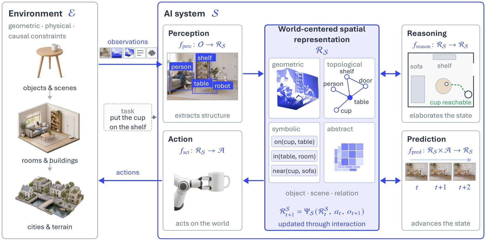
</p>
<p align="center"><sub><b>Figure 4.</b> Spatial intelligence as a closed loop between an AI system <i>𝒮</i> and its environment <i>ℰ</i>. Perception writes observations into a world-centered spatial representation <i>ℛ</i><sub><i>𝒮</i></sub> maintained inside the system; reasoning elaborates the current state, prediction advances it under a candidate action, and embodied action reads it to act on the environment, whose response is observed in turn. Each module is labeled with its operator from Section 2.2.2.</sub></p>

**2026**

- [**Theory of Space: Can Foundation Models Construct Spatial Beliefs through Active Exploration?**](https://arxiv.org/abs/2602.07055) [](https://arxiv.org/abs/2602.07055) <!-- 26 -->

**2025**

- [**Embodied AI: From LLMs to World Models**](https://arxiv.org/abs/2509.20021) [](https://arxiv.org/abs/2509.20021) <!-- 09-25 -->
- [**GIScience in the era of Artificial Intelligence: a research agenda towards Autonomous GIS**](https://arxiv.org/abs/2503.23633) [](https://arxiv.org/abs/2503.23633) <!-- 25 -->

**2024**

- [**Thinking in Space: How Multimodal Large Language Models See, Remember, and Recall Spaces**](https://arxiv.org/abs/2412.14171) [](https://arxiv.org/abs/2412.14171) [](https://github.com/vision-x-nyu/thinking-in-space) <!-- 12-24 -->
- [**GPT-4V(ision) is a Human-Aligned Evaluator for Text-to-3D Generation**](https://arxiv.org/abs/2401.04092) [](https://arxiv.org/abs/2401.04092) [](https://github.com/3DTopia/GPTEval3D) <!-- 24 -->
- [**RoboTwin: Dual-Arm Robot Benchmark with Generative Digital Twins (Early Version)**](https://arxiv.org/abs/2409.02920) [](https://arxiv.org/abs/2409.02920) [](https://github.com/TianxingChen/RoboTwin) <!-- 24 -->
- [**SpatialVLM: Endowing Vision-Language Models with Spatial Reasoning Capabilities**](https://arxiv.org/abs/2401.12168) [](https://arxiv.org/abs/2401.12168) <!-- 24 -->

**2023**

- [**3D Gaussian Splatting for Real-Time Radiance Field Rendering**](https://arxiv.org/abs/2308.04079) [](https://arxiv.org/abs/2308.04079) [](https://github.com/graphdeco-inria/gaussian-splatting) <!-- 23 -->
- [**PaLM-E: An Embodied Multimodal Language Model**](https://arxiv.org/abs/2303.03378) [](https://arxiv.org/abs/2303.03378) [](https://github.com/kyegomez/PALM-E) <!-- 23 -->
- [**RingMo: A Remote Sensing Foundation Model With Masked Image Modeling**](https://doi.org/10.1109/TGRS.2022.3194732) [](https://doi.org/10.1109/TGRS.2022.3194732) <!-- 23 -->
- [**RT-2: Vision-Language-Action Models Transfer Web Knowledge to Robotic Control**](https://arxiv.org/abs/2307.15818) [](https://arxiv.org/abs/2307.15818) <!-- 23 -->

**2022**

- [**SatMAE: Pre-training Transformers for Temporal and Multi-Spectral Satellite Imagery**](https://arxiv.org/abs/2207.08051) [](https://arxiv.org/abs/2207.08051) [](https://github.com/sustainlab-group/SatMAE) <!-- 22 -->

**2021**

- [**Large Scale Interactive Motion Forecasting for Autonomous Driving : The Waymo Open Motion Dataset**](https://arxiv.org/abs/2104.10133) [](https://arxiv.org/abs/2104.10133) <!-- 21 -->

**2020**

- [**NeRF: representing scenes as neural radiance fields for view synthesis**](https://arxiv.org/abs/2003.08934) [](https://arxiv.org/abs/2003.08934) [](https://github.com/bmild/nerf) <!-- 03-20 -->

**Before 2020**

- [**Gibson Env: Real-World Perception for Embodied Agents**](https://arxiv.org/abs/1808.10654) [](https://arxiv.org/abs/1808.10654) [](https://github.com/StanfordVL/GibsonEnv) <!-- 18 -->
- [**Probabilistic robotics**](https://doi.org/10.1145/504729.504754) [](https://doi.org/10.1145/504729.504754) <!-- 02 -->
- [**Whence and whither in spatial language and spatial cognition?**](https://doi.org/10.1017/s0140525x00029927) [](https://doi.org/10.1017/s0140525x00029927) <!-- 06-93 -->
- [**Geographical information science**](https://doi.org/10.1080/02693799208901893) [](https://doi.org/10.1080/02693799208901893) <!-- 92 -->
- [**Mental Rotation of Three-Dimensional Objects**](https://doi.org/10.1126/science.171.3972.701) [](https://doi.org/10.1126/science.171.3972.701) <!-- 02-71 -->

# 🧱 Part II · Spatial-aware Representation: Building Blocks of Space
Everything a spatially intelligent system does, perceiving a scene, reasoning over it, generating or acting within it, passes through some representation of space. That representation is upstream of the capability: what a system can perceive is bounded by what its encoding can express, and what it can reason about is bounded by what that encoding makes accessible.

<p align="center">
  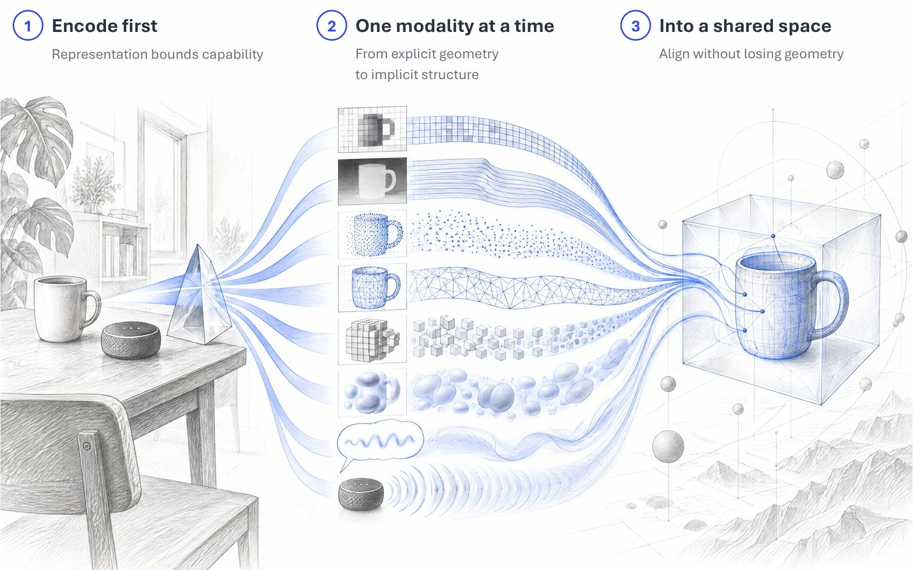
</p>
<p align="center"><sub><b>Figure 5.</b> Part II in one view. (1) Encode first: a scene must be encoded before it can be perceived, reasoned about, or acted on. (2) One modality at a time: the same object as pixels, depth, points, meshes, voxels, and Gaussians, and then as language and sound, from explicit geometry to implicit structure (Chapter 4). (3) Into a shared space: the separate encodings are aligned in one space without losing the geometry that makes them spatially meaningful (Chapter 5).</sub></p>

## 4. Single-Modal Spatial Representation
### 4.1. 2D
<p align="center">
  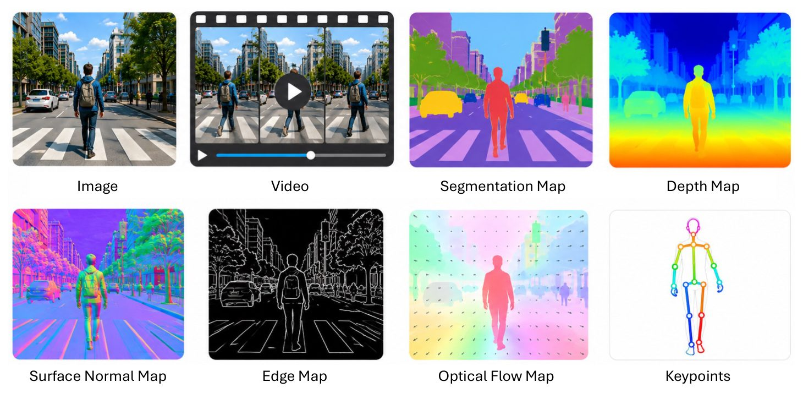
</p>
<p align="center"><sub><b>Figure 6.</b> The seven 2D representations of this section, all defined over the image grid Ω ⊂ ℝ<sup>2</sup>: image/video, segmentation, depth, surface normals, edges, optical flow, and keypoints.</sub></p>

**2022**

- [**A ConvNet for the 2020s**](https://arxiv.org/abs/2201.03545) [](https://arxiv.org/abs/2201.03545) [](https://github.com/facebookresearch/ConvNeXt) <!-- 22 -->

**2021**

- [**Video Swin Transformer**](https://arxiv.org/abs/2106.13230) [](https://arxiv.org/abs/2106.13230) <!-- 06-21 -->
- [**ViViT: A Video Vision Transformer**](https://arxiv.org/abs/2103.15691) [](https://arxiv.org/abs/2103.15691) [](https://github.com/google-research/scenic) <!-- 21 -->

**2020**

- [**URVOS: Unified Referring Video Object Segmentation Network with a Large-Scale Benchmark**](https://doi.org/10.1007/978-3-030-58555-6_13) [](https://doi.org/10.1007/978-3-030-58555-6_13) [](https://github.com/skynbe/Refer-Youtube-VOS) <!-- 20 -->

**Before 2020**

- [**Panoptic Segmentation**](https://arxiv.org/abs/1801.00868) [](https://arxiv.org/abs/1801.00868) [](https://github.com/cocodataset/panopticapi) <!-- 01-18 -->
- [**Stacked Hourglass Networks for Human Pose Estimation**](https://arxiv.org/abs/1603.06937) [](https://arxiv.org/abs/1603.06937) <!-- 16 -->
- [**FlowNet: Learning Optical Flow with Convolutional Networks**](https://arxiv.org/abs/1504.06852) [](https://arxiv.org/abs/1504.06852) <!-- 15 -->
- [**Holistically-Nested Edge Detection**](https://arxiv.org/abs/1504.06375) [](https://arxiv.org/abs/1504.06375) [](https://github.com/s9xie/hed) <!-- 15 -->
- [**Learning Spatiotemporal Features with 3D Convolutional Networks**](https://doi.org/10.1109/ICCV.2015.510) [](https://doi.org/10.1109/ICCV.2015.510) <!-- 15 -->
- [**Depth Map Prediction from a Single Image using a Multi-Scale Deep Network**](https://arxiv.org/abs/1406.2283) [](https://arxiv.org/abs/1406.2283) <!-- 14 -->
- [**Large-Scale Video Classification with Convolutional Neural Networks**](https://doi.org/10.1109/CVPR.2014.223) [](https://doi.org/10.1109/CVPR.2014.223) <!-- 14 -->
- [**Predicting Depth, Surface Normals and Semantic Labels with a Common Multi-scale Convolutional Architecture**](https://arxiv.org/abs/1411.4734) [](https://arxiv.org/abs/1411.4734) <!-- 11-14 -->
- [**DeepPose: Human Pose Estimation via Deep Neural Networks**](https://arxiv.org/abs/1312.4659) [](https://arxiv.org/abs/1312.4659) <!-- 12-13 -->
- [**Computer Vision - Algorithms and Applications**](https://doi.org/10.1007/978-1-84882-935-0) [](https://doi.org/10.1007/978-1-84882-935-0) <!-- 11 -->
- [**Distinctive Image Features from Scale-Invariant Keypoints**](https://doi.org/10.1023/B:VISI.0000029664.99615.94) [](https://doi.org/10.1023/B:VISI.0000029664.99615.94) <!-- 04 -->
- [**High Accuracy Optical Flow Estimation Based on a Theory for Warping**](https://doi.org/10.1007/978-3-540-24673-2_3) [](https://doi.org/10.1007/978-3-540-24673-2_3) <!-- 04 -->
- [**Gradient-based learning applied to document recognition**](https://doi.org/10.1109/5.726791) [](https://doi.org/10.1109/5.726791) <!-- 98 -->
- [**A Combined Corner and Edge Detector**](https://doi.org/10.5244/C.2.23) [](https://doi.org/10.5244/C.2.23) <!-- 88 -->
- [**A Computational Approach to Edge Detection**](https://doi.org/10.1109/TPAMI.1986.4767851) [](https://doi.org/10.1109/TPAMI.1986.4767851) <!-- 86 -->
- [**Determining Optical Flow**](https://doi.org/10.1016/0004-3702%2881%2990024-2) [](https://doi.org/10.1016/0004-3702%2881%2990024-2) <!-- 81 -->
- [**Photometric Method For Determining Surface Orientation From Multiple Images**](https://doi.org/10.1117/12.7972479) [](https://doi.org/10.1117/12.7972479) <!-- 02-80 -->

### 4.2. 3D
#### 4.2.1–4.2.4. RGB-D Images, Voxel Grids, Point Clouds and Meshes
<p align="center">
  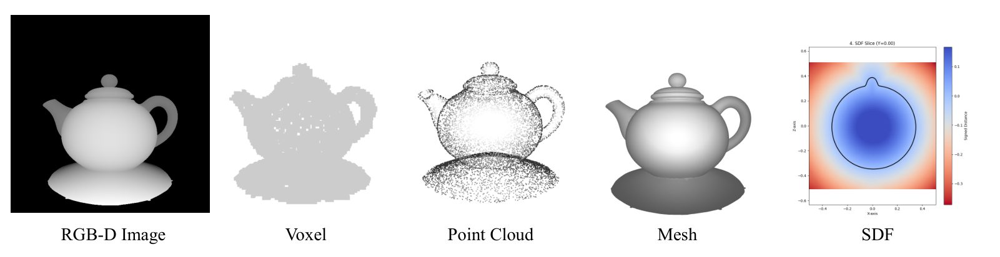
</p>
<p align="center"><sub><b>Figure 7.</b> Examples of 3D representations: RGB-D image, voxel grid, point cloud, triangle mesh, and a signed distance field (SDF) slice.</sub></p>

**2025**

- [**Towards Affordance-Aware Robotic Dexterous Grasping with Human-like Priors**](https://arxiv.org/abs/2508.08896) [](https://arxiv.org/abs/2508.08896) <!-- 08-25 -->

**Before 2020**

- [**DADA: Depth-Aware Domain Adaptation in Semantic Segmentation**](https://arxiv.org/abs/1904.01886) [](https://arxiv.org/abs/1904.01886) [](https://github.com/valeoai/DADA) <!-- 19 -->
- [**Lidar System Architectures and Circuits**](https://doi.org/10.1109/MCOM.2017.1700030) [](https://doi.org/10.1109/MCOM.2017.1700030) <!-- 17 -->
- [**3D U-Net: Learning Dense Volumetric Segmentation from Sparse Annotation**](https://arxiv.org/abs/1606.06650) [](https://arxiv.org/abs/1606.06650) <!-- 16 -->
- [**R-FCN: Object Detection via Region-based Fully Convolutional Networks**](https://arxiv.org/abs/1605.06409) [](https://arxiv.org/abs/1605.06409) [](https://github.com/daijifeng001/R-FCN) <!-- 16 -->
- [**Indoor Semantic Segmentation using depth information**](https://arxiv.org/abs/1301.3572) [](https://arxiv.org/abs/1301.3572) <!-- 01-13 -->
- [**Robotic Grasping of Novel Objects**](https://proceedings.neurips.cc/paper/2006/hash/22722a343513ed45f14905eb07621686-Abstract.html) [](https://proceedings.neurips.cc/paper/2006/hash/22722a343513ed45f14905eb07621686-Abstract.html) <!-- 06 -->

#### 4.2.5–4.2.8. Implicit Representations, Neural Radiance Fields, 3D Gaussian Splatting and Hybrid Methods
<p align="center">
  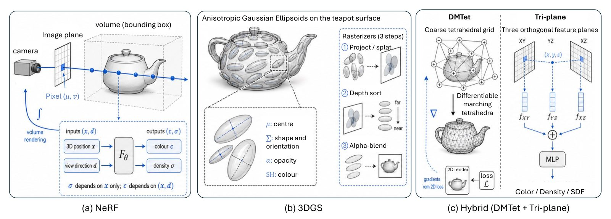
</p>
<p align="center"><sub><b>Figure 8.</b> Neural and hybrid 3D representations: (a) NeRF, (b) 3DGS, and (c) hybrid methods (DMTet and Tri-plane).</sub></p>

**2023**

- [**Scaffold-GS: Structured 3D Gaussians for View-Adaptive Rendering**](https://arxiv.org/abs/2312.00109) [](https://arxiv.org/abs/2312.00109) [](https://github.com/city-super/Scaffold-GS) <!-- 11-23 -->
- [**Zip-NeRF: Anti-Aliased Grid-Based Neural Radiance Fields**](https://arxiv.org/abs/2304.06706) [](https://arxiv.org/abs/2304.06706) [](https://github.com/SuLvXiangXin/zipnerf-pytorch) <!-- 23 -->

**2022**

- [**Differentiable signed distance function rendering**](https://doi.org/10.1145/3528223.3530139) [](https://doi.org/10.1145/3528223.3530139) <!-- 22 -->
- [**PointNeXt: Revisiting PointNet++ with Improved Training and Scaling Strategies**](https://arxiv.org/abs/2206.04670) [](https://arxiv.org/abs/2206.04670) [](https://github.com/guochengqian/PointNeXt) <!-- 22 -->

**2021**

- [**Efficient Geometry-aware 3D Generative Adversarial Networks**](https://arxiv.org/abs/2112.07945) [](https://arxiv.org/abs/2112.07945) [](https://github.com/NVlabs/eg3d) <!-- 12-21 -->
- [**Deep Marching Tetrahedra: a Hybrid Representation for High-Resolution 3D Shape Synthesis**](https://arxiv.org/abs/2111.04276) [](https://arxiv.org/abs/2111.04276) <!-- 21 -->
- [**Mip-NeRF: A Multiscale Representation for Anti-Aliasing Neural Radiance Fields**](https://arxiv.org/abs/2103.13415) [](https://arxiv.org/abs/2103.13415) [](https://github.com/google/mipnerf) <!-- 21 -->

**Before 2020**

- [**DeepSDF: Learning Continuous Signed Distance Functions for Shape Representation**](https://arxiv.org/abs/1901.05103) [](https://arxiv.org/abs/1901.05103) <!-- 19 -->
- [**Learning to Predict 3D Objects with an Interpolation-based Differentiable Renderer**](https://arxiv.org/abs/1908.01210) [](https://arxiv.org/abs/1908.01210) <!-- 19 -->
- [**Soft Rasterizer: A Differentiable Renderer for Image-Based 3D Reasoning**](https://arxiv.org/abs/1904.01786) [](https://arxiv.org/abs/1904.01786) [](https://github.com/ShichenLiu/SoftRas) <!-- 19 -->
- [**A Papier-Mâché Approach to Learning 3D Surface Generation**](https://arxiv.org/abs/1802.05384) [](https://arxiv.org/abs/1802.05384) [](https://github.com/ThibaultGROUEIX/AtlasNet) <!-- 18 -->
- [**MeshCNN: a network with an edge**](https://arxiv.org/abs/1809.05910) [](https://arxiv.org/abs/1809.05910) [](https://github.com/ranahanocka/MeshCNN) <!-- 09-18 -->
- [**Occupancy Networks: Learning 3D Reconstruction in Function Space**](https://arxiv.org/abs/1812.03828) [](https://arxiv.org/abs/1812.03828) [](https://github.com/autonomousvision/occupancy_networks) <!-- 12-18 -->
- [**Octree Generating Networks: Efficient Convolutional Architectures for High-resolution 3D Outputs**](https://arxiv.org/abs/1703.09438) [](https://arxiv.org/abs/1703.09438) [](https://github.com/lmb-freiburg/ogn) <!-- 17 -->
- [**SemanticFusion: Dense 3D semantic mapping with convolutional neural networks**](https://arxiv.org/abs/1609.05130) [](https://arxiv.org/abs/1609.05130) <!-- 09-16 -->
- [**VoxNet: A 3D Convolutional Neural Network for real-time object recognition**](https://doi.org/10.1109/IROS.2015.7353481) [](https://doi.org/10.1109/IROS.2015.7353481) <!-- 15 -->
- [**Marching cubes: A high resolution 3D surface construction algorithm**](https://doi.org/10.1145/37401.37422) [](https://doi.org/10.1145/37401.37422) <!-- 87 -->
- [**Compositing digital images**](https://doi.org/10.1145/800031.808606) [](https://doi.org/10.1145/800031.808606) <!-- 84 -->

### 4.3. 4D
<p align="center">
  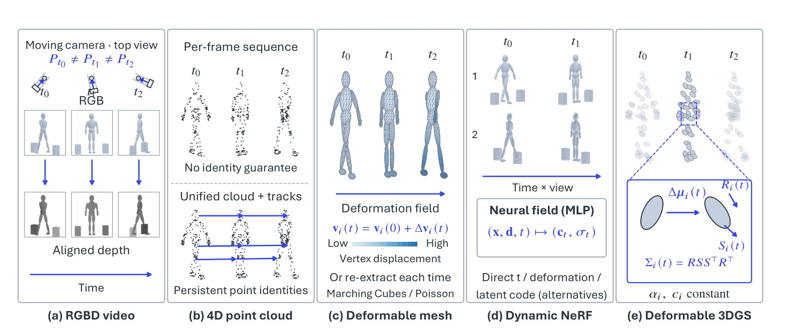
</p>
<p align="center"><sub><b>Figure 9.</b> Five 4D representations, each a 3D primitive evolving over time: (a) RGBD video, (b) 4D point cloud, (c) deformable mesh, (d) dynamic NeRF, and (e) deformable 3DGS.</sub></p>

**2025**

- [**Gaussian Variation Field Diffusion for High-Fidelity Video-to-4D Synthesis**](https://arxiv.org/abs/2507.23785) [](https://arxiv.org/abs/2507.23785) <!-- 25 -->
- [**Video Depth Anything: Consistent Depth Estimation for Super-Long Videos**](https://arxiv.org/abs/2501.12375) [](https://arxiv.org/abs/2501.12375) [](https://github.com/DepthAnything/Video-Depth-Anything) <!-- 25 -->

**2024**

- [**MegaSaM: Accurate, Fast and Robust Structure and Motion from Casual Dynamic Videos**](https://arxiv.org/abs/2412.04463) [](https://arxiv.org/abs/2412.04463) [](https://github.com/mega-sam/mega-sam) <!-- 12-24 -->
- [**DepthCrafter: Generating Consistent Long Depth Sequences for Open-world Videos**](https://arxiv.org/abs/2409.02095) [](https://arxiv.org/abs/2409.02095) [](https://github.com/Tencent/DepthCrafter) <!-- 09-24 -->
- [**Motion2VecSets: 4D Latent Vector Set Diffusion for Non-Rigid Shape Reconstruction and Tracking**](https://arxiv.org/abs/2401.06614) [](https://arxiv.org/abs/2401.06614) <!-- 24 -->

**2023**

- [**Neural Video Depth Stabilizer**](https://arxiv.org/abs/2307.08695) [](https://arxiv.org/abs/2307.08695) [](https://github.com/RaymondWang987/NVDS) <!-- 23 -->

**2021**

- [**Dynamic View Synthesis from Dynamic Monocular Video**](https://arxiv.org/abs/2105.06468) [](https://arxiv.org/abs/2105.06468) <!-- 21 -->

**Before 2020**

- [**Poisson surface reconstruction**](https://doi.org/10.2312/SGP/SGP06/061-070) [](https://doi.org/10.2312/SGP/SGP06/061-070) <!-- 06 -->

### 4.4. Language
<p align="center">
  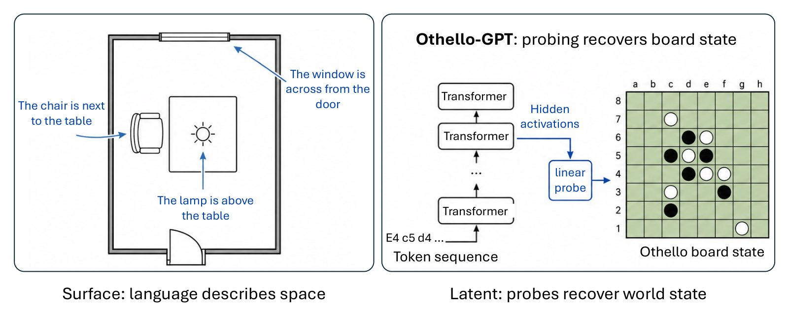
</p>
<p align="center"><sub><b>Figure 10.</b> Spatial information implicit in language-only representations.</sub></p>

**2024**

- [**Instruction Pre-Training: Language Models are Supervised Multitask Learners**](https://doi.org/10.18653/v1/2024.emnlp-main.148) [](https://doi.org/10.18653/v1/2024.emnlp-main.148) [](https://github.com/microsoft/LMOps) <!-- 24 -->

**2022**

- [**Emergent World Representations: Exploring a Sequence Model Trained on a Synthetic Task**](https://arxiv.org/abs/2210.13382) [](https://arxiv.org/abs/2210.13382) [](https://github.com/likenneth/othello_world) <!-- 10-22 -->
- [**Beyond the Imitation Game: Quantifying and extrapolating the capabilities of language models**](https://arxiv.org/abs/2206.04615) [](https://arxiv.org/abs/2206.04615) [](https://github.com/google/BIG-bench) <!-- 06-22 -->
- [**Mapping Language Models to Grounded Conceptual Spaces**](https://openreview.net/forum?id=gJcEM8sxHK) [](https://openreview.net/forum?id=gJcEM8sxHK) <!-- 22 -->
- [**Probing Classifiers: Promises, Shortcomings, and Advances**](https://doi.org/10.1162/coli_a_00422) [](https://doi.org/10.1162/coli_a_00422) <!-- 22 -->

**2021**

- [**Acquisition of Chess Knowledge in AlphaZero**](https://arxiv.org/abs/2111.09259) [](https://arxiv.org/abs/2111.09259) <!-- 11-21 -->
- [**Chess as a Testbed for Language Model State Tracking**](https://arxiv.org/abs/2102.13249) [](https://arxiv.org/abs/2102.13249) [](https://github.com/shtoshni/learning-chess-blindfolded) <!-- 02-21 -->
- [**Can Language Models Encode Perceptual Structure Without Grounding? A Case Study in Color**](https://arxiv.org/abs/2109.06129) [](https://arxiv.org/abs/2109.06129) <!-- 21 -->
- [**Implicit Representations of Meaning in Neural Language Models**](https://arxiv.org/abs/2106.00737) [](https://arxiv.org/abs/2106.00737) [](https://github.com/belindal/state-probes) <!-- 21 -->

**Before 2020**

- [**A Structural Probe for Finding Syntax in Word Representations**](https://aclanthology.org/N19-1419/) [](https://aclanthology.org/N19-1419/) [](https://github.com/john-hewitt/structural-probes) <!-- 19 -->
- [**BERT Rediscovers the Classical NLP Pipeline**](https://arxiv.org/abs/1905.05950) [](https://arxiv.org/abs/1905.05950) [](https://github.com/nyu-mll/jiant) <!-- 19 -->
- [**Exploring the Limits of Transfer Learning with a Unified Text-to-Text Transformer**](https://arxiv.org/abs/1910.10683) [](https://arxiv.org/abs/1910.10683) <!-- 10-19 -->
- [**RoBERTa: A Robustly Optimized BERT Pretraining Approach**](https://arxiv.org/abs/1907.11692) [](https://arxiv.org/abs/1907.11692) [](https://github.com/facebookresearch/fairseq) <!-- 07-19 -->
- [**Towards Automatic Concept-based Explanations**](https://proceedings.neurips.cc/paper/2019/hash/77d2afcb31f6493e350fca61764efb9a-Abstract.html) [](https://proceedings.neurips.cc/paper/2019/hash/77d2afcb31f6493e350fca61764efb9a-Abstract.html) [](https://github.com/amiratag/ACE) <!-- 19 -->
- [**XLNet: Generalized Autoregressive Pretraining for Language Understanding**](https://arxiv.org/abs/1906.08237) [](https://arxiv.org/abs/1906.08237) [](https://github.com/zihangdai/xlnet) <!-- 19 -->
- [**A general reinforcement learning algorithm that masters chess, shogi, and Go through self-play**](https://doi.org/10.1126/science.aar6404) [](https://doi.org/10.1126/science.aar6404) <!-- 12-18 -->
- [**Interpretability Beyond Feature Attribution: Quantitative Testing with Concept Activation Vectors (TCAV)**](http://proceedings.mlr.press/v80/kim18d.html) [](http://proceedings.mlr.press/v80/kim18d.html) [](https://github.com/tensorflow/tcav) <!-- 18 -->
- [**Understanding intermediate layers using linear classifier probes**](https://arxiv.org/abs/1610.01644) [](https://arxiv.org/abs/1610.01644) <!-- 10-16 -->

### 4.5. Audio
<p align="center">
  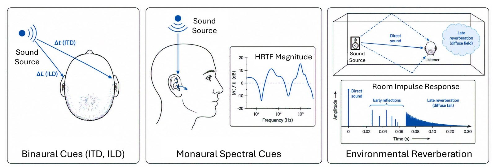
</p>
<p align="center"><sub><b>Figure 11.</b> Three families of acoustic spatial cues: binaural cues (ITD, ILD), monaural spectral cues (direction-dependent filtering by torso, head, and pinnae, summarized by the HRTF), and environmental reverberation (room impulse response).</sub></p>

**2025**

- [**OWL : Geometry-Aware Spatial Reasoning for Audio Large Language Models**](https://arxiv.org/abs/2509.26140) [](https://arxiv.org/abs/2509.26140) <!-- 09-25 -->
- [**GRAM: Spatial general-purpose audio representation models for real-world applications**](https://arxiv.org/abs/2506.00934) [](https://arxiv.org/abs/2506.00934) <!-- 06-25 -->

**2024**

- [**BAT: Learning to Reason about Spatial Sounds with Large Language Models**](https://arxiv.org/abs/2402.01591) [](https://arxiv.org/abs/2402.01591) <!-- 24 -->

**2022**

- [**SoundSpaces 2.0: A Simulation Platform for Visual-Acoustic Learning**](https://arxiv.org/abs/2206.08312) [](https://arxiv.org/abs/2206.08312) [](https://github.com/facebookresearch/sound-spaces) <!-- 22 -->

**2020**

- [**Learning Representations from Audio-Visual Spatial Alignment**](https://arxiv.org/abs/2011.01819) [](https://arxiv.org/abs/2011.01819) <!-- 20 -->
- [**Self-supervised Learning of Audio-Visual Objects from Video**](https://arxiv.org/abs/2008.04237) [](https://arxiv.org/abs/2008.04237) <!-- 20 -->

**Before 2020**

- [**Ambisonics: A Practical 3D Audio Theory for Recording, Studio Production, Sound Reinforcement, and Virtual Reality**](https://doi.org/10.1007/978-3-030-17207-7) [](https://doi.org/10.1007/978-3-030-17207-7) <!-- 19 -->
- [**Listener weighting of cues for lateral angle: The duplex theory of sound localization revisited**](https://doi.org/10.1121/1.1471898) [](https://doi.org/10.1121/1.1471898) <!-- 05-02 -->
- [**Room Acoustics**](https://doi.org/10.1201/9781482286632) [](https://doi.org/10.1201/9781482286632) <!-- 01-02 -->
- [**Spatial Hearing: The Psychophysics of Human Sound Localization**](https://doi.org/10.7551/mitpress/6391.001.0001) [](https://doi.org/10.7551/mitpress/6391.001.0001) <!-- 10-96 -->
- [**Headphone simulation of free-field listening. I: Stimulus synthesis**](https://doi.org/10.1121/1.397557) [](https://doi.org/10.1121/1.397557) <!-- 02-89 -->

### 4.6. Domain-Specific Representations
**Before 2020**

- [**3D Scene Graph: A Structure for Unified Semantics, 3D Space, and Camera**](https://arxiv.org/abs/1910.02527) [](https://arxiv.org/abs/1910.02527) [](https://github.com/StanfordVL/3DSceneGraph) <!-- 19 -->
- [**Habitat: A Platform for Embodied AI Research**](https://arxiv.org/abs/1904.01201) [](https://arxiv.org/abs/1904.01201) [](https://github.com/facebookresearch/habitat-sim) <!-- 19 -->
- [**Dense Object Nets: Learning Dense Visual Object Descriptors By and For Robotic Manipulation**](https://arxiv.org/abs/1806.08756) [](https://arxiv.org/abs/1806.08756) [](https://github.com/RobotLocomotion/pytorch-dense-correspondence) <!-- 18 -->
- [**BundleFusion: Real-Time Globally Consistent 3D Reconstruction Using On-the-Fly Surface Reintegration**](https://arxiv.org/abs/1604.01093) [](https://arxiv.org/abs/1604.01093) <!-- 04-16 -->
- [**U-Net: Convolutional Networks for Biomedical Image Segmentation**](https://arxiv.org/abs/1505.04597) [](https://arxiv.org/abs/1505.04597) <!-- 15 -->
- [**OctoMap: an efficient probabilistic 3D mapping framework based on octrees**](https://doi.org/10.1007/s10514-012-9321-0) [](https://doi.org/10.1007/s10514-012-9321-0) <!-- 13 -->
- [**KinectFusion: Real-time dense surface mapping and tracking**](https://doi.org/10.1109/ISMAR.2011.6092378) [](https://doi.org/10.1109/ISMAR.2011.6092378) <!-- 11 -->
- [**A Volumetric Method for Building Complex Models from Range Images**](https://doi.org/10.1145/237170.237269) [](https://doi.org/10.1145/237170.237269) <!-- 96 -->
- [**High resolution maps from wide angle sonar**](https://doi.org/10.1109/ROBOT.1985.1087316) [](https://doi.org/10.1109/ROBOT.1985.1087316) <!-- 85 -->

## 5. Cross-Modal Spatial Representation
### 5.1–5.2. Overview and 2D-text
**2022**

- [**Image as a Foreign Language: BEIT Pretraining for Vision and Vision-Language Tasks**](https://arxiv.org/abs/2208.10442) [](https://arxiv.org/abs/2208.10442) [](https://github.com/microsoft/unilm) <!-- 08-22 -->
- [**BLIP: Bootstrapping Language-Image Pre-training for Unified Vision-Language Understanding and Generation**](https://arxiv.org/abs/2201.12086) [](https://arxiv.org/abs/2201.12086) [](https://github.com/salesforce/BLIP) <!-- 22 -->
- [**CoCa: Contrastive Captioners are Image-Text Foundation Models**](https://arxiv.org/abs/2205.01917) [](https://arxiv.org/abs/2205.01917) <!-- 22 -->
- [**GIT: A Generative Image-to-text Transformer for Vision and Language**](https://arxiv.org/abs/2205.14100) [](https://arxiv.org/abs/2205.14100) [](https://github.com/microsoft/GenerativeImage2Text) <!-- 22 -->
- [**GroupViT: Semantic Segmentation Emerges from Text Supervision**](https://arxiv.org/abs/2202.11094) [](https://arxiv.org/abs/2202.11094) [](https://github.com/NVlabs/GroupViT) <!-- 22 -->

**2021**

- [**DenseCLIP: Language-Guided Dense Prediction with Context-Aware Prompting**](https://arxiv.org/abs/2112.01518) [](https://arxiv.org/abs/2112.01518) [](https://github.com/raoyongming/DenseCLIP) <!-- 12-21 -->
- [**Grounded Language-Image Pre-training**](https://arxiv.org/abs/2112.03857) [](https://arxiv.org/abs/2112.03857) [](https://github.com/microsoft/GLIP) <!-- 12-21 -->
- [**RegionCLIP: Region-based Language-Image Pretraining**](https://arxiv.org/abs/2112.09106) [](https://arxiv.org/abs/2112.09106) [](https://github.com/microsoft/RegionCLIP) <!-- 12-21 -->
- [**FILIP: Fine-grained Interactive Language-Image Pre-Training**](https://arxiv.org/abs/2111.07783) [](https://arxiv.org/abs/2111.07783) <!-- 11-21 -->
- [**LiT: Zero-Shot Transfer with Locked-image text Tuning**](https://arxiv.org/abs/2111.07991) [](https://arxiv.org/abs/2111.07991) [](https://github.com/google-research/big_vision) <!-- 11-21 -->
- [**Multi-Grained Vision Language Pre-Training: Aligning Texts with Visual Concepts**](https://arxiv.org/abs/2111.08276) [](https://arxiv.org/abs/2111.08276) [](https://github.com/zengyan-97/X-VLM) <!-- 11-21 -->
- [**VLMo: Unified Vision-Language Pre-Training with Mixture-of-Modality-Experts**](https://arxiv.org/abs/2111.02358) [](https://arxiv.org/abs/2111.02358) [](https://github.com/microsoft/unilm) <!-- 11-21 -->
- [**SimVLM: Simple Visual Language Model Pretraining with Weak Supervision**](https://arxiv.org/abs/2108.10904) [](https://arxiv.org/abs/2108.10904) <!-- 08-21 -->
- [**Align before Fuse: Vision and Language Representation Learning with Momentum Distillation**](https://arxiv.org/abs/2107.07651) [](https://arxiv.org/abs/2107.07651) [](https://github.com/salesforce/ALBEF) <!-- 21 -->
- [**Scaling Up Visual and Vision-Language Representation Learning With Noisy Text Supervision**](https://arxiv.org/abs/2102.05918) [](https://arxiv.org/abs/2102.05918) <!-- 21 -->

**2020**

- [**Oscar: Object-Semantics Aligned Pre-training for Vision-Language Tasks**](https://arxiv.org/abs/2004.06165) [](https://arxiv.org/abs/2004.06165) [](https://github.com/microsoft/Oscar) <!-- 20 -->
- [**UNITER: UNiversal Image-TExt Representation Learning**](https://doi.org/10.1007/978-3-030-58577-8_7) [](https://doi.org/10.1007/978-3-030-58577-8_7) [](https://github.com/ChenRocks/UNITER) <!-- 20 -->

**Before 2020**

- [**LXMERT: Learning Cross-Modality Encoder Representations from Transformers**](https://arxiv.org/abs/1908.07490) [](https://arxiv.org/abs/1908.07490) [](https://github.com/airsplay/lxmert) <!-- 19 -->
- [**ViLBERT: Pretraining Task-Agnostic Visiolinguistic Representations for Vision-and-Language Tasks**](https://arxiv.org/abs/1908.02265) [](https://arxiv.org/abs/1908.02265) <!-- 19 -->

### 5.3. 3D-text
**2023**

- [**LangSplat: 3D Language Gaussian Splatting**](https://arxiv.org/abs/2312.16084) [](https://arxiv.org/abs/2312.16084) [](https://github.com/minghanqin/LangSplat) <!-- 12-23 -->
- [**3D-VisTA: Pre-trained Transformer for 3D Vision and Text Alignment**](https://arxiv.org/abs/2308.04352) [](https://arxiv.org/abs/2308.04352) <!-- 23 -->
- [**NS3D: Neuro-Symbolic Grounding of 3D Objects and Relations**](https://arxiv.org/abs/2303.13483) [](https://arxiv.org/abs/2303.13483) <!-- 23 -->
- [**OpenShape: Scaling Up 3D Shape Representation Towards Open-World Understanding**](https://arxiv.org/abs/2305.10764) [](https://arxiv.org/abs/2305.10764) [](https://github.com/Colin97/OpenShape_code) <!-- 23 -->
- [**ULIP: Learning a Unified Representation of Language, Images, and Point Clouds for 3D Understanding**](https://doi.org/10.1109/CVPR52729.2023.00120) [](https://doi.org/10.1109/CVPR52729.2023.00120) [](https://github.com/salesforce/ULIP) <!-- 23 -->

**2022**

- [**CLIP-Fields: Weakly Supervised Semantic Fields for Robotic Memory**](https://arxiv.org/abs/2210.05663) [](https://arxiv.org/abs/2210.05663) [](https://github.com/clip-fields/clip-fields.github.io) <!-- 10-22 -->
- [**CLIP2Point: Transfer CLIP to Point Cloud Classification with Image-Depth Pre-Training**](https://arxiv.org/abs/2210.01055) [](https://arxiv.org/abs/2210.01055) [](https://github.com/tyhuang0428/CLIP2Point) <!-- 10-22 -->

**2021**

- [**Bottom Up Top Down Detection Transformers for Language Grounding in Images and Point Clouds**](https://arxiv.org/abs/2112.08879) [](https://arxiv.org/abs/2112.08879) [](https://github.com/nickgkan/butd_detr) <!-- 12-21 -->
- [**PointCLIP: Point Cloud Understanding by CLIP**](https://arxiv.org/abs/2112.02413) [](https://arxiv.org/abs/2112.02413) [](https://github.com/ZrrSkywalker/PointCLIP) <!-- 12-21 -->
- [**InstanceRefer: Cooperative Holistic Understanding for Visual Grounding on Point Clouds through Instance Multi-level Contextual Referring**](https://arxiv.org/abs/2103.01128) [](https://arxiv.org/abs/2103.01128) [](https://github.com/CurryYuan/InstanceRefer) <!-- 21 -->

**Before 2020**

- [**Representation Learning with Contrastive Predictive Coding**](https://arxiv.org/abs/1807.03748) [](https://arxiv.org/abs/1807.03748) <!-- 07-18 -->

### 5.4. Audio-text
**2022**

- [**BEATs: Audio Pre-Training with Acoustic Tokenizers**](https://arxiv.org/abs/2212.09058) [](https://arxiv.org/abs/2212.09058) [](https://github.com/microsoft/unilm) <!-- 12-22 -->
- [**Large-Scale Contrastive Language-Audio Pretraining with Feature Fusion and Keyword-to-Caption Augmentation**](https://arxiv.org/abs/2211.06687) [](https://arxiv.org/abs/2211.06687) [](https://github.com/LAION-AI/CLAP) <!-- 11-22 -->
- [**CLAP Learning Audio Concepts from Natural Language Supervision**](https://arxiv.org/abs/2206.04769) [](https://arxiv.org/abs/2206.04769) <!-- 06-22 -->
- [**HTS-AT: A Hierarchical Token-Semantic Audio Transformer for Sound Classification and Detection**](https://arxiv.org/abs/2202.00874) [](https://arxiv.org/abs/2202.00874) [](https://github.com/RetroCirce/HTS-Audio-Transformer) <!-- 22 -->
- [**MAE-AST: Masked Autoencoding Audio Spectrogram Transformer**](https://arxiv.org/abs/2203.16691) [](https://arxiv.org/abs/2203.16691) [](https://github.com/AlanBaade/MAE-AST-Public) <!-- 22 -->
- [**Masked Autoencoders that Listen**](https://arxiv.org/abs/2207.06405) [](https://arxiv.org/abs/2207.06405) [](https://github.com/facebookresearch/AudioMAE) <!-- 22 -->

**2021**

- [**Efficient Training of Audio Transformers with Patchout**](https://arxiv.org/abs/2110.05069) [](https://arxiv.org/abs/2110.05069) [](https://github.com/kkoutini/PaSST) <!-- 10-21 -->
- [**SSAST: Self-Supervised Audio Spectrogram Transformer**](https://arxiv.org/abs/2110.09784) [](https://arxiv.org/abs/2110.09784) [](https://github.com/YuanGongND/ssast) <!-- 10-21 -->
- [**Wav2CLIP: Learning Robust Audio Representations from Clip**](https://arxiv.org/abs/2110.11499) [](https://arxiv.org/abs/2110.11499) [](https://github.com/descriptinc/lyrebird-wav2clip) <!-- 10-21 -->
- [**Audioclip: Extending Clip to Image, Text and Audio**](https://arxiv.org/abs/2106.13043) [](https://arxiv.org/abs/2106.13043) [](https://github.com/AndreyGuzhov/AudioCLIP) <!-- 06-21 -->
- [**AST: Audio Spectrogram Transformer**](https://arxiv.org/abs/2104.01778) [](https://arxiv.org/abs/2104.01778) [](https://github.com/YuanGongND/ast) <!-- 21 -->

### 5.5. Vision-vision
**2023**

- [**Distilled Feature Fields Enable Few-Shot Language-Guided Manipulation**](https://arxiv.org/abs/2308.07931) [](https://arxiv.org/abs/2308.07931) [](https://github.com/f3rm/f3rm) <!-- 23 -->
- [**FeatureNeRF: Learning Generalizable NeRFs by Distilling Foundation Models**](https://arxiv.org/abs/2303.12786) [](https://arxiv.org/abs/2303.12786) [](https://github.com/jianglongye/featurenerf) <!-- 23 -->
- [**ImageBind One Embedding Space to Bind Them All**](https://arxiv.org/abs/2305.05665) [](https://arxiv.org/abs/2305.05665) [](https://github.com/facebookresearch/ImageBind) <!-- 23 -->

**2021**

- [**NeuralRecon: Real-Time Coherent 3D Reconstruction From Monocular Video**](https://arxiv.org/abs/2104.00681) [](https://arxiv.org/abs/2104.00681) [](https://github.com/zju3dv/NeuralRecon) <!-- 21 -->

**Before 2020**

- [**Look, Listen and Learn**](https://arxiv.org/abs/1705.08168) [](https://arxiv.org/abs/1705.08168) <!-- 17 -->
- [**ORB-SLAM2: An Open-Source SLAM System for Monocular, Stereo, and RGB-D Cameras**](https://arxiv.org/abs/1610.06475) [](https://arxiv.org/abs/1610.06475) <!-- 10-16 -->
- [**ElasticFusion: Dense SLAM Without A Pose Graph**](https://doi.org/10.15607/RSS.2015.XI.001) [](https://doi.org/10.15607/RSS.2015.XI.001) <!-- 15 -->

# 🧠 Part III · Spatial Intelligence: From Perception to Generation
Spatial intelligence, in the working sense of this handbook, is the ability to turn spatial structure into understanding and understanding into action, and it resolves into three capabilities that build on one another: perceiving space, reasoning over it, and generating it.

<p align="center">
  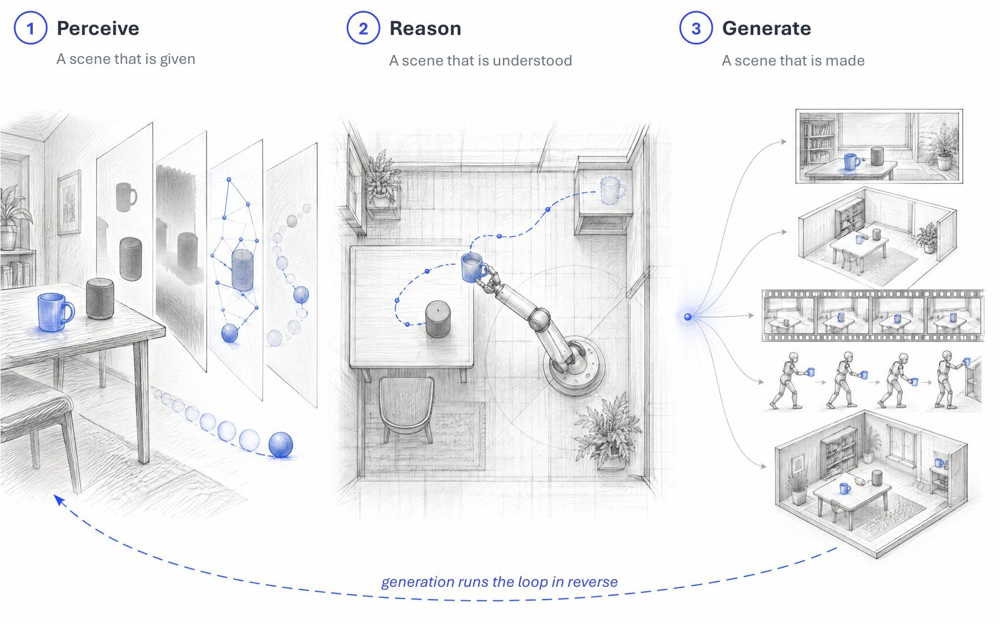
</p>
<p align="center"><sub><b>Figure 12.</b> Part III in one view. (1) Perceive: a given scene is separated into objects, depth, relational structure, and motion. (2) Reason: the understood scene supports inference and planning, here a path that carries the cup around an obstacle to the shelf. (3) Generate: an intent unfolds into images, 3D scenes, video, motion, and whole worlds, so that generation runs the loop in reverse.</sub></p>

## 6. Spatial Perception
Spatial perception is the foundational layer of spatial intelligence: it turns raw sensory input into the structured spatial evidence that everything downstream depends on, answering what is present, where it lies, and how it moves.

### 6.1. Spatial Entity Recognition
#### 6.1.1. Object Detection
<p align="center">
  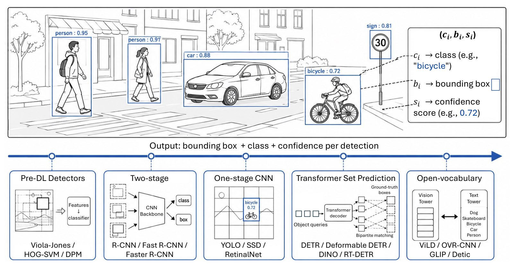
</p>
<p align="center"><sub><b>Figure 13.</b> 2D object detection: each detected instance is a tuple (<i>c</i><sub><i>i</i></sub>, <i>b</i><sub><i>i</i></sub>, <i>s</i><sub><i>i</i></sub>) of class, bounding box, and confidence score (top), and the progression of detector families with representative methods under each (bottom).</sub></p>

**2024**

- [**YOLO-World: Real-Time Open-Vocabulary Object Detection**](https://arxiv.org/abs/2401.17270) [](https://arxiv.org/abs/2401.17270) [](https://github.com/AILab-CVC/YOLO-World) <!-- 24 -->
- [**YOLOv10: Real-Time End-to-End Object Detection**](https://arxiv.org/abs/2405.14458) [](https://arxiv.org/abs/2405.14458) [](https://github.com/THU-MIG/yolov10) <!-- 24 -->

**2023**

- [**DETRs Beat YOLOs on Real-time Object Detection**](https://arxiv.org/abs/2304.08069) [](https://arxiv.org/abs/2304.08069) [](https://github.com/lyuwenyu/RT-DETR) <!-- 04-23 -->

**2022**

- [**Omni3D: A Large Benchmark and Model for 3D Object Detection in the Wild**](https://arxiv.org/abs/2207.10660) [](https://arxiv.org/abs/2207.10660) [](https://github.com/facebookresearch/omni3d) <!-- 07-22 -->
- [**BEVFusion: Multi-Task Multi-Sensor Fusion with Unified Bird's-Eye View Representation**](https://arxiv.org/abs/2205.13542) [](https://arxiv.org/abs/2205.13542) [](https://github.com/mit-han-lab/bevfusion) <!-- 05-22 -->
- [**DINO: DETR with Improved DeNoising Anchor Boxes for End-to-End Object Detection**](https://arxiv.org/abs/2203.03605) [](https://arxiv.org/abs/2203.03605) [](https://github.com/IDEA-Research/DINO) <!-- 03-22 -->
- [**Detecting Twenty-Thousand Classes Using Image-Level Supervision**](https://arxiv.org/abs/2201.02605) [](https://arxiv.org/abs/2201.02605) [](https://github.com/facebookresearch/Detic) <!-- 22 -->

**2021**

- [**Open-vocabulary Object Detection via Vision and Language Knowledge Distillation**](https://arxiv.org/abs/2104.13921) [](https://arxiv.org/abs/2104.13921) [](https://github.com/tensorflow/tpu) <!-- 04-21 -->

**2020**

- [**Sparse R-CNN: End-to-End Object Detection With Learnable Proposals**](https://arxiv.org/abs/2011.12450) [](https://arxiv.org/abs/2011.12450) [](https://github.com/PeizeSun/SparseR-CNN) <!-- 11-20 -->
- [**Deformable DETR: Deformable Transformers for End-to-End Object Detection**](https://arxiv.org/abs/2010.04159) [](https://arxiv.org/abs/2010.04159) [](https://github.com/fundamentalvision/Deformable-DETR) <!-- 10-20 -->
- [**End-to-End Object Detection with Transformers**](https://arxiv.org/abs/2005.12872) [](https://arxiv.org/abs/2005.12872) [](https://github.com/facebookresearch/detr) <!-- 20 -->
- [**Lift, Splat, Shoot: Encoding Images from Arbitrary Camera Rigs by Implicitly Unprojecting to 3D**](https://arxiv.org/abs/2008.05711) [](https://arxiv.org/abs/2008.05711) [](https://github.com/nv-tlabs/lift-splat-shoot) <!-- 20 -->

**Before 2020**

- [**Focal Loss for Dense Object Detection**](https://arxiv.org/abs/1708.02002) [](https://arxiv.org/abs/1708.02002) [](https://github.com/facebookresearch/Detectron) <!-- 17 -->
- [**Faster R-CNN: Towards Real-Time Object Detection with Region Proposal Networks**](https://arxiv.org/abs/1506.01497) [](https://arxiv.org/abs/1506.01497) [](https://github.com/rbgirshick/py-faster-rcnn) <!-- 15 -->

#### 6.1.2. Segmentation
<p align="center">
  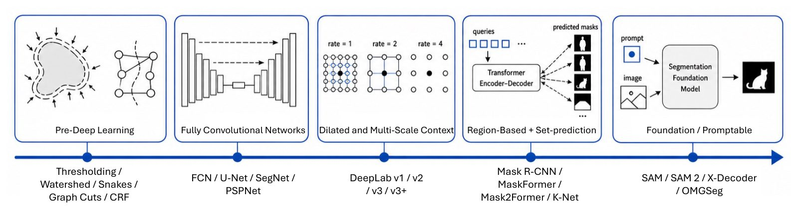
</p>
<p align="center"><sub><b>Figure 14.</b> Methodological progression of image and video segmentation, from pre-deep-learning methods to foundation and promptable segmenters, with representative methods under each stage.</sub></p>

**2024**

- [**OMG-Seg: Is One Model Good Enough for all Segmentation?**](https://arxiv.org/abs/2401.10229) [](https://arxiv.org/abs/2401.10229) [](https://github.com/lxtGH/OMG-Seg) <!-- 24 -->

**2023**

- [**Point Transformer V3: Simpler, Faster, Stronger**](https://arxiv.org/abs/2312.10035) [](https://arxiv.org/abs/2312.10035) [](https://github.com/Pointcept/PointTransformerV3) <!-- 12-23 -->
- [**Mask3D: Mask Transformer for 3D Semantic Instance Segmentation**](https://doi.org/10.1109/ICRA48891.2023.10160590) [](https://doi.org/10.1109/ICRA48891.2023.10160590) [](https://github.com/JonasSchult/Mask3D) <!-- 23 -->
- [**OpenMask3D: Open-Vocabulary 3D Instance Segmentation**](https://arxiv.org/abs/2306.13631) [](https://arxiv.org/abs/2306.13631) [](https://github.com/OpenMask3D/openmask3d) <!-- 23 -->

**2022**

- [**Generalized Decoding for Pixel, Image, and Language**](https://arxiv.org/abs/2212.11270) [](https://arxiv.org/abs/2212.11270) [](https://github.com/microsoft/X-Decoder) <!-- 12-22 -->
- [**Video K-Net: A Simple, Strong, and Unified Baseline for Video Segmentation**](https://arxiv.org/abs/2204.04656) [](https://arxiv.org/abs/2204.04656) [](https://github.com/lxtGH/Video-K-Net) <!-- 22 -->

**2021**

- [**Masked-attention Mask Transformer for Universal Image Segmentation**](https://arxiv.org/abs/2112.01527) [](https://arxiv.org/abs/2112.01527) [](https://github.com/facebookresearch/Mask2Former) <!-- 12-21 -->
- [**Instances as Queries**](https://arxiv.org/abs/2105.01928) [](https://arxiv.org/abs/2105.01928) [](https://github.com/hustvl/QueryInst) <!-- 21 -->
- [**K-Net: Towards Unified Image Segmentation**](https://arxiv.org/abs/2106.14855) [](https://arxiv.org/abs/2106.14855) [](https://github.com/ZwwWayne/K-Net) <!-- 21 -->
- [**Per-Pixel Classification is Not All You Need for Semantic Segmentation**](https://arxiv.org/abs/2107.06278) [](https://arxiv.org/abs/2107.06278) [](https://github.com/facebookresearch/MaskFormer) <!-- 21 -->
- [**SegFormer: Simple and Efficient Design for Semantic Segmentation with Transformers**](https://arxiv.org/abs/2105.15203) [](https://arxiv.org/abs/2105.15203) [](https://github.com/NVlabs/SegFormer) <!-- 21 -->

**2020**

- [**Rethinking Semantic Segmentation From a Sequence-to-Sequence Perspective With Transformers**](https://arxiv.org/abs/2012.15840) [](https://arxiv.org/abs/2012.15840) [](https://github.com/LogosIntelligenceLab/SETR) <!-- 12-20 -->
- [**Searching Efficient 3D Architectures with Sparse Point-Voxel Convolution**](https://arxiv.org/abs/2007.16100) [](https://arxiv.org/abs/2007.16100) [](https://github.com/mit-han-lab/spvnas) <!-- 20 -->

**Before 2020**

- [**Hybrid Task Cascade for Instance Segmentation**](https://arxiv.org/abs/1901.07518) [](https://arxiv.org/abs/1901.07518) [](https://github.com/open-mmlab/mmdetection) <!-- 19 -->
- [**PointRend: Image Segmentation As Rendering**](https://arxiv.org/abs/1912.08193) [](https://arxiv.org/abs/1912.08193) [](https://github.com/facebookresearch/detectron2) <!-- 12-19 -->
- [**Encoder-Decoder with Atrous Separable Convolution for Semantic Image Segmentation**](https://arxiv.org/abs/1802.02611) [](https://arxiv.org/abs/1802.02611) [](https://github.com/tensorflow/models) <!-- 18 -->
- [**Mask R-CNN**](https://arxiv.org/abs/1703.06870) [](https://arxiv.org/abs/1703.06870) [](https://github.com/facebookresearch/Detectron) <!-- 17 -->
- [**Pyramid Scene Parsing Network**](https://arxiv.org/abs/1612.01105) [](https://arxiv.org/abs/1612.01105) [](https://github.com/hszhao/PSPNet) <!-- 12-16 -->
- [**Fully convolutional networks for semantic segmentation**](https://arxiv.org/abs/1411.4038) [](https://arxiv.org/abs/1411.4038) <!-- 11-14 -->
- [**The Pascal Visual Object Classes (VOC) Challenge**](https://doi.org/10.1007/s11263-009-0275-4) [](https://doi.org/10.1007/s11263-009-0275-4) <!-- 10 -->

#### 6.1.3. Keypoint and Landmark Detection
<p align="center">
  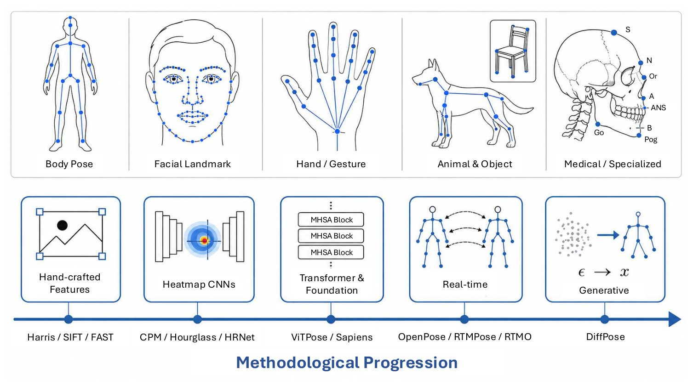
</p>
<p align="center"><sub><b>Figure 15.</b> Keypoint and landmark detection: representative task families (top) and the methodological progression, mainly of 2D detectors, from hand-crafted feature detectors to generative models, with representative methods under each stage (bottom).</sub></p>

**2025**

- [**2D Animal Skeletons Keypoint Detection: Research Progress and Future Trends**](https://doi.org/10.1109/ACCESS.2025.3585267) [](https://doi.org/10.1109/ACCESS.2025.3585267) <!-- 25 -->

**2024**

- [**Sapiens: Foundation for Human Vision Models**](https://arxiv.org/abs/2408.12569) [](https://arxiv.org/abs/2408.12569) <!-- 24 -->

**2023**

- [**RTMO: Towards High-Performance One-Stage Real-Time Multi-Person Pose Estimation**](https://arxiv.org/abs/2312.07526) [](https://arxiv.org/abs/2312.07526) [](https://github.com/open-mmlab/mmpose) <!-- 12-23 -->
- [**RTMPose: Real-Time Multi-Person Pose Estimation based on MMPose**](https://arxiv.org/abs/2303.07399) [](https://arxiv.org/abs/2303.07399) [](https://github.com/open-mmlab/mmpose) <!-- 03-23 -->
- [**MotionBERT: A Unified Perspective on Learning Human Motion Representations**](https://doi.org/10.1109/ICCV51070.2023.01385) [](https://doi.org/10.1109/ICCV51070.2023.01385) [](https://github.com/Walter0807/MotionBERT) <!-- 23 -->

**2022**

- [**DiffPose: Toward More Reliable 3D Pose Estimation**](https://arxiv.org/abs/2211.16940) [](https://arxiv.org/abs/2211.16940) [](https://github.com/GONGJIA0208/Diffpose) <!-- 11-22 -->
- [**ViTPose: Simple Vision Transformer Baselines for Human Pose Estimation**](https://arxiv.org/abs/2204.12484) [](https://arxiv.org/abs/2204.12484) [](https://github.com/ViTAE-Transformer/ViTPose) <!-- 22 -->
- [**YOLO-Pose: Enhancing YOLO for Multi Person Pose Estimation Using Object Keypoint Similarity Loss**](https://arxiv.org/abs/2204.06806) [](https://arxiv.org/abs/2204.06806) <!-- 22 -->

**2021**

- [**AP-10K: A Benchmark for Animal Pose Estimation in the Wild**](https://arxiv.org/abs/2108.12617) [](https://arxiv.org/abs/2108.12617) [](https://github.com/AlexTheBad/AP-10K) <!-- 21 -->
- [**LoFTR: Detector-Free Local Feature Matching With Transformers**](https://arxiv.org/abs/2104.00680) [](https://arxiv.org/abs/2104.00680) [](https://github.com/zju3dv/LoFTR) <!-- 21 -->

**2020**

- [**D3Feat: Joint Learning of Dense Detection and Description of 3D Local Features**](https://arxiv.org/abs/2003.03164) [](https://arxiv.org/abs/2003.03164) [](https://github.com/XuyangBai/D3Feat) <!-- 20 -->
- [**DISK: Learning local features with policy gradient**](https://arxiv.org/abs/2006.13566) [](https://arxiv.org/abs/2006.13566) [](https://github.com/cvlab-epfl/disk) <!-- 20 -->
- [**KeypointNet: A Large-Scale 3D Keypoint Dataset Aggregated From Numerous Human Annotations**](https://arxiv.org/abs/2002.12687) [](https://arxiv.org/abs/2002.12687) [](https://github.com/qq456cvb/KeypointNet) <!-- 20 -->
- [**RTM3D: Real-Time Monocular 3D Detection from Object Keypoints for Autonomous Driving**](https://arxiv.org/abs/2001.03343) [](https://arxiv.org/abs/2001.03343) [](https://github.com/Banconxuan/RTM3D) <!-- 20 -->

**Before 2020**

- [**3D Human Pose Estimation in Video With Temporal Convolutions and Semi-Supervised Training**](https://arxiv.org/abs/1811.11742) [](https://arxiv.org/abs/1811.11742) [](https://github.com/facebookresearch/VideoPose3D) <!-- 11-18 -->
- [**Look at Boundary: A Boundary-Aware Face Alignment Algorithm**](https://arxiv.org/abs/1805.10483) [](https://arxiv.org/abs/1805.10483) [](https://github.com/wywu/LAB) <!-- 18 -->
- [**OpenPose: Realtime Multi-Person 2D Pose Estimation Using Part Affinity Fields**](https://arxiv.org/abs/1812.08008) [](https://arxiv.org/abs/1812.08008) [](https://github.com/CMU-Perceptual-Computing-Lab/openpose) <!-- 12-18 -->
- [**A Simple Yet Effective Baseline for 3d Human Pose Estimation**](https://arxiv.org/abs/1705.03098) [](https://arxiv.org/abs/1705.03098) [](https://github.com/una-dinosauria/3d-pose-baseline) <!-- 17 -->
- [**Learning to Estimate 3D Hand Pose from Single RGB Images**](https://arxiv.org/abs/1705.01389) [](https://arxiv.org/abs/1705.01389) [](https://github.com/lmb-freiburg/hand3d) <!-- 17 -->
- [**Realtime Multi-person 2D Pose Estimation Using Part Affinity Fields**](https://arxiv.org/abs/1611.08050) [](https://arxiv.org/abs/1611.08050) [](https://github.com/ZheC/Realtime_Multi-Person_Pose_Estimation) <!-- 11-16 -->
- [**Microsoft COCO: Common Objects in Context**](https://arxiv.org/abs/1405.0312) [](https://arxiv.org/abs/1405.0312) <!-- 14 -->

#### 6.1.4. Scene Classification
<p align="center">
  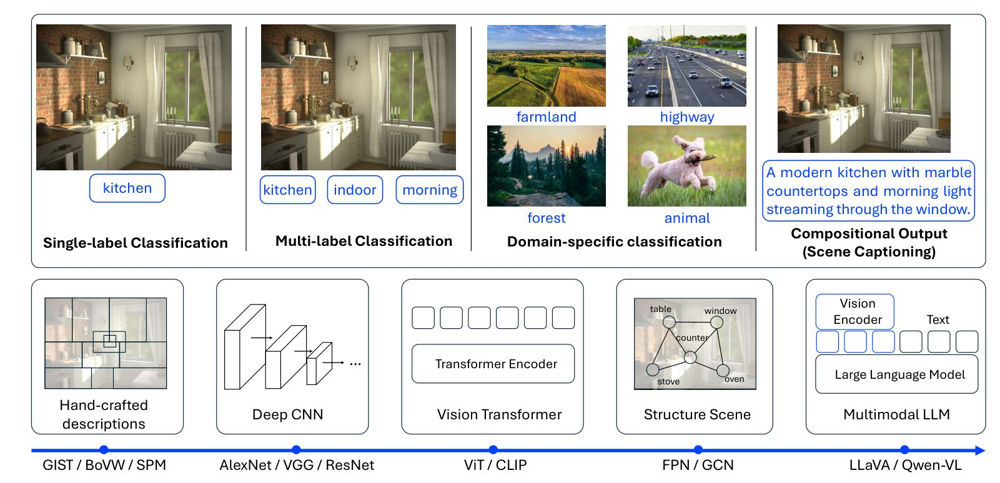
</p>
<p align="center"><sub><b>Figure 16.</b> Scene classification: four task formulations, from single-label classification to compositional captioning output (top), and the methodological progression from hand-crafted descriptors to multimodal LLMs, with representative methods under each stage (bottom).</sub></p>

**2025**

- [**SpatialBench: Benchmarking Multimodal Large Language Models for Spatial Cognition**](https://arxiv.org/abs/2511.21471) [](https://arxiv.org/abs/2511.21471) <!-- 11-25 -->
- [**Gemma 3 Technical Report**](https://arxiv.org/abs/2503.19786) [](https://arxiv.org/abs/2503.19786) <!-- 03-25 -->
- [**MM-Spatial: Exploring 3D Spatial Understanding in Multimodal LLMs**](https://arxiv.org/abs/2503.13111) [](https://arxiv.org/abs/2503.13111) [](https://github.com/apple-aiml-research/ml-cubifyanything) <!-- 25 -->

**2024**

- [**Improved Zero-Shot Classification by Adapting VLMs with Text Descriptions**](https://arxiv.org/abs/2401.02460) [](https://arxiv.org/abs/2401.02460) [](https://github.com/cvl-umass/AdaptCLIPZS) <!-- 24 -->
- [**Why are Visually-Grounded Language Models Bad at Image Classification?**](https://arxiv.org/abs/2405.18415) [](https://arxiv.org/abs/2405.18415) [](https://github.com/yuhui-zh15/VLMClassifier) <!-- 24 -->

**2023**

- [**Qwen-VL: A Versatile Vision-Language Model for Understanding, Localization, Text Reading, and Beyond**](https://arxiv.org/abs/2308.12966) [](https://arxiv.org/abs/2308.12966) [](https://github.com/QwenLM/Qwen-VL) <!-- 08-23 -->
- [**CLIP2Scene: Towards Label-efficient 3D Scene Understanding by CLIP**](https://arxiv.org/abs/2301.04926) [](https://arxiv.org/abs/2301.04926) [](https://github.com/runnanchen/CLIP2Scene) <!-- 23 -->

**2022**

- [**An Improved Deep Network-Based Scene Classification Method for Self-Driving Cars**](https://doi.org/10.1109/TIM.2022.3146923) [](https://doi.org/10.1109/TIM.2022.3146923) <!-- 22 -->

**Before 2020**

- [**SUN RGB-D: A RGB-D scene understanding benchmark suite**](https://doi.org/10.1109/CVPR.2015.7298655) [](https://doi.org/10.1109/CVPR.2015.7298655) <!-- 15 -->
- [**Learning Deep Features for Scene Recognition using Places Database**](https://proceedings.neurips.cc/paper_files/paper/2014/hash/19ea3982b415d7bb3363917eb3d60c4a-Abstract.html) [](https://proceedings.neurips.cc/paper_files/paper/2014/hash/19ea3982b415d7bb3363917eb3d60c4a-Abstract.html) <!-- 14 -->
- [**Indoor Segmentation and Support Inference from RGBD Images**](https://doi.org/10.1007/978-3-642-33715-4_54) [](https://doi.org/10.1007/978-3-642-33715-4_54) <!-- 12 -->
- [**Recognizing indoor scenes**](https://doi.org/10.1109/CVPR.2009.5206537) [](https://doi.org/10.1109/CVPR.2009.5206537) <!-- 09 -->
- [**Beyond Bags of Features: Spatial Pyramid Matching for Recognizing Natural Scene Categories**](https://doi.org/10.1109/CVPR.2006.68) [](https://doi.org/10.1109/CVPR.2006.68) <!-- 06 -->

### 6.2. Spatial Localization and Position Estimation
#### 6.2.1. Depth Estimation
<p align="center">
  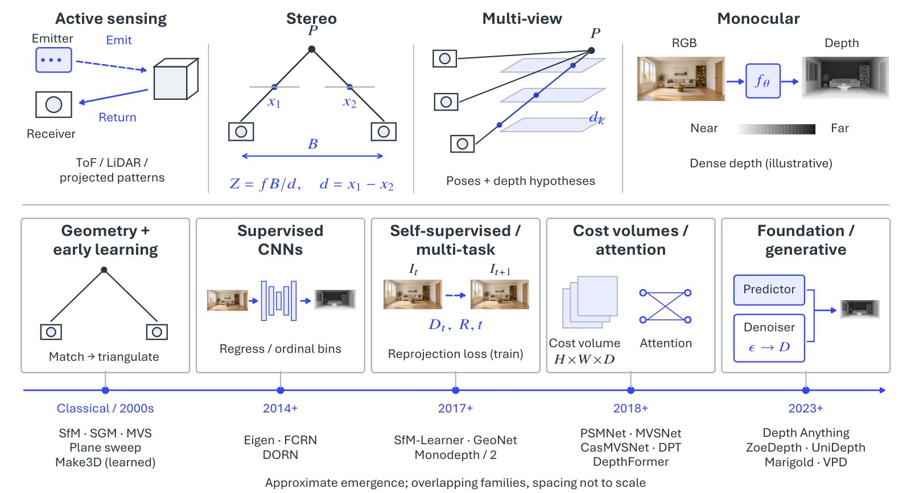
</p>
<p align="center"><sub><b>Figure 17.</b> Depth estimation: four input configurations (top) and five overlapping method families with representative methods on an approximate emergence timeline (bottom).</sub></p>

**2025**

- [**MonoLENS: Monocular Lightweight Efficient Network with Separable Convolutions for Self-Supervised Monocular Depth Estimation**](https://doi.org/10.3390/app151910393) [](https://doi.org/10.3390/app151910393) <!-- 09-25 -->
- [**LMDepth: Lightweight Mamba-based Monocular Depth Estimation for Real-World Deployment**](https://arxiv.org/abs/2505.00980) [](https://arxiv.org/abs/2505.00980) <!-- 05-25 -->
- [**DERD-Net: Learning Depth from Event-based Ray Densities**](https://arxiv.org/abs/2504.15863) [](https://arxiv.org/abs/2504.15863) [](https://github.com/tub-rip/DERD-Net) <!-- 25 -->

**2024**

- [**DepthSplat: Connecting Gaussian Splatting and Depth**](https://arxiv.org/abs/2410.13862) [](https://arxiv.org/abs/2410.13862) [](https://github.com/cvg/depthsplat) <!-- 10-24 -->
- [**Depth Anything: Unleashing the Power of Large-Scale Unlabeled Data**](https://arxiv.org/abs/2401.10891) [](https://arxiv.org/abs/2401.10891) [](https://github.com/LiheYoung/Depth-Anything) <!-- 24 -->
- [**RGBD Objects in the Wild: Scaling Real-World 3D Object Learning from RGB-D Videos**](https://arxiv.org/abs/2401.12592) [](https://arxiv.org/abs/2401.12592) <!-- 24 -->
- [**RSA: Resolving Scale Ambiguities in Monocular Depth Estimators through Language Descriptions**](https://arxiv.org/abs/2410.02924) [](https://arxiv.org/abs/2410.02924) [](https://github.com/Adonis-galaxy/RSA) <!-- 24 -->
- [**Temporal Event Stereo via Joint Learning with Stereoscopic Flow**](https://arxiv.org/abs/2407.10831) [](https://arxiv.org/abs/2407.10831) [](https://github.com/mickeykang16/TemporalEventStereo) <!-- 24 -->
- [**UniDepth: Universal Monocular Metric Depth Estimation**](https://arxiv.org/abs/2403.18913) [](https://arxiv.org/abs/2403.18913) [](https://github.com/lpiccinelli-eth/UniDepth) <!-- 24 -->

**2023**

- [**Repurposing Diffusion-Based Image Generators for Monocular Depth Estimation**](https://arxiv.org/abs/2312.02145) [](https://arxiv.org/abs/2312.02145) [](https://github.com/prs-eth/Marigold) <!-- 12-23 -->
- [**ZoeDepth: Zero-shot Transfer by Combining Relative and Metric Depth**](https://arxiv.org/abs/2302.12288) [](https://arxiv.org/abs/2302.12288) [](https://github.com/isl-org/ZoeDepth) <!-- 02-23 -->
- [**Unleashing Text-to-Image Diffusion Models for Visual Perception**](https://arxiv.org/abs/2303.02153) [](https://arxiv.org/abs/2303.02153) [](https://github.com/wl-zhao/VPD) <!-- 23 -->

**2021**

- [**KITTI-360: A Novel Dataset and Benchmarks for Urban Scene Understanding in 2D and 3D**](https://arxiv.org/abs/2109.13410) [](https://arxiv.org/abs/2109.13410) [](https://github.com/autonomousvision/kitti360LabelTool) <!-- 09-21 -->
- [**Argoverse 2: Next Generation Datasets for Self-Driving Perception and Forecasting**](https://arxiv.org/abs/2301.00493) [](https://arxiv.org/abs/2301.00493) [](https://github.com/argoverse/av2-api) <!-- 21 -->
- [**ARKitScenes: A Diverse Real-World Dataset For 3D Indoor Scene Understanding Using Mobile RGB-D Data**](https://arxiv.org/abs/2111.08897) [](https://arxiv.org/abs/2111.08897) [](https://github.com/apple-aiml-research/ARKitScenes) <!-- 21 -->
- [**Vision Transformers for Dense Prediction**](https://arxiv.org/abs/2103.13413) [](https://arxiv.org/abs/2103.13413) [](https://github.com/isl-org/DPT) <!-- 21 -->

**2020**

- [**TartanAir: A Dataset to Push the Limits of Visual SLAM**](https://arxiv.org/abs/2003.14338) [](https://arxiv.org/abs/2003.14338) [](https://github.com/castacks/tartanair_tools) <!-- 20 -->

**Before 2020**

- [**Cascade Cost Volume for High-Resolution Multi-View Stereo and Stereo Matching**](https://arxiv.org/abs/1912.06378) [](https://arxiv.org/abs/1912.06378) [](https://github.com/alibaba/cascade-stereo) <!-- 12-19 -->
- [**From Big to Small: Multi-Scale Local Planar Guidance for Monocular Depth Estimation**](https://arxiv.org/abs/1907.10326) [](https://arxiv.org/abs/1907.10326) [](https://github.com/cleinc/bts) <!-- 07-19 -->
- [**Digging Into Self-Supervised Monocular Depth Estimation**](https://arxiv.org/abs/1806.01260) [](https://arxiv.org/abs/1806.01260) [](https://github.com/nianticlabs/monodepth2) <!-- 06-18 -->
- [**MVSNet: Depth Inference for Unstructured Multi-view Stereo**](https://arxiv.org/abs/1804.02505) [](https://arxiv.org/abs/1804.02505) <!-- 18 -->
- [**Unsupervised Learning of Depth and Ego-Motion from Video**](https://arxiv.org/abs/1704.07813) [](https://arxiv.org/abs/1704.07813) [](https://github.com/tinghuiz/SfMLearner) <!-- 17 -->
- [**A Large Dataset to Train Convolutional Networks for Disparity, Optical Flow, and Scene Flow Estimation**](https://arxiv.org/abs/1512.02134) [](https://arxiv.org/abs/1512.02134) <!-- 12-15 -->
- [**Make3D: Learning 3D Scene Structure from a Single Still Image**](https://doi.org/10.1109/TPAMI.2008.132) [](https://doi.org/10.1109/TPAMI.2008.132) <!-- 09 -->

#### 6.2.2. Surface Normal Estimation
<p align="center">
  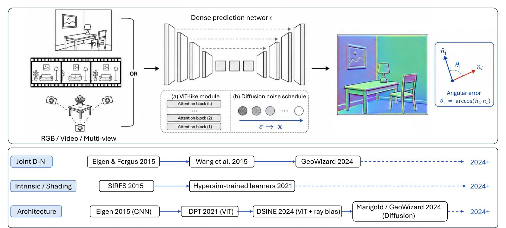
</p>
<p align="center"><sub><b>Figure 18.</b> Surface normal estimation. Top: an RGB, video, or multi-view input is mapped by a dense prediction network ((a) ViT-like or (b) diffusion variant) to a per-pixel unit normal field <b>n̂</b> ∈ 𝕊<sup>2</sup>, scored by angular error.</sub></p>

**2026**

- [**TransNormal: Dense Visual Semantics for Diffusion-based Transparent Object Normal Estimation**](https://arxiv.org/abs/2602.00839) [](https://arxiv.org/abs/2602.00839) <!-- 01-26 -->

**2025**

- [**NormalCrafter: Learning Temporally Consistent Normals from Video Diffusion Priors**](https://arxiv.org/abs/2504.11427) [](https://arxiv.org/abs/2504.11427) [](https://github.com/Binyr/NormalCrafter) <!-- 25 -->

**2024**

- [**GeoWizard: Unleashing the Diffusion Priors for 3D Geometry Estimation from a Single Image**](https://arxiv.org/abs/2403.12013) [](https://arxiv.org/abs/2403.12013) [](https://github.com/fuxiao0719/GeoWizard) <!-- 24 -->
- [**Metric3D v2: A Versatile Monocular Geometric Foundation Model for Zero-Shot Metric Depth and Surface Normal Estimation**](https://arxiv.org/abs/2404.15506) [](https://arxiv.org/abs/2404.15506) [](https://github.com/YvanYin/Metric3D) <!-- 24 -->
- [**Rethinking Inductive Biases for Surface Normal Estimation**](https://arxiv.org/abs/2403.00712) [](https://arxiv.org/abs/2403.00712) [](https://github.com/baegwangbin/DSINE) <!-- 24 -->
- [**StableNormal: Reducing Diffusion Variance for Stable and Sharp Normal**](https://arxiv.org/abs/2406.16864) [](https://arxiv.org/abs/2406.16864) <!-- 24 -->

**2021**

- [**NeuS: Learning Neural Implicit Surfaces by Volume Rendering for Multi-view Reconstruction**](https://arxiv.org/abs/2106.10689) [](https://arxiv.org/abs/2106.10689) [](https://github.com/Totoro97/NeuS) <!-- 21 -->
- [**Omnidata: A Scalable Pipeline for Making Multi-Task Mid-Level Vision Datasets from 3D Scans**](https://arxiv.org/abs/2110.04994) [](https://arxiv.org/abs/2110.04994) [](https://github.com/EPFL-VILAB/omnidata) <!-- 21 -->

**2020**

- [**Hypersim: A Photorealistic Synthetic Dataset for Holistic Indoor Scene Understanding**](https://arxiv.org/abs/2011.02523) [](https://arxiv.org/abs/2011.02523) [](https://github.com/apple-aiml-research/ml-hypersim) <!-- 11-20 -->

#### 6.2.3. Height and Distance Estimation
<p align="center">
  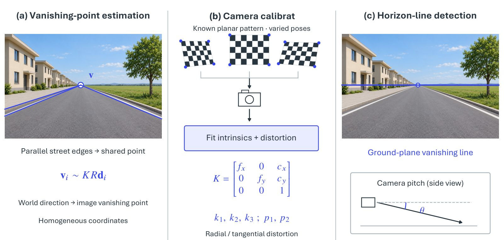
</p>
<p align="center"><sub><b>Figure 19.</b> Geometric subtasks supporting height and distance estimation: (a) parallel street edges determine a vanishing point; (b) multiple views of a known planar pattern estimate camera intrinsics and lens distortion; (c) the ground-plane horizon passes through horizontal-direction vanishing points.</sub></p>

**2023**

- [**Metric3D: Towards Zero-shot Metric 3D Prediction from A Single Image**](https://arxiv.org/abs/2307.10984) [](https://arxiv.org/abs/2307.10984) [](https://github.com/YvanYin/Metric3D) <!-- 23 -->

**2021**

- [**FCOS3D: Fully Convolutional One-Stage Monocular 3D Object Detection**](https://arxiv.org/abs/2104.10956) [](https://arxiv.org/abs/2104.10956) [](https://github.com/open-mmlab/mmdetection3d) <!-- 21 -->
- [**RAFT-Stereo: Multilevel Recurrent Field Transforms for Stereo Matching**](https://arxiv.org/abs/2109.07547) [](https://arxiv.org/abs/2109.07547) [](https://github.com/princeton-vl/RAFT-Stereo) <!-- 21 -->

**2020**

- [**BDD100K: A Diverse Driving Dataset for Heterogeneous Multitask Learning**](https://openaccess.thecvf.com/content_CVPR_2020/html/Yu_BDD100K_A_Diverse_Driving_Dataset_for_Heterogeneous_Multitask_Learning_CVPR_2020_paper.html) [](https://openaccess.thecvf.com/content_CVPR_2020/html/Yu_BDD100K_A_Diverse_Driving_Dataset_for_Heterogeneous_Multitask_Learning_CVPR_2020_paper.html) [](https://github.com/SysCV/bdd100k-models) <!-- 20 -->

**Before 2020**

- [**Normalized Object Coordinate Space for Category-Level 6D Object Pose and Size Estimation**](https://arxiv.org/abs/1901.02970) [](https://arxiv.org/abs/1901.02970) [](https://github.com/hughw19/NOCS_CVPR2019) <!-- 19 -->
- [**The 2018 NVIDIA AI City Challenge**](http://openaccess.thecvf.com/content_cvpr_2018_workshops/w3/html/Naphade_The_2018_NVIDIA_CVPR_2018_paper.html) [](http://openaccess.thecvf.com/content_cvpr_2018_workshops/w3/html/Naphade_The_2018_NVIDIA_CVPR_2018_paper.html) <!-- 18 -->
- [**Vision meets robotics: The KITTI dataset**](https://doi.org/10.1177/0278364913491297) [](https://doi.org/10.1177/0278364913491297) <!-- 13 -->
- [**Multiple View Geometry in Computer Vision**](https://doi.org/10.1017/cbo9780511811685) [](https://doi.org/10.1017/cbo9780511811685) <!-- 04 -->
- [**A Flexible New Technique for Camera Calibration**](https://doi.org/10.1109/34.888718) [](https://doi.org/10.1109/34.888718) <!-- 00 -->
- [**Single View Metrology**](https://doi.org/10.1023/A:1026598000963) [](https://doi.org/10.1023/A:1026598000963) <!-- 00 -->

#### 6.2.4. Visual Odometry and Camera Pose Estimation
<p align="center">
  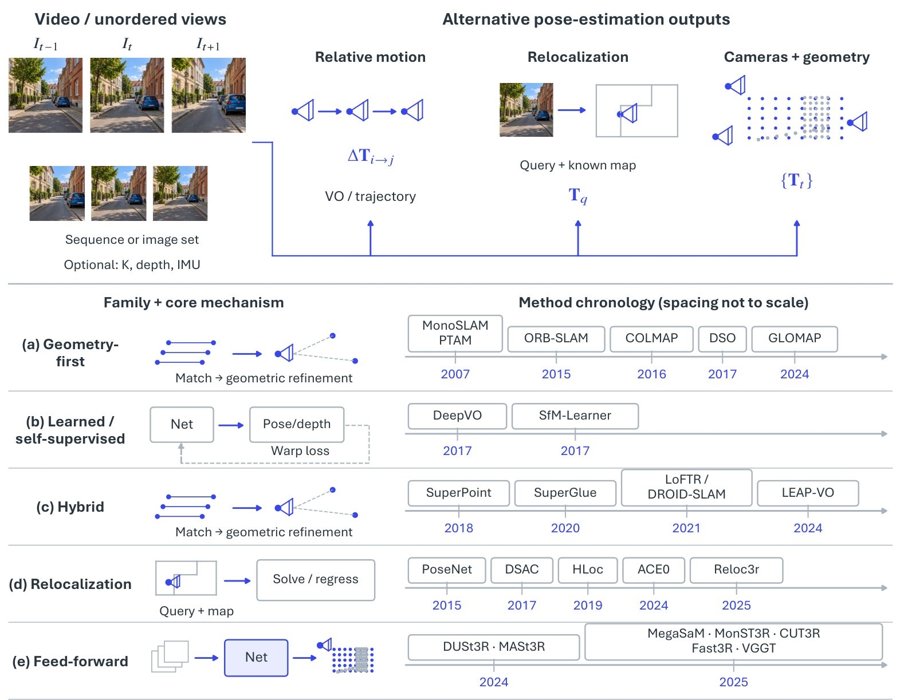
</p>
<p align="center"><sub><b>Figure 20.</b> Visual odometry and camera pose estimation. Top: a video or unordered image set is mapped to relative motion ∆<b>T</b><sub><i>i</i>→<i>j</i></sub>, an absolute pose <b>T</b><sub><i>q</i></sub> in a known scene, or camera poses {<b>T</b><sub><i>t</i></sub>} jointly with scene structure.</sub></p>

**2024**

- [**Reloc3r: Large-Scale Training of Relative Camera Pose Regression for Generalizable, Fast, and Accurate Visual Localization**](https://arxiv.org/abs/2412.08376) [](https://arxiv.org/abs/2412.08376) [](https://github.com/ffrivera0/reloc3r) <!-- 12-24 -->
- [**MonST3R: A Simple Approach for Estimating Geometry in the Presence of Motion**](https://arxiv.org/abs/2410.03825) [](https://arxiv.org/abs/2410.03825) [](https://github.com/Junyi42/monst3r) <!-- 10-24 -->
- [**Global Structure-from-Motion Revisited**](https://arxiv.org/abs/2407.20219) [](https://arxiv.org/abs/2407.20219) [](https://github.com/colmap/glomap) <!-- 24 -->
- [**Scene Coordinate Reconstruction: Posing of Image Collections via Incremental Learning of a Relocalizer**](https://arxiv.org/abs/2404.14351) [](https://arxiv.org/abs/2404.14351) <!-- 24 -->

**2021**

- [**DROID-SLAM: Deep Visual SLAM for Monocular, Stereo, and RGB-D Cameras**](https://arxiv.org/abs/2108.10869) [](https://arxiv.org/abs/2108.10869) [](https://github.com/princeton-vl/DROID-SLAM) <!-- 21 -->

**Before 2020**

- [**Structure-from-Motion Revisited**](https://doi.org/10.1109/CVPR.2016.445) [](https://doi.org/10.1109/CVPR.2016.445) [](https://github.com/colmap/colmap) <!-- 16 -->
- [**PoseNet: A Convolutional Network for Real-Time 6-DOF Camera Relocalization**](https://doi.org/10.1109/ICCV.2015.336) [](https://doi.org/10.1109/ICCV.2015.336) <!-- 15 -->
- [**Scene Coordinate Regression Forests for Camera Relocalization in RGB-D Images**](https://doi.org/10.1109/CVPR.2013.377) [](https://doi.org/10.1109/CVPR.2013.377) <!-- 13 -->

#### 6.2.5. Pose Estimation
<p align="center">
  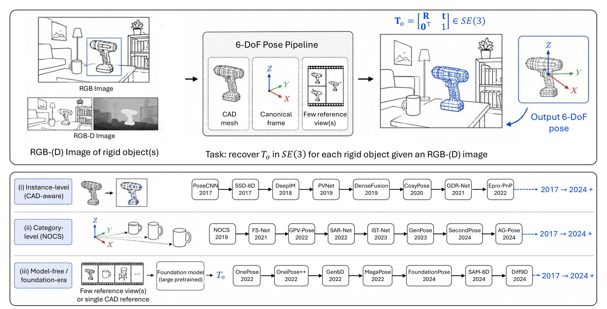
</p>
<p align="center"><sub><b>Figure 21.</b> 6-DoF object pose estimation. Top: recover <b>T</b><sub><i>o</i></sub> ∈ SE(3) for each rigid object in an RGB(-D) image, given a CAD mesh, a canonical frame, or a few reference views.</sub></p>

**2025**

- [**BOP Challenge 2024 on Model-Based and Model-Free 6D Object Pose Estimation**](https://arxiv.org/abs/2504.02812) [](https://arxiv.org/abs/2504.02812) [](https://github.com/thodan/bop_toolkit) <!-- 04-25 -->
- [**Any6D: Model-free 6D Pose Estimation of Novel Objects**](https://arxiv.org/abs/2503.18673) [](https://arxiv.org/abs/2503.18673) [](https://github.com/taeyeopl/Any6D) <!-- 25 -->
- [**Diff9D: Diffusion-Based Domain-Generalized Category-Level 9-DoF Object Pose Estimation**](https://arxiv.org/abs/2502.02525) [](https://arxiv.org/abs/2502.02525) [](https://github.com/CNJianLiu/Diff9D) <!-- 25 -->

**2024**

- [**FreeZe: Training-Free Zero-Shot 6D Pose Estimation with Geometric and Vision Foundation Models**](https://doi.org/10.1007/978-3-031-73226-3_24) [](https://doi.org/10.1007/978-3-031-73226-3_24) <!-- 24 -->

**2023**

- [**FoundationPose: Unified 6D Pose Estimation and Tracking of Novel Objects**](https://arxiv.org/abs/2312.08344) [](https://arxiv.org/abs/2312.08344) [](https://github.com/NVlabs/FoundationPose) <!-- 12-23 -->
- [**GigaPose: Fast and Robust Novel Object Pose Estimation via One Correspondence**](https://arxiv.org/abs/2311.14155) [](https://arxiv.org/abs/2311.14155) [](https://github.com/nv-nguyen/gigapose) <!-- 11-23 -->

**2022**

- [**EPro-PnP: Generalized End-to-End Probabilistic Perspective-n-Points for Monocular Object Pose Estimation**](https://arxiv.org/abs/2203.13254) [](https://arxiv.org/abs/2203.13254) [](https://github.com/tjiiv-cprg/EPro-PnP) <!-- 22 -->
- [**OnePose: One-Shot Object Pose Estimation without CAD Models**](https://arxiv.org/abs/2205.12257) [](https://arxiv.org/abs/2205.12257) [](https://github.com/zju3dv/OnePose) <!-- 22 -->

**2021**

- [**GDR-Net: Geometry-Guided Direct Regression Network for Monocular 6D Object Pose Estimation**](https://arxiv.org/abs/2102.12145) [](https://arxiv.org/abs/2102.12145) [](https://github.com/shanice-l/gdrnpp_bop2022) <!-- 21 -->

**Before 2020**

- [**BOP: Benchmark for 6D Object Pose Estimation**](https://arxiv.org/abs/1808.08319) [](https://arxiv.org/abs/1808.08319) [](https://github.com/thodan/bop_toolkit) <!-- 18 -->
- [**PoseCNN: A Convolutional Neural Network for 6D Object Pose Estimation in Cluttered Scenes**](https://arxiv.org/abs/1711.00199) [](https://arxiv.org/abs/1711.00199) <!-- 11-17 -->
- [**T-LESS: An RGB-D Dataset for 6D Pose Estimation of Texture-Less Objects**](https://arxiv.org/abs/1701.05498) [](https://arxiv.org/abs/1701.05498) [](https://github.com/thodan/t-less_toolkit) <!-- 17 -->
- [**Learning 6D Object Pose Estimation Using 3D Object Coordinates**](https://doi.org/10.1007/978-3-319-10605-2_35) [](https://doi.org/10.1007/978-3-319-10605-2_35) <!-- 14 -->

### 6.3. Spatial Structure Construction
#### 6.3.1. Spatial Relation Extraction
<p align="center">
  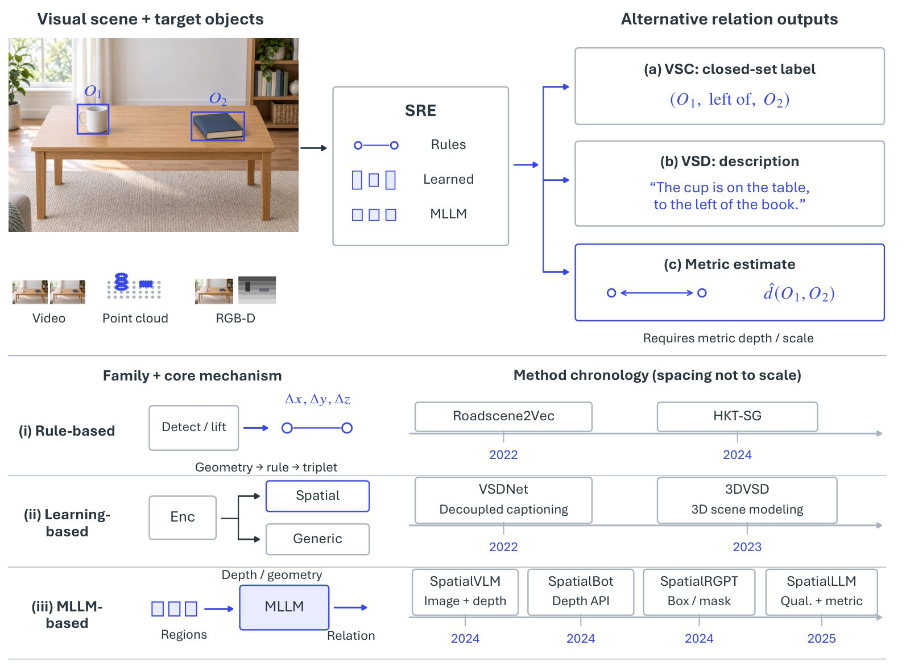
</p>
<p align="center"><sub><b>Figure 22.</b> Spatial relation extraction. Top: given a visual scene (image, video, point cloud, or RGB-D) and two target objects (<i>O</i><sub>1</sub>, <i>O</i><sub>2</sub>), predict (a) a closed-set relation label (VSC), (b) a free-form description (VSD), or (c) a quantitative metric estimate.</sub></p>

**2025**

- [**A Spatial Relationship Aware Dataset for Robotics**](https://arxiv.org/abs/2506.12525) [](https://arxiv.org/abs/2506.12525) [](https://github.com/PengPaulWang/SpatialAwareRobotDataset) <!-- 25 -->
- [**Boosting Road Event Detection with Adaptive Multi-Modal Models**](https://doi.org/10.1109/ICME59968.2025.11210207) [](https://doi.org/10.1109/ICME59968.2025.11210207) <!-- 25 -->
- [**Edge Feature-Enhanced Network for Collision Risk Assessment Using Traffic Scene Graphs**](https://doi.org/10.1109/MITS.2024.3458393) [](https://doi.org/10.1109/MITS.2024.3458393) <!-- 25 -->
- [**SpatialLLM: A Compound 3D-Informed Design towards Spatially-Intelligent Large Multimodal Models**](https://arxiv.org/abs/2505.00788) [](https://arxiv.org/abs/2505.00788) <!-- 25 -->

**2024**

- [**LLaVA-SpaceSGG: Visual Instruct Tuning for Open-Vocabulary Scene Graph Generation with Enhanced Spatial Relations**](https://arxiv.org/abs/2412.06322) [](https://arxiv.org/abs/2412.06322) [](https://github.com/Endlinc/LLaVA-SpaceSGG) <!-- 12-24 -->
- [**SpatialBot: Precise Spatial Understanding with Vision Language Models**](https://arxiv.org/abs/2406.13642) [](https://arxiv.org/abs/2406.13642) [](https://github.com/BAAI-DCAI/SpatialBot) <!-- 06-24 -->
- [**SpatialRGPT: Grounded Spatial Reasoning in Vision-Language Models**](https://arxiv.org/abs/2406.01584) [](https://arxiv.org/abs/2406.01584) <!-- 24 -->
- [**SpatialVLM: Endowing Vision-Language Models with Spatial Reasoning Capabilities**](https://arxiv.org/abs/2401.12168) [](https://arxiv.org/abs/2401.12168) <!-- 24 -->

**2023**

- [**Generating Visual Spatial Description via Holistic 3D Scene Understanding**](https://arxiv.org/abs/2305.11768) [](https://arxiv.org/abs/2305.11768) [](https://github.com/zhaoyucs/VSD) <!-- 23 -->

**2022**

- [**Visual Spatial Description: Controlled Spatial-Oriented Image-to-Text Generation**](https://arxiv.org/abs/2210.11109) [](https://arxiv.org/abs/2210.11109) [](https://github.com/zhaoyucs/VSD) <!-- 22 -->

**2021**

- [**roadscene2vec: A tool for extracting and embedding road scene-graphs**](https://arxiv.org/abs/2109.01183) [](https://arxiv.org/abs/2109.01183) [](https://github.com/AICPS/roadscene2vec) <!-- 09-21 -->

**Before 2020**

- [**SpatialSense: An Adversarially Crowdsourced Benchmark for Spatial Relation Recognition**](https://arxiv.org/abs/1908.02660) [](https://arxiv.org/abs/1908.02660) [](https://github.com/princeton-vl/SpatialSense) <!-- 19 -->

#### 6.3.2. Scene Graph Generation
<p align="center">
  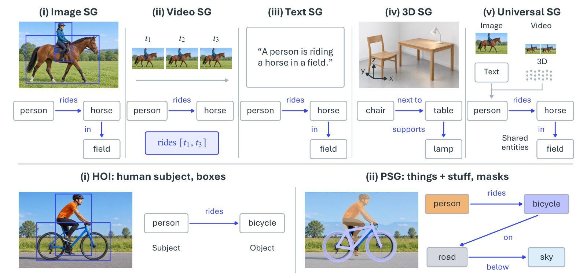
</p>
<p align="center"><sub><b>Figure 23.</b> Scene graph generation by input modality (top) and sub-task setting (bottom).</sub></p>

**2025**

- [**DiscoSG: Towards Discourse-Level Text Scene Graph Parsing through Iterative Graph Refinement**](https://arxiv.org/abs/2506.15583) [](https://arxiv.org/abs/2506.15583) [](https://github.com/ShaoqLin/DiscoSG) <!-- 25 -->
- [**EgoExOR: An Ego-Exo-Centric Operating Room Dataset for Surgical Activity Understanding**](https://arxiv.org/abs/2505.24287) [](https://arxiv.org/abs/2505.24287) [](https://github.com/ardamamur/EgoExOR) <!-- 25 -->
- [**Generating Actionable Robot Knowledge Bases by Combining 3D Scene Graphs with Robot Ontologies**](https://arxiv.org/abs/2507.11770) [](https://arxiv.org/abs/2507.11770) <!-- 25 -->
- [**LLM Meets Scene Graph: Can Large Language Models Understand and Generate Scene Graphs? A Benchmark and Empirical Study**](https://arxiv.org/abs/2505.19510) [](https://arxiv.org/abs/2505.19510) [](https://github.com/docworlds/tsg-bench) <!-- 25 -->
- [**MM-OR: A Large Multimodal Operating Room Dataset for Semantic Understanding of High-Intensity Surgical Environments**](https://arxiv.org/abs/2503.02579) [](https://arxiv.org/abs/2503.02579) [](https://github.com/egeozsoy/MM-OR) <!-- 25 -->
- [**STAR: A First-Ever Dataset and a Large-Scale Benchmark for Scene Graph Generation in Large-Size Satellite Imagery**](https://doi.org/10.1109/TPAMI.2024.3508072) [](https://doi.org/10.1109/TPAMI.2024.3508072) [](https://github.com/VisionXLab/STAR-MMRotate) <!-- 25 -->
- [**Universal Scene Graph Generation**](https://arxiv.org/abs/2503.15005) [](https://arxiv.org/abs/2503.15005) <!-- 25 -->

**2024**

- [**EGTR: Extracting Graph from Transformer for Scene Graph Generation**](https://arxiv.org/abs/2404.02072) [](https://arxiv.org/abs/2404.02072) [](https://github.com/naver-ai/egtr) <!-- 24 -->
- [**Hierarchical Home Action Understanding with Implicit and Explicit Prior Knowledge**](https://doi.org/10.1109/ICASSP48485.2024.10445997) [](https://doi.org/10.1109/ICASSP48485.2024.10445997) <!-- 24 -->
- [**Hierarchical Open-Vocabulary 3D Scene Graphs for Language-Grounded Robot Navigation**](https://arxiv.org/abs/2403.17846) [](https://arxiv.org/abs/2403.17846) <!-- 24 -->
- [**RoboHop: Segment-based Topological Map Representation for Open-World Visual Navigation**](https://arxiv.org/abs/2405.05792) [](https://arxiv.org/abs/2405.05792) <!-- 24 -->

**2023**

- [**FACTUAL: A Benchmark for Faithful and Consistent Textual Scene Graph Parsing**](https://arxiv.org/abs/2305.17497) [](https://arxiv.org/abs/2305.17497) [](https://github.com/zhuang-li/FactualSceneGraph) <!-- 23 -->
- [**Learning From Interaction-Enhanced Scene Graph for Pedestrian Collision Risk Assessment**](https://doi.org/10.1109/TIV.2023.3309274) [](https://doi.org/10.1109/TIV.2023.3309274) <!-- 23 -->
- [**Panoptic Video Scene Graph Generation**](https://arxiv.org/abs/2311.17058) [](https://arxiv.org/abs/2311.17058) [](https://github.com/LilyDaytoy/OpenPVSG) <!-- 23 -->

**2022**

- [**Panoptic Scene Graph Generation**](https://arxiv.org/abs/2207.11247) [](https://arxiv.org/abs/2207.11247) [](https://github.com/Jingkang50/OpenPSG) <!-- 22 -->
- [**Toward Driving Scene Understanding: A Paradigm and Benchmark Dataset for Ego-Centric Traffic Scene Graph Representation**](https://doi.org/10.1109/jrfid.2022.3207017) [](https://doi.org/10.1109/jrfid.2022.3207017) <!-- 22 -->

**2021**

- [**Bipartite Graph Network With Adaptive Message Passing for Unbiased Scene Graph Generation**](https://arxiv.org/abs/2104.00308) [](https://arxiv.org/abs/2104.00308) [](https://github.com/Scarecrow0/BGNN-SGG) <!-- 21 -->
- [**SceneGraphFusion: Incremental 3D Scene Graph Prediction From RGB-D Sequences**](https://arxiv.org/abs/2103.14898) [](https://arxiv.org/abs/2103.14898) [](https://github.com/ShunChengWu/SceneGraphFusion) <!-- 21 -->
- [**Spatial-Temporal Transformer for Dynamic Scene Graph Generation**](https://arxiv.org/abs/2107.12309) [](https://arxiv.org/abs/2107.12309) [](https://github.com/yrcong/STTran) <!-- 21 -->
- [**Target Adaptive Context Aggregation for Video Scene Graph Generation**](https://arxiv.org/abs/2108.08121) [](https://arxiv.org/abs/2108.08121) [](https://github.com/MCG-NJU/TRACE) <!-- 21 -->

**2020**

- [**Learning 3D Semantic Scene Graphs From 3D Indoor Reconstructions**](https://arxiv.org/abs/2004.03967) [](https://arxiv.org/abs/2004.03967) <!-- 20 -->

**Before 2020**

- [**Neural Motifs: Scene Graph Parsing With Global Context**](https://arxiv.org/abs/1711.06640) [](https://arxiv.org/abs/1711.06640) [](https://github.com/rowanz/neural-motifs) <!-- 11-17 -->
- [**Image retrieval using scene graphs**](https://doi.org/10.1109/CVPR.2015.7298990) [](https://doi.org/10.1109/CVPR.2015.7298990) <!-- 15 -->

#### 6.3.3. Layout Estimation and Room Parsing
<p align="center">
  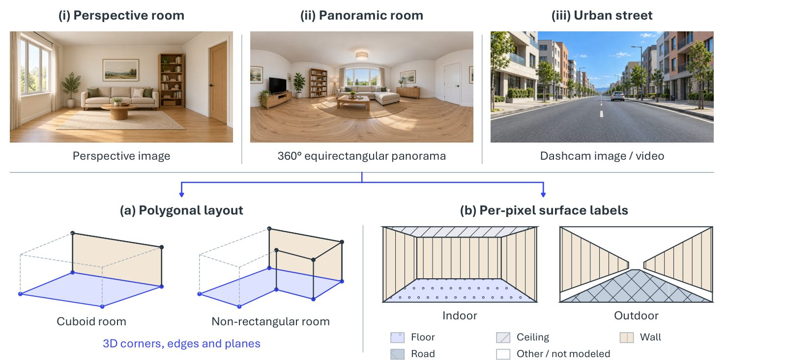
</p>
<p align="center"><sub><b>Figure 24.</b> Inputs and output representations of structural layout estimation.</sub></p>

**2021**

- [**LED2-Net: Monocular 360deg Layout Estimation via Differentiable Depth Rendering**](https://arxiv.org/abs/2104.00568) [](https://arxiv.org/abs/2104.00568) [](https://github.com/fuenwang/LED2-Net) <!-- 21 -->
- [**Projecting Your View Attentively: Monocular Road Scene Layout Estimation via Cross-View Transformation**](https://openaccess.thecvf.com/content/CVPR2021/html/Yang_Projecting_Your_View_Attentively_Monocular_Road_Scene_Layout_Estimation_via_CVPR_2021_paper.html) [](https://openaccess.thecvf.com/content/CVPR2021/html/Yang_Projecting_Your_View_Attentively_Monocular_Road_Scene_Layout_Estimation_via_CVPR_2021_paper.html) [](https://github.com/JonDoe-297/cross-view) <!-- 21 -->

**2020**

- [**AtlantaNet: Inferring the 3D Indoor Layout from a Single $360^\circ $ Image Beyond the Manhattan World Assumption**](https://doi.org/10.1007/978-3-030-58598-3_26) [](https://doi.org/10.1007/978-3-030-58598-3_26) [](https://github.com/crs4/AtlantaNet) <!-- 20 -->
- [**GeoLayout: Geometry Driven Room Layout Estimation Based on Depth Maps of Planes**](https://arxiv.org/abs/2008.06286) [](https://arxiv.org/abs/2008.06286) <!-- 20 -->

**Before 2020**

- [**HorizonNet: Learning Room Layout With 1D Representation and Pano Stretch Data Augmentation**](https://arxiv.org/abs/1901.03861) [](https://arxiv.org/abs/1901.03861) [](https://github.com/sunset1995/HorizonNet) <!-- 19 -->
- [**LayoutNet: Reconstructing the 3D Room Layout From a Single RGB Image**](https://arxiv.org/abs/1803.08999) [](https://arxiv.org/abs/1803.08999) [](https://github.com/zouchuhang/LayoutNetv2) <!-- 18 -->
- [**Learning Informative Edge Maps for Indoor Scene Layout Prediction**](https://doi.org/10.1109/ICCV.2015.113) [](https://doi.org/10.1109/ICCV.2015.113) <!-- 15 -->
- [**Recovering the spatial layout of cluttered rooms**](https://doi.org/10.1109/ICCV.2009.5459411) [](https://doi.org/10.1109/ICCV.2009.5459411) <!-- 09 -->

#### 6.3.4. Action Detection
<p align="center">
  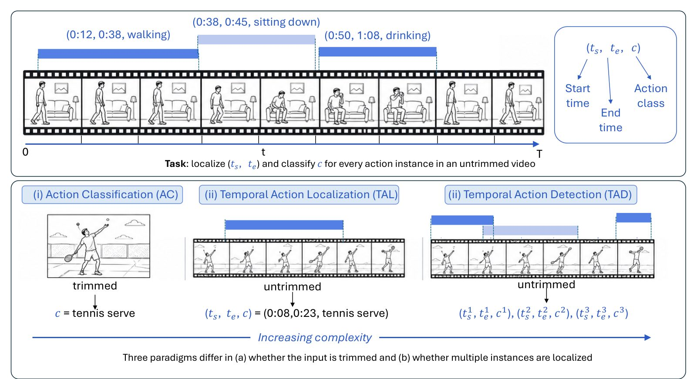
</p>
<p align="center"><sub><b>Figure 25.</b> Action detection: each action instance in an untrimmed video is localized to [<i>t</i><sub><i>s</i></sub>, <i>t</i><sub><i>e</i></sub>] and labeled with class <i>c</i> (top).</sub></p>

**2026**

- [**Synergistic audio-textual cues: A cross-modal framework for weakly-supervised temporal action localization**](https://doi.org/10.1016/j.patcog.2026.113526) [](https://doi.org/10.1016/j.patcog.2026.113526) <!-- 26 -->

**2025**

- [**Pose-Aware Weakly-Supervised Action Segmentation**](https://arxiv.org/abs/2504.05700) [](https://arxiv.org/abs/2504.05700) <!-- 25 -->

**2024**

- [**Exploiting VLM Localizability and Semantics for Open Vocabulary Action Detection**](https://arxiv.org/abs/2411.10922) [](https://arxiv.org/abs/2411.10922) [](https://github.com/Cogito2012/OpenMixer) <!-- 11-24 -->
- [**Dual DETRs for Multi-Label Temporal Action Detection**](https://arxiv.org/abs/2404.00653) [](https://arxiv.org/abs/2404.00653) <!-- 24 -->
- [**Learning from Observer Gaze: Zero-Shot Attention Prediction Oriented by Human-Object Interaction Recognition**](https://arxiv.org/abs/2405.09931) [](https://arxiv.org/abs/2405.09931) <!-- 24 -->
- [**Realigning Confidence with Temporal Saliency Information for Point-Level Weakly-Supervised Temporal Action Localization**](https://doi.org/10.1109/CVPR52733.2024.01745) [](https://doi.org/10.1109/CVPR52733.2024.01745) [](https://github.com/zyxia1009/CVPR2024-TSPNet) <!-- 24 -->

**2022**

- [**FineAction: A Fine-Grained Video Dataset for Temporal Action Localization**](https://doi.org/10.1109/TIP.2022.3217368) [](https://doi.org/10.1109/TIP.2022.3217368) [](https://github.com/Richard-61/FineAction) <!-- 22 -->
- [**ReAct: Temporal Action Detection with Relational Queries**](https://arxiv.org/abs/2207.07097) [](https://arxiv.org/abs/2207.07097) [](https://github.com/dingfengshi/ReAct) <!-- 22 -->

**2021**

- [**MoVi: A large multi-purpose human motion and video dataset**](https://doi.org/10.1371/journal.pone.0253157) [](https://doi.org/10.1371/journal.pone.0253157) [](https://github.com/saeed1262/MoVi-Toolbox) <!-- 06-21 -->
- [**CoLA: Weakly-Supervised Temporal Action Localization With Snippet Contrastive Learning**](https://arxiv.org/abs/2103.16392) [](https://arxiv.org/abs/2103.16392) [](https://github.com/zhang-can/CoLA) <!-- 21 -->
- [**Learning Salient Boundary Feature for Anchor-free Temporal Action Localization**](https://arxiv.org/abs/2103.13137) [](https://arxiv.org/abs/2103.13137) [](https://github.com/TencentYoutuResearch/ActionDetection-AFSD) <!-- 21 -->

**Before 2020**

- [**BSN: Boundary Sensitive Network for Temporal Action Proposal Generation**](https://arxiv.org/abs/1806.02964) [](https://arxiv.org/abs/1806.02964) [](https://github.com/wzmsltw/BSN-boundary-sensitive-network.pytorch) <!-- 18 -->
- [**A Closer Look at Spatiotemporal Convolutions for Action Recognition**](https://arxiv.org/abs/1711.11248) [](https://arxiv.org/abs/1711.11248) [](https://github.com/facebookresearch/VMZ) <!-- 11-17 -->
- [**Temporal Segment Networks: Towards Good Practices for Deep Action Recognition**](https://arxiv.org/abs/1608.00859) [](https://arxiv.org/abs/1608.00859) [](https://github.com/yjxiong/temporal-segment-networks) <!-- 16 -->
- [**ActivityNet: A large-scale video benchmark for human activity understanding**](https://doi.org/10.1109/CVPR.2015.7298698) [](https://doi.org/10.1109/CVPR.2015.7298698) <!-- 15 -->
- [**Every Moment Counts: Dense Detailed Labeling of Actions in Complex Videos**](https://arxiv.org/abs/1507.05738) [](https://arxiv.org/abs/1507.05738) <!-- 07-15 -->
- [**Two-Stream Convolutional Networks for Action Recognition in Videos**](https://arxiv.org/abs/1406.2199) [](https://arxiv.org/abs/1406.2199) [](https://github.com/feichtenhofer/twostreamfusion) <!-- 14 -->

#### 6.3.5. Mapping and SLAM
<p align="center">
  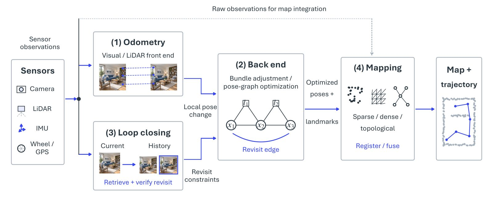
</p>
<p align="center"><sub><b>Figure 26.</b> SLAM module data flow. Sensor observations feed odometry and place recognition; odometry constraints and verified revisit constraints enter back-end optimization.</sub></p>

**2025**

- [**CU-Multi: A Dataset for Multi-Robot Data Association**](https://arxiv.org/abs/2505.17576) [](https://arxiv.org/abs/2505.17576) <!-- 05-25 -->
- [**AirSwarm: Enabling Cost-Effective Multi-UAV Research with COTS drones**](https://arxiv.org/abs/2503.06890) [](https://arxiv.org/abs/2503.06890) [](https://github.com/vvEverett/tello_ros) <!-- 25 -->
- [**KISS-SLAM: A Simple, Robust, and Accurate 3D LiDAR SLAM System With Enhanced Generalization Capabilities**](https://arxiv.org/abs/2503.12660) [](https://arxiv.org/abs/2503.12660) <!-- 25 -->

**2024**

- [**MASt3R-SLAM: Real-Time Dense SLAM with 3D Reconstruction Priors**](https://arxiv.org/abs/2412.12392) [](https://arxiv.org/abs/2412.12392) [](https://github.com/rmurai0610/MASt3R-SLAM) <!-- 12-24 -->
- [**Grounding Image Matching in 3D with MASt3R**](https://arxiv.org/abs/2406.09756) [](https://arxiv.org/abs/2406.09756) [](https://github.com/naver/mast3r) <!-- 24 -->

**2023**

- [**DUSt3R: Geometric 3D Vision Made Easy**](https://arxiv.org/abs/2312.14132) [](https://arxiv.org/abs/2312.14132) [](https://github.com/naver/dust3r) <!-- 12-23 -->
- [**SplaTAM: Splat, Track & Map 3D Gaussians for Dense RGB-D SLAM**](https://arxiv.org/abs/2312.02126) [](https://arxiv.org/abs/2312.02126) [](https://github.com/spla-tam/SplaTAM) <!-- 12-23 -->

**2021**

- [**NICE-SLAM: Neural Implicit Scalable Encoding for SLAM**](https://arxiv.org/abs/2112.12130) [](https://arxiv.org/abs/2112.12130) [](https://github.com/cvg/nice-slam) <!-- 12-21 -->

**Before 2020**

- [**SuperGlue: Learning Feature Matching With Graph Neural Networks**](https://arxiv.org/abs/1911.11763) [](https://arxiv.org/abs/1911.11763) [](https://github.com/magicleap/SuperGluePretrainedNetwork) <!-- 11-19 -->
- [**SuperPoint: Self-Supervised Interest Point Detection and Description**](https://arxiv.org/abs/1712.07629) [](https://arxiv.org/abs/1712.07629) [](https://github.com/magicleap/SuperPointPretrainedNetwork) <!-- 12-17 -->

### 6.4. Spatio-Temporal Perception
#### 6.4.1. Scene Flow Estimation
<p align="center">
  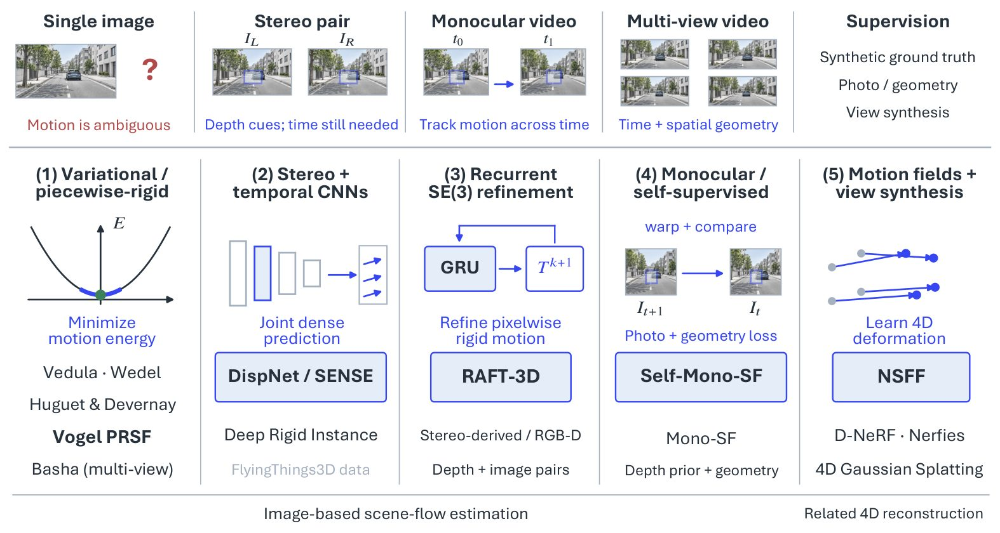
</p>
<p align="center"><sub><b>Figure 27.</b> Image- and video-based scene flow. Top row: observation settings and supervision signals.</sub></p>

**2023**

- [**4D Gaussian Splatting for Real-Time Dynamic Scene Rendering**](https://arxiv.org/abs/2310.08528) [](https://arxiv.org/abs/2310.08528) [](https://github.com/hustvl/4DGaussians) <!-- 10-23 -->
- [**DINOv2: Learning Robust Visual Features without Supervision**](https://arxiv.org/abs/2304.07193) [](https://arxiv.org/abs/2304.07193) [](https://github.com/facebookresearch/dinov2) <!-- 04-23 -->

**2020**

- [**RAFT-3D: Scene Flow Using Rigid-Motion Embeddings**](https://arxiv.org/abs/2012.00726) [](https://arxiv.org/abs/2012.00726) [](https://github.com/princeton-vl/RAFT-3D) <!-- 12-20 -->
- [**D-NeRF: Neural Radiance Fields for Dynamic Scenes**](https://arxiv.org/abs/2011.13961) [](https://arxiv.org/abs/2011.13961) <!-- 11-20 -->
- [**Nerfies: Deformable Neural Radiance Fields**](https://arxiv.org/abs/2011.12948) [](https://arxiv.org/abs/2011.12948) [](https://github.com/google/nerfies) <!-- 11-20 -->
- [**Neural Scene Flow Fields for Space-Time View Synthesis of Dynamic Scenes**](https://arxiv.org/abs/2011.13084) [](https://arxiv.org/abs/2011.13084) <!-- 11-20 -->

**Before 2020**

- [**SENSE: A Shared Encoder Network for Scene-Flow Estimation**](https://arxiv.org/abs/1910.12361) [](https://arxiv.org/abs/1910.12361) [](https://github.com/NVlabs/SENSE) <!-- 19 -->
- [**3D Scene Flow Estimation with a Piecewise Rigid Scene Model**](https://doi.org/10.1007/s11263-015-0806-0) [](https://doi.org/10.1007/s11263-015-0806-0) <!-- 15 -->

#### 6.4.2. Object Tracking
<p align="center">
  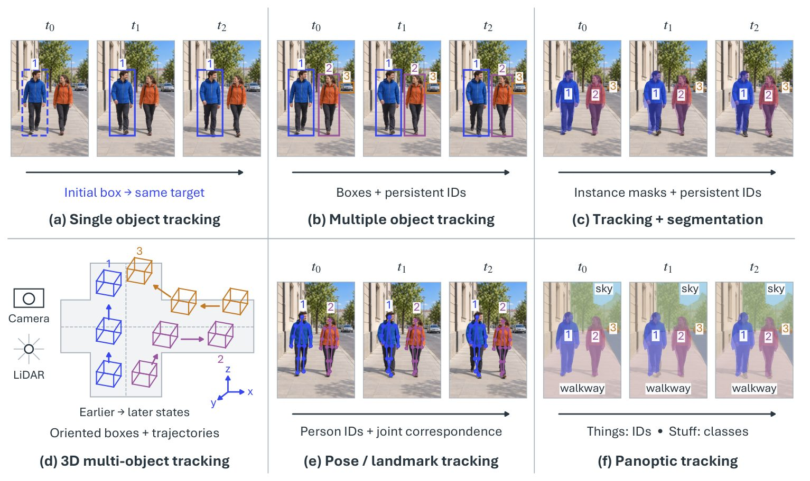
</p>
<p align="center"><sub><b>Figure 28.</b> Object-tracking subtasks: (a) single object tracking (SOT) from an initial box, (b) multiple object tracking (MOT) with identity-consistent boxes, (c) multiple object tracking and segmentation (MOTS) with per-frame masks, (d) 3D multi-object tracking (3D-MOT) of oriented boxes from LiDAR or camera input, (e) pose and landmark tracking, and (f) panoptic tracking with semantic classes for stuff and persistent instance IDs for things.</sub></p>

**2025**

- [**UASTrack: A Unified Adaptive Selection Framework with Modality-Customization in Single Object Tracking**](https://arxiv.org/abs/2502.18220) [](https://arxiv.org/abs/2502.18220) <!-- 02-25 -->

**2024**

- [**SAM 2: Segment Anything in Images and Videos**](https://arxiv.org/abs/2408.00714) [](https://arxiv.org/abs/2408.00714) [](https://github.com/facebookresearch/sam2) <!-- 08-24 -->
- [**LaMOT: Language-Guided Multi-Object Tracking**](https://arxiv.org/abs/2406.08324) [](https://arxiv.org/abs/2406.08324) [](https://github.com/Nathan-Li123/LaMOT) <!-- 06-24 -->
- [**OneTracker: Unifying Visual Object Tracking with Foundation Models and Efficient Tuning**](https://arxiv.org/abs/2403.09634) [](https://arxiv.org/abs/2403.09634) <!-- 24 -->
- [**UniVS: Unified and Universal Video Segmentation with Prompts as Queries**](https://arxiv.org/abs/2402.18115) [](https://arxiv.org/abs/2402.18115) [](https://github.com/MinghanLi/UniVS) <!-- 24 -->

**2023**

- [**Single-Model and Any-Modality for Video Object Tracking**](https://arxiv.org/abs/2311.15851) [](https://arxiv.org/abs/2311.15851) [](https://github.com/Zongwei97/UnTrack) <!-- 11-23 -->
- [**Segment Anything**](https://arxiv.org/abs/2304.02643) [](https://arxiv.org/abs/2304.02643) [](https://github.com/facebookresearch/segment-anything) <!-- 23 -->

**2022**

- [**Decoupling Features in Hierarchical Propagation for Video Object Segmentation**](https://arxiv.org/abs/2210.09782) [](https://arxiv.org/abs/2210.09782) [](https://github.com/z-x-yang/AOT) <!-- 22 -->
- [**Joint Feature Learning and Relation Modeling for Tracking: A One-Stream Framework**](https://arxiv.org/abs/2203.11991) [](https://arxiv.org/abs/2203.11991) [](https://github.com/botaoye/OSTrack) <!-- 22 -->
- [**Towards Grand Unification of Object Tracking**](https://arxiv.org/abs/2207.07078) [](https://arxiv.org/abs/2207.07078) [](https://github.com/MasterBin-IIAU/Unicorn) <!-- 22 -->
- [**Unified Transformer Tracker for Object Tracking**](https://arxiv.org/abs/2203.15175) [](https://arxiv.org/abs/2203.15175) [](https://github.com/Flowerfan/Trackron) <!-- 22 -->
- [**XMem: Long-Term Video Object Segmentation with an Atkinson-Shiffrin Memory Model**](https://arxiv.org/abs/2207.07115) [](https://arxiv.org/abs/2207.07115) [](https://github.com/hkchengrex/XMem) <!-- 22 -->

**2021**

- [**DanceTrack: Multi-Object Tracking in Uniform Appearance and Diverse Motion**](https://arxiv.org/abs/2111.14690) [](https://arxiv.org/abs/2111.14690) [](https://github.com/DanceTrack/DanceTrack) <!-- 11-21 -->
- [**ByteTrack: Multi-object Tracking by Associating Every Detection Box**](https://arxiv.org/abs/2110.06864) [](https://arxiv.org/abs/2110.06864) [](https://github.com/FoundationVision/ByteTrack) <!-- 10-21 -->
- [**MOTR: End-to-End Multiple-Object Tracking with Transformer**](https://arxiv.org/abs/2105.03247) [](https://arxiv.org/abs/2105.03247) [](https://github.com/megvii-research/MOTR) <!-- 05-21 -->
- [**TrackFormer: Multi-Object Tracking with Transformers**](https://arxiv.org/abs/2101.02702) [](https://arxiv.org/abs/2101.02702) [](https://github.com/timmeinhardt/trackformer) <!-- 01-21 -->
- [**Do Different Tracking Tasks Require Different Appearance Models?**](https://arxiv.org/abs/2107.02156) [](https://arxiv.org/abs/2107.02156) [](https://github.com/Zhongdao/UniTrack) <!-- 21 -->
- [**FairMOT: On the Fairness of Detection and Re-identification in Multiple Object Tracking**](https://doi.org/10.1007/s11263-021-01513-4) [](https://doi.org/10.1007/s11263-021-01513-4) [](https://github.com/ifzhang/FairMOT) <!-- 21 -->
- [**Learning Spatio-Temporal Transformer for Visual Tracking**](https://arxiv.org/abs/2103.17154) [](https://arxiv.org/abs/2103.17154) [](https://github.com/researchmm/Stark) <!-- 21 -->
- [**Towards More Flexible and Accurate Object Tracking With Natural Language: Algorithms and Benchmark**](https://arxiv.org/abs/2103.16746) [](https://arxiv.org/abs/2103.16746) [](https://github.com/wangxiao5791509/TNL2K_evaluation_toolkit) <!-- 21 -->
- [**Transformer Tracking**](https://arxiv.org/abs/2103.15436) [](https://arxiv.org/abs/2103.15436) [](https://github.com/chenxin-dlut/TransT) <!-- 21 -->

**2020**

- [**Center-Based 3D Object Detection and Tracking**](https://arxiv.org/abs/2006.11275) [](https://arxiv.org/abs/2006.11275) [](https://github.com/tianweiy/CenterPoint) <!-- 06-20 -->
- [**RoboTHOR: An Open Simulation-to-Real Embodied AI Platform**](https://arxiv.org/abs/2004.06799) [](https://arxiv.org/abs/2004.06799) [](https://github.com/allenai/ai2thor) <!-- 20 -->
- [**Tracking Objects as Points**](https://arxiv.org/abs/2004.01177) [](https://arxiv.org/abs/2004.01177) [](https://github.com/xingyizhou/CenterTrack) <!-- 20 -->

**Before 2020**

- [**Learning Discriminative Model Prediction for Tracking**](https://arxiv.org/abs/1904.07220) [](https://arxiv.org/abs/1904.07220) [](https://github.com/visionml/pytracking) <!-- 19 -->
- [**Scalability in Perception for Autonomous Driving: Waymo Open Dataset**](https://arxiv.org/abs/1912.04838) [](https://arxiv.org/abs/1912.04838) <!-- 12-19 -->
- [**LaSOT: A High-Quality Benchmark for Large-Scale Single Object Tracking**](https://arxiv.org/abs/1809.07845) [](https://arxiv.org/abs/1809.07845) <!-- 09-18 -->

#### 6.4.3. Temporal Localization
<p align="center">
  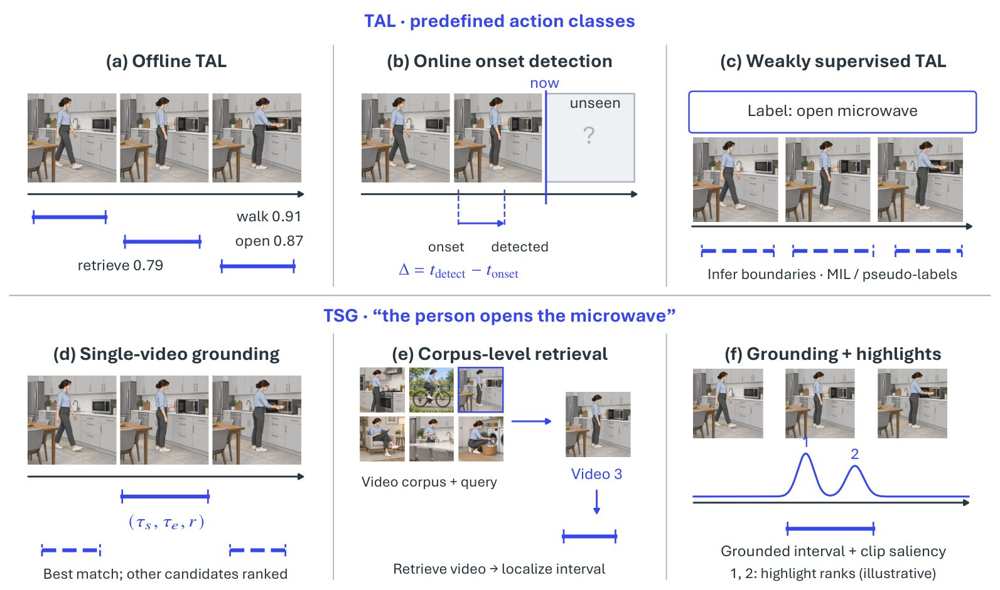
</p>
<p align="center"><sub><b>Figure 29.</b> Six settings of temporal localization. Top row (TAL): (a) offline detection of <i>K</i> classes; (b) online detection of action starts; (c) weakly supervised training from video-level labels.</sub></p>

**2024**

- [**TE-TAD: Towards Full End-to-End Temporal Action Detection via Time-Aligned Coordinate Expression**](https://arxiv.org/abs/2404.02405) [](https://arxiv.org/abs/2404.02405) [](https://github.com/Dotori-HJ/TE-TAD) <!-- 24 -->
- [**Test-Time Zero-Shot Temporal Action Localization**](https://arxiv.org/abs/2404.05426) [](https://arxiv.org/abs/2404.05426) [](https://github.com/benedettaliberatori/T3AL) <!-- 24 -->

**2023**

- [**TriDet: Temporal Action Detection with Relative Boundary Modeling**](https://arxiv.org/abs/2303.07347) [](https://arxiv.org/abs/2303.07347) [](https://github.com/dingfengshi/TriDet) <!-- 23 -->
- [**VideoMAE V2: Scaling Video Masked Autoencoders with Dual Masking**](https://arxiv.org/abs/2303.16727) [](https://arxiv.org/abs/2303.16727) [](https://github.com/OpenGVLab/VideoMAEv2) <!-- 23 -->

**2022**

- [**AxIoU: An Axiomatically Justified Measure for Video Moment Retrieval**](https://arxiv.org/abs/2203.16062) [](https://arxiv.org/abs/2203.16062) <!-- 22 -->
- [**VideoMAE: Masked Autoencoders are Data-Efficient Learners for Self-Supervised Video Pre-Training**](https://arxiv.org/abs/2203.12602) [](https://arxiv.org/abs/2203.12602) [](https://github.com/MCG-NJU/VideoMAE) <!-- 22 -->

**2021**

- [**QVHighlights: Detecting Moments and Highlights in Videos via Natural Language Queries**](https://arxiv.org/abs/2107.09609) [](https://arxiv.org/abs/2107.09609) <!-- 07-21 -->
- [**Detecting Moments and Highlights in Videos via Natural Language Queries**](https://arxiv.org/abs/2107.09609) [](https://arxiv.org/abs/2107.09609) [](https://github.com/jayleicn/moment_detr) <!-- 21 -->

**2020**

- [**TVR: A Large-Scale Dataset for Video-Subtitle Moment Retrieval**](https://arxiv.org/abs/2001.09099) [](https://arxiv.org/abs/2001.09099) [](https://github.com/jayleicn/TVCaption) <!-- 20 -->

**Before 2020**

- [**Localizing Moments in Video with Natural Language**](https://arxiv.org/abs/1708.01641) [](https://arxiv.org/abs/1708.01641) <!-- 17 -->
- [**TALL: Temporal Activity Localization via Language Query**](https://arxiv.org/abs/1705.02101) [](https://arxiv.org/abs/1705.02101) [](https://github.com/jiyanggao/TALL) <!-- 17 -->

### 6.5. Multimodal Spatial Perception
#### 6.5.1. Audio-Visual Spatial Localization
<p align="center">
  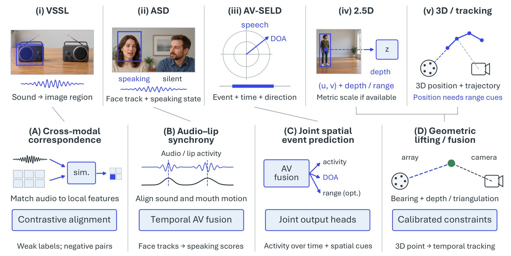
</p>
<p align="center"><sub><b>Figure 30.</b> Audio-visual spatial localization. Top: task outputs for (i) VSSL, (ii) ASD, (iii) AV-SELD, (iv) 2.5D localization, and (v) 3D localization and tracking.</sub></p>

**2023**

- [**STARSS23: An Audio-Visual Dataset of Spatial Recordings of Real Scenes with Spatiotemporal Annotations of Sound Events**](https://arxiv.org/abs/2306.09126) [](https://arxiv.org/abs/2306.09126) [](https://github.com/sony/audio-visual-seld-dcase2023) <!-- 23 -->

**2022**

- [**A Closer Look at Weakly-Supervised Audio-Visual Source Localization**](https://arxiv.org/abs/2209.09634) [](https://arxiv.org/abs/2209.09634) [](https://github.com/stoneMo/SLAVC) <!-- 22 -->

**2021**

- [**How to Design a Three-Stage Architecture for Audio-Visual Active Speaker Detection in the Wild**](https://arxiv.org/abs/2106.03932) [](https://arxiv.org/abs/2106.03932) [](https://github.com/okankop/ASDNet) <!-- 21 -->
- [**Is Someone Speaking?: Exploring Long-term Temporal Features for Audio-visual Active Speaker Detection**](https://arxiv.org/abs/2107.06592) [](https://arxiv.org/abs/2107.06592) [](https://github.com/TaoRuijie/TalkNet-ASD) <!-- 21 -->
- [**Localizing Visual Sounds the Hard Way**](https://arxiv.org/abs/2104.02691) [](https://arxiv.org/abs/2104.02691) <!-- 21 -->

**2020**

- [**Multiple Sound Sources Localization from Coarse to Fine**](https://arxiv.org/abs/2007.06355) [](https://arxiv.org/abs/2007.06355) [](https://github.com/shvdiwnkozbw/Multi-Source-Sound-Localization) <!-- 20 -->
- [**SoundSpaces: Audio-Visual Navigation in 3D Environments**](https://doi.org/10.1007/978-3-030-58539-6_2) [](https://doi.org/10.1007/978-3-030-58539-6_2) [](https://github.com/facebookresearch/sound-spaces) <!-- 20 -->
- [**VisualEchoes: Spatial Image Representation Learning Through Echolocation**](https://arxiv.org/abs/2005.01616) [](https://arxiv.org/abs/2005.01616) <!-- 20 -->

#### 6.5.2. Vision-Language Grounding
<p align="center">
  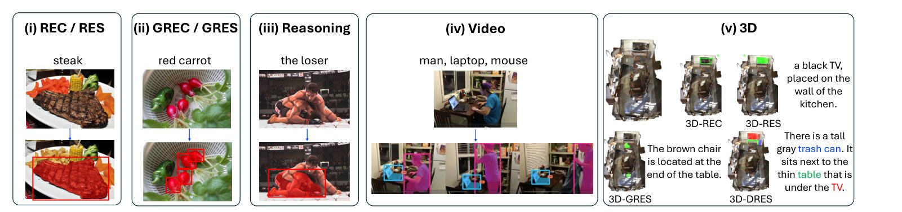
</p>
<p align="center"><sub><b>Figure 31.</b> Vision-language grounding task variants: (i) REC / RES; (ii) generalized REC / RES with zero, one, or multiple targets; (iii) reasoning grounding; (iv) video referring and reasoning grounding; (v) 3D and embodied grounding.</sub></p>

**2026**

- [**Image Generators are Generalist Vision Learners**](https://arxiv.org/abs/2604.20329) [](https://arxiv.org/abs/2604.20329) <!-- 04-26 -->
- [**Moondream Segmentation: From Words to Masks**](https://arxiv.org/abs/2604.02593) [](https://arxiv.org/abs/2604.02593) <!-- 04-26 -->
- [**3D-DRES: Detailed 3D Referring Expression Segmentation**](https://arxiv.org/abs/2603.02896) [](https://arxiv.org/abs/2603.02896) <!-- 26 -->
- [**Ref-Adv: Exploring MLLM Visual Reasoning in Referring Expression Tasks**](https://arxiv.org/abs/2602.23898) [](https://arxiv.org/abs/2602.23898) [](https://github.com/dddraxxx/Ref-Adv) <!-- 26 -->

**2025**

- [**GroundingME: Exposing the Visual Grounding Gap in MLLMs through Multi-Dimensional Evaluation**](https://arxiv.org/abs/2512.17495) [](https://arxiv.org/abs/2512.17495) [](https://github.com/lirang04/GroundingME) <!-- 12-25 -->
- [**SAM 3: Segment Anything with Concepts**](https://arxiv.org/abs/2511.16719) [](https://arxiv.org/abs/2511.16719) [](https://github.com/facebookresearch/sam3) <!-- 11-25 -->
- [**Dr.V : A Hierarchical Perception-Temporal-Cognition Framework to Diagnose Video Hallucination by Fine-Grained Spatial-Temporal Grounding**](https://arxiv.org/abs/2509.11866) [](https://arxiv.org/abs/2509.11866) [](https://github.com/Eurekaleo/Dr.V) <!-- 09-25 -->
- [**DeepEyes: Incentivizing "Thinking with Images" via Reinforcement Learning**](https://arxiv.org/abs/2505.14362) [](https://arxiv.org/abs/2505.14362) [](https://github.com/Visual-Agent/DeepEyes) <!-- 05-25 -->
- [**Seed1.5-VL Technical Report**](https://arxiv.org/abs/2505.07062) [](https://arxiv.org/abs/2505.07062) [](https://github.com/ByteDance-Seed/Seed1.5-VL) <!-- 05-25 -->
- [**InternVL3: Exploring Advanced Training and Test-Time Recipes for Open-Source Multimodal Models**](https://arxiv.org/abs/2504.10479) [](https://arxiv.org/abs/2504.10479) [](https://github.com/OpenGVLab/InternVL) <!-- 04-25 -->
- [**Qwen2.5-VL Technical Report**](https://arxiv.org/abs/2502.13923) [](https://arxiv.org/abs/2502.13923) [](https://github.com/QwenLM/Qwen3-VL) <!-- 02-25 -->
- [**Sa2VA: Marrying SAM2 with MLLM for Dense Grounded Understanding of Images and Videos**](https://arxiv.org/abs/2501.04001) [](https://arxiv.org/abs/2501.04001) [](https://github.com/bytedance/Sa2VA) <!-- 01-25 -->
- [**Decoupled Motion Expression Video Segmentation**](https://openaccess.thecvf.com/content/CVPR2025/html/Fang_Decoupled_Motion_Expression_Video_Segmentation_CVPR_2025_paper.html) [](https://openaccess.thecvf.com/content/CVPR2025/html/Fang_Decoupled_Motion_Expression_Video_Segmentation_CVPR_2025_paper.html) <!-- 25 -->
- [**MMR: A Large-scale Benchmark Dataset for Multi-target and Multi-granularity Reasoning Segmentation**](https://arxiv.org/abs/2503.13881) [](https://arxiv.org/abs/2503.13881) [](https://github.com/jdg900/MMR) <!-- 25 -->
- [**Refer to Any Segmentation Mask Group with Vision-Language Prompts**](https://doi.org/10.1109/ICCV51701.2025.02029) [](https://doi.org/10.1109/ICCV51701.2025.02029) <!-- 25 -->
- [**SegAgent: Exploring Pixel Understanding Capabilities in MLLMs by Imitating Human Annotator Trajectories**](https://arxiv.org/abs/2503.08625) [](https://arxiv.org/abs/2503.08625) [](https://github.com/aim-uofa/SegAgent) <!-- 25 -->

**2024**

- [**Expanding Performance Boundaries of Open-Source Multimodal Models with Model, Data, and Test-Time Scaling**](https://arxiv.org/abs/2412.05271) [](https://arxiv.org/abs/2412.05271) [](https://github.com/OpenGVLab/InternVL) <!-- 12-24 -->
- [**ReferevErything: Towards Segmenting Everything we can Speak of in Videos**](https://arxiv.org/abs/2410.23287) [](https://arxiv.org/abs/2410.23287) <!-- 10-24 -->
- [**Revisiting Referring Expression Comprehension Evaluation in the Era of Large Multimodal Models**](https://arxiv.org/abs/2406.16866) [](https://arxiv.org/abs/2406.16866) [](https://github.com/JierunChen/Ref-L4) <!-- 06-24 -->
- [**Grounded SAM: Assembling Open-World Models for Diverse Visual Tasks**](https://arxiv.org/abs/2401.14159) [](https://arxiv.org/abs/2401.14159) [](https://github.com/IDEA-Research/Grounded-Segment-Anything) <!-- 01-24 -->
- [**3D-VLA: A 3D Vision-Language-Action Generative World Model**](https://arxiv.org/abs/2403.09631) [](https://arxiv.org/abs/2403.09631) <!-- 24 -->
- [**VISA: Reasoning Video Object Segmentation via Large Language Models**](https://arxiv.org/abs/2407.11325) [](https://arxiv.org/abs/2407.11325) [](https://github.com/cilinyan/VISA) <!-- 24 -->

**2023**

- [**Florence-2: Advancing a Unified Representation for a Variety of Vision Tasks**](https://arxiv.org/abs/2311.06242) [](https://arxiv.org/abs/2311.06242) [](https://github.com/retkowsky/florence-2) <!-- 11-23 -->
- [**Ferret: Refer and Ground Anything Anywhere at Any Granularity**](https://arxiv.org/abs/2310.07704) [](https://arxiv.org/abs/2310.07704) [](https://github.com/apple-aiml-research/ml-ferret) <!-- 10-23 -->
- [**LISA: Reasoning Segmentation via Large Language Model**](https://arxiv.org/abs/2308.00692) [](https://arxiv.org/abs/2308.00692) [](https://github.com/JIA-Lab-research/LISA) <!-- 08-23 -->
- [**Grounding DINO: Marrying DINO with Grounded Pre-training for Open-Set Object Detection**](https://arxiv.org/abs/2303.05499) [](https://arxiv.org/abs/2303.05499) [](https://github.com/IDEA-Research/GroundingDINO) <!-- 03-23 -->
- [**Beyond One-to-One: Rethinking the Referring Image Segmentation**](https://arxiv.org/abs/2308.13853) [](https://arxiv.org/abs/2308.13853) [](https://github.com/toggle1995/RIS-DMMI) <!-- 23 -->
- [**GRES: Generalized Referring Expression Segmentation**](https://arxiv.org/abs/2306.00968) [](https://arxiv.org/abs/2306.00968) [](https://github.com/henghuiding/ReLA) <!-- 23 -->

## 7. Spatial Reasoning
Spatial reasoning is the step that turns perceived structure into decisions: given detections, depths, poses, and a task, it works out the relations, the causes, and the actions that follow, the why and how of spatial interaction rather than merely the what and where.

### 7.1. Rule-based Symbolic Spatial Reasoning
#### 7.1.1. Geometric and Algebraic Reasoning
<p align="center">
  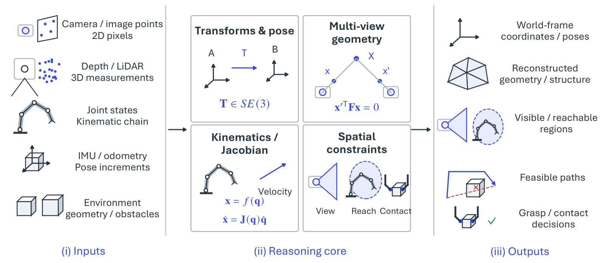
</p>
<p align="center"><sub><b>Figure 32.</b> Abstract task formulation of geometric and algebraic reasoning: (i) local spatial measurements and system models are mapped by (ii) a core of reusable symbolic formalisms to (iii) analyzable, verifiable spatial outputs.</sub></p>

**2026**

- [**RichMap: A Reachability Map Balancing Precision, Efficiency, and Flexibility for Rich Robot Manipulation Tasks**](https://arxiv.org/abs/2604.06778) [](https://arxiv.org/abs/2604.06778) <!-- 04-26 -->

**2021**

- [**Habitat-Matterport 3D Dataset (HM3D): 1000 Large-scale 3D Environments for Embodied AI**](https://arxiv.org/abs/2109.08238) [](https://arxiv.org/abs/2109.08238) [](https://github.com/facebookresearch/habitat-matterport3d-dataset) <!-- 21 -->
- [**Online Extrinsic Calibration Based on Per-Sensor Ego-Motion Using Dual Quaternions**](https://arxiv.org/abs/2101.11440) [](https://arxiv.org/abs/2101.11440) [](https://github.com/uulm-mrm/excalibur) <!-- 21 -->

**2020**

- [**4Seasons: A Cross-Season Dataset for Multi-Weather SLAM in Autonomous Driving**](https://arxiv.org/abs/2009.06364) [](https://arxiv.org/abs/2009.06364) <!-- 20 -->

**Before 2020**

- [**A micro Lie theory for state estimation in robotics**](https://arxiv.org/abs/1812.01537) [](https://arxiv.org/abs/1812.01537) [](https://github.com/artivis/manif) <!-- 12-18 -->
- [**Benchmarking 6DOF Outdoor Visual Localization in Changing Conditions**](http://openaccess.thecvf.com/content_cvpr_2018/html/Sattler_Benchmarking_6DOF_Outdoor_CVPR_2018_paper.html) [](http://openaccess.thecvf.com/content_cvpr_2018/html/Sattler_Benchmarking_6DOF_Outdoor_CVPR_2018_paper.html) <!-- 18 -->
- [**Modern Robotics: Mechanics, Planning, and Control**](https://doi.org/10.1017/9781316661239) [](https://doi.org/10.1017/9781316661239) <!-- 05-17 -->
- [**Large-Scale Data for Multiple-View Stereopsis**](https://doi.org/10.1007/s11263-016-0902-9) [](https://doi.org/10.1007/s11263-016-0902-9) <!-- 16 -->
- [**A benchmark for the evaluation of RGB-D SLAM systems**](https://doi.org/10.1109/IROS.2012.6385773) [](https://doi.org/10.1109/IROS.2012.6385773) <!-- 12 -->
- [**Building Rome in a day**](https://doi.org/10.1109/ICCV.2009.5459148) [](https://doi.org/10.1109/ICCV.2009.5459148) <!-- 09 -->
- [**An Efficient Solution to the Five-Point Relative Pose Problem**](https://doi.org/10.1109/TPAMI.2004.17) [](https://doi.org/10.1109/TPAMI.2004.17) <!-- 04 -->
- [**Probabilistic robotics**](https://doi.org/10.1145/504729.504754) [](https://doi.org/10.1145/504729.504754) <!-- 02 -->
- [**Hand-Eye Calibration Using Dual Quaternions**](https://doi.org/10.1177/02783649922066213) [](https://doi.org/10.1177/02783649922066213) <!-- 99 -->
- [**In Defense of the Eight-Point Algorithm**](https://doi.org/10.1109/34.601246) [](https://doi.org/10.1109/34.601246) <!-- 97 -->
- [**A unified approach for motion and force control of robot manipulators: The operational space formulation**](https://doi.org/10.1109/JRA.1987.1087068) [](https://doi.org/10.1109/JRA.1987.1087068) <!-- 87 -->
- [**Inverse Kinematic Solutions With Singularity Robustness for Robot Manipulator Control**](https://doi.org/10.1115/1.3143764) [](https://doi.org/10.1115/1.3143764) <!-- 09-86 -->
- [**Animating rotation with quaternion curves**](https://doi.org/10.1145/325334.325242) [](https://doi.org/10.1145/325334.325242) <!-- 85 -->
- [**A computer algorithm for reconstructing a scene from two projections**](https://doi.org/10.1038/293133a0) [](https://doi.org/10.1038/293133a0) <!-- 09-81 -->
- [**Random Sample Consensus: A Paradigm for Model Fitting with Applications to Image Analysis and Automated Cartography**](https://doi.org/10.1145/358669.358692) [](https://doi.org/10.1145/358669.358692) <!-- 81 -->

#### 7.1.2. Physical Reasoning
<p align="center">
  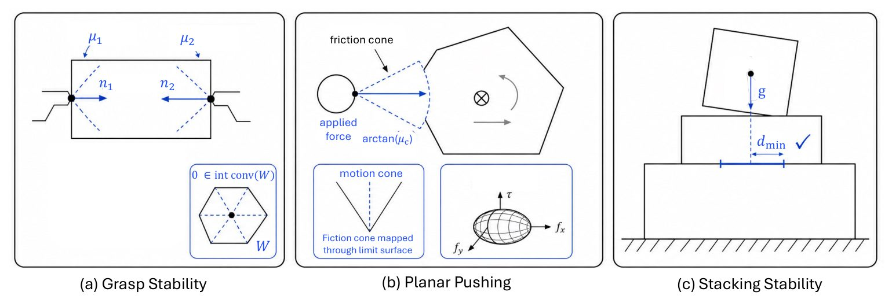
</p>
<p align="center"><sub><b>Figure 33.</b> Physics-aware spatial reasoning in robotics: (a) grasp stability from contact forces and friction cones, (b) planar pushing under quasi-static assumptions, and (c) stacking stability under equilibrium and support constraints.</sub></p>

**2022**

- [**ComPhy: Compositional Physical Reasoning of Objects and Events from Videos**](https://arxiv.org/abs/2205.01089) [](https://arxiv.org/abs/2205.01089) <!-- 22 -->

**2021**

- [**PlasticineLab: A Soft-Body Manipulation Benchmark with Differentiable Physics**](https://arxiv.org/abs/2104.03311) [](https://arxiv.org/abs/2104.03311) [](https://github.com/hzaskywalker/PlasticineLab) <!-- 21 -->

**2020**

- [**PhyNet: Physics Guided Neural Networks for Particle Drag Force Prediction in Assembly**](https://doi.org/10.1137/1.9781611976236.63) [](https://doi.org/10.1137/1.9781611976236.63) <!-- 20 -->

**Before 2020**

- [**CLEVRER: Collision Events for Video Representation and Reasoning**](https://arxiv.org/abs/1910.01442) [](https://arxiv.org/abs/1910.01442) <!-- 10-19 -->
- [**PHYRE: A New Benchmark for Physical Reasoning**](https://arxiv.org/abs/1908.05656) [](https://arxiv.org/abs/1908.05656) [](https://github.com/facebookresearch/phyre) <!-- 19 -->
- [**IntPhys: A Framework and Benchmark for Visual Intuitive Physics Reasoning**](https://arxiv.org/abs/1803.07616) [](https://arxiv.org/abs/1803.07616) [](https://github.com/rronan/IntPhys-Baselines) <!-- 03-18 -->
- [**ShapeStacks: Learning Vision-Based Physical Intuition for Generalised Object Stacking**](https://arxiv.org/abs/1804.08018) [](https://arxiv.org/abs/1804.08018) [](https://github.com/ogroth/shapestacks) <!-- 18 -->
- [**MuJoCo: A physics engine for model-based control**](https://doi.org/10.1109/IROS.2012.6386109) [](https://doi.org/10.1109/IROS.2012.6386109) [](https://github.com/google-deepmind/mujoco) <!-- 12 -->

#### 7.1.3. Topological and Graph-based Reasoning
<p align="center">
  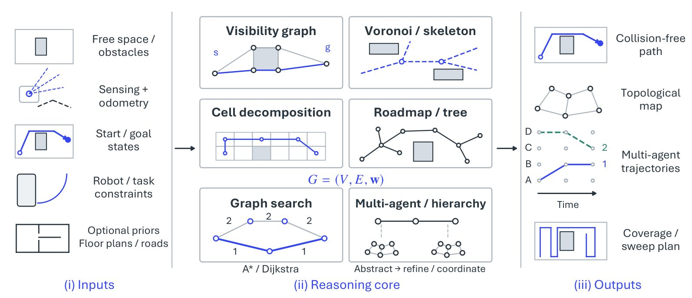
</p>
<p align="center"><sub><b>Figure 34.</b> Abstract task formulation of topological and graph-based reasoning: (i) free space, sensing, start and goal states, and constraints are turned by (ii) construction and search over a graph <i>G</i> = (<i>V</i>, <i>E</i>, <i>w</i>) into (iii) decision-ready graph artifacts such as collision-free paths, topological maps, coordinated multi-agent trajectories, and coverage plans.</sub></p>

**2023**

- [**Safety‐critical control for robotic systems with uncertain model via control barrier function**](https://doi.org/10.1002/rnc.6585) [](https://doi.org/10.1002/rnc.6585) <!-- 01-23 -->

**2021**

- [**Neuro-Symbolic Reinforcement Learning with First-Order Logic**](https://arxiv.org/abs/2110.10963) [](https://arxiv.org/abs/2110.10963) <!-- 21 -->

**2020**

- [**EECBS: A Bounded-Suboptimal Search for Multi-Agent Path Finding**](https://arxiv.org/abs/2010.01367) [](https://arxiv.org/abs/2010.01367) [](https://github.com/Jiaoyang-Li/EECBS) <!-- 10-20 -->

**Before 2020**

- [**Multi-Agent Pathfinding: Definitions, Variants, and Benchmarks**](https://arxiv.org/abs/1906.08291) [](https://arxiv.org/abs/1906.08291) <!-- 19 -->
- [**1 year, 1000 km: The Oxford RobotCar dataset**](https://doi.org/10.1177/0278364916679498) [](https://doi.org/10.1177/0278364916679498) <!-- 17 -->
- [**Batch Informed Trees (BIT\*): Sampling-based optimal planning via the heuristically guided search of implicit random geometric graphs**](https://doi.org/10.1109/ICRA.2015.7139620) [](https://doi.org/10.1109/ICRA.2015.7139620) <!-- 15 -->
- [**Conflict-based search for optimal multi-agent pathfinding**](https://doi.org/10.1016/j.artint.2014.11.006) [](https://doi.org/10.1016/j.artint.2014.11.006) <!-- 15 -->
- [**Optimal Multirobot Path Planning on Graphs: Complete Algorithms and Effective Heuristics**](https://arxiv.org/abs/1507.03290) [](https://arxiv.org/abs/1507.03290) <!-- 07-15 -->
- [**Suboptimal Variants of the Conflict-Based Search Algorithm for the Multi-Agent Pathfinding Problem**](https://doi.org/10.1609/socs.v5i1.18315) [](https://doi.org/10.1609/socs.v5i1.18315) <!-- 14 -->
- [**Benchmarks for Grid-Based Pathfinding**](https://doi.org/10.1109/TCIAIG.2012.2197681) [](https://doi.org/10.1109/TCIAIG.2012.2197681) <!-- 12 -->
- [**Sampling-based algorithms for optimal motion planning**](https://arxiv.org/abs/1105.1186) [](https://arxiv.org/abs/1105.1186) <!-- 11 -->
- [**Contraction Hierarchies: Faster and Simpler Hierarchical Routing in Road Networks**](https://doi.org/10.1007/978-3-540-68552-4_24) [](https://doi.org/10.1007/978-3-540-68552-4_24) <!-- 08 -->
- [**D\*Lite**](http://www.aaai.org/Library/AAAI/2002/aaai02-072.php) [](http://www.aaai.org/Library/AAAI/2002/aaai02-072.php) <!-- 02 -->
- [**Sensor-Based Exploration: The Hierarchical Generalized Voronoi Graph**](https://doi.org/10.1177/02783640022066770) [](https://doi.org/10.1177/02783640022066770) <!-- 00 -->
- [**Probabilistic roadmaps for path planning in high-dimensional configuration spaces**](https://doi.org/10.1109/70.508439) [](https://doi.org/10.1109/70.508439) <!-- 96 -->
- [**A Formal Basis for the Heuristic Determination of Minimum Cost Paths**](https://doi.org/10.1109/TSSC.1968.300136) [](https://doi.org/10.1109/TSSC.1968.300136) <!-- 68 -->
- [**A note on two problems in connexion with graphs**](https://doi.org/10.1007/BF01386390) [](https://doi.org/10.1007/BF01386390) <!-- 59 -->

#### 7.1.4. Constraint-based Spatial Solving
<p align="center">
  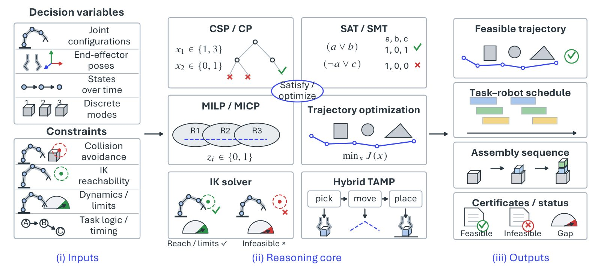
</p>
<p align="center"><sub><b>Figure 35.</b> Abstract task formulation of constraint-based spatial solving: (i) decision variables and constraints, (ii) a solver core that satisfies or optimizes them, and (iii) feasible trajectories, schedules, and assembly sequences, with feasibility or infeasibility certificates and optimality-gap bounds where supported by the solver and problem formulation.</sub></p>

**2024**

- [**COAST: COnstraints And STreams for Task and Motion Planning**](https://arxiv.org/abs/2405.08572) [](https://arxiv.org/abs/2405.08572) <!-- 24 -->
- [**Robust Multi-Agent Pathfinding with Continuous Time**](https://doi.org/10.1609/icaps.v34i1.31519) [](https://doi.org/10.1609/icaps.v34i1.31519) <!-- 24 -->

**2023**

- [**R-LGP: A Reachability-guided Logic-geometric Programming Framework for Optimal Task and Motion Planning on Mobile Manipulators**](https://arxiv.org/abs/2310.02791) [](https://arxiv.org/abs/2310.02791) <!-- 10-23 -->
- [**ASAP: Automated Sequence Planning for Complex Robotic Assembly with Physical Feasibility**](https://arxiv.org/abs/2309.16909) [](https://arxiv.org/abs/2309.16909) <!-- 09-23 -->
- [**Certified polyhedral decompositions of collision-free configuration space**](https://arxiv.org/abs/2302.12219) [](https://arxiv.org/abs/2302.12219) <!-- 02-23 -->
- [**FurnitureBench: Reproducible Real-World Benchmark for Long-Horizon Complex Manipulation**](https://arxiv.org/abs/2305.12821) [](https://arxiv.org/abs/2305.12821) [](https://github.com/clvrai/furniture-bench) <!-- 23 -->

**2022**

- [**Motion planning around obstacles with convex optimization**](https://arxiv.org/abs/2205.04422) [](https://arxiv.org/abs/2205.04422) [](https://github.com/mpetersen94/gcs) <!-- 05-22 -->

**2021**

- [**Shortest Paths in Graphs of Convex Sets**](https://arxiv.org/abs/2101.11565) [](https://arxiv.org/abs/2101.11565) [](https://github.com/TobiaMarcucci/shortest-paths-in-graphs-of-convex-sets) <!-- 01-21 -->

**2020**

- [**PDDLStream: Integrating Symbolic Planners and Blackbox Samplers via Optimistic Adaptive Planning**](https://ojs.aaai.org/index.php/ICAPS/article/view/6739) [](https://ojs.aaai.org/index.php/ICAPS/article/view/6739) [](https://github.com/caelan/pddlstream) <!-- 20 -->

**Before 2020**

- [**Logic-Geometric Programming: An Optimization-Based Approach to Combined Task and Motion Planning**](http://ijcai.org/Abstract/15/274) [](http://ijcai.org/Abstract/15/274) <!-- 15 -->
- [**Computing Large Convex Regions of Obstacle-Free Space Through Semidefinite Programming**](https://doi.org/10.1007/978-3-319-16595-0_7) [](https://doi.org/10.1007/978-3-319-16595-0_7) <!-- 14 -->
- [**Motion planning with sequential convex optimization and convex collision checking**](https://doi.org/10.1177/0278364914528132) [](https://doi.org/10.1177/0278364914528132) <!-- 14 -->
- [**CHOMP: Covariant Hamiltonian optimization for motion planning**](https://doi.org/10.1177/0278364913488805) [](https://doi.org/10.1177/0278364913488805) <!-- 13 -->
- [**Chance-Constrained Optimal Path Planning With Obstacles**](https://doi.org/10.1109/TRO.2011.2161160) [](https://doi.org/10.1109/TRO.2011.2161160) <!-- 11 -->

#### 7.1.5. Rule-based and Programmatic Reasoning
<p align="center">
  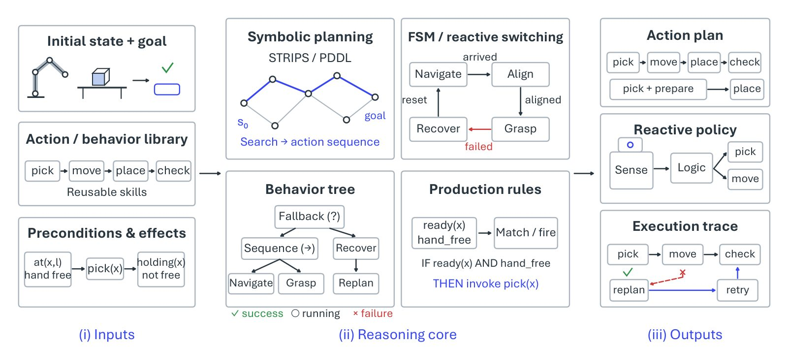
</p>
<p align="center"><sub><b>Figure 36.</b> Abstract task formulation of rule-based and programmatic reasoning: (i) symbolic task structure, (ii) four representations for executing decision logic, and (iii) executable plans, reactive policies, and monitored execution traces with replanning after a disturbance.</sub></p>

**2024**

- [**Autonomous Robot Task Execution in Flexible Manufacturing: Integrating PDDL and Behavior Trees in ARIAC 2023**](https://doi.org/10.3390/biomimetics9100612) [](https://doi.org/10.3390/biomimetics9100612) <!-- 10-24 -->
- [**BEHAVIOR-1K: A Human-Centered, Embodied AI Benchmark with 1,000 Everyday Activities and Realistic Simulation**](https://arxiv.org/abs/2403.09227) [](https://arxiv.org/abs/2403.09227) <!-- 03-24 -->

**2023**

- [**The CRAM Cognitive Architecture for Robot Manipulation in Everyday Activities**](https://arxiv.org/abs/2304.14119) [](https://arxiv.org/abs/2304.14119) <!-- 04-23 -->

**2021**

- [**BEHAVIOR: Benchmark for Everyday Household Activities in Virtual, Interactive, and Ecological Environments**](https://arxiv.org/abs/2108.03332) [](https://arxiv.org/abs/2108.03332) <!-- 21 -->
- [**Habitat 2.0: Training Home Assistants to Rearrange their Habitat**](https://arxiv.org/abs/2106.14405) [](https://arxiv.org/abs/2106.14405) [](https://github.com/facebookresearch/habitat-lab) <!-- 21 -->
- [**Optimized Execution of PDDL Plans using Behavior Trees**](https://arxiv.org/abs/2101.01964) [](https://arxiv.org/abs/2101.01964) <!-- 21 -->

**2020**

- [**Integrated Task and Motion Planning**](https://arxiv.org/abs/2010.01083) [](https://arxiv.org/abs/2010.01083) <!-- 10-20 -->

**Before 2020**

- [**Behavior Trees in Robotics and AI: An Introduction**](https://arxiv.org/abs/1709.00084) [](https://arxiv.org/abs/1709.00084) [](https://github.com/miccol/Behavior-Tree) <!-- 08-17 -->
- [**How Behavior Trees modularize robustness and safety in hybrid systems**](https://doi.org/10.1109/IROS.2014.6942752) [](https://doi.org/10.1109/IROS.2014.6942752) <!-- 14 -->
- [**Towards a unified behavior trees framework for robot control**](https://doi.org/10.1109/ICRA.2014.6907656) [](https://doi.org/10.1109/ICRA.2014.6907656) <!-- 14 -->
- [**A robust layered control system for a mobile robot**](https://doi.org/10.1109/JRA.1986.1087032) [](https://doi.org/10.1109/JRA.1986.1087032) <!-- 86 -->
- [**Rete: A fast algorithm for the many pattern/many object pattern match problem**](https://doi.org/10.1016/0004-3702%2882%2990020-0) [](https://doi.org/10.1016/0004-3702%2882%2990020-0) <!-- 09-82 -->
- [**STRIPS: A New Approach to the Application of Theorem Proving to Problem Solving**](https://doi.org/10.1016/0004-3702%2871%2990010-5) [](https://doi.org/10.1016/0004-3702%2871%2990010-5) <!-- 71 -->

#### 7.1.6. Causal Reasoning
<p align="center">
  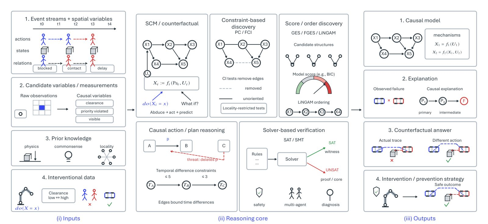
</p>
<p align="center"><sub><b>Figure 37.</b> Abstract task formulation of causal reasoning for spatial intelligence: (i) event streams, candidate variables, prior knowledge, and interventional data feed (ii) methods that discover and verify causal structure, yielding (iii) causal models, explanations, counterfactual answers, and intervention or prevention strategies.</sub></p>

**2024**

- [**ContPhy: Continuum Physical Concept Learning and Reasoning from Videos**](https://arxiv.org/abs/2402.06119) [](https://arxiv.org/abs/2402.06119) <!-- 24 -->

**2023**

- [**Causal-learn: Causal Discovery in Python**](https://arxiv.org/abs/2307.16405) [](https://arxiv.org/abs/2307.16405) [](https://github.com/py-why/causal-learn) <!-- 07-23 -->
- [**ManiSkill2: A Unified Benchmark for Generalizable Manipulation Skills**](https://arxiv.org/abs/2302.04659) [](https://arxiv.org/abs/2302.04659) [](https://github.com/haosulab/ManiSkill2) <!-- 23 -->
- [**Physion++: Evaluating Physical Scene Understanding that Requires Online Inference of Different Physical Properties**](https://arxiv.org/abs/2306.15668) [](https://arxiv.org/abs/2306.15668) <!-- 23 -->
- [**Py-Tetrad and RPy-Tetrad: A New Python Interface with R Support for Tetrad Causal Search**](https://arxiv.org/abs/2308.07346) [](https://arxiv.org/abs/2308.07346) [](https://github.com/cmu-phil/py-tetrad) <!-- 23 -->

**2022**

- [**DoWhy-GCM: An Extension of DoWhy for Causal Inference in Graphical Causal Models**](https://arxiv.org/abs/2206.06821) [](https://arxiv.org/abs/2206.06821) [](https://github.com/py-why/dowhy) <!-- 06-22 -->

**2021**

- [**NExT-QA: Next Phase of Question-Answering to Explaining Temporal Actions**](https://arxiv.org/abs/2105.08276) [](https://arxiv.org/abs/2105.08276) [](https://github.com/doc-doc/NExT-QA) <!-- 21 -->
- [**SUTD-TrafficQA: A Question Answering Benchmark and an Efficient Network for Video Reasoning Over Traffic Events**](https://arxiv.org/abs/2103.15538) [](https://arxiv.org/abs/2103.15538) [](https://github.com/sutdcv/SUTD-TrafficQA) <!-- 21 -->

**Before 2020**

- [**Elements of causal inference: foundations and learning algorithms**](https://doi.org/10.1080/00949655.2018.1505197) [](https://doi.org/10.1080/00949655.2018.1505197) <!-- 08-18 -->
- [**Efficient SAT Approach to Multi-Agent Path Finding Under the Sum of Costs Objective**](https://doi.org/10.3233/978-1-61499-672-9-810) [](https://doi.org/10.3233/978-1-61499-672-9-810) <!-- 16 -->
- [**dReach: δ-Reachability Analysis for Hybrid Systems**](https://doi.org/10.1007/978-3-662-46681-0_15) [](https://doi.org/10.1007/978-3-662-46681-0_15) <!-- 15 -->
- [**Order-independent constraint-based causal structure learning**](https://dl.acm.org/doi/10.5555/2627435.2750365) [](https://dl.acm.org/doi/10.5555/2627435.2750365) <!-- 14 -->
- [**dReal: An SMT Solver for Nonlinear Theories over the Reals**](https://doi.org/10.1007/978-3-642-38574-2_14) [](https://doi.org/10.1007/978-3-642-38574-2_14) <!-- 13 -->
- [**Estimating High-Dimensional Directed Acyclic Graphs with the PC-Algorithm**](https://dl.acm.org/doi/10.5555/1314498.1314520) [](https://dl.acm.org/doi/10.5555/1314498.1314520) <!-- 07 -->
- [**Optimal Structure Identification With Greedy Search**](https://jmlr.org/papers/v3/chickering02b.html) [](https://jmlr.org/papers/v3/chickering02b.html) <!-- 02 -->

### 7.2. Learning-based Spatial Reasoning
#### 7.2.1. Implicit Neural Spatial Reasoning
<p align="center">
  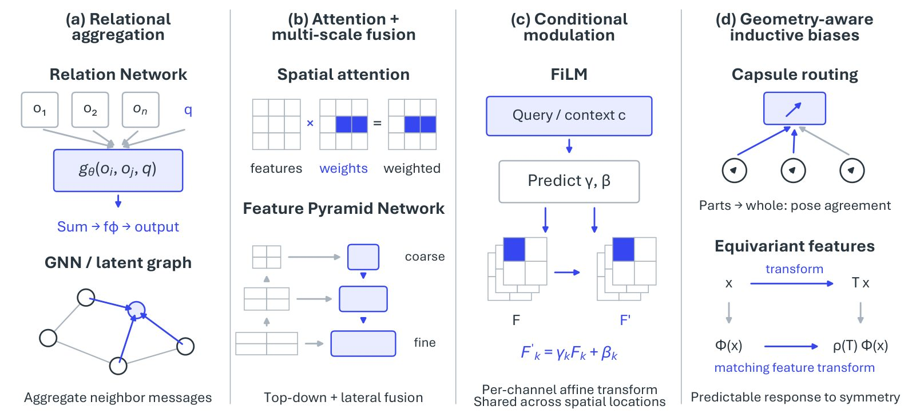
</p>
<p align="center"><sub><b>Figure 38.</b> Four mechanisms for learning spatial representations: (a) relational aggregation (Relation Network, GNN message passing), (b) spatial attention with multi-scale fusion (FPN), (c) conditional modulation (FiLM), and (d) geometry-aware inductive biases (capsule routing, equivariant features).</sub></p>

**2021**

- [**Pyramid Vision Transformer: A Versatile Backbone for Dense Prediction without Convolutions**](https://arxiv.org/abs/2102.12122) [](https://arxiv.org/abs/2102.12122) [](https://github.com/whai362/PVT) <!-- 21 -->
- [**Swin Transformer: Hierarchical Vision Transformer using Shifted Windows**](https://arxiv.org/abs/2103.14030) [](https://arxiv.org/abs/2103.14030) [](https://github.com/microsoft/Swin-Transformer) <!-- 21 -->
- [**Twins: Revisiting the Design of Spatial Attention in Vision Transformers**](https://proceedings.neurips.cc/paper/2021/hash/4e0928de075538c593fbdabb0c5ef2c3-Abstract.html) [](https://proceedings.neurips.cc/paper/2021/hash/4e0928de075538c593fbdabb0c5ef2c3-Abstract.html) [](https://github.com/Meituan-AutoML/Twins) <!-- 21 -->

**Before 2020**

- [**GQA: A New Dataset for Real-World Visual Reasoning and Compositional Question Answering**](http://openaccess.thecvf.com/content_CVPR_2019/html/Hudson_GQA_A_New_Dataset_for_Real-World_Visual_Reasoning_and_Compositional_CVPR_2019_paper.html) [](http://openaccess.thecvf.com/content_CVPR_2019/html/Hudson_GQA_A_New_Dataset_for_Real-World_Visual_Reasoning_and_Compositional_CVPR_2019_paper.html) [](https://github.com/stanfordnlp/mac-network) <!-- 19 -->
- [**A simple neural network module for relational reasoning**](https://arxiv.org/abs/1706.01427) [](https://arxiv.org/abs/1706.01427) <!-- 17 -->
- [**CLEVR: A Diagnostic Dataset for Compositional Language and Elementary Visual Reasoning**](https://arxiv.org/abs/1612.06890) [](https://arxiv.org/abs/1612.06890) <!-- 12-16 -->
- [**Making the V in VQA Matter: Elevating the Role of Image Understanding in Visual Question Answering**](https://arxiv.org/abs/1612.00837) [](https://arxiv.org/abs/1612.00837) <!-- 12-16 -->
- [**Visual7W: Grounded Question Answering in Images**](https://arxiv.org/abs/1511.03416) [](https://arxiv.org/abs/1511.03416) <!-- 11-15 -->

#### 7.2.2. Explicit Structured Neural Reasoning
<p align="center">
  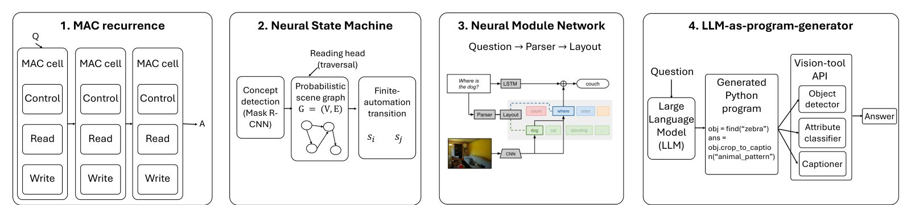
</p>
<p align="center"><sub><b>Figure 39.</b> Four method families for explicit structured neural reasoning, ordered by the intermediate structure <i>S</i> each exposes: (A) the MAC recurrent reasoning cell; (B) the Neural State Machine; (C) program-based reasoning, a parse-to-execute pipeline whose executor ranges from neural modules (NMN, IEP) through the symbolic executor of NS-VQA to the quasi-symbolic executor of NS-CL; and (D) LLM-as-program-generator pipelines that call vision tools (e.g., ViperGPT, VisProg, Code-as-Policies).</sub></p>

**2023**

- [**ViperGPT: Visual Inference via Python Execution for Reasoning**](https://arxiv.org/abs/2303.08128) [](https://arxiv.org/abs/2303.08128) [](https://github.com/cvlab-columbia/viper) <!-- 23 -->

**2022**

- [**Visual Programming: Compositional visual reasoning without training**](https://arxiv.org/abs/2211.11559) [](https://arxiv.org/abs/2211.11559) [](https://github.com/allenai/visprog) <!-- 11-22 -->

**Before 2020**

- [**Learning by Abstraction: The Neural State Machine**](https://arxiv.org/abs/1907.03950) [](https://arxiv.org/abs/1907.03950) [](https://github.com/stanfordnlp/mac-network) <!-- 19 -->
- [**The Neuro-Symbolic Concept Learner: Interpreting Scenes, Words, and Sentences From Natural Supervision**](https://arxiv.org/abs/1904.12584) [](https://arxiv.org/abs/1904.12584) [](https://github.com/vacancy/NSCL-PyTorch-Release) <!-- 19 -->
- [**Compositional Attention Networks for Machine Reasoning**](https://arxiv.org/abs/1803.03067) [](https://arxiv.org/abs/1803.03067) [](https://github.com/stanfordnlp/mac-network) <!-- 18 -->
- [**Neural-Symbolic VQA: Disentangling Reasoning from Vision and Language Understanding**](https://arxiv.org/abs/1810.02338) [](https://arxiv.org/abs/1810.02338) <!-- 18 -->
- [**Inferring and Executing Programs for Visual Reasoning**](https://arxiv.org/abs/1705.03633) [](https://arxiv.org/abs/1705.03633) [](https://github.com/facebookresearch/clevr-iep) <!-- 17 -->
- [**Neural Module Networks**](https://doi.org/10.1109/CVPR.2016.12) [](https://doi.org/10.1109/CVPR.2016.12) <!-- 16 -->

#### 7.2.3. Geometry-aware Neural Spatial Reasoning
<p align="center">
  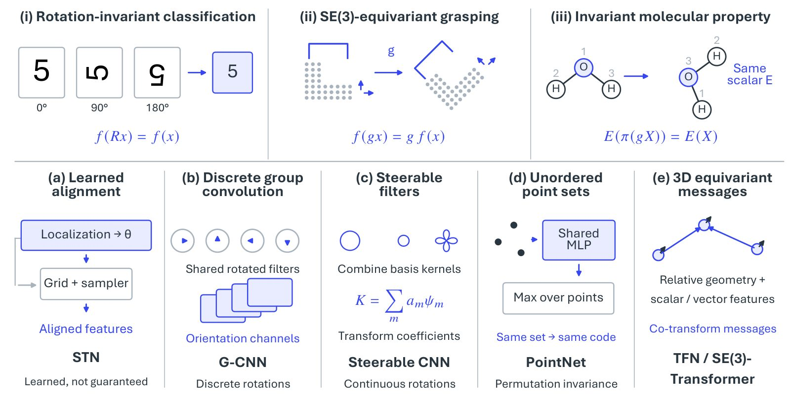
</p>
<p align="center"><sub><b>Figure 40.</b> Symmetry-driven tasks (top) and geometric neural mechanisms (bottom).</sub></p>

**2024**

- [**Towards Geometric Normalization Techniques in SE(3) Equivariant Graph Neural Networks for Physical Dynamics Simulations**](https://www.ijcai.org/proceedings/2024/661) [](https://www.ijcai.org/proceedings/2024/661) <!-- 24 -->

**2022**

- [**MACE: Higher Order Equivariant Message Passing Neural Networks for Fast and Accurate Force Fields**](https://arxiv.org/abs/2206.07697) [](https://arxiv.org/abs/2206.07697) [](https://github.com/ACEsuit/mace) <!-- 22 -->

**2021**

- [**Vector Neurons: A General Framework for SO(3)-Equivariant Networks**](https://arxiv.org/abs/2104.12229) [](https://arxiv.org/abs/2104.12229) [](https://github.com/FlyingGiraffe/vnn) <!-- 21 -->

**2020**

- [**SE(3)-Transformers: 3D Roto-Translation Equivariant Attention Networks**](https://arxiv.org/abs/2006.10503) [](https://arxiv.org/abs/2006.10503) [](https://github.com/FabianFuchsML/se3-transformer-public) <!-- 20 -->

**Before 2020**

- [**General E(2)-Equivariant Steerable CNNs**](https://arxiv.org/abs/1911.08251) [](https://arxiv.org/abs/1911.08251) [](https://github.com/QUVA-Lab/e2cnn) <!-- 19 -->
- [**Group Equivariant Convolutional Networks**](https://arxiv.org/abs/1602.07576) [](https://arxiv.org/abs/1602.07576) <!-- 16 -->
- [**PointNet: Deep Learning on Point Sets for 3D Classification and Segmentation**](https://arxiv.org/abs/1612.00593) [](https://arxiv.org/abs/1612.00593) <!-- 12-16 -->
- [**Steerable CNNs**](https://arxiv.org/abs/1612.08498) [](https://arxiv.org/abs/1612.08498) <!-- 12-16 -->

#### 7.2.4. Differentiable Optimization Layers for Spatial Reasoning
<p align="center">
  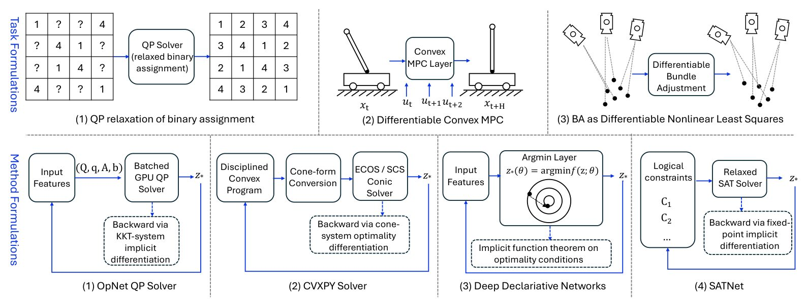
</p>
<p align="center"><sub><b>Figure 41.</b> Differentiable optimization layers for spatial reasoning. Top, tasks: (1) QP relaxation of binary assignment for Sudoku, (2) differentiable convex MPC, and (3) bundle adjustment as differentiable nonlinear least squares for end-to-end SLAM.</sub></p>

**2023**

- [**Learning differentiable logic programs for abstract visual reasoning**](https://arxiv.org/abs/2307.00928) [](https://arxiv.org/abs/2307.00928) [](https://github.com/ml-research/neumann) <!-- 07-23 -->

**2022**

- [**Exploiting Problem Structure in Deep Declarative Networks: Two Case Studies**](https://arxiv.org/abs/2202.12404) [](https://arxiv.org/abs/2202.12404) <!-- 02-22 -->

**2020**

- [**Solving the Blind Perspective-n-Point Problem End-to-End with Robust Differentiable Geometric Optimization**](https://arxiv.org/abs/2007.14628) [](https://arxiv.org/abs/2007.14628) [](https://github.com/dylan-campbell/bpnpnet) <!-- 20 -->

**Before 2020**

- [**Deep Declarative Networks**](https://arxiv.org/abs/1909.04866) [](https://arxiv.org/abs/1909.04866) <!-- 09-19 -->
- [**Differentiable Convex Optimization Layers**](https://arxiv.org/abs/1910.12430) [](https://arxiv.org/abs/1910.12430) [](https://github.com/cvxpy/cvxpylayers) <!-- 19 -->
- [**SATNet: Bridging deep learning and logical reasoning using a differentiable satisfiability solver**](https://arxiv.org/abs/1905.12149) [](https://arxiv.org/abs/1905.12149) [](https://github.com/locuslab/SATNet) <!-- 19 -->
- [**Differentiable MPC for End-to-end Planning and Control**](https://arxiv.org/abs/1810.13400) [](https://arxiv.org/abs/1810.13400) [](https://github.com/locuslab/differentiable-mpc) <!-- 18 -->
- [**OptNet: Differentiable Optimization as a Layer in Neural Networks**](https://arxiv.org/abs/1703.00443) [](https://arxiv.org/abs/1703.00443) [](https://github.com/locuslab/optnet) <!-- 17 -->

#### 7.2.5. Reinforcement Learning with Spatial Inductive Biases
<p align="center">
  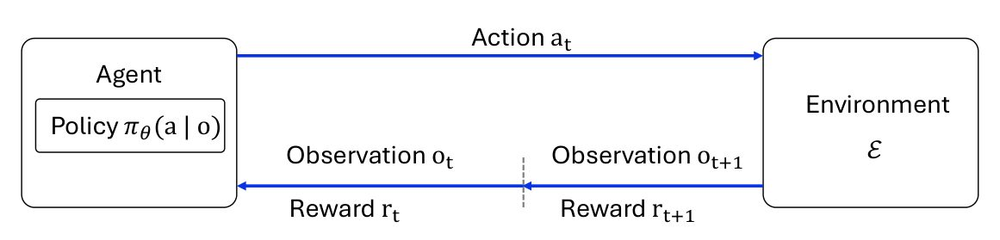
</p>
<p align="center"><sub><b>Figure 42.</b> The general framework in RL: the agent acts on the environment, receives an observation and a reward, and updates its policy from this feedback.</sub></p>

**2025**

- [**OctoNav: Towards Generalist Embodied Navigation**](https://arxiv.org/abs/2506.09839) [](https://arxiv.org/abs/2506.09839) <!-- 06-25 -->
- [**SpaceR: Reinforcing MLLMs in Video Spatial Reasoning**](https://arxiv.org/abs/2504.01805) [](https://arxiv.org/abs/2504.01805) [](https://github.com/OuyangKun10/SpaceR) <!-- 04-25 -->
- [**LEGO-Puzzles: How Good Are MLLMs at Multi-step Spatial Reasoning?**](https://arxiv.org/abs/2503.19990) [](https://arxiv.org/abs/2503.19990) [](https://github.com/Tangkexian/LEGO-Puzzles) <!-- 03-25 -->
- [**DeepSeek-R1: Incentivizing Reasoning Capability in LLMs via Reinforcement Learning**](https://arxiv.org/abs/2501.12948) [](https://arxiv.org/abs/2501.12948) [](https://github.com/deepseek-ai/DeepSeek-R1) <!-- 01-25 -->
- [**Reason-RFT: Reinforcement Fine-Tuning for Visual Reasoning of Vision Language Models**](http://papers.nips.cc/paper_files/paper/2025/hash/08d70284b013c03ba89cd2b642bc864b-Abstract-Conference.html) [](http://papers.nips.cc/paper_files/paper/2025/hash/08d70284b013c03ba89cd2b642bc864b-Abstract-Conference.html) <!-- 25 -->
- [**Spatial Preference Rewarding for MLLMs Spatial Understanding**](https://arxiv.org/abs/2510.14374) [](https://arxiv.org/abs/2510.14374) [](https://github.com/hanqiu-hq/SPR) <!-- 25 -->
- [**Structured Preference Optimization for Vision-Language Long-Horizon Task Planning**](https://arxiv.org/abs/2502.20742) [](https://arxiv.org/abs/2502.20742) <!-- 25 -->

**2023**

- [**Direct Preference Optimization: Your Language Model is Secretly a Reward Model**](https://arxiv.org/abs/2305.18290) [](https://arxiv.org/abs/2305.18290) <!-- 23 -->

**Before 2020**

- [**Deep reinforcement learning with relational inductive biases**](https://openreview.net/forum?id=HkxaFoC9KQ) [](https://openreview.net/forum?id=HkxaFoC9KQ) <!-- 19 -->
- [**Gibson Env: Real-World Perception for Embodied Agents**](https://arxiv.org/abs/1808.10654) [](https://arxiv.org/abs/1808.10654) [](https://github.com/StanfordVL/GibsonEnv) <!-- 18 -->
- [**Cognitive Mapping and Planning for Visual Navigation**](https://arxiv.org/abs/1702.03920) [](https://arxiv.org/abs/1702.03920) <!-- 17 -->
- [**Matterport3D: Learning from RGB-D Data in Indoor Environments**](https://arxiv.org/abs/1709.06158) [](https://arxiv.org/abs/1709.06158) [](https://github.com/niessner/Matterport) <!-- 17 -->
- [**QMDP-Net: Deep Learning for Planning under Partial Observability**](https://arxiv.org/abs/1703.06692) [](https://arxiv.org/abs/1703.06692) [](https://github.com/AdaCompNUS/qmdp-net) <!-- 17 -->
- [**Value Iteration Networks**](https://arxiv.org/abs/1602.02867) [](https://arxiv.org/abs/1602.02867) [](https://github.com/avivt/VIN) <!-- 16 -->

#### 7.2.6. Multi-agent Spatial Reasoning
<p align="center">
  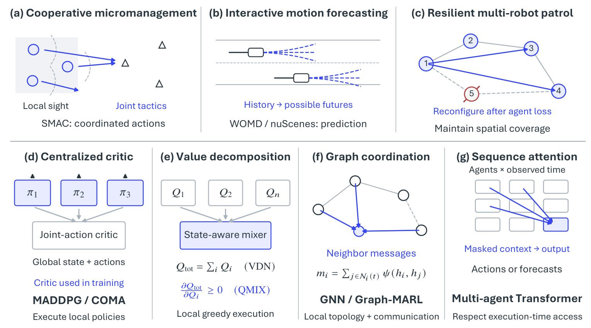
</p>
<p align="center"><sub><b>Figure 43.</b> Multi-agent spatial reasoning tasks (top) and mechanisms (bottom).</sub></p>

**2024**

- [**Graph Neural Network-based Multi-agent Reinforcement Learning for Resilient Distributed Coordination of Multi-Robot Systems**](https://arxiv.org/abs/2403.13093) [](https://arxiv.org/abs/2403.13093) [](https://github.com/NU-IDEAS-Lab/patrolling_zoo) <!-- 24 -->

**2021**

- [**Large Scale Interactive Motion Forecasting for Autonomous Driving : The Waymo Open Motion Dataset**](https://arxiv.org/abs/2104.10133) [](https://arxiv.org/abs/2104.10133) <!-- 21 -->

**Before 2020**

- [**Google Research Football: A Novel Reinforcement Learning Environment**](https://arxiv.org/abs/1907.11180) [](https://arxiv.org/abs/1907.11180) [](https://github.com/google-research/football) <!-- 07-19 -->
- [**nuScenes: A Multimodal Dataset for Autonomous Driving**](https://arxiv.org/abs/1903.11027) [](https://arxiv.org/abs/1903.11027) [](https://github.com/nutonomy/nuscenes-devkit) <!-- 03-19 -->
- [**The StarCraft Multi-Agent Challenge**](https://arxiv.org/abs/1902.04043) [](https://arxiv.org/abs/1902.04043) [](https://github.com/oxwhirl/smac) <!-- 19 -->
- [**QMIX: Monotonic Value Function Factorisation for Deep Multi-Agent Reinforcement Learning**](https://arxiv.org/abs/1803.11485) [](https://arxiv.org/abs/1803.11485) [](https://github.com/oxwhirl/pymarl) <!-- 18 -->
- [**Counterfactual Multi-Agent Policy Gradients**](https://arxiv.org/abs/1705.08926) [](https://arxiv.org/abs/1705.08926) <!-- 05-17 -->
- [**Multi-Agent Actor-Critic for Mixed Cooperative-Competitive Environments**](https://arxiv.org/abs/1706.02275) [](https://arxiv.org/abs/1706.02275) [](https://github.com/openai/multiagent-particle-envs) <!-- 17 -->

### 7.3. Foundation Model-driven Spatial Reasoning
#### 7.3.1. LLM/VLM-centric Spatial Reasoning
<p align="center">
  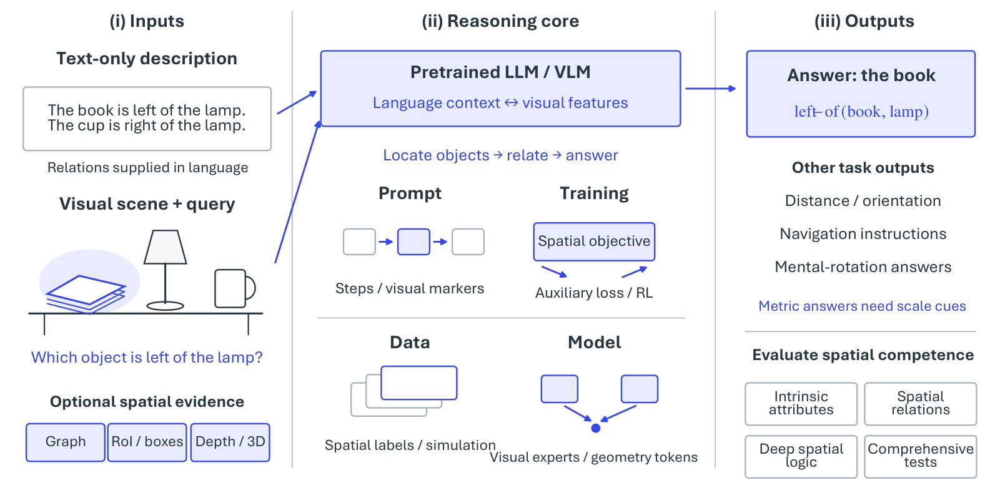
</p>
<p align="center"><sub><b>Figure 44.</b> LLM/VLM-centric spatial reasoning, illustrated by the query “Which object is left of the lamp?”: (i) text-only or visual inputs with optional spatial evidence, (ii) a pretrained LLM/VLM with four complementary, not sequential, intervention strategies (prompt, training, data, model), and (iii) the answer, other task outputs, and evaluation categories.</sub></p>

**2026**

- [**SpatialSV: Internalizing Interpretable 3D Spatial Awareness in MLLMs via Task-Oriented Visual Supervision**](https://arxiv.org/abs/2606.19915) [](https://arxiv.org/abs/2606.19915) <!-- 26 -->

**2025**

- [**Deconstructing Spatial Intelligence in Vision-Language Models**](https://doi.org/10.36227/techrxiv.176231405.57942913/v1) [](https://doi.org/10.36227/techrxiv.176231405.57942913/v1) <!-- 11-25 -->
- [**Logic Unseen: Revealing the Logical Blindspots of Vision-Language Models**](https://arxiv.org/abs/2508.11317) [](https://arxiv.org/abs/2508.11317) <!-- 08-25 -->
- [**Spatial 3D-LLM: Exploring Spatial Awareness in 3D Vision-Language Models**](https://arxiv.org/abs/2507.16524) [](https://arxiv.org/abs/2507.16524) [](https://github.com/bjshuyuan/Spatial-3D-LLM) <!-- 07-25 -->
- [**Spatial Mental Modeling from Limited Views**](https://arxiv.org/abs/2506.21458) [](https://arxiv.org/abs/2506.21458) [](https://github.com/mll-lab-nu/MindCube) <!-- 06-25 -->
- [**SVQA-R1: Reinforcing Spatial Reasoning in MLLMs via View-Consistent Reward Optimization**](https://arxiv.org/abs/2506.01371) [](https://arxiv.org/abs/2506.01371) <!-- 06-25 -->
- [**Agentic 3D Scene Generation with Spatially Contextualized VLMs**](https://arxiv.org/abs/2505.20129) [](https://arxiv.org/abs/2505.20129) <!-- 05-25 -->
- [**Mind the Gap: Benchmarking Spatial Reasoning in Vision-Language Models**](https://arxiv.org/abs/2503.19707) [](https://arxiv.org/abs/2503.19707) [](https://github.com/stogiannidis/srbench) <!-- 03-25 -->
- [**3DAxisPrompt: Promoting the 3D grounding and reasoning in GPT-4o**](https://arxiv.org/abs/2503.13185) [](https://arxiv.org/abs/2503.13185) <!-- 25 -->
- [**Fine-Grained Preference Optimization Improves Spatial Reasoning in VLMs**](https://arxiv.org/abs/2506.21656) [](https://arxiv.org/abs/2506.21656) <!-- 25 -->
- [**MindJourney: Test-Time Scaling with World Models for Spatial Reasoning**](https://arxiv.org/abs/2507.12508) [](https://arxiv.org/abs/2507.12508) <!-- 25 -->
- [**Perspective-Aware Reasoning in Vision-Language Models via Mental Imagery Simulation**](https://arxiv.org/abs/2504.17207) [](https://arxiv.org/abs/2504.17207) [](https://github.com/KAIST-Visual-AI-Group/APC-VLM) <!-- 25 -->
- [**Reinforcing Spatial Reasoning in Vision-Language Models with Interwoven Thinking and Visual Drawing**](https://arxiv.org/abs/2506.09965) [](https://arxiv.org/abs/2506.09965) [](https://github.com/AntResearchNLP/ViLaSR) <!-- 25 -->
- [**SpatialCLIP: Learning 3D-aware Image Representations from Spatially Discriminative Language**](https://openaccess.thecvf.com/content/CVPR2025/html/Wang_SpatialCLIP_Learning_3D-aware_Image_Representations_from_Spatially_Discriminative_Language_CVPR_2025_paper.html) [](https://openaccess.thecvf.com/content/CVPR2025/html/Wang_SpatialCLIP_Learning_3D-aware_Image_Representations_from_Spatially_Discriminative_Language_CVPR_2025_paper.html) <!-- 25 -->
- [**Understanding Depth and Height Perception in Large Visual-Language Models**](https://openaccess.thecvf.com/content/CVPR2025W/MMFM/html/Azad_Understanding_Depth_and_Height_Perception_in_Large_Visual-Language_Models__CVPRW_2025_paper.html) [](https://openaccess.thecvf.com/content/CVPR2025W/MMFM/html/Azad_Understanding_Depth_and_Height_Perception_in_Large_Visual-Language_Models__CVPRW_2025_paper.html) <!-- 25 -->

**2024**

- [**SPA: 3D Spatial-Awareness Enables Effective Embodied Representation**](https://arxiv.org/abs/2410.08208) [](https://arxiv.org/abs/2410.08208) [](https://github.com/HaoyiZhu/RealRobot) <!-- 10-24 -->
- [**Sparkle: Mastering Basic Spatial Capabilities in Vision Language Models Elicits Generalization to Spatial Reasoning**](https://arxiv.org/abs/2410.16162) [](https://arxiv.org/abs/2410.16162) [](https://github.com/YihongT/Sparkle) <!-- 10-24 -->
- [**Cambrian-1: A Fully Open, Vision-Centric Exploration of Multimodal LLMs**](https://arxiv.org/abs/2406.16860) [](https://arxiv.org/abs/2406.16860) [](https://github.com/cambrian-mllm/cambrian) <!-- 24 -->
- [**Is A Picture Worth A Thousand Words? Delving Into Spatial Reasoning for Vision Language Models**](https://arxiv.org/abs/2406.14852) [](https://arxiv.org/abs/2406.14852) [](https://github.com/jiayuww/SpatialEval) <!-- 24 -->
- [**The All-Seeing Project V2: Towards General Relation Comprehension of the Open World**](https://arxiv.org/abs/2402.19474) [](https://arxiv.org/abs/2402.19474) [](https://github.com/OpenGVLab/all-seeing) <!-- 24 -->

**2023**

- [**Set-of-Mark Prompting Unleashes Extraordinary Visual Grounding in GPT-4V**](https://arxiv.org/abs/2310.11441) [](https://arxiv.org/abs/2310.11441) [](https://github.com/microsoft/SoM) <!-- 10-23 -->
- [**PaLM-E: An Embodied Multimodal Language Model**](https://arxiv.org/abs/2303.03378) [](https://arxiv.org/abs/2303.03378) [](https://github.com/kyegomez/PALM-E) <!-- 23 -->

**2022**

- [**Visual Spatial Reasoning**](https://arxiv.org/abs/2205.00363) [](https://arxiv.org/abs/2205.00363) [](https://github.com/cambridgeltl/visual-spatial-reasoning) <!-- 04-22 -->

#### 7.3.2. VLA-based Spatial Reasoning
<p align="center">
  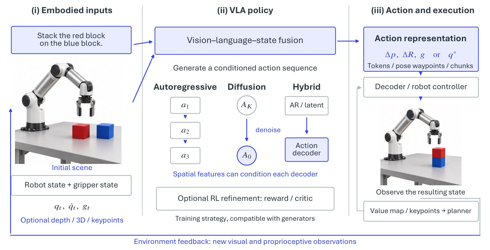
</p>
<p align="center"><sub><b>Figure 45.</b> VLA-based spatial reasoning as a perception–action loop: (i) embodied inputs, (ii) a VLA policy that generates actions autoregressively, by diffusion (denoising <i>A</i><sub><i>K</i></sub> to <i>A</i><sub>0</sub>), or with a hybrid, plus optional RL refinement, and (iii) an action representation executed by a controller, with environment feedback closing the loop.</sub></p>

**2025**

- [**Vision-Language-Action (VLA) Models: Concepts, Progress, Applications and Challenges**](https://arxiv.org/abs/2505.04769) [](https://arxiv.org/abs/2505.04769) [](https://github.com/Applied-AI-Research-Lab/Vision-Language-Action-Models-Concepts-Progress-Applications-and-Challenges) <!-- 05-25 -->
- [**PointVLA: Injecting the 3D World Into Vision-Language-Action Models**](https://arxiv.org/abs/2503.07511) [](https://arxiv.org/abs/2503.07511) <!-- 03-25 -->
- [**SafeVLA: Towards Safety Alignment of Vision-Language-Action Model via Constrained Learning**](https://arxiv.org/abs/2503.03480) [](https://arxiv.org/abs/2503.03480) <!-- 03-25 -->
- [**ForceVLA: Enhancing VLA Models with a Force-aware MoE for Contact-rich Manipulation**](https://arxiv.org/abs/2505.22159) [](https://arxiv.org/abs/2505.22159) <!-- 25 -->

**2024**

- [**TraceVLA: Visual Trace Prompting Enhances Spatial-Temporal Awareness for Generalist Robotic Policies**](https://arxiv.org/abs/2412.10345) [](https://arxiv.org/abs/2412.10345) <!-- 12-24 -->
- [**LoTa-Bench: Benchmarking Language-oriented Task Planners for Embodied Agents**](https://arxiv.org/abs/2402.08178) [](https://arxiv.org/abs/2402.08178) [](https://github.com/lbaa2022/LLMTaskPlanning) <!-- 24 -->
- [**RoboPoint: A Vision-Language Model for Spatial Affordance Prediction in Robotics**](https://arxiv.org/abs/2406.10721) [](https://arxiv.org/abs/2406.10721) <!-- 24 -->

**2022**

- [**VIMA: General Robot Manipulation with Multimodal Prompts**](https://arxiv.org/abs/2210.03094) [](https://arxiv.org/abs/2210.03094) [](https://github.com/vimalabs/VIMABench) <!-- 10-22 -->
- [**SE(3)-DiffusionFields: Learning smooth cost functions for joint grasp and motion optimization through diffusion**](https://arxiv.org/abs/2209.03855) [](https://arxiv.org/abs/2209.03855) [](https://github.com/robotgradient/grasp_diffusion) <!-- 09-22 -->

#### 7.3.3. Chain-of-Thought for Spatial Reasoning
<p align="center">
  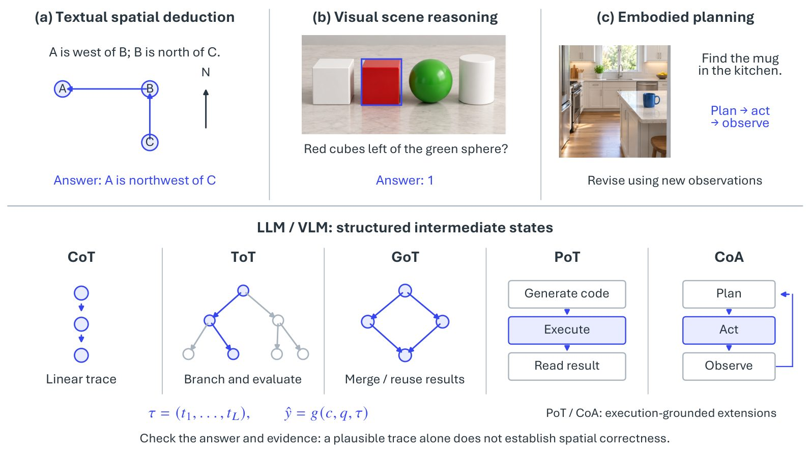
</p>
<p align="center"><sub><b>Figure 46.</b> Spatial reasoning tasks (top) and intermediate-trace structures (bottom).</sub></p>

**2026**

- [**Spatial Chain-of-Thought: Bridging Understanding and Generation Models for Spatial Reasoning Generation**](https://arxiv.org/abs/2602.11980) [](https://arxiv.org/abs/2602.11980) <!-- 02-26 -->
- [**ACoT-VLA: Action Chain-of-Thought for Vision-Language-Action Models**](https://arxiv.org/abs/2601.11404) [](https://arxiv.org/abs/2601.11404) [](https://github.com/AgibotTech/ACoT-VLA) <!-- 26 -->
- [**Chain-of-Thought Degrades Visual Spatial Reasoning Capabilities of Multimodal LLMs**](https://arxiv.org/abs/2604.16060) [](https://arxiv.org/abs/2604.16060) <!-- 26 -->

**2025**

- [**Nav-R1: Reasoning and Navigation in Embodied Scenes**](https://arxiv.org/abs/2509.10884) [](https://arxiv.org/abs/2509.10884) [](https://github.com/AIGeeksGroup/Nav-R1) <!-- 09-25 -->
- [**Enhancing Spatial Reasoning in Vision-Language Models via Chain-of-Thought Prompting and Reinforcement Learning**](https://arxiv.org/abs/2507.13362) [](https://arxiv.org/abs/2507.13362) [](https://github.com/Yvonne511/spatial-vlm-investigator) <!-- 07-25 -->
- [**EmbodiedVSR: Dynamic Scene Graph-Guided Chain-of-Thought Reasoning for Visual Spatial Tasks**](https://arxiv.org/abs/2503.11089) [](https://arxiv.org/abs/2503.11089) <!-- 03-25 -->
- [**CoT-VLA: Visual Chain-of-Thought Reasoning for Vision-Language-Action Models**](https://arxiv.org/abs/2503.22020) [](https://arxiv.org/abs/2503.22020) <!-- 25 -->

**2024**

- [**Mitigating Spatial Hallucination in Large Language Models for Path Planning via Prompt Engineering**](https://doi.org/10.21203/rs.3.rs-4609889/v1) [](https://doi.org/10.21203/rs.3.rs-4609889/v1) <!-- 07-24 -->
- [**NavCoT: Boosting LLM-Based Vision-and-Language Navigation via Learning Disentangled Reasoning**](https://arxiv.org/abs/2403.07376) [](https://arxiv.org/abs/2403.07376) [](https://github.com/expectorlin/NavCoT) <!-- 03-24 -->

#### 7.3.4. Code/DSL Generation for Spatial Reasoning
<p align="center">
  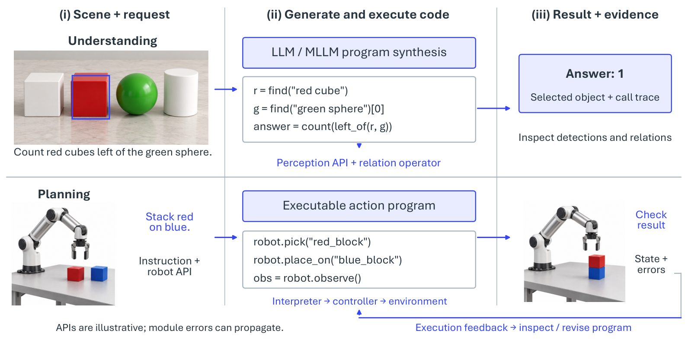
</p>
<p align="center"><sub><b>Figure 47.</b> Code/DSL generation for spatial reasoning in two modes: understanding (top), where a counting query becomes a program over perception calls whose call trace is inspectable, and planning (bottom), where an instruction becomes robot API calls whose execution feedback drives program revision.</sub></p>

**2025**

- [**Visual Agentic AI for Spatial Reasoning with a Dynamic API**](https://arxiv.org/abs/2502.06787) [](https://arxiv.org/abs/2502.06787) [](https://github.com/damianomarsili/VADAR) <!-- 25 -->

**2023**

- [**LLM-Grounder: Open-Vocabulary 3D Visual Grounding with Large Language Model as an Agent**](https://arxiv.org/abs/2309.12311) [](https://arxiv.org/abs/2309.12311) [](https://github.com/sled-group/chat-with-nerf) <!-- 09-23 -->
- [**Voyager: An Open-Ended Embodied Agent with Large Language Models**](https://arxiv.org/abs/2305.16291) [](https://arxiv.org/abs/2305.16291) [](https://github.com/MineDojo/Voyager) <!-- 05-23 -->
- [**LERF: Language Embedded Radiance Fields**](https://arxiv.org/abs/2303.09553) [](https://arxiv.org/abs/2303.09553) <!-- 23 -->
- [**What's Left? Concept Grounding with Logic-Enhanced Foundation Models**](https://arxiv.org/abs/2310.16035) [](https://arxiv.org/abs/2310.16035) [](https://github.com/joyhsu0504/LEFT) <!-- 23 -->

**2022**

- [**OpenScene: 3D Scene Understanding with Open Vocabularies**](https://arxiv.org/abs/2211.15654) [](https://arxiv.org/abs/2211.15654) <!-- 11-22 -->
- [**Code as Policies: Language Model Programs for Embodied Control**](https://arxiv.org/abs/2209.07753) [](https://arxiv.org/abs/2209.07753) <!-- 09-22 -->
- [**Simple Open-Vocabulary Object Detection**](https://doi.org/10.1007/978-3-031-20080-9_42) [](https://doi.org/10.1007/978-3-031-20080-9_42) <!-- 22 -->

#### 7.3.5. Tool-augmented Reasoning
<p align="center">
  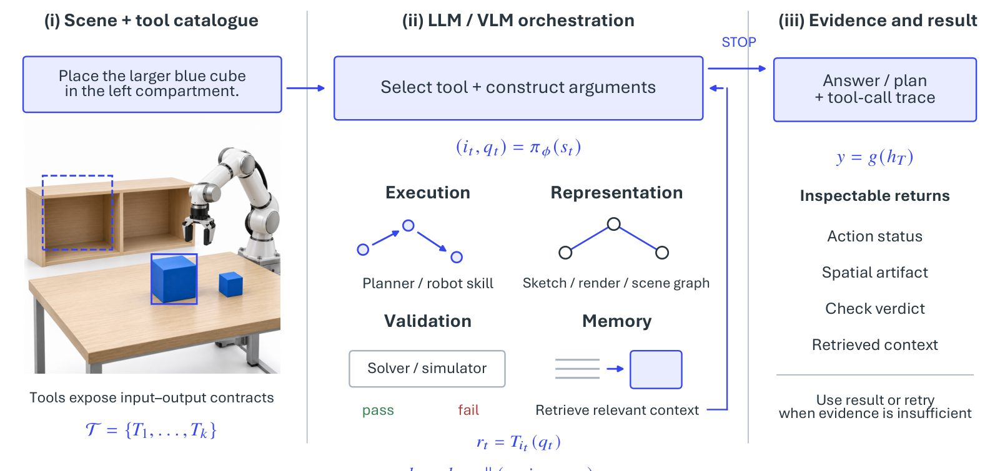
</p>
<p align="center"><sub><b>Figure 48.</b> Tool-augmented spatial reasoning as iterative orchestration over black-box tools: (i) scene, instruction, and tool catalogue <i>𝒯</i>, (ii) an LLM/VLM that selects tool <i>i</i><sub><i>t</i></sub> with arguments <i>q</i><sub><i>t</i></sub>, receives result <i>r</i><sub><i>t</i></sub>, and appends to history <i>h</i><sub><i>t</i></sub> until STOP, and (iii) the answer or plan with its tool-call trace.</sub></p>

**2026**

- [**Perceive, Interact, Reason: Building Tool-Augmented Visual Agents for Spatial Reasoning**](https://arxiv.org/abs/2606.12830) [](https://arxiv.org/abs/2606.12830) <!-- 06-26 -->
- [**S-Agent: Spatial Tool-Use Elicits Reasoning for Spatial Intelligence**](https://arxiv.org/abs/2606.20515) [](https://arxiv.org/abs/2606.20515) [](https://github.com/Ropedia/S-Agent) <!-- 06-26 -->
- [**SpatialClaw: Rethinking Action Interface for Agentic Spatial Reasoning**](https://arxiv.org/abs/2606.13673) [](https://arxiv.org/abs/2606.13673) [](https://github.com/NVlabs/SpatialClaw) <!-- 06-26 -->

**2025**

- [**SpaceTools: Tool-Augmented Spatial Reasoning via Double Interactive RL**](https://arxiv.org/abs/2512.04069) [](https://arxiv.org/abs/2512.04069) [](https://github.com/spacetools/SpaceTools) <!-- 12-25 -->
- [**Cambrian-S: Towards Spatial Supersensing in Video**](https://arxiv.org/abs/2511.04670) [](https://arxiv.org/abs/2511.04670) [](https://github.com/cambrian-mllm/cambrian-s) <!-- 11-25 -->
- [**MemoTime: Memory-Augmented Temporal Knowledge Graph Enhanced Large Language Model Reasoning**](https://arxiv.org/abs/2510.13614) [](https://arxiv.org/abs/2510.13614) <!-- 10-25 -->
- [**Plan Verification for LLM-Based Embodied Task Completion Agents**](https://arxiv.org/abs/2509.02761) [](https://arxiv.org/abs/2509.02761) <!-- 09-25 -->
- [**MemOS: A Memory OS for AI System**](https://arxiv.org/abs/2507.03724) [](https://arxiv.org/abs/2507.03724) [](https://github.com/MemTensor/MemOS) <!-- 07-25 -->
- [**Scaling and Beyond: Advancing Spatial Reasoning in MLLMs Requires New Recipes**](https://arxiv.org/abs/2504.15037) [](https://arxiv.org/abs/2504.15037) <!-- 04-25 -->
- [**Multi-Agent LLM Actor-Critic Framework for Social Robot Navigation**](https://arxiv.org/abs/2503.09758) [](https://arxiv.org/abs/2503.09758) <!-- 03-25 -->
- [**STMA: A Spatio-Temporal Memory Agent for Long-Horizon Embodied Task Planning**](https://arxiv.org/abs/2502.10177) [](https://arxiv.org/abs/2502.10177) <!-- 02-25 -->
- [**Neuro-Symbolic Artificial Intelligence: Towards Improving the Reasoning Abilities of Large Language Models**](https://arxiv.org/abs/2508.13678) [](https://arxiv.org/abs/2508.13678) [](https://github.com/LAMDA-NeSy/Awesome-LLM-Reasoning-with-NeSy) <!-- 25 -->

**2024**

- [**ReMEmbR: Building and Reasoning Over Long-Horizon Spatio-Temporal Memory for Robot Navigation**](https://arxiv.org/abs/2409.13682) [](https://arxiv.org/abs/2409.13682) [](https://github.com/NVIDIA-AI-IOT/remembr) <!-- 09-24 -->
- [**Visual Sketchpad: Sketching as a Visual Chain of Thought for Multimodal Language Models**](https://arxiv.org/abs/2406.09403) [](https://arxiv.org/abs/2406.09403) <!-- 24 -->

**2023**

- [**VoxPoser: Composable 3D Value Maps for Robotic Manipulation with Language Models**](https://arxiv.org/abs/2307.05973) [](https://arxiv.org/abs/2307.05973) [](https://github.com/huangwl18/VoxPoser) <!-- 23 -->

**2022**

- [**Do As I Can, Not As I Say: Grounding Language in Robotic Affordances**](https://arxiv.org/abs/2204.01691) [](https://arxiv.org/abs/2204.01691) [](https://github.com/Cassie-Lim/saycan) <!-- 22 -->

#### 7.3.6. Retrieval- & Memory-augmented Spatial Reasoning
<p align="center">
  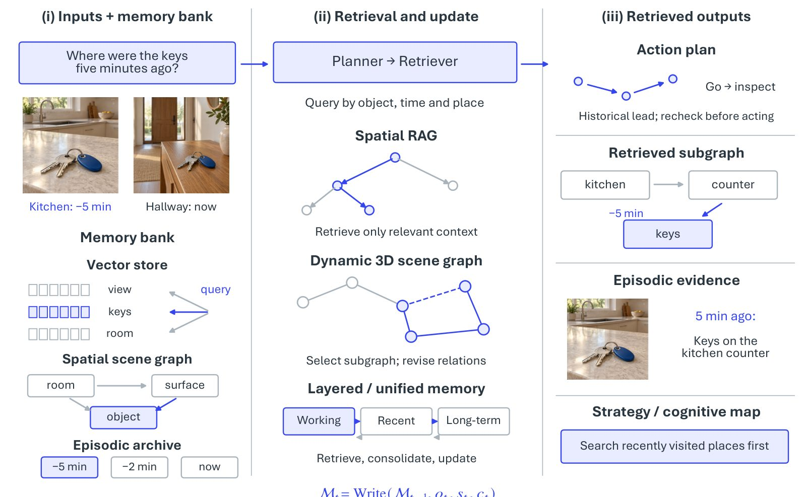
</p>
<p align="center"><sub><b>Figure 49.</b> Retrieval- and memory-augmented spatial reasoning: (i) a query and a memory bank of vector records, spatial scene graphs, and episodic archives, (ii) retrieval and update via spatial RAG, dynamic 3D scene graphs, or layered memory, and (iii) alternative output forms rather than joint outputs of one query.</sub></p>

**2025**

- [**Vision to Geometry: 3D Spatial Memory for Sequential Embodied MLLM Reasoning and Exploration**](https://arxiv.org/abs/2512.02458) [](https://arxiv.org/abs/2512.02458) <!-- 12-25 -->
- [**Vision-Language Memory for Spatial Reasoning**](https://arxiv.org/abs/2511.20644) [](https://arxiv.org/abs/2511.20644) <!-- 11-25 -->
- [**Meta-Memory: Retrieving and Integrating Semantic-Spatial Memories for Robot Spatial Reasoning**](https://arxiv.org/abs/2509.20754) [](https://arxiv.org/abs/2509.20754) <!-- 09-25 -->
- [**GoViG: Goal-Conditioned Visual Navigation Instruction Generation via Multimodal Reasoning**](https://arxiv.org/abs/2508.09547) [](https://arxiv.org/abs/2508.09547) [](https://github.com/UWMILab/GoViG) <!-- 08-25 -->
- [**RoboMemory: A Brain-inspired Multi-memory Agentic Framework for Interactive Environmental Learning in Physical Embodied Systems**](https://arxiv.org/abs/2508.01415) [](https://arxiv.org/abs/2508.01415) <!-- 08-25 -->
- [**SpaCE-10: A Comprehensive Benchmark for Multimodal Large Language Models in Compositional Spatial Intelligence**](https://arxiv.org/abs/2506.07966) [](https://arxiv.org/abs/2506.07966) [](https://github.com/VisionXLab/SpaCE-10) <!-- 06-25 -->
- [**Spatial-RAG: Spatial Retrieval Augmented Generation for Real-World Geospatial Reasoning Questions**](https://arxiv.org/abs/2502.18470) [](https://arxiv.org/abs/2502.18470) <!-- 02-25 -->
- [**3D-Mem: 3D Scene Memory for Embodied Exploration and Reasoning**](https://openaccess.thecvf.com/content/CVPR2025/html/Yang_3D-Mem_3D_Scene_Memory_for_Embodied_Exploration_and_Reasoning_CVPR_2025_paper.html) [](https://openaccess.thecvf.com/content/CVPR2025/html/Yang_3D-Mem_3D_Scene_Memory_for_Embodied_Exploration_and_Reasoning_CVPR_2025_paper.html) <!-- 25 -->
- [**3DLLM-Mem: Long-Term Spatial-Temporal Memory for Embodied 3D Large Language Model**](https://arxiv.org/abs/2505.22657) [](https://arxiv.org/abs/2505.22657) <!-- 25 -->
- [**EmbodiedBench: Comprehensive Benchmarking Multi-modal Large Language Models for Vision-Driven Embodied Agents**](https://arxiv.org/abs/2502.09560) [](https://arxiv.org/abs/2502.09560) [](https://github.com/EmbodiedBench/EmbodiedBench) <!-- 25 -->
- [**NavRAG: Generating User Demand Instructions for Embodied Navigation through Retrieval-Augmented LLM**](https://arxiv.org/abs/2502.11142) [](https://arxiv.org/abs/2502.11142) [](https://github.com/MrZihan/NavRAG) <!-- 25 -->
- [**SITE: Towards Spatial Intelligence Thorough Evaluation**](https://arxiv.org/abs/2505.05456) [](https://arxiv.org/abs/2505.05456) <!-- 25 -->

**2024**

- [**VisRAG: Vision-based Retrieval-augmented Generation on Multi-modality Documents**](https://arxiv.org/abs/2410.10594) [](https://arxiv.org/abs/2410.10594) [](https://github.com/OpenBMB/VisRAG) <!-- 10-24 -->

#### 7.3.7. Agentic Spatial Reasoning
<p align="center">
  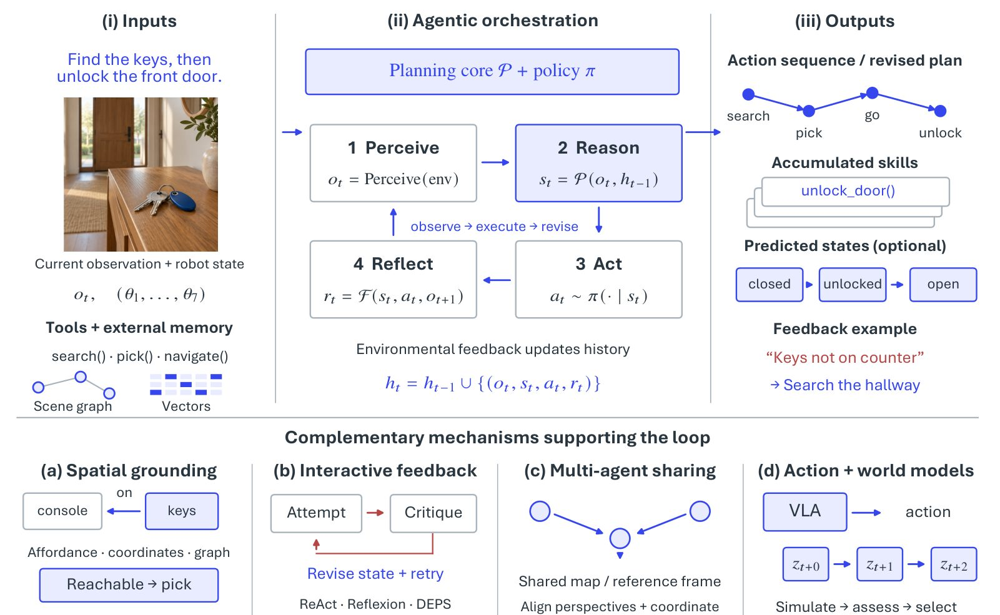
</p>
<p align="center"><sub><b>Figure 50.</b> Agentic spatial reasoning as closed-loop orchestration. Top: (i) instruction, observation, robot state, tools, and memory, (ii) the perceive–reason–act–reflect loop under planning core <i>𝒫</i> and policy π, and (iii) complementary, not simultaneous, output forms; the door-state sequence is a prediction and the failed counter search is feedback from a different step.</sub></p>

**2026**

- [**World Pilot: Steering Vision-Language-Action Models with World-Action Priors**](https://arxiv.org/abs/2606.12403) [](https://arxiv.org/abs/2606.12403) [](https://github.com/ZefuLin/WorldPilot) <!-- 06-26 -->
- [**World-Language-Action Model for Unified World Modeling, Language Reasoning, and Action Synthesis**](https://arxiv.org/abs/2606.05979) [](https://arxiv.org/abs/2606.05979) <!-- 06-26 -->

**2025**

- [**TIR-Bench: A Comprehensive Benchmark for Agentic Thinking-with-Images Reasoning**](https://arxiv.org/abs/2511.01833) [](https://arxiv.org/abs/2511.01833) [](https://github.com/agents-x-project/TIR-Bench) <!-- 11-25 -->
- [**DSI-Bench: A Benchmark for Dynamic Spatial Intelligence**](https://arxiv.org/abs/2510.18873) [](https://arxiv.org/abs/2510.18873) <!-- 10-25 -->
- [**Spatial-DISE: A Unified Benchmark for Evaluating Spatial Reasoning in Vision-Language Models**](https://arxiv.org/abs/2510.13394) [](https://arxiv.org/abs/2510.13394) [](https://github.com/shinmohuang/SpatialDise) <!-- 10-25 -->
- [**Planning with Reasoning using Vision Language World Model**](https://arxiv.org/abs/2509.02722) [](https://arxiv.org/abs/2509.02722) <!-- 09-25 -->
- [**Embodied-R1: Reinforced Embodied Reasoning for General Robotic Manipulation**](https://arxiv.org/abs/2508.13998) [](https://arxiv.org/abs/2508.13998) <!-- 08-25 -->
- [**Genie 3: A New Frontier for World Models**](https://deepmind.google/blog/genie-3-a-new-frontier-for-world-models/) [](https://deepmind.google/blog/genie-3-a-new-frontier-for-world-models/) <!-- 08-25 -->
- [**InternSpatial: A Comprehensive Dataset for Spatial Reasoning in Vision-Language Models**](https://arxiv.org/abs/2506.18385) [](https://arxiv.org/abs/2506.18385) <!-- 06-25 -->
- [**OmniSpatial: Towards Comprehensive Spatial Reasoning Benchmark for Vision Language Models**](https://arxiv.org/abs/2506.03135) [](https://arxiv.org/abs/2506.03135) [](https://github.com/qizekun/OmniSpatial) <!-- 06-25 -->
- [**MMSI-Bench: A Benchmark for Multi-Image Spatial Intelligence**](https://arxiv.org/abs/2505.23764) [](https://arxiv.org/abs/2505.23764) <!-- 05-25 -->
- [**Seeing from Another Perspective: Evaluating Multi-View Understanding in MLLMs**](https://arxiv.org/abs/2504.15280) [](https://arxiv.org/abs/2504.15280) [](https://github.com/Chenyu-Wang567/All-Angles-Bench) <!-- 04-25 -->
- [**Open3D-VQA: A Benchmark for Comprehensive Spatial Reasoning with Multimodal Large Language Model in Open Space**](https://arxiv.org/abs/2503.11094) [](https://arxiv.org/abs/2503.11094) [](https://github.com/EmbodiedCity/Open3D-VQA.code) <!-- 03-25 -->
- [**SpatialCoT: Advancing Spatial Reasoning through Coordinate Alignment and Chain-of-Thought for Embodied Task Planning**](https://arxiv.org/abs/2501.10074) [](https://arxiv.org/abs/2501.10074) <!-- 01-25 -->
- [**iVISPAR - An Interactive Visual-Spatial Reasoning Benchmark for VLMs**](https://arxiv.org/abs/2502.03214) [](https://arxiv.org/abs/2502.03214) [](https://github.com/SharkyBamboozle/iVISPAR) <!-- 25 -->
- [**Spatial457: A Diagnostic Benchmark for 6D Spatial Reasoning of Large Mutimodal Models**](https://openaccess.thecvf.com/content/CVPR2025/html/Wang_Spatial457_A_Diagnostic_Benchmark_for_6D_Spatial_Reasoning_of_Large_CVPR_2025_paper.html) [](https://openaccess.thecvf.com/content/CVPR2025/html/Wang_Spatial457_A_Diagnostic_Benchmark_for_6D_Spatial_Reasoning_of_Large_CVPR_2025_paper.html) <!-- 25 -->
- [**STI-Bench: Are MLLMs Ready for Precise Spatial-Temporal World Understanding?**](https://arxiv.org/abs/2503.23765) [](https://arxiv.org/abs/2503.23765) <!-- 25 -->
- [**VLM4D: Towards Spatiotemporal Awareness in Vision Language Models**](https://arxiv.org/abs/2508.02095) [](https://arxiv.org/abs/2508.02095) <!-- 25 -->

**2024**

- [**Thinking in Space: How Multimodal Large Language Models See, Remember, and Recall Spaces**](https://arxiv.org/abs/2412.14171) [](https://arxiv.org/abs/2412.14171) [](https://github.com/vision-x-nyu/thinking-in-space) <!-- 12-24 -->

**2023**

- [**Describe, Explain, Plan and Select: Interactive Planning with Large Language Models Enables Open-World Multi-Task Agents**](https://arxiv.org/abs/2302.01560) [](https://arxiv.org/abs/2302.01560) [](https://github.com/CraftJarvis/MC-Planner) <!-- 02-23 -->
- [**Mastering Diverse Domains through World Models**](https://arxiv.org/abs/2301.04104) [](https://arxiv.org/abs/2301.04104) [](https://github.com/danijar/dreamerv3) <!-- 01-23 -->
- [**RT-2: Vision-Language-Action Models Transfer Web Knowledge to Robotic Control**](https://arxiv.org/abs/2307.15818) [](https://arxiv.org/abs/2307.15818) <!-- 23 -->

#### 7.3.8. World-Model-based Spatial Reasoning
<p align="center">
  
</p>
<p align="center"><sub><b>Figure 51.</b> World-model-based spatial reasoning read as tool use: (i) a spatial query <i>q</i> with context <i>c</i> and optional actions <i>a</i><sub>0:<i>T</i>−1</sub>; (ii) a pretrained world model (constructed and trained as in §8.6) whose predictive feedback <i>f</i> takes four possibly overlapping forms, namely (a) future observations, (b) future states, (c) action-conditioned trajectories, and (d) predictive latents; and (iii) a readout <i>y</i> = <i>g</i>(<i>c</i>, <i>f</i>) that gives an inferred relation (understanding) or a selected plan (planning).</sub></p>

**2026**

- [**World2VLM: Distilling World Model Imagination into VLMs for Dynamic Spatial Reasoning**](https://arxiv.org/abs/2604.26934) [](https://arxiv.org/abs/2604.26934) [](https://github.com/WanyueZhang-ai/World2VLM) <!-- 04-26 -->
- [**When and How Much to Imagine: Adaptive Test-Time Scaling with World Models for Visual Spatial Reasoning**](https://arxiv.org/abs/2602.08236) [](https://arxiv.org/abs/2602.08236) <!-- 02-26 -->

**2025**

- [**Probing the effectiveness of World Models for Spatial Reasoning through Test-time Scaling**](https://arxiv.org/abs/2512.05809) [](https://arxiv.org/abs/2512.05809) [](https://github.com/chandar-lab/visa-for-mindjourney) <!-- 12-25 -->
- [**SpatialDreamer: Incentivizing Spatial Reasoning via Active Mental Imagery**](https://arxiv.org/abs/2512.07733) [](https://arxiv.org/abs/2512.07733) <!-- 12-25 -->
- [**VL-JEPA: Joint Embedding Predictive Architecture for Vision-language**](https://arxiv.org/abs/2512.10942) [](https://arxiv.org/abs/2512.10942) <!-- 12-25 -->
- [**Think with 3D: Geometric Imagination Grounded Spatial Reasoning from Limited Views**](https://arxiv.org/abs/2510.18632) [](https://arxiv.org/abs/2510.18632) [](https://github.com/zhangquanchen/3DThinker) <!-- 10-25 -->
- [**DreamArt: Generating Interactable Articulated Objects from a Single Image**](https://arxiv.org/abs/2507.05763) [](https://arxiv.org/abs/2507.05763) <!-- 07-25 -->
- [**V-JEPA 2: Self-Supervised Video Models Enable Understanding, Prediction and Planning**](https://arxiv.org/abs/2506.09985) [](https://arxiv.org/abs/2506.09985) [](https://github.com/facebookresearch/vjepa2) <!-- 06-25 -->
- [**DreamGen: Unlocking Generalization in Robot Learning through Video World Models**](https://arxiv.org/abs/2505.12705) [](https://arxiv.org/abs/2505.12705) [](https://github.com/NVIDIA/GR00T-Dreams) <!-- 05-25 -->
- [**Articulate That Object Part (ATOP): 3D Part Articulation via Text and Motion Personalization**](https://arxiv.org/abs/2502.07278) [](https://arxiv.org/abs/2502.07278) <!-- 02-25 -->
- [**Force Prompting: Video Generation Models Can Learn And Generalize Physics-based Control Signals**](https://arxiv.org/abs/2505.19386) [](https://arxiv.org/abs/2505.19386) [](https://github.com/brown-palm/force-prompting) <!-- 25 -->
- [**Learning 3D Persistent Embodied World Models**](https://arxiv.org/abs/2505.05495) [](https://arxiv.org/abs/2505.05495) <!-- 25 -->
- [**Learning 4D Embodied World Models**](https://arxiv.org/abs/2504.20995) [](https://arxiv.org/abs/2504.20995) <!-- 25 -->
- [**VAGEN: Reinforcing World Model Reasoning for Multi-Turn VLM Agents**](https://arxiv.org/abs/2510.16907) [](https://arxiv.org/abs/2510.16907) [](https://github.com/mll-lab-nu/VAGEN) <!-- 25 -->
- [**VMem: Consistent Interactive Video Scene Generation with Surfel-Indexed View Memory**](https://arxiv.org/abs/2506.18903) [](https://arxiv.org/abs/2506.18903) [](https://github.com/runjiali-rl/vmem) <!-- 25 -->

**2023**

- [**Self-Supervised Learning from Images with a Joint-Embedding Predictive Architecture**](https://arxiv.org/abs/2301.08243) [](https://arxiv.org/abs/2301.08243) [](https://github.com/facebookresearch/ijepa) <!-- 23 -->

### 7.4. Hybrid Spatial Reasoning
<p align="center">
  
</p>
<p align="center"><sub><b>Figure 52.</b> Illustration of the agentic hybrid orchestration pattern: a foundation-model controller dynamically selects perception, world-modeling, symbolic-reasoning, memory, and action tools within a closed-loop perceive–reason–act–reflect cycle.</sub></p>

**2026**

- [**LLMPhy: Parameter-Identifiable Physical Reasoning Combining Large Language Models and Physics Engines**](https://arxiv.org/abs/2411.08027) [](https://arxiv.org/abs/2411.08027) <!-- 26 -->

**2025**

- [**DrawingBench: Evaluating Spatial Reasoning and UI Interaction Capabilities of Large Language Models through Mouse-Based Drawing Tasks**](https://arxiv.org/abs/2512.01174) [](https://arxiv.org/abs/2512.01174) [](https://github.com/hyunjun1121/DrawingBench) <!-- 12-25 -->
- [**Neuro-Symbolic Spatial Reasoning in Segmentation**](https://arxiv.org/abs/2510.15841) [](https://arxiv.org/abs/2510.15841) <!-- 10-25 -->
- [**Mind Meets Space: Rethinking Agentic Spatial Intelligence from a Neuroscience-inspired Perspective**](https://arxiv.org/abs/2509.09154) [](https://arxiv.org/abs/2509.09154) <!-- 09-25 -->
- [**ChronoLLM: Customizing Language Models for Physics-Based Simulation Code Generation**](https://arxiv.org/abs/2508.13975) [](https://arxiv.org/abs/2508.13975) <!-- 08-25 -->
- [**MSNav: Zero-Shot Vision-and-Language Navigation with Dynamic Memory and LLM Spatial Reasoning**](https://arxiv.org/abs/2508.16654) [](https://arxiv.org/abs/2508.16654) <!-- 08-25 -->
- [**See it. Say it. Sorted: Agentic System for Compositional Diagram Generation**](https://arxiv.org/abs/2508.15222) [](https://arxiv.org/abs/2508.15222) <!-- 08-25 -->
- [**Embodied-R: Collaborative Framework for Activating Embodied Spatial Reasoning in Foundation Models via Reinforcement Learning**](https://arxiv.org/abs/2504.12680) [](https://arxiv.org/abs/2504.12680) [](https://github.com/EmbodiedCity/Embodied-R.code) <!-- 25 -->
- [**PhysVLM: Enabling Visual Language Models to Understand Robotic Physical Reachability**](https://arxiv.org/abs/2503.08481) [](https://arxiv.org/abs/2503.08481) [](https://github.com/jetteezhou/PhysVLM) <!-- 25 -->
- [**Towards Long-Horizon Vision-Language-Action System: Reasoning, Acting and Memory**](https://doi.org/10.1109/ICCV51701.2025.00643) [](https://doi.org/10.1109/ICCV51701.2025.00643) <!-- 25 -->

### 7.5. Spatial Reasoning Benchmarks
* Rows follow Table 7.6 of the handbook, grouped by what each benchmark tests. Values were checked against the source papers.
* Number is the evaluation-set size where the source paper documents one (train / test when both are given, scene counts for simulators). Perspective marks explicitly designed ego (first-person) and exo (third-person) settings; "-" marks attributes the source paper does not state.

**Physical-Focused Spatial Reasoning**

| Benchmark | Year | Number | Modality | View | Perspective | Data Source | Task |
|:---------------------------:|:------:|:-------------------:|:----------:|:----------:|:----------:|:----------------:|:-----------:|
| [IntPhys](https://arxiv.org/abs/1803.07616) | 2018 | 15k / 10.8k | Video | Single | Exo | Synthetic | VoE plausibility |
| [IntPhys 2](https://arxiv.org/abs/2506.09849) | 2025 | 1,416 | Video | Single | Exo | Synthetic | VoE plausibility |
| [Physion](https://arxiv.org/abs/2106.08261) | 2021 | 1.2k | Video | Single | Exo | Synthetic | Physical prediction / choice |
| [Physion++](https://arxiv.org/abs/2306.15668) | 2023 | 8k / 768 | Video | Single | Exo | Synthetic | Physical prediction / choice |
| [Physical Concepts Dataset](https://doi.org/10.1038/s41562-022-01394-8) | 2022 | 300k / 25k | Video | Single | Exo | Synthetic | classification |
| [Physics-IQ](https://arxiv.org/abs/2501.09038) | 2025 | 396 | Video | Single | Exo | Real | Generative physical prediction |
| [SPhyR](https://arxiv.org/abs/2505.16048) | 2025 | 1,296 | Text | Single | - | Synthetic | Physical prediction / infill |

**Vision-Based Spatial Reasoning**

| Benchmark | Year | Number | Modality | View | Perspective | Data Source | Task |
|:---------------------------:|:------:|:-------------------:|:----------:|:----------:|:----------:|:----------------:|:-----------:|
| [CLEVR](https://arxiv.org/abs/1612.06890) | 2016 | 853k | Image | Single | Exo | Synthetic | VQA |
| [VSR](https://arxiv.org/abs/2205.00363) | 2022 | 10,972 | Image | Single | Exo | Real | VQA |
| [What's Up](https://arxiv.org/abs/2310.19785) | 2023 | 4,958 | Image | Single | Exo | Real | Caption selection |
| [RocketScience](https://arxiv.org/abs/2509.02175) | 2025 | 482 | Image | Single | Exo | Real | Image-text matching |
| [SpaRE](https://arxiv.org/abs/2504.20648) | 2025 | 455k (train) | Image | Single | Exo | Real | VQA |
| RealWorldQA | 2024 | 765 | Image | Single | Ego | Real | VQA |
| [3DSRBench](https://arxiv.org/abs/2412.07825) | 2024 | 2,772 | Image | Single | Exo | Real/Sim | VQA |
| [InternSpatial-Bench](https://arxiv.org/abs/2506.18385) | 2025 | 6,008 | Image | Single | Exo | Real | VQA |
| [OmniSpatial](https://arxiv.org/abs/2506.03135) | 2025 | ~8,400 | Image | Single | Ego, Exo | Real | VQA |
| [Spatial457](https://openaccess.thecvf.com/content/CVPR2025/html/Wang_Spatial457_A_Diagnostic_Benchmark_for_6D_Spatial_Reasoning_of_Large_CVPR_2025_paper.html) | 2025 | 23,752 | Image | Single | - | Synthetic | VQA |
| [All-Angles Bench](https://arxiv.org/abs/2504.15280) | 2025 | ~2,100 | Image | Multi | - | Real | VQA |
| [EmbSpatial-Bench](https://arxiv.org/abs/2406.05756) | 2024 | 3,640 | Image | Single | Ego | Real/Sim | VQA |
| [MMSI-Bench](https://arxiv.org/abs/2505.23764) | 2025 | 1,000 | Image | Multi | - | Real | VQA |
| [MindCube](https://arxiv.org/abs/2506.21458) | 2025 | 21,154 | Image | Multi | - | Real | VQA |
| [BLINK](https://arxiv.org/abs/2404.12390) | 2024 | 3,807 | Image | Single | Exo | Real | VQA |
| [NuScenes-SpatialQA](https://arxiv.org/abs/2504.03164) | 2025 | 3.3M+ | Image | Single, Multi | Ego, Exo | Real | VQA |
| [VSI-Bench](https://arxiv.org/abs/2412.14171) | 2024 | 5,130 | Video | Single | Ego | Real | VQA |
| [VLM4D](https://arxiv.org/abs/2508.02095) | 2025 | ~1,800 | Video | Single | Ego, Exo | Real/Synthetic | VQA |
| [STI-Bench](https://arxiv.org/abs/2503.23765) | 2025 | 2,064 | Video | Single | Ego, Exo | Real | VQA |
| [DSI-Bench](https://arxiv.org/abs/2510.18873) | 2025 | ~1,700 | Video | Single | - | Real/Synthetic | VQA |
| [SITE](https://arxiv.org/abs/2505.05456) | 2025 | 8,068 | Image/Video | Single | - | Real/Sim | VQA |
| [RoboSpatial](https://arxiv.org/abs/2411.16537) | 2024 | 3M (train) | Image/3D | Single | Ego | Real | VQA |
| [OSD](https://arxiv.org/abs/2406.01584) | 2024 | 1,406 | Image | Single | Exo | Real | VQA |
| [SpatialVLM](https://arxiv.org/abs/2401.12168) | 2024 | 2B (train) / 546 | Image | Single | Exo | Real | VQA |
| [ProVision](https://arxiv.org/abs/2412.07012) | 2024 | >10M (train) | Image | Single | Exo | Real | VQA |
| [WhatIsWhere](http://www.ijcai.org/Abstract/16/483) | 2016 | 1,326 | Video | Single | Exo | Real | Containment inference |
| [SURDS](https://arxiv.org/abs/2411.13112) | 2024 | 9,250 | Image | Single | Ego | Real | VQA |
| [EarthSpatialBench](https://arxiv.org/abs/2602.15918) | 2026 | 325k+ | Image | Single | Exo | Real | VQA |
| [PureSpace](https://doi.org/10.1109/cvprf71909.2026.00194) | 2026 | 22.4K / 7,200 | Image | Single | - | Synthetic | VQA |
| [SAT](https://arxiv.org/abs/2412.07755) | 2024 | 175k / 150 | Image | Multi | Ego, Exo | Real/Sim | VQA |
| [SpatiaLQA](https://arxiv.org/abs/2602.20901) | 2026 | 9,605 | Image | Single | Exo | Real | VQA |
| [Q-Spatial++](https://arxiv.org/abs/2409.09788) | 2025 | 101 | Image | Single | Exo | Real | VQA |

**3D-Focused Spatial Reasoning**

| Benchmark | Year | Number | Modality | View | Perspective | Data Source | Task |
|:---------------------------:|:------:|:-------------------:|:----------:|:----------:|:----------:|:----------------:|:-----------:|
| [ScanQA](https://arxiv.org/abs/2112.10482) | 2021 | 41,363 | 3D | Multi | Exo | Real (ScanNet) | 3D VQA |
| [SQA3D](https://arxiv.org/abs/2210.07474) | 2022 | 26,623 / 3,519 | 3D | Single | Ego | Real (ScanNet) | 3D VQA |
| [MMScan QA](https://arxiv.org/abs/2406.09401) | 2024 | 295K | 3D+Image | Single, Multi | Exo | Real (EmbodiedScan) | 3D VQA |
| [OpenEQA](https://doi.org/10.1109/CVPR52733.2024.01560) | 2024 | 1,600+ | Video/3D | Single | Ego | Real (HM3D, ScanNet) | Embodied QA (EM / A splits) |
| [Space3D-Bench](https://arxiv.org/abs/2408.16662) | 2024 | 1,000 | 3D | Single | Ego | Real(Replica) | 3D QA |
| [Scan2Cap](https://arxiv.org/abs/2012.02206) | 2020 | 36,665 / 9,508 | 3D | Multi | Exo | Real (ScanNet) | 3D Captioning |
| [MMScan Captioning](https://arxiv.org/abs/2406.09401) | 2024 | - | 3D+Image | Single, Multi | Exo | Real (EmbodiedScan) | 3D Captioning |
| [ScanRefer](https://arxiv.org/abs/1912.08830) | 2019 | 51,583 | 3D | Multi | Exo | Real (ScanNet) | 3D Grounding |
| [Multi3DRefer](https://arxiv.org/abs/2309.05251) | 2023 | 61,926 | 3D | Multi | Exo | Real (ScanNet) | 3D Grounding |
| [SR3D](https://doi.org/10.1007/978-3-030-58452-8_25) | 2020 | 83,572 | 3D | Multi | Exo | Real (ScanNet) | 3D Grounding |
| [NR3D](https://doi.org/10.1007/978-3-030-58452-8_25) | 2020 | 41,503 | 3D | Multi | Exo | Real (ScanNet) | 3D Grounding |
| [SpaceEra++](https://arxiv.org/abs/2607.01784) | 2026 | 925k (train) | Video/3D | Multi | Ego | Synthetic | 3D VQA |
| [Ego3D-Bench](https://arxiv.org/abs/2509.06266) | 2025 | 8,600+ | Image | Multi | Ego | Real | VQA |
| [SpatialScore](https://arxiv.org/abs/2505.17012) | 2025 | 5,025 | Image/3D | Multi | - | Real/Sim | VQA |
| [iVISPAR](https://arxiv.org/abs/2502.03214) | 2025 | 300 | 3D Env | Single | Exo | Simulation | Interactive reasoning |

**Robot Environments**

| Benchmark | Year | Number | Modality | View | Perspective | Data Source | Task |
|:---------------------------:|:------:|:-------------------:|:----------:|:----------:|:----------:|:----------------:|:-----------:|
| [AI2-THOR](https://arxiv.org/abs/1712.05474) | 2017 | 120 (Scenes) | 3D Env | Multi | Ego | Simulation | Nav/Manip |
| [TDW](https://arxiv.org/abs/2007.04954) | 2020 | - | 3D Env | Multi | Ego, Exo | Simulation | Physical Sim |
| [Habitat 2.0](https://arxiv.org/abs/2106.14405) | 2021 | 111 (Scenes) | 3D Env | Multi | Ego | Simulation | Navigation |
| [iGibson 2.0](https://arxiv.org/abs/2108.03272) | 2021 | 15 (Scenes) | 3D Env | Multi | Ego | Simulation | Interactive Nav |
| [Habitat 3.0](https://arxiv.org/abs/2310.13724) | 2023 | 211 (Scenes) | 3D Env | Multi | Ego | Simulation | Social Nav |
| [R2R](https://arxiv.org/abs/1711.07280) | 2017 | 21,567 | Image/Path | Multi | Ego | Real | Navigation |
| [RxR](https://arxiv.org/abs/2010.07954) | 2020 | 126,069 | Image/Path | Multi | Ego | Real | Navigation |

## 8. Spatial Reconstruction and Generation
Spatial reconstruction and generation is the productive counterpart to spatial perception and reasoning: rather than analyzing a scene that is given, it synthesizes spatial content, recovering or creating the geometry, appearance, and dynamics of objects, scenes, and worlds from conditions such as text, images, partial observations, or explicit constraints.

### 8.1. 2D Spatial Generation
#### 8.1.1. Text-to-image Generation
<p align="center">
  
</p>
<p align="center"><sub><b>Figure 53.</b> The latent-generator view of text-to-image generation. Top: the shared pipeline; the encoder <i>E</i> and the dashed paths are used only in training.</sub></p>

**2025**

- [**WISE: A World Knowledge-Informed Semantic Evaluation for Text-to-Image Generation**](https://arxiv.org/abs/2503.07265) [](https://arxiv.org/abs/2503.07265) [](https://github.com/PKU-YuanGroup/WISE) <!-- 03-25 -->

**2024**

- [**Evaluating and Improving Compositional Text-to-Visual Generation**](https://arxiv.org/abs/2406.13743) [](https://arxiv.org/abs/2406.13743) [](https://github.com/linzhiqiu/t2v_metrics) <!-- 24 -->
- [**Evaluating Text-to-Visual Generation with Image-to-Text Generation**](https://arxiv.org/abs/2404.01291) [](https://arxiv.org/abs/2404.01291) [](https://github.com/linzhiqiu/t2v_metrics) <!-- 24 -->
- [**Getting it Right: Improving Spatial Consistency in Text-to-Image Models**](https://arxiv.org/abs/2404.01197) [](https://arxiv.org/abs/2404.01197) [](https://github.com/SPRIGHT-T2I/SPRIGHT) <!-- 24 -->

**2023**

- [**Consistency Models**](https://arxiv.org/abs/2303.01469) [](https://arxiv.org/abs/2303.01469) [](https://github.com/openai/consistency_models) <!-- 23 -->
- [**GenEval: An object-focused framework for evaluating text-to-image alignment**](https://arxiv.org/abs/2310.11513) [](https://arxiv.org/abs/2310.11513) [](https://github.com/djghosh13/geneval) <!-- 23 -->
- [**Holistic Evaluation of Text-to-Image Models**](https://arxiv.org/abs/2311.04287) [](https://arxiv.org/abs/2311.04287) [](https://github.com/stanford-crfm/helm) <!-- 23 -->
- [**HRS-Bench: Holistic, Reliable and Scalable Benchmark for Text-to-Image Models**](https://arxiv.org/abs/2304.05390) [](https://arxiv.org/abs/2304.05390) [](https://github.com/eslambakr/HRS_benchmark) <!-- 23 -->
- [**ImageReward: Learning and Evaluating Human Preferences for Text-to-Image Generation**](https://arxiv.org/abs/2304.05977) [](https://arxiv.org/abs/2304.05977) [](https://github.com/zai-org/ImageReward) <!-- 23 -->
- [**Pick-a-Pic: An Open Dataset of User Preferences for Text-to-Image Generation**](https://arxiv.org/abs/2305.01569) [](https://arxiv.org/abs/2305.01569) [](https://github.com/yuvalkirstain/PickScore) <!-- 23 -->
- [**TIFA: Accurate and Interpretable Text-to-Image Faithfulness Evaluation with Question Answering**](https://arxiv.org/abs/2303.11897) [](https://arxiv.org/abs/2303.11897) [](https://github.com/Yushi-Hu/tifa) <!-- 23 -->

**2022**

- [**Benchmarking Spatial Relationships in Text-to-Image Generation**](https://arxiv.org/abs/2212.10015) [](https://arxiv.org/abs/2212.10015) [](https://github.com/microsoft/VISOR) <!-- 12-22 -->
- [**Scalable Diffusion Models with Transformers**](https://arxiv.org/abs/2212.09748) [](https://arxiv.org/abs/2212.09748) [](https://github.com/facebookresearch/DiT) <!-- 12-22 -->
- [**LAION-5B: An open large-scale dataset for training next generation image-text models**](https://arxiv.org/abs/2210.08402) [](https://arxiv.org/abs/2210.08402) [](https://github.com/mlfoundations/open_clip) <!-- 22 -->

**2021**

- [**High-Resolution Image Synthesis with Latent Diffusion Models**](https://arxiv.org/abs/2112.10752) [](https://arxiv.org/abs/2112.10752) [](https://github.com/CompVis/latent-diffusion) <!-- 12-21 -->

#### 8.1.2. 2D Spatial-aware Image Generation
<p align="center">
  
</p>
<p align="center"><sub><b>Figure 54.</b> Five mechanisms for injecting a spatial condition κ(<i>c</i>) into a text-to-image denoiser: (a) side-branch control (ControlNet), (b) lightweight adapters (T2I-Adapter), (c) gated grounding (GLIGEN), (d) layout-aware cross-attention (LayoutDiffusion), and (e) inference-time guidance (BoxDiff).</sub></p>

**2024**

- [**Mastering Text-to-Image Diffusion: Recaptioning, Planning, and Generating with Multimodal LLMs**](https://arxiv.org/abs/2401.11708) [](https://arxiv.org/abs/2401.11708) [](https://github.com/YangLing0818/RPG-DiffusionMaster) <!-- 24 -->

**2023**

- [**SDXL: Improving Latent Diffusion Models for High-Resolution Image Synthesis**](https://arxiv.org/abs/2307.01952) [](https://arxiv.org/abs/2307.01952) [](https://github.com/Stability-AI/generative-models) <!-- 07-23 -->
- [**T2I-Adapter: Learning Adapters to Dig Out More Controllable Ability for Text-to-Image Diffusion Models**](https://arxiv.org/abs/2302.08453) [](https://arxiv.org/abs/2302.08453) [](https://github.com/TencentARC/T2I-Adapter) <!-- 02-23 -->
- [**BoxDiff: Text-to-Image Synthesis with Training-Free Box-Constrained Diffusion**](https://arxiv.org/abs/2307.10816) [](https://arxiv.org/abs/2307.10816) [](https://github.com/showlab/BoxDiff) <!-- 23 -->
- [**GLIGEN: Open-Set Grounded Text-to-Image Generation**](https://arxiv.org/abs/2301.07093) [](https://arxiv.org/abs/2301.07093) [](https://github.com/gligen/GLIGEN) <!-- 23 -->
- [**LayoutDiffusion: Controllable Diffusion Model for Layout-to-Image Generation**](https://arxiv.org/abs/2303.17189) [](https://arxiv.org/abs/2303.17189) [](https://github.com/ZGCTroy/LayoutDiffusion) <!-- 23 -->
- [**LayoutGPT: Compositional Visual Planning and Generation with Large Language Models**](https://arxiv.org/abs/2305.15393) [](https://arxiv.org/abs/2305.15393) [](https://github.com/UCSB-AI/LayoutGPT) <!-- 23 -->
- [**MultiDiffusion: Fusing Diffusion Paths for Controlled Image Generation**](https://arxiv.org/abs/2302.08113) [](https://arxiv.org/abs/2302.08113) [](https://github.com/omerbt/MultiDiffusion) <!-- 23 -->

#### 8.1.3. 2D Spatial Inpainting & Editing
<p align="center">
  
</p>
<p align="center"><sub><b>Figure 55.</b> Local 2D editing with context preservation (top) and five editing mechanisms: (a) masked denoising, where <i>M</i> = 1 marks the editable region; (b) inversion and rewrite; (c) instruction-tuned editing; (d) exemplar / reference-guided editing; and (e) drag-based optimization.</sub></p>

**2023**

- [**Emu Edit: Precise Image Editing via Recognition and Generation Tasks**](https://arxiv.org/abs/2311.10089) [](https://arxiv.org/abs/2311.10089) <!-- 11-23 -->
- [**DragDiffusion: Harnessing Diffusion Models for Interactive Point-Based Image Editing**](https://arxiv.org/abs/2306.14435) [](https://arxiv.org/abs/2306.14435) [](https://github.com/Yujun-Shi/DragDiffusion) <!-- 06-23 -->
- [**Drag Your GAN: Interactive Point-based Manipulation on the Generative Image Manifold**](https://arxiv.org/abs/2305.10973) [](https://arxiv.org/abs/2305.10973) [](https://github.com/XingangPan/DragGAN) <!-- 23 -->
- [**MagicBrush: A Manually Annotated Dataset for Instruction-Guided Image Editing**](https://arxiv.org/abs/2306.10012) [](https://arxiv.org/abs/2306.10012) [](https://github.com/OSU-NLP-Group/MagicBrush) <!-- 23 -->

**2022**

- [**InstructPix2Pix: Learning to Follow Image Editing Instructions**](https://arxiv.org/abs/2211.09800) [](https://arxiv.org/abs/2211.09800) [](https://github.com/timothybrooks/instruct-pix2pix) <!-- 11-22 -->
- [**Null-text Inversion for Editing Real Images using Guided Diffusion Models**](https://arxiv.org/abs/2211.09794) [](https://arxiv.org/abs/2211.09794) [](https://github.com/thepowerfuldeez/null-text-inversion) <!-- 11-22 -->
- [**Imagic: Text-Based Real Image Editing with Diffusion Models**](https://arxiv.org/abs/2210.09276) [](https://arxiv.org/abs/2210.09276) <!-- 10-22 -->
- [**Prompt-to-Prompt Image Editing with Cross-Attention Control**](https://arxiv.org/abs/2208.01626) [](https://arxiv.org/abs/2208.01626) [](https://github.com/google/prompt-to-prompt) <!-- 08-22 -->

### 8.2. 3D Spatial Reconstruction and Generation
#### 8.2.1. 3D Object Synthesis
<p align="center">
  
</p>
<p align="center"><sub><b>Figure 56.</b> Four paradigm families for 3D object synthesis: (P1) 3D-native generation; (P2) distillation from a frozen 2D diffusion prior (SDS); (P3) multi-view generation with a fine-tuned prior, then lifting to 3D; and (P4) learned direct-to-3D routes, by one-pass reconstruction or iterative 3D latent sampling.</sub></p>

**2025**

- [**Moving Light Adaptive Colonoscopy Reconstruction via Illumination-Attenuation-Aware 3D Gaussian Splatting**](https://arxiv.org/abs/2510.18739) [](https://arxiv.org/abs/2510.18739) [](https://github.com/haowang020110/ColIAGS) <!-- 10-25 -->
- [**Hunyuan3D-Omni: A Unified Framework for Controllable Generation of 3D Assets**](https://arxiv.org/abs/2509.21245) [](https://arxiv.org/abs/2509.21245) [](https://github.com/Tencent-Hunyuan/Hunyuan3D-Omni) <!-- 09-25 -->
- [**Hunyuan3D 2.0: Scaling Diffusion Models for High Resolution Textured 3D Assets Generation**](https://arxiv.org/abs/2501.12202) [](https://arxiv.org/abs/2501.12202) [](https://github.com/Tencent-Hunyuan/Hunyuan3D-2) <!-- 01-25 -->
- [**AR-1-to-3: Single Image to Consistent 3D Object via Next-View Prediction**](https://doi.org/10.1109/ICCV51701.2025.02438) [](https://doi.org/10.1109/ICCV51701.2025.02438) <!-- 25 -->
- [**Gen3DEval: Using vLLMs for Automatic Evaluation of Generated 3D Objects**](https://arxiv.org/abs/2504.08125) [](https://arxiv.org/abs/2504.08125) <!-- 25 -->
- [**High-fidelity 3D Object Generation from Single Image with RGBN-Volume Gaussian Reconstruction Model**](https://arxiv.org/abs/2504.01512) [](https://arxiv.org/abs/2504.01512) <!-- 25 -->
- [**SPAR3D: Stable Point-Aware Reconstruction of 3D Objects from Single Images**](https://arxiv.org/abs/2501.04689) [](https://arxiv.org/abs/2501.04689) <!-- 25 -->
- [**T23D-QA: An Open Dataset and Benchmark for Text-driven 3D Generation Quality Assessment**](https://doi.org/10.1145/3746027.3758302) [](https://doi.org/10.1145/3746027.3758302) <!-- 25 -->

**2024**

- [**Benchmarking and Learning Multi-Dimensional Quality Evaluator for Text-To-3D Generation**](https://arxiv.org/abs/2412.11170) [](https://arxiv.org/abs/2412.11170) <!-- 12-24 -->
- [**GT23D-Bench: A Comprehensive General Text-to-3D Generation Benchmark**](https://arxiv.org/abs/2412.09997) [](https://arxiv.org/abs/2412.09997) <!-- 12-24 -->
- [**Structured 3D Latents for Scalable and Versatile 3D Generation**](https://arxiv.org/abs/2412.01506) [](https://arxiv.org/abs/2412.01506) [](https://github.com/microsoft/TRELLIS) <!-- 12-24 -->
- [**Hunyuan3D 1.0: A Unified Framework for Text-to-3D and Image-to-3D Generation**](https://arxiv.org/abs/2411.02293) [](https://arxiv.org/abs/2411.02293) <!-- 11-24 -->
- [**3DTopia-XL: Scaling High-quality 3D Asset Generation via Primitive Diffusion**](https://arxiv.org/abs/2409.12957) [](https://arxiv.org/abs/2409.12957) [](https://github.com/3DTopia/3DTopia-XL) <!-- 09-24 -->
- [**Meta 3D Gen**](https://arxiv.org/abs/2407.02599) [](https://arxiv.org/abs/2407.02599) <!-- 07-24 -->
- [**InstantMesh: Efficient 3D Mesh Generation from a Single Image with Sparse-view Large Reconstruction Models**](https://arxiv.org/abs/2404.07191) [](https://arxiv.org/abs/2404.07191) [](https://github.com/TencentARC/InstantMesh) <!-- 04-24 -->
- [**TripoSR: Fast 3D Object Reconstruction from a Single Image**](https://arxiv.org/abs/2403.02151) [](https://arxiv.org/abs/2403.02151) [](https://github.com/VAST-AI-Research/TripoSR) <!-- 03-24 -->
- [**CLAY: A Controllable Large-scale Generative Model for Creating High-quality 3D Assets**](https://arxiv.org/abs/2406.13897) [](https://arxiv.org/abs/2406.13897) <!-- 24 -->
- [**CRM: Single Image to 3D Textured Mesh with Convolutional Reconstruction Model**](https://arxiv.org/abs/2403.05034) [](https://arxiv.org/abs/2403.05034) <!-- 24 -->
- [**GaussianDreamer: Fast Generation from Text to 3D Gaussians by Bridging 2D and 3D Diffusion Models**](https://doi.org/10.1109/CVPR52733.2024.00649) [](https://doi.org/10.1109/CVPR52733.2024.00649) [](https://github.com/hustvl/GaussianDreamer) <!-- 24 -->
- [**LGM: Large Multi-view Gaussian Model for High-Resolution 3D Content Creation**](https://arxiv.org/abs/2402.05054) [](https://arxiv.org/abs/2402.05054) [](https://github.com/3DTopia/LGM) <!-- 24 -->

**2023**

- [**LRM: Large Reconstruction Model for Single Image to 3D**](https://arxiv.org/abs/2311.04400) [](https://arxiv.org/abs/2311.04400) [](https://github.com/3DTopia/OpenLRM) <!-- 11-23 -->
- [**Zero123++: a Single Image to Consistent Multi-view Diffusion Base Model**](https://arxiv.org/abs/2310.15110) [](https://arxiv.org/abs/2310.15110) [](https://github.com/SUDO-AI-3D/zero123plus) <!-- 10-23 -->
- [**Objaverse-XL: A Universe of 10M+ 3D Objects**](https://arxiv.org/abs/2307.05663) [](https://arxiv.org/abs/2307.05663) [](https://github.com/allenai/objaverse-xl) <!-- 23 -->
- [**ProlificDreamer: High-Fidelity and Diverse Text-to-3D Generation with Variational Score Distillation**](https://arxiv.org/abs/2305.16213) [](https://arxiv.org/abs/2305.16213) [](https://github.com/threestudio-project/threestudio) <!-- 23 -->
- [**Zero-1-to-3: Zero-shot One Image to 3D Object**](https://arxiv.org/abs/2303.11328) [](https://arxiv.org/abs/2303.11328) [](https://github.com/cvlab-columbia/zero123) <!-- 23 -->

**2022**

- [**Objaverse: A Universe of Annotated 3D Objects**](https://arxiv.org/abs/2212.08051) [](https://arxiv.org/abs/2212.08051) <!-- 12-22 -->
- [**DreamFusion: Text-to-3D using 2D Diffusion**](https://arxiv.org/abs/2209.14988) [](https://arxiv.org/abs/2209.14988) <!-- 09-22 -->
- [**Google Scanned Objects: A High-Quality Dataset of 3D Scanned Household Items**](https://arxiv.org/abs/2204.11918) [](https://arxiv.org/abs/2204.11918) <!-- 22 -->

#### 8.2.2. 3D Scene Synthesis
<p align="center">
  
</p>
<p align="center"><sub><b>Figure 57.</b> Four paradigm families for 3D scene synthesis: (a) layout- or scene-graph-conditioned placement of objects, (b) view-to-3D reconstruction into a radiance field or 3D Gaussians, (c) view-to-view synthesis with no explicit 3D, and (d) video-model-based synthesis along a camera path.</sub></p>

**2025**

- [**CausNVS: Autoregressive Multi-view Diffusion for Flexible 3D Novel View Synthesis**](https://arxiv.org/abs/2509.06579) [](https://arxiv.org/abs/2509.06579) <!-- 09-25 -->
- [**GEN3C: 3D-Informed World-Consistent Video Generation with Precise Camera Control**](https://arxiv.org/abs/2503.03751) [](https://arxiv.org/abs/2503.03751) [](https://github.com/nv-tlabs/GEN3C) <!-- 25 -->
- [**Generative Gaussian Splatting: Generating 3D Scenes with Video Diffusion Priors**](https://arxiv.org/abs/2503.13272) [](https://arxiv.org/abs/2503.13272) <!-- 25 -->
- [**Stable Virtual Camera: Generative View Synthesis with Diffusion Models**](https://arxiv.org/abs/2503.14489) [](https://arxiv.org/abs/2503.14489) <!-- 25 -->

**2024**

- [**CAT4D: Create Anything in 4D with Multi-View Video Diffusion Models**](https://arxiv.org/abs/2411.18613) [](https://arxiv.org/abs/2411.18613) <!-- 11-24 -->
- [**ViewCrafter: Taming Video Diffusion Models for High-fidelity Novel View Synthesis**](https://arxiv.org/abs/2409.02048) [](https://arxiv.org/abs/2409.02048) <!-- 09-24 -->
- [**CityCraft: A Real Crafter for 3D City Generation**](https://arxiv.org/abs/2406.04983) [](https://arxiv.org/abs/2406.04983) <!-- 06-24 -->
- [**Diffusion for World Modeling: Visual Details Matter in Atari**](https://arxiv.org/abs/2405.12399) [](https://arxiv.org/abs/2405.12399) [](https://github.com/eloialonso/diamond) <!-- 24 -->
- [**GALA3D: Towards Text-to-3D Complex Scene Generation via Layout-guided Generative Gaussian Splatting**](https://arxiv.org/abs/2402.07207) [](https://arxiv.org/abs/2402.07207) <!-- 24 -->
- [**MVSplat360: Feed-Forward 360 Scene Synthesis from Sparse Views**](https://arxiv.org/abs/2411.04924) [](https://arxiv.org/abs/2411.04924) [](https://github.com/donydchen/mvsplat360) <!-- 24 -->
- [**MVSplat: Efficient 3D Gaussian Splatting from Sparse Multi-view Images**](https://arxiv.org/abs/2403.14627) [](https://arxiv.org/abs/2403.14627) [](https://github.com/donydchen/mvsplat) <!-- 24 -->

**2023**

- [**MotionCtrl: A Unified and Flexible Motion Controller for Video Generation**](https://arxiv.org/abs/2312.03641) [](https://arxiv.org/abs/2312.03641) [](https://github.com/TencentARC/MotionCtrl) <!-- 12-23 -->
- [**PixelSplat: 3D Gaussian Splats from Image Pairs for Scalable Generalizable 3D Reconstruction**](https://arxiv.org/abs/2312.12337) [](https://arxiv.org/abs/2312.12337) [](https://github.com/dcharatan/pixelsplat) <!-- 12-23 -->

**Before 2020**

- [**Stereo magnification: learning view synthesis using multiplane images**](https://arxiv.org/abs/1805.09817) [](https://arxiv.org/abs/1805.09817) [](https://github.com/google/stereo-magnification) <!-- 18 -->

#### 8.2.3. 3D Scene Reconstruction
<p align="center">
  
</p>
<p align="center"><sub><b>Figure 58.</b> Three paradigm families for 3D scene reconstruction: (P1) iterative per-scene optimization, (P2) feed-forward reconstruction with weights shared across scenes, and (P3) generative completion of unseen (hatched) regions from a learned prior.</sub></p>

**2025**

- [**LaRI: Layered Ray Intersections for Single-view 3D Geometric Reasoning**](https://arxiv.org/abs/2504.18424) [](https://arxiv.org/abs/2504.18424) <!-- 04-25 -->
- [**TripoSG: High-Fidelity 3D Shape Synthesis using Large-Scale Rectified Flow Models**](https://arxiv.org/abs/2502.06608) [](https://arxiv.org/abs/2502.06608) [](https://github.com/VAST-AI-Research/TripoSG) <!-- 02-25 -->
- [**Bolt3D: Generating 3D Scenes in Seconds**](https://arxiv.org/abs/2503.14445) [](https://arxiv.org/abs/2503.14445) <!-- 25 -->
- [**Continuous 3D Perception Model with Persistent State**](https://arxiv.org/abs/2501.12387) [](https://arxiv.org/abs/2501.12387) [](https://github.com/CUT3R/CUT3R) <!-- 25 -->
- [**Fast3R: Towards 3D Reconstruction of 1000+ Images in One Forward Pass**](https://arxiv.org/abs/2501.13928) [](https://arxiv.org/abs/2501.13928) [](https://github.com/facebookresearch/fast3r) <!-- 25 -->
- [**FLARE: Feed-forward Geometry, Appearance and Camera Estimation from Uncalibrated Sparse Views**](https://arxiv.org/abs/2502.12138) [](https://arxiv.org/abs/2502.12138) <!-- 25 -->
- [**Rayzer: a Self-Supervised Large View Synthesis Model**](https://arxiv.org/abs/2505.00702) [](https://arxiv.org/abs/2505.00702) <!-- 25 -->
- [**VGGT: Visual Geometry Grounded Transformer**](https://arxiv.org/abs/2503.11651) [](https://arxiv.org/abs/2503.11651) [](https://github.com/facebookresearch/vggt) <!-- 25 -->

**2024**

- [**No Pose, No Problem: Surprisingly Simple 3D Gaussian Splats from Sparse Unposed Images**](https://arxiv.org/abs/2410.24207) [](https://arxiv.org/abs/2410.24207) [](https://github.com/cvg/NoPoSplat) <!-- 10-24 -->
- [**Flash3D: Feed-Forward Generalisable 3D Scene Reconstruction from a Single Image**](https://arxiv.org/abs/2406.04343) [](https://arxiv.org/abs/2406.04343) [](https://github.com/eldar/flash3d) <!-- 06-24 -->
- [**CAT3D: Create Anything in 3D with Multi-View Diffusion Models**](https://arxiv.org/abs/2405.10314) [](https://arxiv.org/abs/2405.10314) <!-- 24 -->
- [**LRM-Zero: Training Large Reconstruction Models with Synthesized Data**](https://arxiv.org/abs/2406.09371) [](https://arxiv.org/abs/2406.09371) [](https://github.com/desaixie/zeroverse) <!-- 24 -->

**2023**

- [**MuRF: Multi-Baseline Radiance Fields**](https://arxiv.org/abs/2312.04565) [](https://arxiv.org/abs/2312.04565) [](https://github.com/autonomousvision/murf) <!-- 12-23 -->
- [**Splatter Image: Ultra-Fast Single-View 3D Reconstruction**](https://arxiv.org/abs/2312.13150) [](https://arxiv.org/abs/2312.13150) [](https://github.com/szymanowiczs/splatter-image) <!-- 12-23 -->
- [**XCube: Large-Scale 3D Generative Modeling using Sparse Voxel Hierarchies**](https://arxiv.org/abs/2312.03806) [](https://arxiv.org/abs/2312.03806) [](https://github.com/nv-tlabs/XCube) <!-- 12-23 -->
- [**Depth-Regularized Optimization for 3D Gaussian Splatting in Few-Shot Images**](https://arxiv.org/abs/2311.13398) [](https://arxiv.org/abs/2311.13398) [](https://github.com/robot0321/DepthRegularizedGS) <!-- 11-23 -->
- [**Stable Video Diffusion: Scaling Latent Video Diffusion Models to Large Datasets**](https://arxiv.org/abs/2311.15127) [](https://arxiv.org/abs/2311.15127) [](https://github.com/Stability-AI/generative-models) <!-- 11-23 -->
- [**ZeroNVS: Zero-Shot 360-Degree View Synthesis from a Single Image**](https://arxiv.org/abs/2310.17994) [](https://arxiv.org/abs/2310.17994) [](https://github.com/kylesargent/ZeroNVS) <!-- 10-23 -->
- [**FlashAttention-2: Faster Attention with Better Parallelism and Work Partitioning**](https://arxiv.org/abs/2307.08691) [](https://arxiv.org/abs/2307.08691) [](https://github.com/Dao-AILab/flash-attention) <!-- 07-23 -->
- [**Explicit Correspondence Matching for Generalizable Neural Radiance Fields**](https://arxiv.org/abs/2304.12294) [](https://arxiv.org/abs/2304.12294) [](https://github.com/donydchen/matchnerf) <!-- 04-23 -->
- [**GeoMVSNet: Learning Multi-View Stereo with Geometry Perception**](https://doi.org/10.1109/CVPR52729.2023.02060) [](https://doi.org/10.1109/CVPR52729.2023.02060) [](https://github.com/doubleZ0108/GeoMVSNet) <!-- 23 -->
- [**LightGlue: Local Feature Matching at Light Speed**](https://arxiv.org/abs/2306.13643) [](https://arxiv.org/abs/2306.13643) [](https://github.com/cvg/LightGlue) <!-- 23 -->
- [**Make-It-3D: High-Fidelity 3D Creation from A Single Image with Diffusion Prior**](https://arxiv.org/abs/2303.14184) [](https://arxiv.org/abs/2303.14184) [](https://github.com/junshutang/Make-It-3D) <!-- 23 -->
- [**Michelangelo: Conditional 3D Shape Generation based on Shape-Image-Text Aligned Latent Representation**](https://arxiv.org/abs/2306.17115) [](https://arxiv.org/abs/2306.17115) [](https://github.com/NeuralCarver/Michelangelo) <!-- 23 -->
- [**ScanNet++: A High-Fidelity Dataset of 3D Indoor Scenes**](https://arxiv.org/abs/2308.11417) [](https://arxiv.org/abs/2308.11417) <!-- 23 -->

**2021**

- [**Plenoxels: Radiance Fields without Neural Networks**](https://arxiv.org/abs/2112.05131) [](https://arxiv.org/abs/2112.05131) [](https://github.com/sxyu/svox2) <!-- 12-21 -->
- [**Mip-NeRF 360: Unbounded Anti-Aliased Neural Radiance Fields**](https://arxiv.org/abs/2111.12077) [](https://arxiv.org/abs/2111.12077) <!-- 11-21 -->

**Before 2020**

- [**GeoNet: Unsupervised Learning of Dense Depth, Optical Flow and Camera Pose**](https://arxiv.org/abs/1803.02276) [](https://arxiv.org/abs/1803.02276) [](https://github.com/yzcjtr/GeoNet) <!-- 18 -->

#### 8.2.4. 3D Panorama Synthesis
<p align="center">
  
</p>
<p align="center"><sub><b>Figure 59.</b> The four method families of 3D panorama synthesis, linked by a panoramic intermediate (top): (a) panoramic image synthesis, (b) panoramic video generation, (c) panoramic 3D reconstruction, and (d) panorama-based 3D scene generation.</sub></p>

**2025**

- [**JoPano: Unified Panorama Generation via Joint Modeling**](https://arxiv.org/abs/2512.06885) [](https://arxiv.org/abs/2512.06885) [](https://github.com/VIPL-GENUN/JoPano) <!-- 12-25 -->
- [**Marble: A Multimodal World Model**](https://worldlabs.ai/blog/marble-world-model) [](https://worldlabs.ai/blog/marble-world-model) <!-- 11-25 -->
- [**PanFlow: Decoupled Motion Control for Panoramic Video Generation**](https://arxiv.org/abs/2512.00832) [](https://arxiv.org/abs/2512.00832) [](https://github.com/chengzhag/PanFlow) <!-- 11-25 -->
- [**PanoLora: Bridging Perspective and Panoramic Video Generation with LoRA Adaptation**](https://arxiv.org/abs/2509.11092) [](https://arxiv.org/abs/2509.11092) <!-- 09-25 -->
- [**PanoWorld-X: Generating Explorable Panoramic Worlds via Sphere-Aware Video Diffusion**](https://arxiv.org/abs/2509.24997) [](https://arxiv.org/abs/2509.24997) <!-- 09-25 -->
- [**Matrix-3D: Omnidirectional Explorable 3D World Generation**](https://arxiv.org/abs/2508.08086) [](https://arxiv.org/abs/2508.08086) [](https://github.com/SkyworkAI/Matrix-3D) <!-- 08-25 -->
- [**HunyuanWorld 1.0: Generating Immersive, Explorable, and Interactive 3D Worlds from Words or Pixels**](https://arxiv.org/abs/2507.21809) [](https://arxiv.org/abs/2507.21809) [](https://github.com/Tencent-Hunyuan/HunyuanWorld-1.0) <!-- 07-25 -->
- [**TanDiT: Tangent-Plane Diffusion Transformer for High-Quality 360° Panorama Generation**](https://arxiv.org/abs/2506.21681) [](https://arxiv.org/abs/2506.21681) <!-- 06-25 -->
- [**SphereDiff: Tuning-free 360° Static and Dynamic Panorama Generation via Spherical Latent Representation**](https://arxiv.org/abs/2504.14396) [](https://arxiv.org/abs/2504.14396) [](https://github.com/pmh9960/SphereDiff) <!-- 04-25 -->
- [**Beyond the Frame: Generating 360° Panoramic Videos from Perspective Videos**](https://arxiv.org/abs/2504.07940) [](https://arxiv.org/abs/2504.07940) <!-- 25 -->
- [**Conditional Panoramic Image Generation via Masked Autoregressive Modeling**](https://arxiv.org/abs/2505.16862) [](https://arxiv.org/abs/2505.16862) <!-- 25 -->
- [**CubeDiff: Repurposing Diffusion-Based Image Models for Panorama Generation**](https://arxiv.org/abs/2501.17162) [](https://arxiv.org/abs/2501.17162) <!-- 25 -->
- [**DreamCube: RGB-D Panorama Generation via Multi-Plane Synchronization**](https://doi.org/10.1109/ICCV51701.2025.02311) [](https://doi.org/10.1109/ICCV51701.2025.02311) <!-- 25 -->
- [**HoloTime: Taming Video Diffusion Models for Panoramic 4D Scene Generation**](https://arxiv.org/abs/2504.21650) [](https://arxiv.org/abs/2504.21650) [](https://github.com/PKU-YuanGroup/HoloTime) <!-- 25 -->
- [**PanoDiT: Panoramic Videos Generation with Diffusion Transformer**](https://doi.org/10.1609/aaai.v39i10.33089) [](https://doi.org/10.1609/aaai.v39i10.33089) <!-- 25 -->
- [**Panorama Generation From NFoV Image Done Right**](https://arxiv.org/abs/2503.18420) [](https://arxiv.org/abs/2503.18420) [](https://github.com/iSEE-Laboratory/PanoDecouple) <!-- 25 -->
- [**PanoWan: Lifting Diffusion Video Generation Models to 360° with Latitude/Longitude-aware Mechanisms**](https://arxiv.org/abs/2505.22016) [](https://arxiv.org/abs/2505.22016) <!-- 25 -->
- [**Seam360GS: Seamless 360° Gaussian Splatting from Real-World Omnidirectional Images**](https://arxiv.org/abs/2508.20080) [](https://arxiv.org/abs/2508.20080) <!-- 25 -->
- [**Spherical Manifold Guided Diffusion Model for Panoramic Image Generation**](https://openaccess.thecvf.com/content/CVPR2025/html/Sun_Spherical_Manifold_Guided_Diffusion_Model_for_Panoramic_Image_Generation_CVPR_2025_paper.html) [](https://openaccess.thecvf.com/content/CVPR2025/html/Sun_Spherical_Manifold_Guided_Diffusion_Model_for_Panoramic_Image_Generation_CVPR_2025_paper.html) [](https://github.com/chronos123/SMGD) <!-- 25 -->
- [**TiP4GEN: Text to Immersive Panorama 4D Scene Generation**](https://arxiv.org/abs/2508.12415) [](https://arxiv.org/abs/2508.12415) <!-- 25 -->
- [**ViewPoint: Panoramic Video Generation with Pretrained Diffusion Models**](https://arxiv.org/abs/2506.23513) [](https://arxiv.org/abs/2506.23513) <!-- 25 -->

**2024**

- [**DynamicScaler: Seamless and Scalable Video Generation for Panoramic Scenes**](https://arxiv.org/abs/2412.11100) [](https://arxiv.org/abs/2412.11100) [](https://github.com/sh-Lin/DynamicScaler) <!-- 12-24 -->
- [**GenEx: Generating an Explorable World**](https://arxiv.org/abs/2412.09624) [](https://arxiv.org/abs/2412.09624) <!-- 12-24 -->
- [**Imagine360: Immersive 360 Video Generation from Perspective Anchor**](https://arxiv.org/abs/2412.03552) [](https://arxiv.org/abs/2412.03552) [](https://github.com/3DTopia/Imagine360) <!-- 12-24 -->
- [**PanSplat: 4K Panorama Synthesis with Feed-Forward Gaussian Splatting**](https://arxiv.org/abs/2412.12096) [](https://arxiv.org/abs/2412.12096) [](https://github.com/chengzhag/PanSplat) <!-- 12-24 -->
- [**LayerPano3D: Layered 3D Panorama for Hyper-Immersive Scene Generation**](https://arxiv.org/abs/2408.13252) [](https://arxiv.org/abs/2408.13252) <!-- 08-24 -->
- [**360DVD: Controllable Panorama Video Generation with 360-Degree Video Diffusion Model**](https://arxiv.org/abs/2401.06578) [](https://arxiv.org/abs/2401.06578) <!-- 24 -->
- [**DiffPano: Scalable and Consistent Text to Panorama Generation with Spherical Epipolar-Aware Diffusion**](https://arxiv.org/abs/2410.24203) [](https://arxiv.org/abs/2410.24203) [](https://github.com/zju3dv/DiffPano) <!-- 24 -->
- [**From an Image to a Scene: Learning to Imagine the World from a Million 360° Videos**](https://arxiv.org/abs/2412.07770) [](https://arxiv.org/abs/2412.07770) [](https://github.com/MattWallingford/360-1M) <!-- 24 -->
- [**Taming Stable Diffusion for Text to 360° Panorama Image Generation**](https://arxiv.org/abs/2404.07949) [](https://arxiv.org/abs/2404.07949) [](https://github.com/chengzhag/PanFusion) <!-- 24 -->

**2023**

- [**MVDiffusion: Enabling Holistic Multi-view Image Generation with Correspondence-Aware Diffusion**](https://arxiv.org/abs/2307.01097) [](https://arxiv.org/abs/2307.01097) [](https://github.com/Tangshitao/MVDiffusion) <!-- 23 -->

#### 8.2.5. 3D Scene Editing
<p align="center">
  
</p>
<p align="center"><sub><b>Figure 60.</b> Five method families for 3D scene editing: (a) 2D-lifted iterative editing, (b) multi-view-consistent guidance, (c) 3D-native primitive editing, (d) LLM-integrated editing, and (e) efficient and training-free editing.</sub></p>

**2025**

- [**Feedforward 3D Editing via Text-Steerable Image-to-3D**](https://arxiv.org/abs/2512.13678) [](https://arxiv.org/abs/2512.13678) [](https://github.com/ziqi-ma/Steer3D) <!-- 12-25 -->
- [**Towards Scalable and Consistent 3D Editing**](https://arxiv.org/abs/2510.02994) [](https://arxiv.org/abs/2510.02994) [](https://github.com/LVLab-SMU/3DEditFormer) <!-- 10-25 -->
- [**LL3M: Large Language 3D Modelers**](https://arxiv.org/abs/2508.08228) [](https://arxiv.org/abs/2508.08228) [](https://github.com/threedle/ll3m) <!-- 08-25 -->
- [**VoxHammer: Training-Free Precise and Coherent 3D Editing in Native 3D Space**](https://arxiv.org/abs/2508.19247) [](https://arxiv.org/abs/2508.19247) [](https://github.com/Nelipot-Lee/VoxHammer) <!-- 08-25 -->
- [**ARAP-GS: Drag-driven As-Rigid-As-Possible 3D Gaussian Splatting Editing with Diffusion Prior**](https://arxiv.org/abs/2504.12788) [](https://arxiv.org/abs/2504.12788) <!-- 04-25 -->
- [**CMD: Controllable Multiview Diffusion for 3D Editing and Progressive Generation**](https://arxiv.org/abs/2505.07003) [](https://arxiv.org/abs/2505.07003) <!-- 25 -->
- [**GaussEdit: Adaptive 3D Scene Editing With Text and Image Prompts**](https://arxiv.org/abs/2509.26055) [](https://arxiv.org/abs/2509.26055) <!-- 25 -->
- [**InterGSEdit: Interactive 3D Gaussian Splatting Editing with 3D Geometry-Consistent Attention Prior**](https://arxiv.org/abs/2507.04961) [](https://arxiv.org/abs/2507.04961) <!-- 25 -->
- [**Morpheus: Text-Driven 3D Gaussian Splat Shape and Color Stylization**](https://arxiv.org/abs/2503.02009) [](https://arxiv.org/abs/2503.02009) <!-- 25 -->
- [**ShapeLLM-Omni: A Native Multimodal LLM for 3D Generation and Understanding**](https://arxiv.org/abs/2506.01853) [](https://arxiv.org/abs/2506.01853) [](https://github.com/JAMESYJL/ShapeLLM-Omni) <!-- 25 -->

**2024**

- [**CTRL-D: Controllable Dynamic 3D Scene Editing with Personalized 2D Diffusion**](https://arxiv.org/abs/2412.01792) [](https://arxiv.org/abs/2412.01792) <!-- 12-24 -->
- [**SAGD: Boundary-Enhanced Segment Anything in 3D Gaussian via Gaussian Decomposition**](https://arxiv.org/abs/2401.17857) [](https://arxiv.org/abs/2401.17857) [](https://github.com/XuHu0529/SAGS) <!-- 01-24 -->
- [**GPT-4V(ision) is a Human-Aligned Evaluator for Text-to-3D Generation**](https://arxiv.org/abs/2401.04092) [](https://arxiv.org/abs/2401.04092) [](https://github.com/3DTopia/GPTEval3D) <!-- 24 -->
- [**View-Consistent 3D Editing with Gaussian Splatting**](https://arxiv.org/abs/2403.11868) [](https://arxiv.org/abs/2403.11868) <!-- 24 -->

**2023**

- [**Free-Editor: Zero-Shot Text-Driven 3D Scene Editing**](https://arxiv.org/abs/2312.13663) [](https://arxiv.org/abs/2312.13663) [](https://github.com/nazmul-karim170/Free-Editor) <!-- 12-23 -->
- [**GaussianEditor: Swift and Controllable 3D Editing with Gaussian Splatting**](https://arxiv.org/abs/2311.14521) [](https://arxiv.org/abs/2311.14521) [](https://github.com/buaacyw/GaussianEditor) <!-- 11-23 -->

### 8.3. Video Spatial Generation
#### 8.3.1. Text-to-Video Generation
<p align="center">
  
</p>
<p align="center"><sub><b>Figure 61.</b> Three mechanisms for text-to-video generation: (a) a GAN with spatial and temporal critics, a representative rather than universal design; (b) autoregressive prediction of discrete space–time tokens, with pale cells as generated context and the blue cell as the next token; and (c) diffusion with factorized spatial / temporal attention, where <i>s</i> is the sampling step and <i>t</i> is video time.</sub></p>

**2025**

- [**MAGI-1: Autoregressive Video Generation at Scale**](https://arxiv.org/abs/2505.13211) [](https://arxiv.org/abs/2505.13211) [](https://github.com/SandAI-org/MAGI-1) <!-- 05-25 -->
- [**Wan: Open and Advanced Large-Scale Video Generative Models**](https://arxiv.org/abs/2503.20314) [](https://arxiv.org/abs/2503.20314) [](https://github.com/Wan-Video/Wan2.1) <!-- 03-25 -->
- [**Step-Video-T2V Technical Report: The Practice, Challenges, and Future of Video Foundation Model**](https://arxiv.org/abs/2502.10248) [](https://arxiv.org/abs/2502.10248) [](https://github.com/stepfun-ai/Step-Video-T2V) <!-- 02-25 -->
- [**Cosmos World Foundation Model Platform for Physical AI**](https://arxiv.org/abs/2501.03575) [](https://arxiv.org/abs/2501.03575) [](https://github.com/nvidia-cosmos/cosmos-predict1) <!-- 01-25 -->
- [**From Slow Bidirectional to Fast Autoregressive Video Diffusion Models**](https://openaccess.thecvf.com/content/CVPR2025/html/Yin_From_Slow_Bidirectional_to_Fast_Autoregressive_Video_Diffusion_Models_CVPR_2025_paper.html) [](https://openaccess.thecvf.com/content/CVPR2025/html/Yin_From_Slow_Bidirectional_to_Fast_Autoregressive_Video_Diffusion_Models_CVPR_2025_paper.html) <!-- 25 -->

**2024**

- [**HunyuanVideo: A Systematic Framework For Large Video Generative Models**](https://arxiv.org/abs/2412.03603) [](https://arxiv.org/abs/2412.03603) [](https://github.com/Tencent-Hunyuan/HunyuanVideo) <!-- 12-24 -->
- [**Open-Sora: Democratizing Efficient Video Production for All**](https://arxiv.org/abs/2412.20404) [](https://arxiv.org/abs/2412.20404) [](https://github.com/hpcaitech/Open-Sora) <!-- 12-24 -->
- [**Movie Gen: A Cast of Media Foundation Models**](https://arxiv.org/abs/2410.13720) [](https://arxiv.org/abs/2410.13720) [](https://github.com/facebookresearch/MovieGenBench) <!-- 10-24 -->
- [**CogVideoX: Text-to-Video Diffusion Models with An Expert Transformer**](https://arxiv.org/abs/2408.06072) [](https://arxiv.org/abs/2408.06072) [](https://github.com/zai-org/CogVideo) <!-- 08-24 -->
- [**Video generation models as world simulators**](https://openai.com/index/video-generation-models-as-world-simulators/) [](https://openai.com/index/video-generation-models-as-world-simulators/) <!-- 02-24 -->
- [**MiraData: A Large-Scale Video Dataset with Long Durations and Structured Captions**](https://arxiv.org/abs/2407.06358) [](https://arxiv.org/abs/2407.06358) <!-- 24 -->
- [**Panda-70M: Captioning 70M Videos with Multiple Cross-Modality Teachers**](https://arxiv.org/abs/2402.19479) [](https://arxiv.org/abs/2402.19479) <!-- 24 -->
- [**VideoCrafter2: Overcoming Data Limitations for High-Quality Video Diffusion Models**](https://arxiv.org/abs/2401.09047) [](https://arxiv.org/abs/2401.09047) [](https://github.com/AILab-CVC/VideoCrafter) <!-- 24 -->

**2023**

- [**VBench: Comprehensive Benchmark Suite for Video Generative Models**](https://arxiv.org/abs/2311.17982) [](https://arxiv.org/abs/2311.17982) [](https://github.com/Vchitect/VBench) <!-- 11-23 -->
- [**VideoCrafter1: Open Diffusion Models for High-Quality Video Generation**](https://arxiv.org/abs/2310.19512) [](https://arxiv.org/abs/2310.19512) [](https://github.com/AILab-CVC/VideoCrafter) <!-- 10-23 -->
- [**Align Your Latents: High-Resolution Video Synthesis with Latent Diffusion Models**](https://arxiv.org/abs/2304.08818) [](https://arxiv.org/abs/2304.08818) [](https://github.com/Stability-AI/generative-models) <!-- 23 -->

**2022**

- [**CogVideo: Large-scale Pretraining for Text-to-Video Generation via Transformers**](https://arxiv.org/abs/2205.15868) [](https://arxiv.org/abs/2205.15868) [](https://github.com/zai-org/CogVideo) <!-- 05-22 -->

#### 8.3.2. Spatial Controlled Video Generation
<p align="center">
  
</p>
<p align="center"><sub><b>Figure 62.</b> Six spatial-control channels for video generation, (a)–(f), which can be selected or combined, and an example injection route (right) in which a trainable adapter adds residual features to a frozen video backbone.</sub></p>

**2025**

- [**Vidsketch: Hand-drawn sketch-driven video generation with diffusion control**](https://arxiv.org/abs/2502.01101) [](https://arxiv.org/abs/2502.01101) [](https://github.com/CSfufu/VidSketch) <!-- 02-25 -->
- [**LayerAnimate: Layer-level Control for Animation**](https://arxiv.org/abs/2501.08295) [](https://arxiv.org/abs/2501.08295) <!-- 01-25 -->
- [**ControlVideo: conditional control for one-shot text-driven video editing and beyond**](https://doi.org/10.1007/s11432-023-4184-4) [](https://doi.org/10.1007/s11432-023-4184-4) [](https://github.com/thu-ml/controlvideo) <!-- 25 -->
- [**Ctrl-V: Higher Fidelity Autonomous Vehicle Video Generation with Bounding-Box Controlled Object Motion**](https://openreview.net/forum?id=BMGikHBjlx) [](https://openreview.net/forum?id=BMGikHBjlx) <!-- 25 -->
- [**HunyuanPortrait: Implicit Condition Control for Enhanced Portrait Animation**](https://arxiv.org/abs/2503.18860) [](https://arxiv.org/abs/2503.18860) [](https://github.com/kkakkkka/HunyuanPortrait) <!-- 25 -->
- [**TASTE-Rob: Advancing Video Generation of Task-Oriented Hand-Object Interaction for Generalizable Robotic Manipulation**](https://arxiv.org/abs/2503.11423) [](https://arxiv.org/abs/2503.11423) <!-- 25 -->

**2024**

- [**DisPose: Disentangling Pose Guidance for Controllable Human Image Animation**](https://arxiv.org/abs/2412.09349) [](https://arxiv.org/abs/2412.09349) [](https://github.com/lihxxx/DisPose) <!-- 12-24 -->
- [**DreamForge: Motion-Aware Autoregressive Video Generation for Multi-View Driving Scenes**](https://arxiv.org/abs/2409.04003) [](https://arxiv.org/abs/2409.04003) [](https://github.com/PJLab-ADG/DriveArena) <!-- 09-24 -->
- [**ControlNeXt: Powerful and Efficient Control for Image and Video Generation**](https://arxiv.org/abs/2408.06070) [](https://arxiv.org/abs/2408.06070) [](https://github.com/JIA-Lab-research/ControlNeXt) <!-- 08-24 -->
- [**EchoMimic: Lifelike Audio-Driven Portrait Animations through Editable Landmark Conditions**](https://arxiv.org/abs/2407.08136) [](https://arxiv.org/abs/2407.08136) [](https://github.com/antgroup/echomimic) <!-- 07-24 -->
- [**LivePortrait: Efficient Portrait Animation with Stitching and Retargeting Control**](https://arxiv.org/abs/2407.03168) [](https://arxiv.org/abs/2407.03168) [](https://github.com/KlingAIResearch/LivePortrait) <!-- 07-24 -->
- [**Champ: Controllable and Consistent Human Image Animation with 3D Parametric Guidance**](https://arxiv.org/abs/2403.14781) [](https://arxiv.org/abs/2403.14781) [](https://github.com/fudan-generative-vision/champ) <!-- 24 -->

**2023**

- [**MagicPose: Realistic Human Poses and Facial Expressions Retargeting with Identity-aware Diffusion**](https://arxiv.org/abs/2311.12052) [](https://arxiv.org/abs/2311.12052) [](https://github.com/Boese0601/MagicDance) <!-- 11-23 -->
- [**DynamiCrafter: Animating Open-Domain Images with Video Diffusion Priors**](https://arxiv.org/abs/2310.12190) [](https://arxiv.org/abs/2310.12190) [](https://github.com/Doubiiu/DynamiCrafter) <!-- 10-23 -->
- [**Adding Conditional Control to Text-to-Image Diffusion Models**](https://arxiv.org/abs/2302.05543) [](https://arxiv.org/abs/2302.05543) [](https://github.com/lllyasviel/ControlNet) <!-- 23 -->
- [**Human-Art: A Versatile Human-Centric Dataset Bridging Natural and Artificial Scenes**](https://arxiv.org/abs/2303.02760) [](https://arxiv.org/abs/2303.02760) [](https://github.com/IDEA-Research/HumanArt) <!-- 23 -->
- [**HumanSD: A Native Skeleton-Guided Diffusion Model for Human Image Generation**](https://arxiv.org/abs/2304.04269) [](https://arxiv.org/abs/2304.04269) [](https://github.com/IDEA-Research/HumanSD) <!-- 23 -->

#### 8.3.3. Temporal Controlled Video Generation
<p align="center">
  
</p>
<p align="center"><sub><b>Figure 63.</b> Four temporal-control channels for video generation, (a)–(d), and two alternative ways of applying them (right): warping noise or latents, and encoding the signal as conditioning features.</sub></p>

**2025**

- [**MotionMatcher: Motion Customization of Text-to-Video Diffusion Models via Motion Feature Matching**](https://arxiv.org/abs/2502.13234) [](https://arxiv.org/abs/2502.13234) <!-- 02-25 -->
- [**CameraCtrl II: Dynamic Scene Exploration via Camera-Controlled Video Diffusion Models**](https://arxiv.org/abs/2503.10592) [](https://arxiv.org/abs/2503.10592) <!-- 25 -->
- [**CineMaster: A 3D-Aware and Controllable Framework for Cinematic Text-to-Video Generation**](https://arxiv.org/abs/2502.08639) [](https://arxiv.org/abs/2502.08639) <!-- 25 -->
- [**Diffusion as Shader: 3D-aware Video Diffusion for Versatile Video Generation Control**](https://arxiv.org/abs/2501.03847) [](https://arxiv.org/abs/2501.03847) [](https://github.com/IGL-HKUST/DiffusionAsShader) <!-- 25 -->
- [**Go-with-the-Flow: Motion-Controllable Video Diffusion Models Using Real-Time Warped Noise**](https://arxiv.org/abs/2501.08331) [](https://arxiv.org/abs/2501.08331) [](https://github.com/Eyeline-Labs/Go-with-the-Flow) <!-- 25 -->
- [**GS-DiT: Advancing Video Generation with Dynamic 3D Gaussian Fields through Efficient Dense 3D Point Tracking**](https://arxiv.org/abs/2501.02690) [](https://arxiv.org/abs/2501.02690) [](https://github.com/wkbian/GS-DiT) <!-- 25 -->
- [**MagicMotion: Controllable Video Generation with Dense-to-Sparse Trajectory Guidance**](https://arxiv.org/abs/2503.16421) [](https://arxiv.org/abs/2503.16421) [](https://github.com/quanhaol/MagicMotion) <!-- 25 -->
- [**Motionagent: Fine-Grained Controllable Video Generation via Motion Field Agent**](https://arxiv.org/abs/2502.03207) [](https://arxiv.org/abs/2502.03207) <!-- 25 -->
- [**MotionCanvas: Cinematic Shot Design with Controllable Image-to-Video Generation**](https://arxiv.org/abs/2502.04299) [](https://arxiv.org/abs/2502.04299) <!-- 25 -->
- [**Recammaster: Camera-Controlled Generative Rendering From a Single Video**](https://arxiv.org/abs/2503.11647) [](https://arxiv.org/abs/2503.11647) [](https://github.com/KlingAIResearch/ReCamMaster) <!-- 25 -->
- [**TrajectoryCrafter: Redirecting Camera Trajectory for Monocular Videos via Diffusion Models**](https://arxiv.org/abs/2503.05638) [](https://arxiv.org/abs/2503.05638) <!-- 25 -->

**2024**

- [**Tora: Trajectory-oriented Diffusion Transformer for Video Generation**](https://arxiv.org/abs/2407.21705) [](https://arxiv.org/abs/2407.21705) [](https://github.com/alibaba/Tora) <!-- 07-24 -->
- [**CameraCtrl: Enabling Camera Control for Text-to-Video Generation**](https://arxiv.org/abs/2404.02101) [](https://arxiv.org/abs/2404.02101) [](https://github.com/hehao13/CameraCtrl) <!-- 04-24 -->
- [**MOFA-Video: Controllable Image Animation via Generative Motion Field Adaptions in Frozen Image-to-Video Diffusion Model**](https://arxiv.org/abs/2405.20222) [](https://arxiv.org/abs/2405.20222) [](https://github.com/MyNiuuu/MOFA-Video) <!-- 24 -->

**2023**

- [**VMC: Video Motion Customization Using Temporal Attention Adaption for Text-to-Video Diffusion Models**](https://arxiv.org/abs/2312.00845) [](https://arxiv.org/abs/2312.00845) [](https://github.com/HyeonHo99/Video-Motion-Customization) <!-- 12-23 -->
- [**MotionDirector: Motion Customization of Text-to-Video Diffusion Models**](https://arxiv.org/abs/2310.08465) [](https://arxiv.org/abs/2310.08465) [](https://github.com/showlab/MotionDirector) <!-- 10-23 -->

**2020**

- [**RAFT: Recurrent All-Pairs Field Transforms for Optical Flow**](https://arxiv.org/abs/2003.12039) [](https://arxiv.org/abs/2003.12039) [](https://github.com/princeton-vl/RAFT) <!-- 20 -->

#### 8.3.4. Other Controlled Video Generation
<p align="center">
  
</p>
<p align="center"><sub><b>Figure 64.</b> Further control modalities for video generation, (a)–(e), each with its own encoder <i>E</i><sub><i>k</i></sub> implementing κ<sub><i>k</i></sub>, and (f) alternative ways of fusing <i>K</i> ≥ 1 encoded conditions.</sub></p>

**2025**

- [**Frame Guidance: Training-Free Guidance for Frame-Level Control in Video Diffusion Models**](https://arxiv.org/abs/2506.07177) [](https://arxiv.org/abs/2506.07177) [](https://github.com/agwmon/frame-guidance) <!-- 06-25 -->
- [**OmniVDiff: Omni Controllable Video Diffusion for Generation and Understanding**](https://arxiv.org/abs/2504.10825) [](https://arxiv.org/abs/2504.10825) <!-- 04-25 -->
- [**FullDiT: Multi-Task Video Generative Foundation Model with Full Attention**](https://arxiv.org/abs/2503.19907) [](https://arxiv.org/abs/2503.19907) <!-- 03-25 -->
- [**MagicInfinite: Generating Infinite Talking Videos with Your Words and Voice**](https://arxiv.org/abs/2503.05978) [](https://arxiv.org/abs/2503.05978) <!-- 03-25 -->
- [**SayAnything: Audio-Driven Lip Synchronization with Conditional Video Diffusion**](https://arxiv.org/abs/2502.11515) [](https://arxiv.org/abs/2502.11515) <!-- 02-25 -->
- [**Cafe-Talk: Generating 3D Talking Face Animation with Multimodal Coarse- and Fine-grained Control**](https://arxiv.org/abs/2503.14517) [](https://arxiv.org/abs/2503.14517) <!-- 25 -->
- [**OmniHuman-1: Rethinking the Scaling-Up of One-Stage Conditioned Human Animation Models**](https://arxiv.org/abs/2502.01061) [](https://arxiv.org/abs/2502.01061) <!-- 25 -->

**2024**

- [**MuseTalk: Real-Time High-Fidelity Video Dubbing via Spatio-Temporal Sampling**](https://arxiv.org/abs/2410.10122) [](https://arxiv.org/abs/2410.10122) [](https://github.com/TMElyralab/MuseTalk) <!-- 10-24 -->
- [**UniVST: A Unified Framework for Training-Free Localized Video Style Transfer**](https://arxiv.org/abs/2410.20084) [](https://arxiv.org/abs/2410.20084) [](https://github.com/QuanjianSong/UniVST) <!-- 10-24 -->
- [**MegActor: Harness the Power of Raw Video for Vivid Portrait Animation**](https://arxiv.org/abs/2405.20851) [](https://arxiv.org/abs/2405.20851) [](https://github.com/megvii-research/megactor) <!-- 05-24 -->
- [**AniPortrait: Audio-Driven Synthesis of Photorealistic Portrait Animation**](https://arxiv.org/abs/2403.17694) [](https://arxiv.org/abs/2403.17694) [](https://github.com/Zejun-Yang/AniPortrait) <!-- 03-24 -->
- [**Audio-Synchronized Visual Animation**](https://arxiv.org/abs/2403.05659) [](https://arxiv.org/abs/2403.05659) [](https://github.com/lzhangbj/ASVA) <!-- 24 -->
- [**Fresco: Spatial-Temporal Correspondence for Zero-Shot Video Translation**](https://arxiv.org/abs/2403.12962) [](https://arxiv.org/abs/2403.12962) [](https://github.com/williamyang1991/FRESCO) <!-- 24 -->
- [**MotionCraft: Physics-Based Zero-Shot Video Generation**](https://arxiv.org/abs/2405.13557) [](https://arxiv.org/abs/2405.13557) [](https://github.com/mezzelfo/MotionCraft) <!-- 24 -->

**2023**

- [**DreamTalk: When Emotional Talking Head Generation Meets Diffusion Probabilistic Models**](https://arxiv.org/abs/2312.09767) [](https://arxiv.org/abs/2312.09767) [](https://github.com/ali-vilab/dreamtalk) <!-- 12-23 -->
- [**StyleCrafter: Enhancing Stylized Text-to-Video Generation with Style Adapter**](https://arxiv.org/abs/2312.00330) [](https://arxiv.org/abs/2312.00330) [](https://github.com/GongyeLiu/StyleCrafter) <!-- 12-23 -->

#### 8.3.5. Video Editing
<p align="center">
  
</p>
<p align="center"><sub><b>Figure 65.</b> Five overlapping video-editing paradigms, (a)–(e), applied to one task (top): restyling a driving clip while preserving its layout and motion.</sub></p>

**2025**

- [**IVEBench: Modern Benchmark Suite for Instruction-Guided Video Editing Assessment**](https://arxiv.org/abs/2510.11647) [](https://arxiv.org/abs/2510.11647) [](https://github.com/RyanChenYN/IVEBench) <!-- 10-25 -->
- [**EditVerse: Unifying Image and Video Editing and Generation with In-Context Learning**](https://arxiv.org/abs/2509.20360) [](https://arxiv.org/abs/2509.20360) <!-- 09-25 -->
- [**Unified In-Context Video Editing**](https://arxiv.org/abs/2506.04216) [](https://arxiv.org/abs/2506.04216) <!-- 06-25 -->
- [**FiVE-Bench: A Fine-Grained Video Editing Benchmark for Evaluating Emerging Diffusion and Rectified Flow Models**](https://arxiv.org/abs/2503.13684) [](https://arxiv.org/abs/2503.13684) <!-- 25 -->
- [**VideoPainter: Any-length Video Inpainting and Editing with Plug-and-Play Context Control**](https://arxiv.org/abs/2503.05639) [](https://arxiv.org/abs/2503.05639) [](https://github.com/TencentARC/VideoPainter) <!-- 25 -->

**2024**

- [**AnyV2V: A Tuning-Free Framework For Any Video-to-Video Editing Tasks**](https://arxiv.org/abs/2403.14468) [](https://arxiv.org/abs/2403.14468) [](https://github.com/TIGER-AI-Lab/AnyV2V) <!-- 24 -->

**2023**

- [**PnP Inversion: Boosting Diffusion-based Editing with 3 Lines of Code**](https://arxiv.org/abs/2310.01506) [](https://arxiv.org/abs/2310.01506) [](https://github.com/cure-lab/PnPInversion) <!-- 10-23 -->
- [**FateZero: Fusing Attentions for Zero-shot Text-based Video Editing**](https://arxiv.org/abs/2303.09535) [](https://arxiv.org/abs/2303.09535) [](https://github.com/ChenyangQiQi/FateZero) <!-- 23 -->
- [**Text2Video-Zero: Text-to-Image Diffusion Models are Zero-Shot Video Generators**](https://arxiv.org/abs/2303.13439) [](https://arxiv.org/abs/2303.13439) [](https://github.com/Picsart-AI-Research/Text2Video-Zero) <!-- 23 -->

### 8.4. Motion Generation
#### 8.4.1. Human Motion Generation
<p align="center">
  
</p>
<p align="center"><sub><b>Figure 66.</b> Two-axis organization of human motion generation: the conditioning modality (left), encoded by κ, and the learning paradigm (right), either a regressor that returns one estimate or a generative model that returns alternative samples, shown with diffusion.</sub></p>

**2023**

- [**MoMask: Generative Masked Modeling of 3D Human Motions**](https://arxiv.org/abs/2312.00063) [](https://arxiv.org/abs/2312.00063) [](https://github.com/EricGuo5513/momask-codes) <!-- 11-23 -->
- [**CIRCLE: Capture In Rich Contextual Environments**](https://arxiv.org/abs/2303.17912) [](https://arxiv.org/abs/2303.17912) [](https://github.com/Stanford-TML/circle_dataset) <!-- 23 -->
- [**Generating Human Motion from Textual Descriptions with Discrete Representations**](https://arxiv.org/abs/2301.06052) [](https://arxiv.org/abs/2301.06052) [](https://github.com/Mael-zys/T2M-GPT) <!-- 23 -->
- [**GestureDiffuCLIP: Gesture Diffusion Model with CLIP Latents**](https://arxiv.org/abs/2303.14613) [](https://arxiv.org/abs/2303.14613) <!-- 23 -->
- [**Music-Driven Group Choreography**](https://arxiv.org/abs/2303.12337) [](https://arxiv.org/abs/2303.12337) [](https://github.com/aioz-ai/AIOZ-GDANCE) <!-- 23 -->
- [**QPGesture: Quantization-Based and Phase-Guided Motion Matching for Natural Speech-Driven Gesture Generation**](https://arxiv.org/abs/2305.11094) [](https://arxiv.org/abs/2305.11094) [](https://github.com/YoungSeng/QPGesture) <!-- 23 -->
- [**Taming Diffusion Models for Audio-Driven Co-Speech Gesture Generation**](https://arxiv.org/abs/2303.09119) [](https://arxiv.org/abs/2303.09119) [](https://github.com/Advocate99/DiffGesture) <!-- 23 -->

**2022**

- [**Executing your Commands via Motion Diffusion in Latent Space**](https://arxiv.org/abs/2212.04048) [](https://arxiv.org/abs/2212.04048) [](https://github.com/ChenFengYe/motion-latent-diffusion) <!-- 12-22 -->
- [**Generating Holistic 3D Human Motion from Speech**](https://arxiv.org/abs/2212.04420) [](https://arxiv.org/abs/2212.04420) [](https://github.com/yhw-yhw/TalkSHOW) <!-- 12-22 -->
- [**EDGE: Editable Dance Generation From Music**](https://arxiv.org/abs/2211.10658) [](https://arxiv.org/abs/2211.10658) [](https://github.com/Stanford-TML/EDGE) <!-- 11-22 -->
- [**FLAME: Free-Form Language-Based Motion Synthesis & Editing**](https://arxiv.org/abs/2209.00349) [](https://arxiv.org/abs/2209.00349) [](https://github.com/kakaobrain/flame) <!-- 09-22 -->
- [**Human Motion Diffusion Model**](https://arxiv.org/abs/2209.14916) [](https://arxiv.org/abs/2209.14916) [](https://github.com/GuyTevet/motion-diffusion-model) <!-- 09-22 -->
- [**BEAT: A Large-Scale Semantic and Emotional Multi-modal Dataset for Conversational Gestures Synthesis**](https://arxiv.org/abs/2203.05297) [](https://arxiv.org/abs/2203.05297) <!-- 22 -->
- [**Generating Diverse and Natural 3D Human Motions from Text**](https://doi.org/10.1109/CVPR52688.2022.00509) [](https://doi.org/10.1109/CVPR52688.2022.00509) [](https://github.com/EricGuo5513/text-to-motion) <!-- 22 -->
- [**HUMANISE: Language-conditioned Human Motion Generation in 3D Scenes**](https://arxiv.org/abs/2210.09729) [](https://arxiv.org/abs/2210.09729) [](https://github.com/Silverster98/HUMANISE) <!-- 22 -->
- [**MotionCLIP: Exposing Human Motion Generation to CLIP Space**](https://arxiv.org/abs/2203.08063) [](https://arxiv.org/abs/2203.08063) [](https://github.com/GuyTevet/MotionCLIP) <!-- 22 -->
- [**Towards Diverse and Natural Scene-aware 3D Human Motion Synthesis**](https://arxiv.org/abs/2205.13001) [](https://arxiv.org/abs/2205.13001) <!-- 22 -->
- [**You Never Stop Dancing: Non-freezing Dance Generation via Bank-constrained Manifold Projection**](http://papers.nips.cc/paper_files/paper/2022/hash/40bfe6177e8aed33c982264cf9e6e62c-Abstract-Conference.html) [](http://papers.nips.cc/paper_files/paper/2022/hash/40bfe6177e8aed33c982264cf9e6e62c-Abstract-Conference.html) <!-- 22 -->

**2021**

- [**GOAL: Generating 4D Whole-Body Motion for Hand-Object Grasping**](https://arxiv.org/abs/2112.11454) [](https://arxiv.org/abs/2112.11454) [](https://github.com/otaheri/GOAL) <!-- 12-21 -->
- [**SAGA: Stochastic Whole-Body Grasping with Contact**](https://arxiv.org/abs/2112.10103) [](https://arxiv.org/abs/2112.10103) <!-- 12-21 -->
- [**AI Choreographer: Music Conditioned 3D Dance Generation with AIST++**](https://doi.org/10.1109/ICCV48922.2021.01315) [](https://doi.org/10.1109/ICCV48922.2021.01315) <!-- 21 -->
- [**BABEL: Bodies, Action and Behavior With English Labels**](https://arxiv.org/abs/2106.09696) [](https://arxiv.org/abs/2106.09696) [](https://github.com/abhinanda-punnakkal/BABEL) <!-- 21 -->
- [**Stochastic Scene-Aware Motion Prediction**](https://arxiv.org/abs/2108.08284) [](https://arxiv.org/abs/2108.08284) <!-- 21 -->

**2020**

- [**Action2Motion: Conditioned Generation of 3D Human Motions**](https://arxiv.org/abs/2007.15240) [](https://arxiv.org/abs/2007.15240) [](https://github.com/EricGuo5513/action-to-motion) <!-- 20 -->
- [**Long-Term Human Motion Prediction with Scene Context**](https://arxiv.org/abs/2007.03672) [](https://arxiv.org/abs/2007.03672) [](https://github.com/ZheC/GTA-IM-Dataset) <!-- 20 -->
- [**Structure-Aware Human-Action Generation**](https://arxiv.org/abs/2007.01971) [](https://arxiv.org/abs/2007.01971) [](https://github.com/PingYu-iris/SA-GCN) <!-- 20 -->
- [**Style Transfer for Co-speech Gesture Animation: A Multi-speaker Conditional-Mixture Approach**](https://arxiv.org/abs/2007.12553) [](https://arxiv.org/abs/2007.12553) [](https://github.com/chahuja/mix-stage) <!-- 20 -->

**Before 2020**

- [**Learning Individual Styles of Conversational Gesture**](https://arxiv.org/abs/1906.04160) [](https://arxiv.org/abs/1906.04160) [](https://github.com/amirbar/speech2gesture) <!-- 19 -->

#### 8.4.2. Animal Motion Generation
<p align="center">
  
</p>
<p align="center"><sub><b>Figure 67.</b> Abstract cross-species motion generation: human and animal corpora support a shared representation, species-dependent modulation adapts features, and an action-conditioned sampler produces motion for the selected skeleton.</sub></p>

**2025**

- [**X-MoGen: Unified Motion Generation Across Humans and Animals**](https://arxiv.org/abs/2508.05162) [](https://arxiv.org/abs/2508.05162) <!-- 08-25 -->
- [**AniMo: Species-Aware Model for Text-Driven Animal Motion Generation**](https://openaccess.thecvf.com/content/CVPR2025/html/Wang_AniMo_Species-Aware_Model_for_Text-Driven_Animal_Motion_Generation_CVPR_2025_paper.html) [](https://openaccess.thecvf.com/content/CVPR2025/html/Wang_AniMo_Species-Aware_Model_for_Text-Driven_Animal_Motion_Generation_CVPR_2025_paper.html) <!-- 25 -->

**2024**

- [**Benchmarking Monocular 3D Dog Pose Estimation Using In-The-Wild Motion Capture Data**](https://arxiv.org/abs/2406.14412) [](https://arxiv.org/abs/2406.14412) <!-- 06-24 -->
- [**Motion Avatar: Generate Human and Animal Avatars with Arbitrary Motion**](https://arxiv.org/abs/2405.11286) [](https://arxiv.org/abs/2405.11286) [](https://github.com/steve-zeyu-zhang/MotionAvatar) <!-- 24 -->

**2023**

- [**OmniMotionGPT: Animal Motion Generation with Limited Data**](https://arxiv.org/abs/2311.18303) [](https://arxiv.org/abs/2311.18303) <!-- 11-23 -->
- [**Single Motion Diffusion**](https://arxiv.org/abs/2302.05905) [](https://arxiv.org/abs/2302.05905) [](https://github.com/SinMDM/SinMDM) <!-- 02-23 -->

**2021**

- [**4DComplete: Non-Rigid Motion Estimation Beyond the Observable Surface**](https://arxiv.org/abs/2105.01905) [](https://arxiv.org/abs/2105.01905) [](https://github.com/rabbityl/DeformingThings4D) <!-- 21 -->

**2020**

- [**RGBD-Dog: Predicting Canine Pose from RGBD Sensors**](https://arxiv.org/abs/2004.07788) [](https://arxiv.org/abs/2004.07788) [](https://github.com/CAMERA-Bath/RGBD-Dog) <!-- 20 -->

#### 8.4.3. Vehicle Motion Planning
<p align="center">
  
</p>
<p align="center"><sub><b>Figure 68.</b> Vehicle motion planning as conditional trajectory generation: a vectorized encoder represents map polylines and agent interactions, and a multimodal decoder generates candidate futures.</sub></p>

**2023**

- [**MotionDiffuser: Controllable Multi-Agent Motion Prediction Using Diffusion**](https://arxiv.org/abs/2306.03083) [](https://arxiv.org/abs/2306.03083) <!-- 23 -->

**2022**

- [**Wayformer: Motion Forecasting via Simple & Efficient Attention Networks**](https://arxiv.org/abs/2207.05844) [](https://arxiv.org/abs/2207.05844) <!-- 07-22 -->
- [**Trajectory Prediction for Autonomous Driving Using Spatial-Temporal Graph Attention Transformer**](https://doi.org/10.1109/TITS.2022.3164450) [](https://doi.org/10.1109/TITS.2022.3164450) <!-- 22 -->

**2021**

- [**DenseTNT: End-to-end Trajectory Prediction from Dense Goal Sets**](https://arxiv.org/abs/2108.09640) [](https://arxiv.org/abs/2108.09640) <!-- 21 -->

**2020**

- [**Learning Lane Graph Representations for Motion Forecasting**](https://arxiv.org/abs/2007.13732) [](https://arxiv.org/abs/2007.13732) [](https://github.com/uber-research/LaneGCN) <!-- 20 -->
- [**Trajectron++: Dynamically-Feasible Trajectory Forecasting with Heterogeneous Data**](https://doi.org/10.1007/978-3-030-58523-5_40) [](https://doi.org/10.1007/978-3-030-58523-5_40) [](https://github.com/StanfordASL/Trajectron-plus-plus) <!-- 20 -->

**Before 2020**

- [**Argoverse: 3D Tracking and Forecasting With Rich Maps**](https://arxiv.org/abs/1911.02620) [](https://arxiv.org/abs/1911.02620) [](https://github.com/argoverse/argoverse-api) <!-- 19 -->
- [**Social GAN: Socially Acceptable Trajectories With Generative Adversarial Networks**](https://arxiv.org/abs/1803.10892) [](https://arxiv.org/abs/1803.10892) [](https://github.com/agrimgupta92/sgan) <!-- 18 -->

#### 8.4.4. Motion Editing
<p align="center">
  
</p>
<p align="center"><sub><b>Figure 69.</b> Four motion-editing mechanisms: (a) reinsert known states while infilling missing frames; (b) guide denoising with root-path or joint targets; (c) optimize initial noise through a fixed decoder using an edit loss; and (d) edit source motion from text, using a learned editor or iterative primitive edits.</sub></p>

**2024**

- [**Flexible Motion In-betweening with Diffusion Models**](https://arxiv.org/abs/2405.11126) [](https://arxiv.org/abs/2405.11126) <!-- 24 -->
- [**MotionFix: Text-Driven 3D Human Motion Editing**](https://arxiv.org/abs/2408.00712) [](https://arxiv.org/abs/2408.00712) <!-- 24 -->

**2023**

- [**Iterative Motion Editing with Natural Language**](https://arxiv.org/abs/2312.11538) [](https://arxiv.org/abs/2312.11538) <!-- 12-23 -->
- [**Optimizing Diffusion Noise Can Serve As Universal Motion Priors**](https://arxiv.org/abs/2312.11994) [](https://arxiv.org/abs/2312.11994) <!-- 12-23 -->
- [**OmniControl: Control Any Joint at Any Time for Human Motion Generation**](https://arxiv.org/abs/2310.08580) [](https://arxiv.org/abs/2310.08580) [](https://github.com/neu-3dvi/OmniControl) <!-- 10-23 -->
- [**Human Motion Diffusion as a Generative Prior**](https://arxiv.org/abs/2303.01418) [](https://arxiv.org/abs/2303.01418) [](https://github.com/priorMDM/priorMDM) <!-- 03-23 -->
- [**Guided Motion Diffusion for Controllable Human Motion Synthesis**](https://doi.org/10.1109/ICCV51070.2023.00205) [](https://doi.org/10.1109/ICCV51070.2023.00205) <!-- 23 -->

**2020**

- [**Robust motion in-betweening**](https://arxiv.org/abs/2102.04942) [](https://arxiv.org/abs/2102.04942) [](https://github.com/ubisoft/ubisoft-laforge-animation-dataset) <!-- 20 -->

### 8.5. 4D Spatial Generation
<p align="center">
  
</p>
<p align="center"><sub><b>Figure 70.</b> 4D spatial generation by conditioning input, (a)–(e), with two representative strategies: (i) score distillation from a frozen diffusion prior (dashed: SDS feedback), and (ii) generating video or multiview targets, then reconstructing a dynamic 3D asset.</sub></p>

#### 8.5.1. Text-to-4D Generation
**2025**

- [**TextMesh4D: Zero-shot Text-to-4D Mesh Generation**](https://arxiv.org/abs/2506.24121) [](https://arxiv.org/abs/2506.24121) <!-- 06-25 -->

**2024**

- [**AvatarGO: Zero-shot 4D Human-Object Interaction Generation and Animation**](https://arxiv.org/abs/2410.07164) [](https://arxiv.org/abs/2410.07164) <!-- 10-24 -->
- [**CT4D: Consistent Text-to-4D Generation with Animatable Meshes**](https://arxiv.org/abs/2408.08342) [](https://arxiv.org/abs/2408.08342) <!-- 08-24 -->
- [**Comp4D: LLM-Guided Compositional 4D Scene Generation**](https://arxiv.org/abs/2403.16993) [](https://arxiv.org/abs/2403.16993) <!-- 03-24 -->

**2023**

- [**4D-fy: Text-to-4D Generation Using Hybrid Score Distillation Sampling**](https://arxiv.org/abs/2311.17984) [](https://arxiv.org/abs/2311.17984) [](https://github.com/sherwinbahmani/4dfy) <!-- 11-23 -->
- [**A Unified Approach for Text-and Image-Guided 4D Scene Generation**](https://arxiv.org/abs/2311.16854) [](https://arxiv.org/abs/2311.16854) <!-- 11-23 -->
- [**Deformable 3D Gaussians for High-Fidelity Monocular Dynamic Scene Reconstruction**](https://arxiv.org/abs/2309.13101) [](https://arxiv.org/abs/2309.13101) [](https://github.com/ingra14m/Deformable-3D-Gaussians) <!-- 09-23 -->
- [**Text-To-4D Dynamic Scene Generation**](https://arxiv.org/abs/2301.11280) [](https://arxiv.org/abs/2301.11280) <!-- 23 -->

**2022**

- [**AvatarCLIP: zero-shot text-driven generation and animation of 3D avatars**](https://arxiv.org/abs/2205.08535) [](https://arxiv.org/abs/2205.08535) [](https://github.com/hongfz16/AvatarCLIP) <!-- 22 -->

#### 8.5.2. Image-to-4D Generation
**2025**

- [**Free4D: Tuning-Free 4D Scene Generation with Spatial-Temporal Consistency**](https://arxiv.org/abs/2503.20785) [](https://arxiv.org/abs/2503.20785) [](https://github.com/TQTQliu/Free4D) <!-- 25 -->

**2024**

- [**GenXD: Generating Any 3D and 4D Scenes**](https://arxiv.org/abs/2411.02319) [](https://arxiv.org/abs/2411.02319) <!-- 11-24 -->
- [**Disco4D: Disentangled 4D Human Generation and Animation from a Single Image**](https://arxiv.org/abs/2409.17280) [](https://arxiv.org/abs/2409.17280) <!-- 09-24 -->
- [**EG4D: Explicit Generation of 4D Object without Score Distillation**](https://arxiv.org/abs/2405.18132) [](https://arxiv.org/abs/2405.18132) [](https://github.com/jasongzy/EG4D) <!-- 05-24 -->
- [**Diffusion2: Dynamic 3D Content Generation via Score Composition of Video and Multi-view Diffusion Models**](https://arxiv.org/abs/2404.02148) [](https://arxiv.org/abs/2404.02148) [](https://github.com/LogosIntelligenceLab/diffusion-square) <!-- 04-24 -->
- [**360-degree Human Video Generation with 4D Diffusion Transformer**](https://doi.org/10.1145/3687980) [](https://doi.org/10.1145/3687980) <!-- 24 -->

**2023**

- [**DreamGaussian4D: Generative 4D Gaussian Splatting**](https://arxiv.org/abs/2312.17142) [](https://arxiv.org/abs/2312.17142) [](https://github.com/jiawei-ren/dreamgaussian4d) <!-- 12-23 -->
- [**Animate124: Animating One Image to 4D Dynamic Scene**](https://arxiv.org/abs/2311.14603) [](https://arxiv.org/abs/2311.14603) <!-- 11-23 -->

#### 8.5.3. Video-to-4D Generation
**2025**

- [**V2M4: 4D Mesh Animation Reconstruction from a Single Monocular Video**](https://arxiv.org/abs/2503.09631) [](https://arxiv.org/abs/2503.09631) [](https://github.com/WindVChen/V2M4) <!-- 25 -->

**2024**

- [**Efficient4D: Fast Dynamic 3D Object Generation from a Single-view Video**](https://arxiv.org/abs/2401.08742) [](https://arxiv.org/abs/2401.08742) [](https://github.com/LogosIntelligenceLab/Efficient4D) <!-- 01-24 -->
- [**4Diffusion: Multi-view Video Diffusion Model for 4D Generation**](https://arxiv.org/abs/2405.20674) [](https://arxiv.org/abs/2405.20674) <!-- 24 -->
- [**DreamMesh4D: Video-to-4D Generation with Sparse-Controlled Gaussian-Mesh Hybrid Representation**](https://arxiv.org/abs/2410.06756) [](https://arxiv.org/abs/2410.06756) <!-- 24 -->
- [**L4GM: Large 4D Gaussian Reconstruction Model**](https://arxiv.org/abs/2406.10324) [](https://arxiv.org/abs/2406.10324) <!-- 24 -->
- [**SC4D: Sparse-Controlled Video-to-4D Generation and Motion Transfer**](https://arxiv.org/abs/2404.03736) [](https://arxiv.org/abs/2404.03736) [](https://github.com/JarrentWu1031/SC4D) <!-- 24 -->

**2023**

- [**4DGen: Grounded 4D Content Generation with Spatial-temporal Consistency**](https://arxiv.org/abs/2312.17225) [](https://arxiv.org/abs/2312.17225) <!-- 12-23 -->
- [**Consistent4D: Consistent 360° Dynamic Object Generation from Monocular Video**](https://arxiv.org/abs/2311.02848) [](https://arxiv.org/abs/2311.02848) <!-- 11-23 -->

#### 8.5.4. 3D-to-4D Generation
**2025**

- [**AnimateAnyMesh: A Feed-Forward 4D Foundation Model for Text-Driven Universal Mesh Animation**](https://arxiv.org/abs/2506.09982) [](https://arxiv.org/abs/2506.09982) <!-- 25 -->
- [**MagicArticulate: Make Your 3D Models Articulation-Ready**](https://arxiv.org/abs/2502.12135) [](https://arxiv.org/abs/2502.12135) [](https://github.com/Seed3D/MagicArticulate) <!-- 25 -->
- [**Puppeteer: Rig and Animate Your 3D Models**](https://arxiv.org/abs/2508.10898) [](https://arxiv.org/abs/2508.10898) [](https://github.com/Seed3D/Puppeteer) <!-- 25 -->
- [**RigAnything: Template-Free Autoregressive Rigging for Diverse 3D Assets**](https://arxiv.org/abs/2502.09615) [](https://arxiv.org/abs/2502.09615) [](https://github.com/Isabella98Liu/RigAnything) <!-- 25 -->

**2024**

- [**ElastoGen: 4D Generative Elastodynamics**](https://arxiv.org/abs/2405.15056) [](https://arxiv.org/abs/2405.15056) <!-- 05-24 -->

**2023**

- [**HyperDiffusion: Generating Implicit Neural Fields with Weight-Space Diffusion**](https://arxiv.org/abs/2303.17015) [](https://arxiv.org/abs/2303.17015) [](https://github.com/Rgtemze/HyperDiffusion) <!-- 23 -->

**2022**

- [**Sparse to Dense Dynamic 3D Facial Expression Generation**](https://doi.org/10.1109/CVPR52688.2022.01974) [](https://doi.org/10.1109/CVPR52688.2022.01974) <!-- 22 -->

#### 8.5.5. Multi-conditional 4D Generation
**2024**

- [**PhysSplat: Efficient Physics Simulation for 3D Scenes via MLLM-Guided Gaussian Splatting**](https://arxiv.org/abs/2411.12789) [](https://arxiv.org/abs/2411.12789) <!-- 11-24 -->
- [**Phy124: Fast Physics-Driven 4D Content Generation from a Single Image**](https://arxiv.org/abs/2409.07179) [](https://arxiv.org/abs/2409.07179) <!-- 09-24 -->
- [**3D-Consistent Human Avatars with Sparse Inputs via Gaussian Splatting and Contrastive Learning**](https://arxiv.org/abs/2408.09663) [](https://arxiv.org/abs/2408.09663) <!-- 08-24 -->
- [**Topology-aware Human Avatars with Semantically-guided Gaussian Splatting**](https://arxiv.org/abs/2408.09665) [](https://arxiv.org/abs/2408.09665) <!-- 08-24 -->
- [**MagicDrive3D: Controllable 3D Generation for Any-View Rendering in Street Scenes**](https://arxiv.org/abs/2405.14475) [](https://arxiv.org/abs/2405.14475) <!-- 05-24 -->
- [**Sketch-2-4D: Sketch driven dynamic 3D scene generation**](https://doi.org/10.1016/j.gmod.2024.101231) [](https://doi.org/10.1016/j.gmod.2024.101231) <!-- 24 -->

**2023**

- [**Align Your Gaussians: Text-to-4D with Dynamic 3D Gaussians and Composed Diffusion Models**](https://arxiv.org/abs/2312.13763) [](https://arxiv.org/abs/2312.13763) <!-- 12-23 -->
- [**Vid2Avatar: 3D Avatar Reconstruction from Videos in the Wild via Self-supervised Scene Decomposition**](https://arxiv.org/abs/2302.11566) [](https://arxiv.org/abs/2302.11566) [](https://github.com/MoyGcc/vid2avatar) <!-- 23 -->

### 8.6. World Modeling
<p align="center">
  
</p>
<p align="center"><sub><b>Figure 71.</b> Three paradigms of world modeling, all instances of the transition <i>Ŝ</i>(<i>t</i>+1) = <i>W</i><sub>θ</sub>(<i>S</i>(<i>t</i>), <i>A</i>(<i>t</i>), <i>O</i>(<i>t</i>)), differing in what they predict: (a) a latent state, (b) future observations, and (c) another agent’s mental state and next action.</sub></p>

#### 8.6.1. Representation World Model
**2026**

- [**LeWorldModel: Stable End-to-End Joint-Embedding Predictive Architecture from Pixels**](https://arxiv.org/abs/2603.19312) [](https://arxiv.org/abs/2603.19312) [](https://github.com/lucas-maes/le-wm) <!-- 03-26 -->

**2025**

- [**LeJEPA: Provable and Scalable Self-Supervised Learning Without the Heuristics**](https://arxiv.org/abs/2511.08544) [](https://arxiv.org/abs/2511.08544) [](https://github.com/galilai-group/lejepa) <!-- 11-25 -->
- [**LLM-JEPA: Large Language Models Meet Joint Embedding Predictive Architectures**](https://arxiv.org/abs/2509.14252) [](https://arxiv.org/abs/2509.14252) [](https://github.com/galilai-group/llm-jepa) <!-- 09-25 -->
- [**Back to the Features: DINO as a Foundation for Video World Models**](https://arxiv.org/abs/2507.19468) [](https://arxiv.org/abs/2507.19468) <!-- 07-25 -->
- [**AETHER: Geometric-Aware Unified World Modeling**](https://arxiv.org/abs/2503.18945) [](https://arxiv.org/abs/2503.18945) <!-- 25 -->

**2024**

- [**Revisiting Feature Prediction for Learning Visual Representations from Video**](https://arxiv.org/abs/2404.08471) [](https://arxiv.org/abs/2404.08471) [](https://github.com/facebookresearch/jepa) <!-- 24 -->

**2023**

- [**UniWorld: Autonomous Driving Pre-training via World Models**](https://arxiv.org/abs/2308.07234) [](https://arxiv.org/abs/2308.07234) <!-- 08-23 -->
- [**Learning to Model the World With Language**](https://arxiv.org/abs/2308.01399) [](https://arxiv.org/abs/2308.01399) <!-- 07-23 -->

#### 8.6.2. Generative World Model
**2026**

- [**Code2Worlds-2: Physically Plausible Agent Harness for Embodied World Simulation**](https://arxiv.org/abs/2610.17651) [](https://arxiv.org/abs/2610.17651) [](https://github.com/AIGeeksGroup/Code2Worlds-2) <!-- 10-26 -->
- [**ChronoAgentic: A Code-based Multi-Agent World Simulator for Physically Grounded Simulation Construction**](https://arxiv.org/abs/2605.14398) [](https://arxiv.org/abs/2605.14398) <!-- 05-26 -->
- [**Code2Worlds: Empowering Coding LLMs for 4D World Generation**](https://arxiv.org/abs/2602.11757) [](https://arxiv.org/abs/2602.11757) [](https://github.com/AIGeeksGroup/Code2Worlds) <!-- 02-26 -->

**2025**

- [**Emu3.5: Native Multimodal Models are World Learners**](https://arxiv.org/abs/2510.26583) [](https://arxiv.org/abs/2510.26583) [](https://github.com/baaivision/Emu3.5) <!-- 10-25 -->
- [**Embodied AI Agents: Modeling the World**](https://arxiv.org/abs/2506.22355) [](https://arxiv.org/abs/2506.22355) <!-- 06-25 -->

**2024**

- [**DriveArena: A Closed-Loop Generative Simulation Platform for Autonomous Driving**](https://arxiv.org/abs/2408.00415) [](https://arxiv.org/abs/2408.00415) [](https://github.com/PJLab-ADG/DriveArena) <!-- 08-24 -->
- [**OccSora: 4D Occupancy Generation Models as World Simulators for Autonomous Driving**](https://arxiv.org/abs/2405.20337) [](https://arxiv.org/abs/2405.20337) [](https://github.com/wzzheng/OccSora) <!-- 05-24 -->
- [**Generating Code World Models with Large Language Models Guided by Monte Carlo Tree Search**](https://arxiv.org/abs/2405.15383) [](https://arxiv.org/abs/2405.15383) [](https://github.com/nicoladainese96/code-world-models) <!-- 24 -->

**2023**

- [**OccWorld: Learning a 3D Occupancy World Model for Autonomous Driving**](https://arxiv.org/abs/2311.16038) [](https://arxiv.org/abs/2311.16038) [](https://github.com/wzzheng/OccWorld) <!-- 11-23 -->
- [**GenSim: Generating Robotic Simulation Tasks via Large Language Models**](https://arxiv.org/abs/2310.01361) [](https://arxiv.org/abs/2310.01361) [](https://github.com/liruiw/GenSim) <!-- 10-23 -->

#### 8.6.3. Mental World Modeling
**2026**

- [**Mental World Modeling**](https://arxiv.org/abs/2607.27201) [](https://arxiv.org/abs/2607.27201) [](https://github.com/mental-world/Mentis) <!-- 07-26 -->

**2024**

- [**MMToM-QA: Multimodal Theory of Mind Question Answering**](https://arxiv.org/abs/2401.08743) [](https://arxiv.org/abs/2401.08743) [](https://github.com/chuanyangjin/MMToM-QA) <!-- 24 -->

**2023**

- [**Understanding Social Reasoning in Language Models with Language Models**](https://arxiv.org/abs/2306.15448) [](https://arxiv.org/abs/2306.15448) <!-- 23 -->

**Before 2020**

- [**Revisiting the Evaluation of Theory of Mind through Question Answering**](https://doi.org/10.18653/v1/D19-1598) [](https://doi.org/10.18653/v1/D19-1598) <!-- 19 -->
- [**The Belief-Desire-Intention Model of Agency**](https://doi.org/10.1007/3-540-49057-4_1) [](https://doi.org/10.1007/3-540-49057-4_1) <!-- 98 -->
- [**Theory of mind development and social understanding**](https://doi.org/10.1080/02699939508409006) [](https://doi.org/10.1080/02699939508409006) <!-- 03-95 -->
- [**Mental Models: Concepts for Human-Computer Interaction Research**](https://doi.org/10.1006/imms.1993.1028) [](https://doi.org/10.1006/imms.1993.1028) <!-- 93 -->
- [**In the Theoretician's Laboratory: Thought Experimenting as Mental Modeling**](https://doi.org/10.1086/psaprocbienmeetp.1992.2.192843) [](https://doi.org/10.1086/psaprocbienmeetp.1992.2.192843) <!-- 01-92 -->

### 8.7. Programmatic and Symbolic Spatial Generation
<p align="center">
  
</p>
<p align="center"><sub><b>Figure 72.</b> Three paradigm families for programmatic spatial generation, all producing a program ρ that a deterministic renderer <i>R</i> executes: (P1) rule- and grammar-based procedural generation, (P2) symbolic graphics programs and domain-specific languages, and (P3) language-to-program synthesis by an LLM planner.</sub></p>

**2025**

- [**DesignCoder: Hierarchy-aware and self-correcting UI code generation with large language models**](https://arxiv.org/abs/2506.13663) [](https://arxiv.org/abs/2506.13663) <!-- 06-25 -->
- [**Building Intelligent Agents with Neuro-Symbolic Concepts**](https://arxiv.org/abs/2505.06191) [](https://arxiv.org/abs/2505.06191) <!-- 05-25 -->
- [**From Programs to Poses: Factored Real-World Scene Generation via Learned Program Libraries**](https://arxiv.org/abs/2510.10292) [](https://arxiv.org/abs/2510.10292) <!-- 25 -->

**2024**

- [**The Scene Language: Representing Scenes with Programs, Words, and Embeddings**](https://arxiv.org/abs/2410.16770) [](https://arxiv.org/abs/2410.16770) <!-- 10-24 -->
- [**Learning to Synthesize Graphics Programs for Geometric Artworks**](https://arxiv.org/abs/2410.15768) [](https://arxiv.org/abs/2410.15768) <!-- 24 -->

**2023**

- [**Holodeck: Language Guided Generation of 3D Embodied AI Environments**](https://arxiv.org/abs/2312.09067) [](https://arxiv.org/abs/2312.09067) [](https://github.com/allenai/Holodeck) <!-- 12-23 -->
- [**Efficient Symbolic Policy Learning with Differentiable Symbolic Expression**](https://arxiv.org/abs/2311.02104) [](https://arxiv.org/abs/2311.02104) [](https://github.com/jmguo96/ESPL) <!-- 23 -->

**2020**

- [**ShapeAssembly: learning to generate programs for 3D shape structure synthesis**](https://arxiv.org/abs/2009.08026) [](https://arxiv.org/abs/2009.08026) [](https://github.com/rkjones4/ShapeAssembly) <!-- 20 -->

# 🤖 Part IV · Applications
The preceding parts built spatial intelligence as a set of capabilities; this part asks what those capabilities are worth once they leave the laboratory.

<p align="center">
  
</p>
<p align="center"><sub><b>Figure 73.</b> Part IV at a glance. (1) Leave the lab: deployment tests spatial intelligence under latency, safety, sensor failure, and the cost of error. (2) Domain by domain: embodied agents, extended reality, geo-spatial and scientific settings, assistants, and further fields, each stressing a different axis. (3) A horizontal foundation: one shared layer beneath science, industry, and daily life, with gaps found in the field feeding back into it.</sub></p>

## 9. Spatial Intelligence for Embodied Systems
### 9.1. Robotic Manipulation
<p align="center">
  
</p>
<p align="center"><sub><b>Figure 74.</b> Spatial intelligence for robotic manipulation, illustrated by placing a mug in an open drawer: four complementary spatial capabilities link multimodal inputs to 6-DoF actions, and execution returns new observations for replanning.</sub></p>

**2025**

- [**Differentiable Particle Optimization for Fast Sequential Manipulation**](https://arxiv.org/abs/2510.07674) [](https://arxiv.org/abs/2510.07674) <!-- 10-25 -->
- [**High-Fidelity Simulated Data Generation for Real-World Zero-Shot Robotic Manipulation Learning With Gaussian Splatting**](https://arxiv.org/abs/2510.10637) [](https://arxiv.org/abs/2510.10637) <!-- 10-25 -->
- [**Using VLM Reasoning to Constrain Task and Motion Planning**](https://arxiv.org/abs/2510.25548) [](https://arxiv.org/abs/2510.25548) <!-- 10-25 -->
- [**Joint Model-based Model-free Diffusion for Planning with Constraints**](https://arxiv.org/abs/2509.08775) [](https://arxiv.org/abs/2509.08775) <!-- 09-25 -->
- [**MolmoAct: Action Reasoning Models that can Reason in Space**](https://arxiv.org/abs/2508.07917) [](https://arxiv.org/abs/2508.07917) [](https://github.com/allenai/molmoact) <!-- 08-25 -->
- [**OG-VLA: Orthographic Image Generation for 3D-Aware Vision-Language Action Model**](https://arxiv.org/abs/2506.01196) [](https://arxiv.org/abs/2506.01196) <!-- 06-25 -->
- [**GraspMolmo: Generalizable Task-Oriented Grasping via Large-Scale Synthetic Data Generation**](https://arxiv.org/abs/2505.13441) [](https://arxiv.org/abs/2505.13441) [](https://github.com/abhaybd/GraspMolmo) <!-- 05-25 -->
- [**AnyPlace: Learning Generalized Object Placement for Robot Manipulation**](https://arxiv.org/abs/2502.04531) [](https://arxiv.org/abs/2502.04531) <!-- 02-25 -->
- [**Point Policy: Unifying Observations and Actions with Key Points for Robot Manipulation**](https://arxiv.org/abs/2502.20391) [](https://arxiv.org/abs/2502.20391) [](https://github.com/siddhanthaldar/Point-Policy) <!-- 02-25 -->
- [**SpatialVLA: Exploring Spatial Representations for Visual-Language-Action Model**](https://arxiv.org/abs/2501.15830) [](https://arxiv.org/abs/2501.15830) [](https://github.com/SpatialVLA/SpatialVLA) <!-- 01-25 -->

**2024**

- [**AffordDP: Generalizable Diffusion Policy with Transferable Affordance**](https://arxiv.org/abs/2412.03142) [](https://arxiv.org/abs/2412.03142) <!-- 12-24 -->
- [**P3-PO: Prescriptive Point Priors for Visuo-Spatial Generalization of Robot Policies**](https://arxiv.org/abs/2412.06784) [](https://arxiv.org/abs/2412.06784) <!-- 12-24 -->
- [**Octo: An Open-Source Generalist Robot Policy**](https://arxiv.org/abs/2405.12213) [](https://arxiv.org/abs/2405.12213) [](https://github.com/octo-models/octo) <!-- 24 -->
- [**OpenVLA: An Open-Source Vision-Language-Action Model**](https://arxiv.org/abs/2406.09246) [](https://arxiv.org/abs/2406.09246) <!-- 24 -->
- [**Robo-ABC: Affordance Generalization Beyond Categories via Semantic Correspondence for Robot Manipulation**](https://arxiv.org/abs/2401.07487) [](https://arxiv.org/abs/2401.07487) <!-- 24 -->
- [**RoboTwin: Dual-Arm Robot Benchmark with Generative Digital Twins (Early Version)**](https://arxiv.org/abs/2409.02920) [](https://arxiv.org/abs/2409.02920) [](https://github.com/TianxingChen/RoboTwin) <!-- 24 -->
- [**Track2Act: Predicting Point Tracks from Internet Videos Enables Generalizable Robot Manipulation**](https://doi.org/10.1007/978-3-031-73116-7_18) [](https://doi.org/10.1007/978-3-031-73116-7_18) <!-- 24 -->

**2023**

- [**M2T2: Multi-Task Masked Transformer for Object-centric Pick and Place**](https://arxiv.org/abs/2311.00926) [](https://arxiv.org/abs/2311.00926) <!-- 23 -->

**2021**

- [**Isaac Gym: High Performance GPU Based Physics Simulation For Robot Learning**](https://arxiv.org/abs/2108.10470) [](https://arxiv.org/abs/2108.10470) [](https://github.com/Denys88/rl_games) <!-- 21 -->
- [**ManiSkill: Generalizable Manipulation Skill Benchmark with Large-Scale Demonstrations**](https://datasets-benchmarks-proceedings.neurips.cc/paper/2021/hash/eda80a3d5b344bc40f3bc04f65b7a357-Abstract-round2.html) [](https://datasets-benchmarks-proceedings.neurips.cc/paper/2021/hash/eda80a3d5b344bc40f3bc04f65b7a357-Abstract-round2.html) [](https://github.com/haosulab/ManiSkill-Learn) <!-- 21 -->
- [**Where2Act: From Pixels to Actions for Articulated 3D Objects**](https://arxiv.org/abs/2101.02692) [](https://arxiv.org/abs/2101.02692) [](https://github.com/daerduoCarey/where2act) <!-- 21 -->

**2020**

- [**SAPIEN: A SimulAted Part-Based Interactive ENvironment**](https://arxiv.org/abs/2003.08515) [](https://arxiv.org/abs/2003.08515) [](https://github.com/haosulab/SAPIEN) <!-- 20 -->

### 9.2. Autonomous Driving
<p align="center">
  
</p>
<p align="center"><sub><b>Figure 75.</b> Closed-loop spatial intelligence for autonomous driving: complementary sensor streams feed perception and localization and mapping, whose scene and ego/map state drive decision, planning, and trajectory tracking; vehicle–environment interaction returns new observations.</sub></p>

**2023**

- [**Fast-BEV: A Fast and Strong Bird's-Eye View Perception Baseline**](https://arxiv.org/abs/2301.12511) [](https://arxiv.org/abs/2301.12511) [](https://github.com/Sense-GVT/Fast-BEV) <!-- 01-23 -->
- [**Planning-oriented Autonomous Driving**](https://doi.org/10.1109/CVPR52729.2023.01712) [](https://doi.org/10.1109/CVPR52729.2023.01712) [](https://github.com/OpenDriveLab/UniAD) <!-- 23 -->
- [**SparseBEV: High-Performance Sparse 3D Object Detection from Multi-Camera Videos**](https://arxiv.org/abs/2308.09244) [](https://arxiv.org/abs/2308.09244) [](https://github.com/MCG-NJU/SparseBEV) <!-- 23 -->
- [**SurroundOcc: Multi-Camera 3D Occupancy Prediction for Autonomous Driving**](https://arxiv.org/abs/2303.09551) [](https://arxiv.org/abs/2303.09551) [](https://github.com/weiyithu/SurroundOcc) <!-- 23 -->
- [**Tri-Perspective View for Vision-Based 3D Semantic Occupancy Prediction**](https://arxiv.org/abs/2302.07817) [](https://arxiv.org/abs/2302.07817) [](https://github.com/wzzheng/TPVFormer) <!-- 23 -->

**2022**

- [**TransFuser: Imitation With Transformer-Based Sensor Fusion for Autonomous Driving**](https://arxiv.org/abs/2205.15997) [](https://arxiv.org/abs/2205.15997) [](https://github.com/autonomousvision/transfuser) <!-- 05-22 -->
- [**SePiCo: Semantic-Guided Pixel Contrast for Domain Adaptive Semantic Segmentation**](https://arxiv.org/abs/2204.08808) [](https://arxiv.org/abs/2204.08808) [](https://github.com/BIT-DA/SePiCo) <!-- 04-22 -->
- [**Motion Transformer with Global Intention Localization and Local Movement Refinement**](https://arxiv.org/abs/2209.13508) [](https://arxiv.org/abs/2209.13508) [](https://github.com/sshaoshuai/MTR) <!-- 22 -->

**2020**

- [**The ApolloScape Open Dataset for Autonomous Driving and Its Application**](https://doi.org/10.1109/TPAMI.2019.2926463) [](https://doi.org/10.1109/TPAMI.2019.2926463) [](https://github.com/pengwangucla/DeLS-3D) <!-- 20 -->

**Before 2020**

- [**Are we ready for autonomous driving? The KITTI vision benchmark suite**](https://doi.org/10.1109/CVPR.2012.6248074) [](https://doi.org/10.1109/CVPR.2012.6248074) <!-- 12 -->

### 9.3. Wearable AI System
<p align="center">
  
</p>
<p align="center"><sub><b>Figure 76.</b> The wearable AI system as a body-centric loop: on-body signals are modeled into kinematic and biomechanical state (T1), interpreted into activity and intent (T2), and acted on through haptic, exoskeleton, and safety channels (T3), used separately or together.</sub></p>

**2024**

- [**A generic noninvasive neuromotor interface for human-computer interaction**](https://doi.org/10.1101/2024.02.23.581779) [](https://doi.org/10.1101/2024.02.23.581779) <!-- 02-24 -->
- [**Ultra Inertial Poser: Scalable Motion Capture and Tracking from Sparse Inertial Sensors and Ultra-Wideband Ranging**](https://arxiv.org/abs/2404.19541) [](https://arxiv.org/abs/2404.19541) [](https://github.com/eth-siplab/UltraInertialPoser) <!-- 24 -->

**2023**

- [**Aria Digital Twin: A New Benchmark Dataset for Egocentric 3D Machine Perception**](https://arxiv.org/abs/2306.06362) [](https://arxiv.org/abs/2306.06362) <!-- 23 -->
- [**EgoLocate: Real-time Motion Capture, Localization, and Mapping with Sparse Body-mounted Sensors**](https://arxiv.org/abs/2305.01599) [](https://arxiv.org/abs/2305.01599) <!-- 23 -->

**2022**

- [**HOI4D: A 4D Egocentric Dataset for Category-Level Human-Object Interaction**](https://arxiv.org/abs/2203.01577) [](https://arxiv.org/abs/2203.01577) [](https://github.com/leolyliu/HOI4D-Instructions) <!-- 22 -->
- [**Physical Inertial Poser (PIP): Physics-aware Real-time Human Motion Tracking from Sparse Inertial Sensors**](https://arxiv.org/abs/2203.08528) [](https://arxiv.org/abs/2203.08528) <!-- 22 -->

**2021**

- [**Ego4D: Around the World in 3, 000 Hours of Egocentric Video**](https://arxiv.org/abs/2110.07058) [](https://arxiv.org/abs/2110.07058) [](https://github.com/facebookresearch/Ego4d) <!-- 10-21 -->
- [**Learning human–environment interactions using conformal tactile textiles**](https://doi.org/10.1038/s41928-021-00558-0) [](https://doi.org/10.1038/s41928-021-00558-0) <!-- 03-21 -->
- [**TransPose: real-time 3D human translation and pose estimation with six inertial sensors**](https://arxiv.org/abs/2105.04605) [](https://arxiv.org/abs/2105.04605) [](https://github.com/Xinyu-Yi/TransPose) <!-- 21 -->

**Before 2020**

- [**Deep inertial poser: learning to reconstruct human pose from sparse inertial measurements in real time**](https://arxiv.org/abs/1810.04703) [](https://arxiv.org/abs/1810.04703) [](https://github.com/eth-ait/dip18) <!-- 18 -->
- [**The TUM VI Benchmark for Evaluating Visual-Inertial Odometry**](https://arxiv.org/abs/1804.06120) [](https://arxiv.org/abs/1804.06120) <!-- 18 -->
- [**Electromyography data for non-invasive naturally-controlled robotic hand prostheses**](https://doi.org/10.1038/sdata.2014.53) [](https://doi.org/10.1038/sdata.2014.53) <!-- 12-14 -->

### 9.4. Aerial Agents
<p align="center">
  
</p>
<p align="center"><sub><b>Figure 77.</b> Spatial intelligence for aerial agents as a closed loop from multi-tier aerial sensing (satellite, HAPS, UAV, GNSS, onboard sensors), through three complementary core capabilities, to flight plans with 6-DoF pose targets and downstream flight control.</sub></p>

**2025**

- [**Next-Generation LLM for UAV: From Natural Language to Autonomous Flight**](https://arxiv.org/abs/2510.21739) [](https://arxiv.org/abs/2510.21739) <!-- 10-25 -->
- [**AirV2X: Unified Air-Ground Vehicle-to-Everything Collaboration**](https://arxiv.org/abs/2506.19283) [](https://arxiv.org/abs/2506.19283) [](https://github.com/taco-group/AirV2X-Perception) <!-- 06-25 -->
- [**Towards Autonomous UAV Visual Object Search in City Space: Benchmark and Agentic Methodology**](https://arxiv.org/abs/2505.08765) [](https://arxiv.org/abs/2505.08765) <!-- 05-25 -->
- [**Openfly: A comprehensive platform for aerial vision-language navigation**](https://arxiv.org/abs/2502.18041) [](https://arxiv.org/abs/2502.18041) <!-- 02-25 -->
- [**AeroDuo: Aerial Duo for UAV-based Vision and Language Navigation**](https://arxiv.org/abs/2508.15232) [](https://arxiv.org/abs/2508.15232) <!-- 25 -->
- [**AirVista-II: An Agentic System for Embodied UAVs Toward Dynamic Scene Semantic Understanding**](https://arxiv.org/abs/2504.09583) [](https://arxiv.org/abs/2504.09583) <!-- 25 -->

**2024**

- [**Towards Realistic UAV Vision-Language Navigation: Platform, Benchmark, and Methodology**](https://arxiv.org/abs/2410.07087) [](https://arxiv.org/abs/2410.07087) <!-- 10-24 -->
- [**NavRL: Learning Safe Flight in Dynamic Environments**](https://arxiv.org/abs/2409.15634) [](https://arxiv.org/abs/2409.15634) [](https://github.com/Zhefan-Xu/NavRL) <!-- 09-24 -->
- [**CityNav: A Large-Scale Dataset for Real-World Aerial Navigation**](https://arxiv.org/abs/2406.14240) [](https://arxiv.org/abs/2406.14240) <!-- 06-24 -->
- [**YOLOv9: Learning What You Want to Learn Using Programmable Gradient Information**](https://arxiv.org/abs/2402.13616) [](https://arxiv.org/abs/2402.13616) [](https://github.com/WongKinYiu/yolov9) <!-- 24 -->

**2023**

- [**Towards Natural Language-Guided Drones: GeoText-1652 Benchmark with Spatial Relation Matching**](https://arxiv.org/abs/2311.12751) [](https://arxiv.org/abs/2311.12751) [](https://github.com/MultimodalGeo/GeoText-1652) <!-- 11-23 -->
- [**Adaptive Rotated Convolution for Rotated Object Detection**](https://arxiv.org/abs/2303.07820) [](https://arxiv.org/abs/2303.07820) [](https://github.com/LeapLabTHU/ARC) <!-- 23 -->
- [**AerialVLN: Vision-and-Language Navigation for UAVs**](https://arxiv.org/abs/2308.06735) [](https://arxiv.org/abs/2308.06735) [](https://github.com/AirVLN/AirVLN) <!-- 23 -->
- [**Boosting 3-DoF Ground-to-Satellite Camera Localization Accuracy via Geometry-Guided Cross-View Transformer**](https://arxiv.org/abs/2307.08015) [](https://arxiv.org/abs/2307.08015) [](https://github.com/YujiaoShi/Boosting3DoFAccuracy) <!-- 23 -->
- [**Context-Aware Pretraining for Efficient Blind Image Decomposition**](https://doi.org/10.1109/CVPR52729.2023.01744) [](https://doi.org/10.1109/CVPR52729.2023.01744) [](https://github.com/Oliiveralien/CPNet) <!-- 23 -->
- [**Large Selective Kernel Network for Remote Sensing Object Detection**](https://arxiv.org/abs/2303.09030) [](https://arxiv.org/abs/2303.09030) [](https://github.com/zcablii/LSKNet) <!-- 23 -->
- [**Sample4Geo: Hard Negative Sampling For Cross-View Geo-Localisation**](https://arxiv.org/abs/2303.11851) [](https://arxiv.org/abs/2303.11851) [](https://github.com/Skyy93/Sample4Geo) <!-- 23 -->

**2022**

- [**More ConvNets in the 2020s: Scaling up Kernels Beyond 51x51 using Sparsity**](https://arxiv.org/abs/2207.03620) [](https://arxiv.org/abs/2207.03620) [](https://github.com/VITA-Group/SLaK) <!-- 07-22 -->
- [**Multiple-environment Self-adaptive Network for aerial-view geo-localization**](https://arxiv.org/abs/2204.08381) [](https://arxiv.org/abs/2204.08381) [](https://github.com/wtyhub/MuseNet) <!-- 04-22 -->
- [**SUES-200: A Multi-Height Multi-Scene Cross-View Image Benchmark Across Drone and Satellite**](https://arxiv.org/abs/2204.10704) [](https://arxiv.org/abs/2204.10704) [](https://github.com/Reza-Zhu/SUES-200-Benchmark) <!-- 04-22 -->
- [**Beyond Cross-view Image Retrieval: Highly Accurate Vehicle Localization Using Satellite Image**](https://arxiv.org/abs/2204.04752) [](https://arxiv.org/abs/2204.04752) [](https://github.com/YujiaoShi/HighlyAccurate) <!-- 22 -->
- [**Joint Representation Learning and Keypoint Detection for Cross-View Geo-Localization**](https://doi.org/10.1109/TIP.2022.3175601) [](https://doi.org/10.1109/TIP.2022.3175601) <!-- 22 -->
- [**Scaling Up Your Kernels to 31×31: Revisiting Large Kernel Design in CNNs**](https://arxiv.org/abs/2203.06717) [](https://arxiv.org/abs/2203.06717) [](https://github.com/MegEngine/RepLKNet) <!-- 22 -->
- [**SegNeXt: Rethinking Convolutional Attention Design for Semantic Segmentation**](https://arxiv.org/abs/2209.08575) [](https://arxiv.org/abs/2209.08575) [](https://github.com/Visual-Attention-Network/SegNeXt) <!-- 22 -->
- [**TransGeo: Transformer Is All You Need for Cross-view Image Geo-localization**](https://arxiv.org/abs/2204.00097) [](https://arxiv.org/abs/2204.00097) [](https://github.com/Jeff-Zilence/TransGeo2022) <!-- 22 -->

**2021**

- [**Object Detection in Aerial Images: A Large-Scale Benchmark and Challenges**](https://arxiv.org/abs/2102.12219) [](https://arxiv.org/abs/2102.12219) [](https://github.com/dingjiansw101/AerialDetection) <!-- 02-21 -->
- [**Learning High-Precision Bounding Box for Rotated Object Detection via Kullback-Leibler Divergence**](https://arxiv.org/abs/2106.01883) [](https://arxiv.org/abs/2106.01883) [](https://github.com/yangxue0827/RotationDetection) <!-- 21 -->
- [**ReDet: A Rotation-Equivariant Detector for Aerial Object Detection**](https://arxiv.org/abs/2103.07733) [](https://arxiv.org/abs/2103.07733) [](https://github.com/csuhan/ReDet) <!-- 21 -->
- [**Rethinking Rotated Object Detection with Gaussian Wasserstein Distance Loss**](https://arxiv.org/abs/2101.11952) [](https://arxiv.org/abs/2101.11952) [](https://github.com/yangxue0827/RotationDetection) <!-- 21 -->
- [**UAV-Human: A Large Benchmark for Human Behavior Understanding With Unmanned Aerial Vehicles**](https://arxiv.org/abs/2104.00946) [](https://arxiv.org/abs/2104.00946) [](https://github.com/sutdcv/UAV-Human) <!-- 21 -->

**2020**

- [**Each Part Matters: Local Patterns Facilitate Cross-View Geo-Localization**](https://arxiv.org/abs/2008.11646) [](https://arxiv.org/abs/2008.11646) [](https://github.com/wtyhub/LPN) <!-- 08-20 -->
- [**University-1652: A Multi-view Multi-source Benchmark for Drone-based Geo-localization**](https://arxiv.org/abs/2002.12186) [](https://arxiv.org/abs/2002.12186) [](https://github.com/layumi/University1652-Baseline) <!-- 20 -->

**Before 2020**

- [**Lending Orientation to Neural Networks for Cross-View Geo-Localization**](https://arxiv.org/abs/1903.12351) [](https://arxiv.org/abs/1903.12351) [](https://github.com/Liumouliu/OriCNN) <!-- 19 -->
- [**Optimal Feature Transport for Cross-View Image Geo-Localization**](https://arxiv.org/abs/1907.05021) [](https://arxiv.org/abs/1907.05021) [](https://github.com/YujiaoShi/cross_view_localization_CVFT) <!-- 07-19 -->
- [**VisDrone-DET2019: The Vision Meets Drone Object Detection in Image Challenge Results**](https://doi.org/10.1109/ICCVW.2019.00030) [](https://doi.org/10.1109/ICCVW.2019.00030) <!-- 19 -->
- [**Cross-View Image Matching for Geo-Localization in Urban Environments**](https://arxiv.org/abs/1703.07815) [](https://arxiv.org/abs/1703.07815) <!-- 17 -->
- [**DOTA: A Large-Scale Dataset for Object Detection in Aerial Images**](https://arxiv.org/abs/1711.10398) [](https://arxiv.org/abs/1711.10398) <!-- 11-17 -->
- [**Localizing and Orienting Street Views Using Overhead Imagery**](https://arxiv.org/abs/1608.00161) [](https://arxiv.org/abs/1608.00161) <!-- 16 -->
- [**Predicting Ground-Level Scene Layout from Aerial Imagery**](https://arxiv.org/abs/1612.02709) [](https://arxiv.org/abs/1612.02709) <!-- 12-16 -->
- [**Learning deep representations for ground-to-aerial geolocalization**](https://doi.org/10.1109/CVPR.2015.7299135) [](https://doi.org/10.1109/CVPR.2015.7299135) <!-- 15 -->

### 9.5. Warehouse and Industrial Logistics
<p align="center">
  
</p>
<p align="center"><sub><b>Figure 78.</b> Spatial intelligence for warehouse and industrial logistics: RGB-D, LiDAR, and RFID observations support five complementary capabilities for picking and pallet transport, and execution outcomes update maps and plans.</sub></p>

**2020**

- [**ORB-SLAM3: An Accurate Open-Source Library for Visual, Visual-Inertial, and Multimap SLAM**](https://arxiv.org/abs/2007.11898) [](https://arxiv.org/abs/2007.11898) [](https://github.com/UZ-SLAMLab/ORB_SLAM3) <!-- 07-20 -->
- [**LIO-SAM: Tightly-coupled Lidar Inertial Odometry via Smoothing and Mapping**](https://arxiv.org/abs/2007.00258) [](https://arxiv.org/abs/2007.00258) [](https://github.com/TixiaoShan/LIO-SAM) <!-- 20 -->

**Before 2020**

- [**Analysis and Observations From the First Amazon Picking Challenge**](https://doi.org/10.1109/TASE.2016.2600527) [](https://doi.org/10.1109/TASE.2016.2600527) <!-- 18 -->
- [**Dex-Net 2.0: Deep Learning to Plan Robust Grasps with Synthetic Point Clouds and Analytic Grasp Metrics**](https://arxiv.org/abs/1703.09312) [](https://arxiv.org/abs/1703.09312) <!-- 17 -->
- [**Learning hand-eye coordination for robotic grasping with deep learning and large-scale data collection**](https://arxiv.org/abs/1603.02199) [](https://arxiv.org/abs/1603.02199) <!-- 03-16 -->
- [**Benchmarking in Manipulation Research: The YCB Object and Model Set and Benchmarking Protocols**](https://arxiv.org/abs/1502.03143) [](https://arxiv.org/abs/1502.03143) <!-- 02-15 -->
- [**You Only Look Once: Unified, Real-Time Object Detection**](https://arxiv.org/abs/1506.02640) [](https://arxiv.org/abs/1506.02640) <!-- 06-15 -->
- [**Legibility and predictability of robot motion**](http://dl.acm.org/citation.cfm?id=2447672) [](http://dl.acm.org/citation.cfm?id=2447672) <!-- 13 -->

## 10. Spatial Intelligence for Virtual Realities
### 10.1. AR/VR/XR
<p align="center">
  
</p>
<p align="center"><sub><b>Figure 79.</b> Spatial intelligence for XR as a closed real-time loop: world-facing sensing, tracking and mapping, and registration (T1), user-facing input (T2), and rendering and display (T3).</sub></p>

**2023**

- [**Avatars Grow Legs: Generating Smooth Human Motion from Sparse Tracking Inputs with Diffusion Model**](https://arxiv.org/abs/2304.08577) [](https://arxiv.org/abs/2304.08577) [](https://github.com/facebookresearch/AGRoL) <!-- 23 -->

**2022**

- [**AvatarPoser: Articulated Full-Body Pose Tracking from Sparse Motion Sensing**](https://arxiv.org/abs/2207.13784) [](https://arxiv.org/abs/2207.13784) [](https://github.com/eth-siplab/AvatarPoser) <!-- 22 -->

**2020**

- [**DepthLab: Real-time 3D Interaction with Depth Maps for Mobile Augmented Reality**](https://doi.org/10.1145/3379337.3415881) [](https://doi.org/10.1145/3379337.3415881) <!-- 20 -->
- [**InterHand2.6M: A Dataset and Baseline for 3D Interacting Hand Pose Estimation from a Single RGB Image**](https://arxiv.org/abs/2008.09309) [](https://arxiv.org/abs/2008.09309) <!-- 20 -->

**Before 2020**

- [**OpenEDS: Open Eye Dataset**](https://arxiv.org/abs/1905.03702) [](https://arxiv.org/abs/1905.03702) <!-- 04-19 -->
- [**ScanNet: Richly-Annotated 3D Reconstructions of Indoor Scenes**](https://arxiv.org/abs/1702.04405) [](https://arxiv.org/abs/1702.04405) <!-- 17 -->
- [**VINS-Mono: A Robust and Versatile Monocular Visual-Inertial State Estimator**](https://arxiv.org/abs/1708.03852) [](https://arxiv.org/abs/1708.03852) [](https://github.com/HKUST-Aerial-Robotics/VINS-Mono) <!-- 08-17 -->
- [**The EuRoC micro aerial vehicle datasets**](https://doi.org/10.1177/0278364915620033) [](https://doi.org/10.1177/0278364915620033) <!-- 16 -->

### 10.2. Entertainment
<p align="center">
  
</p>
<p align="center"><sub><b>Figure 80.</b> Spatial intelligence for entertainment as a real-time closed loop: sensor inputs feed world reconstruction, performance capture, and content authoring, whose composited render is presented back to the user.</sub></p>

**2023**

- [**GaussianAvatars: Photorealistic Head Avatars with Rigged 3D Gaussians**](https://arxiv.org/abs/2312.02069) [](https://arxiv.org/abs/2312.02069) [](https://github.com/ShenhanQian/GaussianAvatars) <!-- 12-23 -->
- [**Animatable Gaussians: Learning Pose-Dependent Gaussian Maps for High-Fidelity Human Avatar Modeling**](https://arxiv.org/abs/2311.16096) [](https://arxiv.org/abs/2311.16096) [](https://github.com/lizhe00/AnimatableGaussians) <!-- 11-23 -->
- [**3D Gaussian Splatting for Real-Time Radiance Field Rendering**](https://arxiv.org/abs/2308.04079) [](https://arxiv.org/abs/2308.04079) [](https://github.com/graphdeco-inria/gaussian-splatting) <!-- 23 -->
- [**Designing to Leverage Presence in VR Rhythm Games**](https://doi.org/10.3390/mti7020018) [](https://doi.org/10.3390/mti7020018) <!-- 23 -->

**2022**

- [**Instant neural graphics primitives with a multiresolution hash encoding**](https://arxiv.org/abs/2201.05989) [](https://arxiv.org/abs/2201.05989) [](https://github.com/NVlabs/instant-ngp) <!-- 22 -->

**2020**

- [**NeRF: representing scenes as neural radiance fields for view synthesis**](https://arxiv.org/abs/2003.08934) [](https://arxiv.org/abs/2003.08934) [](https://github.com/bmild/nerf) <!-- 03-20 -->

**Before 2020**

- [**AMASS: Archive of Motion Capture As Surface Shapes**](https://arxiv.org/abs/1904.03278) [](https://arxiv.org/abs/1904.03278) [](https://github.com/nghorbani/moshpp) <!-- 19 -->
- [**Human3.6M: Large Scale Datasets and Predictive Methods for 3D Human Sensing in Natural Environments**](https://doi.org/10.1109/TPAMI.2013.248) [](https://doi.org/10.1109/TPAMI.2013.248) <!-- 14 -->

## 11. Spatial Intelligence for Geo-spatial Systems
### 11.1. Digital Twins
<p align="center">
  
</p>
<p align="center"><sub><b>Figure 81.</b> The digital twin as a closed loop around its physical asset: construction (T1) and modeling (T2) establish the replica, synchronization (T3) corrects its state from live observations, and forecasts drive decisions through a control path separate from the observation path.</sub></p>

**2025**

- [**Digital Twin Catalog: A Large-Scale Photorealistic 3D Object Digital Twin Dataset**](https://arxiv.org/abs/2504.08541) [](https://arxiv.org/abs/2504.08541) <!-- 25 -->

**2024**

- [**CityGaussianV2: Efficient and Geometrically Accurate Reconstruction for Large-Scale Scenes**](https://arxiv.org/abs/2411.00771) [](https://arxiv.org/abs/2411.00771) [](https://github.com/Linketic/CityGaussian) <!-- 11-24 -->
- [**2D Gaussian Splatting for Geometrically Accurate Radiance Fields**](https://arxiv.org/abs/2403.17888) [](https://arxiv.org/abs/2403.17888) [](https://github.com/hbb1/2d-gaussian-splatting) <!-- 24 -->
- [**Automated Creation of Digital Cousins for Robust Policy Learning**](https://arxiv.org/abs/2410.07408) [](https://arxiv.org/abs/2410.07408) <!-- 24 -->
- [**Reconciling Reality through Simulation: A Real-To-Sim-to-Real Approach for Robust Manipulation**](https://arxiv.org/abs/2403.03949) [](https://arxiv.org/abs/2403.03949) <!-- 24 -->
- [**URDFormer: A Pipeline for Constructing Articulated Simulation Environments from Real-World Images**](https://arxiv.org/abs/2405.11656) [](https://arxiv.org/abs/2405.11656) <!-- 24 -->

**2023**

- [**SuGaR: Surface-Aligned Gaussian Splatting for Efficient 3D Mesh Reconstruction and High-Quality Mesh Rendering**](https://arxiv.org/abs/2311.12775) [](https://arxiv.org/abs/2311.12775) [](https://github.com/Anttwo/SuGaR) <!-- 11-23 -->
- [**Neuralangelo: High-Fidelity Neural Surface Reconstruction**](https://arxiv.org/abs/2306.03092) [](https://arxiv.org/abs/2306.03092) [](https://github.com/NVlabs/neuralangelo) <!-- 23 -->

**2021**

- [**Extracting Triangular 3D Models, Materials, and Lighting From Images**](https://arxiv.org/abs/2111.12503) [](https://arxiv.org/abs/2111.12503) [](https://github.com/NVlabs/nvdiffrec) <!-- 11-21 -->
- [**Common Objects in 3D: Large-Scale Learning and Evaluation of Real-life 3D Category Reconstruction**](https://arxiv.org/abs/2109.00512) [](https://arxiv.org/abs/2109.00512) [](https://github.com/facebookresearch/co3d) <!-- 21 -->
- [**NeRFactor: neural factorization of shape and reflectance under an unknown illumination**](https://arxiv.org/abs/2106.01970) [](https://arxiv.org/abs/2106.01970) [](https://github.com/google/nerfactor) <!-- 21 -->

**Before 2020**

- [**DiffTaichi: Differentiable Programming for Physical Simulation**](https://arxiv.org/abs/1910.00935) [](https://arxiv.org/abs/1910.00935) [](https://github.com/taichi-dev/difftaichi) <!-- 10-19 -->
- [**Physics-informed neural networks: A deep learning framework for solving forward and inverse problems involving nonlinear partial differential equations**](https://doi.org/10.1016/j.jcp.2018.10.045) [](https://doi.org/10.1016/j.jcp.2018.10.045) [](https://github.com/maziarraissi/PINNs) <!-- 19 -->

### 11.2. GeoAI
<p align="center">
  
</p>
<p align="center"><sub><b>Figure 82.</b> GeoAI as a data-to-decision loop: satellite, UAV, LiDAR, GNSS, and IoT observations feed alternative or combined CNN, transformer, and ensemble models, whose outputs serve six application domains and act back, through planning and policy, on the sensed world.</sub></p>

**2025**

- [**SegEarth-R1: Geospatial Pixel Reasoning via Large Language Model**](https://arxiv.org/abs/2504.09644) [](https://arxiv.org/abs/2504.09644) [](https://github.com/earth-insights/SegEarth-R1) <!-- 04-25 -->

**2024**

- [**Automated detection of sugarcane crop lines from UAV images using deep learning**](https://doi.org/10.1016/j.inpa.2023.04.001) [](https://doi.org/10.1016/j.inpa.2023.04.001) <!-- 09-24 -->
- [**Hybrid deep learning and remote sensing for the delineation of artificial groundwater recharge zones**](https://doi.org/10.1016/j.ejrs.2024.02.006) [](https://doi.org/10.1016/j.ejrs.2024.02.006) <!-- 06-24 -->
- [**Implementation of a GEOAI model to assess the impact of agricultural land on the spatial distribution of PM2.5 concentration**](https://doi.org/10.1016/j.chemosphere.2024.141438) [](https://doi.org/10.1016/j.chemosphere.2024.141438) <!-- 03-24 -->
- [**Applying deep learning to manage urban ecosystems in arid Abha, Saudi Arabia: Remote sensing-based modelling for ecological condition assessment and decision-making**](https://doi.org/10.1016/j.heliyon.2024.e25731) [](https://doi.org/10.1016/j.heliyon.2024.e25731) <!-- 02-24 -->
- [**Automated in-season rice crop mapping using Sentinel time-series data and Google Earth Engine: A case study in climate-risk prone Bangladesh**](https://doi.org/10.1016/j.jenvman.2023.119615) [](https://doi.org/10.1016/j.jenvman.2023.119615) <!-- 02-24 -->
- [**Drainage ditch network extraction from lidar data using deep convolutional neural networks in a low relief landscape**](https://doi.org/10.1016/j.jhydrol.2023.130591) [](https://doi.org/10.1016/j.jhydrol.2023.130591) <!-- 01-24 -->
- [**Predicting solar radiation in the urban area: A data-driven analysis for sustainable city planning using artificial neural networking**](https://doi.org/10.1016/j.scs.2023.105042) [](https://doi.org/10.1016/j.scs.2023.105042) <!-- 01-24 -->
- [**A New Approach Based on Deep Neural Networks and Multisource Geospatial Data for Spatial Prediction of Groundwater Spring Potential**](https://doi.org/10.1109/ACCESS.2024.3360337) [](https://doi.org/10.1109/ACCESS.2024.3360337) <!-- 24 -->
- [**A novel reflectance transformation and convolutional neural network framework for generating bathymetric data for long rivers: A case study on the Bei River in South China**](https://doi.org/10.1016/j.jag.2024.103682) [](https://doi.org/10.1016/j.jag.2024.103682) <!-- 24 -->
- [**Classifying forest cover and mapping forest fire susceptibility in Dak Nong province, Vietnam utilizing remote sensing and machine learning**](https://doi.org/10.1016/j.ecoinf.2023.102392) [](https://doi.org/10.1016/j.ecoinf.2023.102392) <!-- 24 -->
- [**IODRNN - Incremental output decomposition for a valid traffic flow prediction with GNSS data**](https://doi.org/10.1016/j.engappai.2023.107520) [](https://doi.org/10.1016/j.engappai.2023.107520) <!-- 24 -->
- [**SpatioTemporal Inference Network for Precipitation Nowcasting With Multimodal Fusion**](https://doi.org/10.1109/JSTARS.2023.3321963) [](https://doi.org/10.1109/JSTARS.2023.3321963) <!-- 24 -->
- [**Sustainable collaboration: Federated learning for environmentally conscious forest fire classification in Green Internet of Things (IoT)**](https://doi.org/10.1016/j.iot.2023.101013) [](https://doi.org/10.1016/j.iot.2023.101013) <!-- 24 -->

**2023**

- [**Spatio-temporal multi-level attention crop mapping method using time-series SAR imagery**](https://doi.org/10.1016/j.isprsjprs.2023.11.016) [](https://doi.org/10.1016/j.isprsjprs.2023.11.016) <!-- 12-23 -->
- [**GeoChat: Grounded Large Vision-Language Model for Remote Sensing**](https://arxiv.org/abs/2311.15826) [](https://arxiv.org/abs/2311.15826) [](https://github.com/mbzuai-oryx/GeoChat) <!-- 11-23 -->
- [**Long Short-Term Memory and Attention Models for Simulating Urban Densification**](https://doi.org/10.1016/j.scs.2023.104852) [](https://doi.org/10.1016/j.scs.2023.104852) <!-- 11-23 -->
- [**Climate Change Impact on Agricultural Land Suitability: An Interpretable Machine Learning-Based Eurasia Case Study**](https://arxiv.org/abs/2310.15912) [](https://arxiv.org/abs/2310.15912) [](https://github.com/makboard/ArableLandSuitability) <!-- 10-23 -->
- [**Foundation Models for Generalist Geospatial Artificial Intelligence**](https://arxiv.org/abs/2310.18660) [](https://arxiv.org/abs/2310.18660) [](https://github.com/ClarkCGA/cloud-gap-filling-td) <!-- 10-23 -->
- [**Soil and satellite remote sensing variables importance using machine learning to predict cotton yield**](https://doi.org/10.1016/j.atech.2023.100292) [](https://doi.org/10.1016/j.atech.2023.100292) <!-- 10-23 -->
- [**Multimodal deep learning for point cloud panoptic segmentation of railway environments**](https://doi.org/10.1016/j.autcon.2023.104854) [](https://doi.org/10.1016/j.autcon.2023.104854) <!-- 06-23 -->
- [**RemoteCLIP: A Vision Language Foundation Model for Remote Sensing**](https://arxiv.org/abs/2306.11029) [](https://arxiv.org/abs/2306.11029) [](https://github.com/ChenDelong1999/RemoteCLIP) <!-- 06-23 -->
- [**Deep learning reveals rapid vegetation greening in changing climate from 1988 to 2018 on the Qinghai-Tibet Plateau**](https://doi.org/10.1016/j.ecolind.2023.110020) [](https://doi.org/10.1016/j.ecolind.2023.110020) <!-- 04-23 -->
- [**Improvement in crop mapping from satellite image time series by effectively supervising deep neural networks**](https://doi.org/10.1016/j.isprsjprs.2023.03.007) [](https://doi.org/10.1016/j.isprsjprs.2023.03.007) <!-- 04-23 -->
- [**Nationwide urban tree canopy mapping and coverage assessment in Brazil from high-resolution remote sensing images using deep learning**](https://doi.org/10.1016/j.isprsjprs.2023.02.007) [](https://doi.org/10.1016/j.isprsjprs.2023.02.007) <!-- 04-23 -->
- [**In-season and dynamic crop mapping using 3D convolution neural networks and sentinel-2 time series**](https://doi.org/10.1016/j.isprsjprs.2022.12.005) [](https://doi.org/10.1016/j.isprsjprs.2022.12.005) <!-- 01-23 -->
- [**A Multimodal Data Fusion and Deep Neural Networks Based Technique for Tea Yield Estimation in Pakistan Using Satellite Imagery**](https://doi.org/10.1109/ACCESS.2023.3271410) [](https://doi.org/10.1109/ACCESS.2023.3271410) <!-- 23 -->
- [**A spatiotemporal intelligent framework and experimental platform for urban digital twins**](https://doi.org/10.1016/j.vrih.2022.08.018) [](https://doi.org/10.1016/j.vrih.2022.08.018) <!-- 23 -->
- [**Automatic detection to inventory road slopes using open LiDAR point clouds**](https://doi.org/10.1016/j.jag.2023.103225) [](https://doi.org/10.1016/j.jag.2023.103225) <!-- 23 -->
- [**Burned Area Mapping Using Unitemporal PlanetScope Imagery With a Deep Learning Based Approach**](https://doi.org/10.1109/JSTARS.2022.3225070) [](https://doi.org/10.1109/JSTARS.2022.3225070) <!-- 23 -->
- [**Combination of UAV and deep learning to estimate wheat yield at ripening stage: The potential of phenotypic features**](https://doi.org/10.1016/j.jag.2023.103494) [](https://doi.org/10.1016/j.jag.2023.103494) <!-- 23 -->
- [**Drone Aided Thermal Mapping for Selective Irrigation of Localized Dry Spots**](https://doi.org/10.1109/ACCESS.2023.3237546) [](https://doi.org/10.1109/ACCESS.2023.3237546) <!-- 23 -->

**2022**

- [**Scale-MAE: A Scale-Aware Masked Autoencoder for Multiscale Geospatial Representation Learning**](https://arxiv.org/abs/2212.14532) [](https://arxiv.org/abs/2212.14532) [](https://github.com/bair-climate-initiative/scale-mae) <!-- 12-22 -->
- [**SatMAE: Pre-training Transformers for Temporal and Multi-Spectral Satellite Imagery**](https://arxiv.org/abs/2207.08051) [](https://arxiv.org/abs/2207.08051) [](https://github.com/sustainlab-group/SatMAE) <!-- 22 -->

### 11.3. Aerospace Engineering
<p align="center">
  
</p>
<p align="center"><sub><b>Figure 83.</b> Aerospace spatial intelligence as a closed loop from onboard and ground sensing, through a perception–reasoning–decision core, to complementary pose, structural-semantic, planning, and surface-action outputs.</sub></p>

**2026**

- [**Enhanced Autonomous Navigation on the Perseverance Mars Rover**](https://doi.org/10.1109/tfr.2025.3636366) [](https://doi.org/10.1109/tfr.2025.3636366) <!-- 26 -->

**2025**

- [**A Large-Scale Synthetic Benchmark Dataset for Non-Cooperative Space Target Perception**](https://doi.org/10.1038/s41597-025-06056-8) [](https://doi.org/10.1038/s41597-025-06056-8) <!-- 11-25 -->
- [**Exploiting Diffusion Priors for Generalizable Few-Shot Satellite Image Semantic Segmentation**](https://doi.org/10.3390/rs17223706) [](https://doi.org/10.3390/rs17223706) <!-- 11-25 -->
- [**SpaceMind: An MCP-based Agent Architecture Fusing Large and Small Models for On-orbit Servicing**](https://doi.org/10.36227/techrxiv.176184709.92373655/v1) [](https://doi.org/10.36227/techrxiv.176184709.92373655/v1) <!-- 10-25 -->
- [**Large Language Models as Autonomous Spacecraft Operators in Kerbal Space Program**](https://arxiv.org/abs/2505.19896) [](https://arxiv.org/abs/2505.19896) [](https://github.com/ARCLab-MIT/kspdg) <!-- 05-25 -->
- [**Fine-Tuned Language Models as Space Systems Controllers**](https://arxiv.org/abs/2501.16588) [](https://arxiv.org/abs/2501.16588) <!-- 01-25 -->
- [**Visual Language Models as Operator Agents in the Space Domain**](https://arxiv.org/abs/2501.07802) [](https://arxiv.org/abs/2501.07802) <!-- 01-25 -->
- [**Automatic Segmentation Annotation of Space Target Using Segment Anything Model and Object Detection Prompts**](https://doi.org/10.1109/TAES.2024.3512533) [](https://doi.org/10.1109/TAES.2024.3512533) <!-- 25 -->
- [**Language Modeling and Retrieval-Augmented Generation for Integration in Space Operation Decision Support Tools**](https://doi.org/10.52202/083095-0016) [](https://doi.org/10.52202/083095-0016) <!-- 25 -->
- [**Question Answering over Knowledge Graphs for Explainable Satellite Scheduling**](https://doi.org/10.2514/1.i011531) [](https://doi.org/10.2514/1.i011531) <!-- 25 -->
- [**Stereo Event-Based, 6-DOF Pose Tracking for Uncooperative Spacecraft**](https://arxiv.org/abs/2503.12732) [](https://arxiv.org/abs/2503.12732) [](https://github.com/Zibin6/SE6PT) <!-- 25 -->

**2023**

- [**SpaceGym: Discrete and Differential Games in Non-Cooperative Space Operations**](https://doi.org/10.1109/aero55745.2023.10115968) [](https://doi.org/10.1109/aero55745.2023.10115968) <!-- 03-23 -->
- [**Satellite Component Semantic Segmentation: Video Dataset and Real-Time Pyramid Attention and Decoupled Attention Network**](https://doi.org/10.1109/TAES.2023.3282608) [](https://doi.org/10.1109/TAES.2023.3282608) <!-- 23 -->

**2022**

- [**3D Component Segmentation Network and Dataset for Non-Cooperative Spacecraft**](https://doi.org/10.3390/aerospace9050248) [](https://doi.org/10.3390/aerospace9050248) <!-- 05-22 -->
- [**Robust Multi-Task Learning and Online Refinement for Spacecraft Pose Estimation across Domain Gap**](https://arxiv.org/abs/2203.04275) [](https://arxiv.org/abs/2203.04275) [](https://github.com/tpark94/spnv2) <!-- 03-22 -->
- [**CubeSat-CDT: A Cross-Domain Dataset for 6-DoF Trajectory Estimation of a Symmetric Spacecraft**](https://doi.org/10.1007/978-3-031-25056-9_8) [](https://doi.org/10.1007/978-3-031-25056-9_8) <!-- 22 -->

**2021**

- [**SPEED+: Next-Generation Dataset for Spacecraft Pose Estimation across Domain Gap**](https://arxiv.org/abs/2110.03101) [](https://arxiv.org/abs/2110.03101) [](https://github.com/tpark94/speedplusbaseline) <!-- 10-21 -->
- [**Spacecraft Recognition Leveraging Knowledge of Space Environment: Simulator, Dataset, Competition Design and Analysis**](https://doi.org/10.1109/icipc53495.2021.9620184) [](https://doi.org/10.1109/icipc53495.2021.9620184) <!-- 09-21 -->

**Before 2020**

- [**Satellite Pose Estimation Challenge: Dataset, Competition Design, and Results**](https://arxiv.org/abs/1911.02050) [](https://arxiv.org/abs/1911.02050) <!-- 11-19 -->
- [**Two years of Visual Odometry on the Mars Exploration Rovers**](https://doi.org/10.1002/rob.20184) [](https://doi.org/10.1002/rob.20184) <!-- 07 -->
- [**Design of the Remote Agent experiment for spacecraft autonomy**](https://doi.org/10.1109/aero.1998.687914) [](https://doi.org/10.1109/aero.1998.687914) <!-- 98 -->

## 12. Spatial Intelligence for Biomedicine and Natural Sciences
### 12.1. Medicine and Clinical Healthcare
<p align="center">
  
</p>
<p align="center"><sub><b>Figure 84.</b> Clinical spatial intelligence with two connected information paths: acquired observations support anatomical perception and patient-specific planning, while live imaging and tracking update the alignment used for guided intervention.</sub></p>

**2023**

- [**SegVol: Universal and Interactive Volumetric Medical Image Segmentation**](https://arxiv.org/abs/2311.13385) [](https://arxiv.org/abs/2311.13385) [](https://github.com/BAAI-DCAI/SegVol) <!-- 11-23 -->
- [**SAM-Med3D: Towards General-Purpose Segmentation Models for Volumetric Medical Images**](https://arxiv.org/abs/2310.15161) [](https://arxiv.org/abs/2310.15161) [](https://github.com/uni-medical/SAM-Med3D) <!-- 10-23 -->
- [**Segment Anything in Medical Images**](https://arxiv.org/abs/2304.12306) [](https://arxiv.org/abs/2304.12306) [](https://github.com/bowang-lab/MedSAM) <!-- 04-23 -->

**2022**

- [**MONAI: An open-source framework for deep learning in healthcare**](https://arxiv.org/abs/2211.02701) [](https://arxiv.org/abs/2211.02701) [](https://github.com/Project-MONAI/MONAI) <!-- 11-22 -->
- [**TotalSegmentator: robust segmentation of 104 anatomical structures in CT images**](https://arxiv.org/abs/2208.05868) [](https://arxiv.org/abs/2208.05868) [](https://github.com/wasserth/TotalSegmentator) <!-- 08-22 -->
- [**AMOS: A Large-Scale Abdominal Multi-Organ Benchmark for Versatile Medical Image Segmentation**](https://arxiv.org/abs/2206.08023) [](https://arxiv.org/abs/2206.08023) [](https://github.com/JiYuanFeng/AMOS) <!-- 22 -->
- [**NAF: Neural Attenuation Fields for Sparse-View CBCT Reconstruction**](https://arxiv.org/abs/2209.14540) [](https://arxiv.org/abs/2209.14540) [](https://github.com/Ruyi-Zha/naf_cbct) <!-- 22 -->
- [**Neural Rendering for Stereo 3D Reconstruction of Deformable Tissues in Robotic Surgery**](https://arxiv.org/abs/2206.15255) [](https://arxiv.org/abs/2206.15255) [](https://github.com/med-air/EndoNeRF) <!-- 22 -->

**2021**

- [**TransMorph: Transformer for unsupervised medical image registration**](https://arxiv.org/abs/2111.10480) [](https://arxiv.org/abs/2111.10480) [](https://github.com/junyuchen245/TransMorph_Transformer_for_Medical_Image_Registration) <!-- 11-21 -->
- [**UNETR: Transformers for 3D Medical Image Segmentation**](https://arxiv.org/abs/2103.10504) [](https://arxiv.org/abs/2103.10504) <!-- 03-21 -->
- [**A deep-learning approach for direct whole-heart mesh reconstruction**](https://arxiv.org/abs/2102.07899) [](https://arxiv.org/abs/2102.07899) [](https://github.com/fkong7/MeshDeformNet) <!-- 21 -->

**2020**

- [**nnU-Net: a self-configuring method for deep learning-based biomedical image segmentation**](https://doi.org/10.1038/s41592-020-01008-z) [](https://doi.org/10.1038/s41592-020-01008-z) [](https://github.com/MIC-DKFZ/nnUNet) <!-- 12-20 -->
- [**Voxel2Mesh: 3D Mesh Model Generation from Volumetric Data**](https://doi.org/10.1007/978-3-030-59719-1_30) [](https://doi.org/10.1007/978-3-030-59719-1_30) [](https://github.com/cvlab-epfl/voxel2mesh) <!-- 20 -->

**Before 2020**

- [**The state of the art in kidney and kidney tumor segmentation in contrast-enhanced CT imaging: Results of the KiTS19 challenge**](https://arxiv.org/abs/1912.01054) [](https://arxiv.org/abs/1912.01054) [](https://github.com/neheller/kits19) <!-- 12-19 -->
- [**VoxelMorph: A Learning Framework for Deformable Medical Image Registration**](https://arxiv.org/abs/1809.05231) [](https://arxiv.org/abs/1809.05231) [](https://github.com/voxelmorph/voxelmorph) <!-- 09-18 -->
- [**V-Net: Fully Convolutional Neural Networks for Volumetric Medical Image Segmentation**](https://arxiv.org/abs/1606.04797) [](https://arxiv.org/abs/1606.04797) [](https://github.com/faustomilletari/VNet) <!-- 16 -->

### 12.2. Natural Science
<p align="center">
  
</p>
<p align="center"><sub><b>Figure 85.</b> Spatial intelligence across physics, chemistry, and life science (columns), each repeating the same capability triad (rows).</sub></p>

**2026**

- [**Accurate structure prediction of biomolecular interactions with AlphaFold 3**](https://doi.org/10.55277/researchhub.zto7x62j) [](https://doi.org/10.55277/researchhub.zto7x62j) <!-- 04-26 -->

**2023**

- [**A generative model for inorganic materials design**](https://arxiv.org/abs/2312.03687) [](https://arxiv.org/abs/2312.03687) [](https://github.com/janosh/pymatviz) <!-- 12-23 -->
- [**Crystal Structure Prediction by Joint Equivariant Diffusion**](https://arxiv.org/abs/2309.04475) [](https://arxiv.org/abs/2309.04475) [](https://github.com/jiaor17/DiffCSP) <!-- 23 -->

**2022**

- [**DiffDock: Diffusion Steps, Twists, and Turns for Molecular Docking**](https://arxiv.org/abs/2210.01776) [](https://arxiv.org/abs/2210.01776) [](https://github.com/gcorso/DiffDock) <!-- 10-22 -->
- [**Robust deep learning based protein sequence design using ProteinMPNN**](https://doi.org/10.1101/2022.06.03.494563) [](https://doi.org/10.1101/2022.06.03.494563) [](https://github.com/dauparas/ProteinMPNN) <!-- 06-22 -->
- [**Learning Local Equivariant Representations for Large-Scale Atomistic Dynamics**](https://arxiv.org/abs/2204.05249) [](https://arxiv.org/abs/2204.05249) [](https://github.com/mir-group/allegro) <!-- 04-22 -->
- [**A universal graph deep learning interatomic potential for the periodic table**](https://doi.org/10.1038/s43588-022-00349-3) [](https://doi.org/10.1038/s43588-022-00349-3) [](https://github.com/materialyzeai/m3gnet) <!-- 22 -->
- [**EquiBind: Geometric Deep Learning for Drug Binding Structure Prediction**](https://arxiv.org/abs/2202.05146) [](https://arxiv.org/abs/2202.05146) [](https://github.com/HannesStark/EquiBind) <!-- 22 -->
- [**Equivariant Diffusion for Molecule Generation in 3D**](https://arxiv.org/abs/2203.17003) [](https://arxiv.org/abs/2203.17003) [](https://github.com/ehoogeboom/e3_diffusion_for_molecules) <!-- 22 -->
- [**GeoDiff: A Geometric Diffusion Model for Molecular Conformation Generation**](https://arxiv.org/abs/2203.02923) [](https://arxiv.org/abs/2203.02923) [](https://github.com/MinkaiXu/GeoDiff) <!-- 22 -->
- [**Torsional Diffusion for Molecular Conformer Generation**](https://arxiv.org/abs/2206.01729) [](https://arxiv.org/abs/2206.01729) [](https://github.com/gcorso/torsional-diffusion) <!-- 22 -->

**2021**

- [**Crystal Diffusion Variational Autoencoder for Periodic Material Generation**](https://arxiv.org/abs/2110.06197) [](https://arxiv.org/abs/2110.06197) [](https://github.com/txie-93/cdvae) <!-- 10-21 -->
- [**SE(3)-Equivariant Graph Neural Networks for Data-Efficient and Accurate Interatomic Potentials**](https://doi.org/10.21203/rs.3.rs-244137/v1) [](https://doi.org/10.21203/rs.3.rs-244137/v1) <!-- 03-21 -->
- [**CryoDRGN: reconstruction of heterogeneous cryo-EM structures using neural networks**](https://doi.org/10.1038/s41592-020-01049-4) [](https://doi.org/10.1038/s41592-020-01049-4) <!-- 02-21 -->

**2020**

- [**Learning Mesh-Based Simulation with Graph Networks**](https://arxiv.org/abs/2010.03409) [](https://arxiv.org/abs/2010.03409) [](https://github.com/google-deepmind/deepmind-research) <!-- 10-20 -->
- [**Directional Message Passing for Molecular Graphs**](https://arxiv.org/abs/2003.03123) [](https://arxiv.org/abs/2003.03123) [](https://github.com/gasteigerjo/dimenet) <!-- 20 -->
- [**Implicit Neural Representations with Periodic Activation Functions**](https://arxiv.org/abs/2006.09661) [](https://arxiv.org/abs/2006.09661) [](https://github.com/vsitzmann/siren) <!-- 20 -->
- [**Learning to Simulate Complex Physics with Graph Networks**](https://arxiv.org/abs/2002.09405) [](https://arxiv.org/abs/2002.09405) [](https://github.com/google-deepmind/deepmind-research) <!-- 20 -->

**Before 2020**

- [**Neural Ordinary Differential Equations**](https://arxiv.org/abs/1806.07366) [](https://arxiv.org/abs/1806.07366) [](https://github.com/rtqichen/torchdiffeq) <!-- 18 -->
- [**SchNet: A continuous-filter convolutional neural network for modeling quantum interactions**](https://proceedings.neurips.cc/paper/2017/hash/303ed4c69846ab36c2904d3ba8573050-Abstract.html) [](https://proceedings.neurips.cc/paper/2017/hash/303ed4c69846ab36c2904d3ba8573050-Abstract.html) [](https://github.com/atomistic-machine-learning/schnetpack) <!-- 17 -->

## 13. Spatial Intelligence for Intelligent Assistance
### 13.1. Assistant
<p align="center">
  
</p>
<p align="center"><sub><b>Figure 86.</b> The intelligent-assistant loop. User and scene observations populate persistent room–object memory; instructions are grounded to specific objects and target states before planning.</sub></p>

**2026**

- [**EmbodiedGovBench: A Benchmark for Governance, Recovery, and Upgrade Safety in Embodied Agent Systems**](https://arxiv.org/abs/2604.11174) [](https://arxiv.org/abs/2604.11174) [](https://github.com/s20sc/embodied-gov-bench) <!-- 04-26 -->

**2025**

- [**EMMOE: A Comprehensive Benchmark for Embodied Mobile Manipulation in Open Environments**](https://arxiv.org/abs/2503.08604) [](https://arxiv.org/abs/2503.08604) [](https://github.com/silence143/EMMOE) <!-- 03-25 -->
- [**An Embodied AR Navigation Agent: Integrating BIM with Retrieval-Augmented Generation for Language Guidance**](https://arxiv.org/abs/2508.16602) [](https://arxiv.org/abs/2508.16602) <!-- 25 -->

**2024**

- [**$π\_0$: A Vision-Language-Action Flow Model for General Robot Control**](https://arxiv.org/abs/2410.24164) [](https://arxiv.org/abs/2410.24164) <!-- 10-24 -->
- [**OK-Robot: What Really Matters in Integrating Open-Knowledge Models for Robotics**](https://arxiv.org/abs/2401.12202) [](https://arxiv.org/abs/2401.12202) [](https://github.com/ok-robot/ok-robot) <!-- 01-24 -->
- [**OpenEQA: Embodied Question Answering in the Era of Foundation Models**](https://doi.org/10.1109/CVPR52733.2024.01560) [](https://doi.org/10.1109/CVPR52733.2024.01560) <!-- 24 -->

**2023**

- [**ConceptFusion: Open-set multimodal 3D mapping**](https://arxiv.org/abs/2302.07241) [](https://arxiv.org/abs/2302.07241) [](https://github.com/concept-fusion/concept-fusion) <!-- 23 -->
- [**HomeRobot: Open-Vocabulary Mobile Manipulation**](https://arxiv.org/abs/2306.11565) [](https://arxiv.org/abs/2306.11565) <!-- 23 -->
- [**TidyBot: personalized robot assistance with large language models**](https://arxiv.org/abs/2305.05658) [](https://arxiv.org/abs/2305.05658) [](https://github.com/jimmyyhwu/tidybot) <!-- 23 -->

**2022**

- [**Housekeep: Tidying Virtual Households Using Commonsense Reasoning**](https://arxiv.org/abs/2205.10712) [](https://arxiv.org/abs/2205.10712) [](https://github.com/yashkant/housekeep) <!-- 22 -->
- [**Hydra: A Real-time Spatial Perception System for 3D Scene Graph Construction and Optimization**](https://arxiv.org/abs/2201.13360) [](https://arxiv.org/abs/2201.13360) <!-- 22 -->

**2021**

- [**TEACh: Task-Driven Embodied Agents That Chat**](https://arxiv.org/abs/2110.00534) [](https://arxiv.org/abs/2110.00534) [](https://github.com/alexa/teach) <!-- 10-21 -->

**2020**

- [**ReferIt3D: Neural Listeners for Fine-Grained 3D Object Identification in Real-World Scenes**](https://doi.org/10.1007/978-3-030-58452-8_25) [](https://doi.org/10.1007/978-3-030-58452-8_25) [](https://github.com/referit3d/referit3d) <!-- 20 -->

**Before 2020**

- [**ALFRED: A Benchmark for Interpreting Grounded Instructions for Everyday Tasks**](https://arxiv.org/abs/1912.01734) [](https://arxiv.org/abs/1912.01734) [](https://github.com/askforalfred/alfred) <!-- 12-19 -->

## 14. Spatial Intelligence for Others
<p align="center">
  
  
  
  
  
</p>
<p align="center"><sub><b>Figure 87.</b> Construction (AEC), sports analytics, cultural heritage, marine and underwater systems, and retail.</sub></p>

**2024**

- [**Re-assembling the past: The RePAIR dataset and benchmark for real world 2D and 3D puzzle solving**](https://arxiv.org/abs/2410.24010) [](https://arxiv.org/abs/2410.24010) <!-- 24 -->

**2023**

- [**OpenCap: Human movement dynamics from smartphone videos**](https://doi.org/10.1371/journal.pcbi.1011462) [](https://doi.org/10.1371/journal.pcbi.1011462) <!-- 23 -->
- [**SportsMOT: A Large Multi-Object Tracking Dataset in Multiple Sports Scenes**](https://arxiv.org/abs/2304.05170) [](https://arxiv.org/abs/2304.05170) [](https://github.com/MCG-NJU/SportsMOT) <!-- 23 -->

**2022**

- [**Connecting the Dots: Floorplan Reconstruction Using Two-Level Queries**](https://arxiv.org/abs/2211.15658) [](https://arxiv.org/abs/2211.15658) [](https://github.com/ywyue/RoomFormer) <!-- 11-22 -->
- [**FathomNet: A global image database for enabling artificial intelligence in the ocean**](https://doi.org/10.1038/s41598-022-19939-2) [](https://doi.org/10.1038/s41598-022-19939-2) [](https://github.com/fathomnet/fathomnet-py) <!-- 09-22 -->
- [**Breaking Bad: A Dataset for Geometric Fracture and Reassembly**](https://arxiv.org/abs/2210.11463) [](https://arxiv.org/abs/2210.11463) [](https://github.com/Wuziyi616/multi_part_assembly) <!-- 22 -->
- [**SoccerNet-Tracking: Multiple Object Tracking Dataset and Benchmark in Soccer Videos**](https://arxiv.org/abs/2204.06918) [](https://arxiv.org/abs/2204.06918) <!-- 22 -->

**2020**

- [**Multiview Detection with Feature Perspective Transformation**](https://arxiv.org/abs/2007.07247) [](https://arxiv.org/abs/2007.07247) [](https://github.com/hou-yz/MVDet) <!-- 20 -->

**Before 2020**

- [**Optimizing Through Learned Errors for Accurate Sports Field Registration**](https://arxiv.org/abs/1909.08034) [](https://arxiv.org/abs/1909.08034) [](https://github.com/vcg-uvic/sportsfield_release) <!-- 09-19 -->
- [**Precise Detection in Densely Packed Scenes**](https://arxiv.org/abs/1904.00853) [](https://arxiv.org/abs/1904.00853) [](https://github.com/eg4000/SKU110K_CVPR19) <!-- 19 -->

# 🔮 Part V · Discussions and Futures
Parts II to IV described how spatial representations are constructed, how they support perception, reasoning, and generation, and how they are deployed in applications ranging from household robots and surgical systems to city-scale digital twins. However, current systems often perceive or act well at a single moment, while most of the open problems arise when a system must maintain a consistent picture of the world as it moves, revisits places, and acts over extended periods.

<p align="center">
  
</p>
<p align="center"><sub><b>Figure 88.</b> Part V in one view. (1) What it requires: a household robot must keep one consistent account of its kitchen while it turns away, people move things, and a stack of cans may topple. (2) Where the gaps are: the loop from perception to action still breaks, benchmark success diverges from deployment, and consistency erodes over long horizons. (3) What comes next: open problems that set the directions for future work.</sub></p>

## 15. Foundations: What Spatial Intelligence Requires
This chapter asks what makes an internal model of physical space usable for continued reasoning and action.

### 15.1. Spatial Observability and Identifiability
> What can be inferred from limited observations, and what remains underdetermined?

- [**Theory of Space: Can Foundation Models Construct Spatial Beliefs through Active Exploration?**](https://arxiv.org/abs/2602.07055) [](https://arxiv.org/abs/2602.07055) <!-- 26 -->
- [**VABench: Measuring Embodied Spatial Intelligence through Visual Demonstrations, Active Perception, and Metric Control**](https://arxiv.org/abs/2609.19554) [](https://arxiv.org/abs/2609.19554) [](https://github.com/zhangzhongbo2213/VABench) <!-- 09-26 -->

### 15.2. Representation and State Sufficiency
> Which information must a representation retain, and for which operations?

- [**Language Models Represent Space and Time**](https://arxiv.org/abs/2310.02207) [](https://arxiv.org/abs/2310.02207) [](https://github.com/wesg52/world-models) <!-- 10-23 -->
- [**Holistic Evaluation of Multimodal LLMs on Spatial Intelligence**](https://arxiv.org/abs/2508.13142) [](https://arxiv.org/abs/2508.13142) [](https://github.com/EvolvingLMMs-Lab/EASI) <!-- 08-25 -->
- [**Chain-of-Thought Degrades Visual Spatial Reasoning Capabilities of Multimodal LLMs**](https://arxiv.org/abs/2604.16060) [](https://arxiv.org/abs/2604.16060) <!-- 26 -->
- [**Understanding the limits of latent world models**](https://arxiv.org/abs/2610.37588) [](https://arxiv.org/abs/2610.37588) <!-- 10-26 -->

### 15.3. Persistent World States and Belief Updating
> How can a world state be maintained and revised over time?

- [**Keep It in Mind: User Centric Continual Spatial Intelligence Reasoning in Egocentric Video Streams**](https://arxiv.org/abs/2606.15200) [](https://arxiv.org/abs/2606.15200) <!-- 06-26 -->
- [**WorldProbe: When Video World Models Fall Apart under Long-Horizon Spatial Exploration**](https://arxiv.org/abs/2610.39721) [](https://arxiv.org/abs/2610.39721) <!-- 10-26 -->
- [**Same Space or Not: Benchmarking Spatial Intelligence Through Cross-View Contradictions**](https://arxiv.org/abs/2610.23959) [](https://arxiv.org/abs/2610.23959) <!-- 10-26 -->
- [**KilometerVision: A New Frontier for Large-Scale Spatial Intelligence in VLMs**](https://arxiv.org/abs/2609.39588) [](https://arxiv.org/abs/2609.39588) <!-- 09-26 -->
- [**Theory of Space: Can Foundation Models Construct Spatial Beliefs through Active Exploration?**](https://arxiv.org/abs/2602.07055) [](https://arxiv.org/abs/2602.07055) <!-- 26 -->
- [**Understanding the limits of latent world models**](https://arxiv.org/abs/2610.37588) [](https://arxiv.org/abs/2610.37588) <!-- 10-26 -->
- [**GROME: GROunding Factorized MEmory into Video World Models**](https://arxiv.org/abs/2610.39812) [](https://arxiv.org/abs/2610.39812) <!-- 10-26 -->
- [**State World Models: Execute the Rules, Generate the Pixels**](https://arxiv.org/abs/2610.26811) [](https://arxiv.org/abs/2610.26811) [](https://github.com/Zhangyr2022/StateWorldModel) <!-- 10-26 -->
- [**OVO-S-Bench: A Hierarchical Benchmark for Streaming Spatial Intelligence in Multimodal LLMs**](https://arxiv.org/abs/2606.03890) [](https://arxiv.org/abs/2606.03890) [](https://github.com/InternLM/OVO-S-Bench) <!-- 06-26 -->

### 15.4. Predictive Validity and Physical Grounding
> When can its predictions be trusted?

- [**Image Generators are Generalist Vision Learners**](https://arxiv.org/abs/2604.20329) [](https://arxiv.org/abs/2604.20329) <!-- 04-26 -->
- [**Scalable Real2Sim: Physics-Aware Asset Generation Via Robotic Pick-and-Place Setups**](https://arxiv.org/abs/2503.00370) [](https://arxiv.org/abs/2503.00370) [](https://github.com/nepfaff/scalable-real2sim) <!-- 25 -->
- [**Vision-Language-Action or World-Action? Just Action Models**](https://arxiv.org/abs/2610.37219) [](https://arxiv.org/abs/2610.37219) <!-- 10-26 -->
- [**Calibrated for Which Policy? Conformal Uncertainty for Fixed World Models Under Intervention**](https://arxiv.org/abs/2610.35877) [](https://arxiv.org/abs/2610.35877) [](https://github.com/noumenal-ai/conformal-realrobot-lab) <!-- 08-26 -->

### 15.5. Situated and Interactive Spatial Intelligence
> How is spatial knowledge acquired and used through interaction, in environments shared with other agents?

- [**Theory of Space: Can Foundation Models Construct Spatial Beliefs through Active Exploration?**](https://arxiv.org/abs/2602.07055) [](https://arxiv.org/abs/2602.07055) <!-- 26 -->
- [**VABench: Measuring Embodied Spatial Intelligence through Visual Demonstrations, Active Perception, and Metric Control**](https://arxiv.org/abs/2609.19554) [](https://arxiv.org/abs/2609.19554) [](https://github.com/zhangzhongbo2213/VABench) <!-- 09-26 -->
- [**Rollback: Experience Backtracking in World Models for Policy Improvement**](https://arxiv.org/abs/2610.36068) [](https://arxiv.org/abs/2610.36068) <!-- 10-26 -->
- [**Mental World Modeling**](https://arxiv.org/abs/2607.27201) [](https://arxiv.org/abs/2607.27201) [](https://github.com/mental-world/Mentis) <!-- 07-26 -->
- [**Habitual use of GPS negatively impacts spatial memory during self-guided navigation**](https://doi.org/10.1038/s41598-020-62877-0) [](https://doi.org/10.1038/s41598-020-62877-0) <!-- 04-20 -->

## 16. Research Gaps and Future Directions
The problems in this chapter are widely acknowledged and concern missing methods, inadequate measurements, and systems that work in the laboratory but not yet in open environments.

### 16.1. Research Gaps along the Loop
- **Models recognize scenes without relating views to one another.**
  - [**Same Space or Not: Benchmarking Spatial Intelligence Through Cross-View Contradictions**](https://arxiv.org/abs/2610.23959) [](https://arxiv.org/abs/2610.23959) <!-- 10-26 -->
  - [**KilometerVision: A New Frontier for Large-Scale Spatial Intelligence in VLMs**](https://arxiv.org/abs/2609.39588) [](https://arxiv.org/abs/2609.39588) <!-- 09-26 -->
- **Memory breaks when it has to be revised.**
  - [**Theory of Space: Can Foundation Models Construct Spatial Beliefs through Active Exploration?**](https://arxiv.org/abs/2602.07055) [](https://arxiv.org/abs/2602.07055) <!-- 26 -->
- **Pixel prediction is mismatched with the needs of control.**
  - [**Understanding the limits of latent world models**](https://arxiv.org/abs/2610.37588) [](https://arxiv.org/abs/2610.37588) <!-- 10-26 -->
  - [**Vision-Language-Action or World-Action? Just Action Models**](https://arxiv.org/abs/2610.37219) [](https://arxiv.org/abs/2610.37219) <!-- 10-26 -->
- **Correct perception does not carry through to completed actions.**
  - [**VABench: Measuring Embodied Spatial Intelligence through Visual Demonstrations, Active Perception, and Metric Control**](https://arxiv.org/abs/2609.19554) [](https://arxiv.org/abs/2609.19554) [](https://github.com/zhangzhongbo2213/VABench) <!-- 09-26 -->
- **Room-scale results say little about larger spaces.**
  - [**KilometerVision: A New Frontier for Large-Scale Spatial Intelligence in VLMs**](https://arxiv.org/abs/2609.39588) [](https://arxiv.org/abs/2609.39588) <!-- 09-26 -->

### 16.2. Benchmarking Gaps
- **Score the belief behind the answer.**
  - [**Theory of Space: Can Foundation Models Construct Spatial Beliefs through Active Exploration?**](https://arxiv.org/abs/2602.07055) [](https://arxiv.org/abs/2602.07055) <!-- 26 -->
- **Gathering evidence is a separate ability.**
- **Spatial failures unfold over time.**
  - [**OVO-S-Bench: A Hierarchical Benchmark for Streaming Spatial Intelligence in Multimodal LLMs**](https://arxiv.org/abs/2606.03890) [](https://arxiv.org/abs/2606.03890) [](https://github.com/InternLM/OVO-S-Bench) <!-- 06-26 -->
  - [**WorldProbe: When Video World Models Fall Apart under Long-Horizon Spatial Exploration**](https://arxiv.org/abs/2610.39721) [](https://arxiv.org/abs/2610.39721) <!-- 10-26 -->
- **The same question should be asked at several scales.**
- **Generated worlds should be judged by what an agent can do in them.**
- **Benchmarks should borrow construct validity from psychometrics.**

### 16.3. Deployment Bottlenecks
- **Guarantees end at the edge of the model.**
- **The large model cannot sit in the inner loop.**
  - [**GeoThinker-F: Endogenous Predictive World Representations for Fast Spatial Intelligence**](https://arxiv.org/abs/2610.20592) [](https://arxiv.org/abs/2610.20592) <!-- 10-26 -->
- **A map starts going stale as soon as it is made.**
- **Real data are scarcest where simulation is least trustworthy.**
- **A persistent map is also an attack surface.**
  - [**PASA-KV: Attacking Action-Facing Visual Routes in World Action Models**](https://arxiv.org/abs/2610.39816) [](https://arxiv.org/abs/2610.39816) <!-- 10-26 -->

### 16.4. Future Directions
Each is a hypothesis rather than a recommendation: where it takes an architectural position, we name the alternative it must beat and an experiment that would decide.

- **Persistence and rendering can be separated.**
  - [**GROME: GROunding Factorized MEmory into Video World Models**](https://arxiv.org/abs/2610.39812) [](https://arxiv.org/abs/2610.39812) <!-- 10-26 -->
- **The medium of spatial reasoning can be learned per query.**
- **The update policy can be trained from experience.**
  - [**Theory of Space: Can Foundation Models Construct Spatial Beliefs through Active Exploration?**](https://arxiv.org/abs/2602.07055) [](https://arxiv.org/abs/2602.07055) <!-- 26 -->
- **Verification is feasible where part of the state is explicit.**
  - [**Algebraic World Model: From Exploration to Proofs**](https://arxiv.org/abs/2610.40503) [](https://arxiv.org/abs/2610.40503) <!-- 10-26 -->
  - [**Calibrated for Which Policy? Conformal Uncertainty for Fixed World Models Under Intervention**](https://arxiv.org/abs/2610.35877) [](https://arxiv.org/abs/2610.35877) [](https://github.com/noumenal-ai/conformal-realrobot-lab) <!-- 08-26 -->
  - [**Understanding the limits of latent world models**](https://arxiv.org/abs/2610.37588) [](https://arxiv.org/abs/2610.37588) <!-- 10-26 -->
- **A shared world state needs the machinery of version control.**
  - [**CoCoSI: Collaborative Cognitive Map Construction for Spatial Intelligence**](https://arxiv.org/abs/2606.10401) [](https://arxiv.org/abs/2606.10401) <!-- 06-26 -->
- **A theory of spatial representation has a concrete agenda.**
  - [**Understanding the limits of latent world models**](https://arxiv.org/abs/2610.37588) [](https://arxiv.org/abs/2610.37588) <!-- 10-26 -->

# 🚀 Useful Links
### Surveys Cited in the Handbook

**Part I · Introduction and Background**

- [A Survey of Large Language Model-Powered Spatial Intelligence Across Scales: Advances in Embodied Agents, Smart Cities, and Earth Science](https://arxiv.org/abs/2504.09848) <!-- 04-25 -->
- [Human Cognitive Abilities: A Survey of Factor-Analytic Studies](https://doi.org/10.1017/cbo9780511571312) <!-- 01-93 -->

**Part II · Spatial-aware Representation: Building Blocks of Space**

- [Transformer-Based Visual Segmentation: A Survey](https://arxiv.org/abs/2304.09854) <!-- 04-23 -->
- [Deep Learning-based Human Pose Estimation: A Survey](https://arxiv.org/abs/2012.13392) <!-- 12-20 -->
- [Lock-in Time-of-Flight (ToF) Cameras: A Survey](https://doi.org/10.1109/jsen.2010.2101060) <!-- 09-11 -->
- [Vision for Mobile Robot Navigation: A Survey](https://doi.org/10.1109/34.982903) <!-- 02 -->
- [Robotic Grasping and Contact: A Review](https://doi.org/10.1109/ROBOT.2000.844081) <!-- 00 -->

**Part III · Spatial Intelligence: From Perception to Generation**

- [A survey on 3D editing based on NeRF and 3DGS](https://doi.org/10.1007/s11704-025-41176-9) <!-- 26 -->
- [A survey on deep learning for 2D and 3D human pose estimation](https://doi.org/10.1007/s10462-025-11430-4) <!-- 26 -->
- [Generative 3D appearance design: A survey of generation, segmentation and editing by artificial intelligence](https://doi.org/10.1093/jcde/qwaf128) <!-- 26 -->
- [3D and 4D World Modeling: A Survey](https://arxiv.org/abs/2509.07996) <!-- 09-25 -->
- [A Comprehensive Survey on World Models for Embodied AI](https://arxiv.org/abs/2510.16732) <!-- 10-25 -->
- [A Survey of the State of the Art in Monocular 3D Human Pose Estimation: Methods, Benchmarks, and Challenges](https://doi.org/10.3390/s25082409) <!-- 04-25 -->
- [Advances in Feed-Forward 3D Reconstruction and View Synthesis: A Survey](https://arxiv.org/abs/2507.14501) <!-- 07-25 -->
- [From 2D to 3D Cognition: A Brief Survey of General World Models](https://arxiv.org/abs/2506.20134) <!-- 06-25 -->
- [Pure Vision Language Action (VLA) Models: A Comprehensive Survey](https://arxiv.org/abs/2509.19012) <!-- 09-25 -->
- [Reported Challenges in Deep Learning-Based Human Pose Estimation: A Systematic Review](https://doi.org/10.1109/ACCESS.2025.3567337) <!-- 25 -->
- [A Survey of Optimization-based Task and Motion Planning: From Classical To Learning Approaches](https://arxiv.org/abs/2404.02817) <!-- 04-24 -->
- [A Systematic Survey of Prompt Engineering in Large Language Models: Techniques and Applications](https://arxiv.org/abs/2402.07927) <!-- 02-24 -->
- [Event-Based Stereo Depth Estimation: A Survey](https://arxiv.org/abs/2409.17680) <!-- 09-24 -->
- [Understanding World or Predicting Future? A Comprehensive Survey of World Models](https://arxiv.org/abs/2411.14499) <!-- 11-24 -->
- [A Comprehensive Survey of Scene Graphs: Generation and Application](https://doi.org/10.1109/TPAMI.2021.3137605) <!-- 23 -->
- [A Survey on Open-Vocabulary Detection and Segmentation: Past, Present, and Future](https://arxiv.org/abs/2307.09220) <!-- 07-23 -->
- [Event-based Simultaneous Localization and Mapping: A Comprehensive Survey](https://arxiv.org/abs/2304.09793) <!-- 04-23 -->
- [Towards Open Vocabulary Learning: A Survey](https://arxiv.org/abs/2306.15880) <!-- 06-23 -->
- [Scene Graph Generation: A comprehensive survey](https://arxiv.org/abs/2201.00443) <!-- 01-22 -->
- [Deep Learning for Scene Classification: A Survey](https://arxiv.org/abs/2101.10531) <!-- 01-21 -->
- [Fast Facial Landmark Detection and Applications: A Survey](https://arxiv.org/abs/2101.10808) <!-- 01-21 -->
- [Overview and Evaluation of Sound Event Localization and Detection in DCASE 2019](https://arxiv.org/abs/2009.02792) <!-- 09-20 -->
- [Object Detection in 20 Years: A Survey](https://arxiv.org/abs/1905.05055) <!-- 05-19 -->
- [Comprehensive Data Set for Automatic Single Camera Visual Speed Measurement](https://arxiv.org/abs/1702.06441) <!-- 02-17 -->
- [Image processing techniques for object tracking in video surveillance- A survey](https://doi.org/10.1109/pervasive.2015.7087180) <!-- 01-15 -->
- [Multi-View Stereo: A Tutorial](https://doi.org/10.1561/0600000052) <!-- 15 -->
- [Visual Tracking: An Experimental Survey](https://doi.org/10.1109/TPAMI.2013.230) <!-- 14 -->
- [A survey on coverage path planning for robotics](https://doi.org/10.1016/j.robot.2013.09.004) <!-- 13 -->
- [A Survey of Augmented Reality](https://doi.org/10.1162/pres.1997.6.4.355) <!-- 97 -->
- [A survey of sensor planning in computer vision](https://doi.org/10.1109/70.345940) <!-- 95 -->
- [Book Review: Art gallery theorems and algorithms](https://doi.org/10.1090/s0273-0979-1990-15939-7) <!-- 07-90 -->
- [Iterative Methods for Large Convex Quadratic Programs: A Survey](https://doi.org/10.1137/0325023) <!-- 03-87 -->

**Part IV · Applications**

- [Intelligent Cinematography: a review of AI research for cinematographic production](https://doi.org/10.1007/s10462-024-11089-3) <!-- 25 -->
- [UAV-based person re-identification: A survey of UAV datasets, approaches, and challenges](https://doi.org/10.1016/j.cviu.2024.104261) <!-- 25 -->
- [A comprehensive GeoAI review: Progress, Challenges and Outlooks](https://arxiv.org/abs/2412.11643) <!-- 12-24 -->
- [Advancing autonomy through lifelong learning: a survey of autonomous intelligent systems](https://doi.org/10.3389/fnbot.2024.1385778) <!-- 24 -->
- [Digital twins for health: a scoping review](https://doi.org/10.1038/s41746-024-01073-0) <!-- 24 -->
- [Object Detection in Autonomous Vehicles under Adverse Weather: A Review of Traditional and Deep Learning Approaches](https://doi.org/10.3390/a17030103) <!-- 24 -->
- [Review of Navigation Methods for UAV-Based Parcel Delivery](https://doi.org/10.1109/TASE.2022.3232025) <!-- 24 -->
- [A Survey on Digital Twins: Architecture, Enabling Technologies, Security and Privacy, and Future Prospects](https://arxiv.org/abs/2301.13350) <!-- 23 -->
- [Perception and sensing for autonomous vehicles under adverse weather conditions: A survey](https://doi.org/10.1016/j.isprsjprs.2022.12.021) <!-- 02-23 -->
- [Self-supervised learning for medical image classification: a systematic review and implementation guidelines](https://doi.org/10.1038/s41746-023-00811-0) <!-- 23 -->
- [A Review and Comparative Study on Probabilistic Object Detection in Autonomous Driving](https://arxiv.org/abs/2011.10671) <!-- 11-20 -->
- [A REVIEW OF DEEP LEARNING APPROACHES FOR INVERSE SCATTERING PROBLEMS (INVITED REVIEW)](https://doi.org/10.2528/pier20030705) <!-- 20 -->
- [A review on monitoring and advanced control strategies for precision irrigation](https://doi.org/10.1016/j.compag.2020.105441) <!-- 20 -->
- [Object Detection Under Rainy Conditions for Autonomous Vehicles: A Review of State-of-the-Art and Emerging Techniques](https://arxiv.org/abs/2006.16471) <!-- 06-20 -->
- [A Survey of Autonomous Driving: Common Practices and Emerging Technologies](https://arxiv.org/abs/1906.05113) <!-- 06-19 -->
- [Digital Twin in manufacturing: A categorical literature review and classification](https://doi.org/10.1016/j.ifacol.2018.08.474) <!-- 18 -->
- [Wearable Haptic Systems for the Fingertip and the Hand: Taxonomy, Review, and Perspectives](https://doi.org/10.1109/TOH.2017.2689006) <!-- 17 -->
- [The Ethics of Computing: A Survey of the Computing-Oriented Literature](https://doi.org/10.1145/2871196) <!-- 16 -->
- [AUV Navigation and Localization: A Review](https://doi.org/10.1109/joe.2013.2278891) <!-- 01-14 -->
- [Unmanned Aerial Survey of Elephants](https://doi.org/10.1371/journal.pone.0054700) <!-- 02-13 -->
- [A review of wearable sensors and systems with application in rehabilitation](https://doi.org/10.1186/1743-0003-9-21) <!-- 04-12 -->
- [Statistical shape models for 3D medical image segmentation: A review](https://doi.org/10.1016/j.media.2009.05.004) <!-- 09 -->
- [Smart wheelchairs: A literature review](https://doi.org/10.1682/jrrd.2004.08.0101) <!-- 05 -->
- [The GLONASS System – An Overview](https://doi.org/10.1017/s0373463300010675) <!-- 05-92 -->

---
# ❤️ Citation
> If you find this list useful, please consider starring the repository and citing the handbook:
```
@misc{wu2026spatial,
  title={Spatial Intelligence: Foundations, Architectures, Methodologies, Applications and Challenges},
  author={Wu, Shengqiong and Zhao, Yu and Xu, Jundong and Yang, Jingkang and Tian, Shulin and Zhang, Daoan and Li, Bobo and Zhao, Yanguang and Ju, Xuan and Zhao, Haoyu and Zhou, Yuchen and Li, Xiangtai and Zheng, Zhedong and Hsu, Joy and Kong, Xin and Li, Ruining and Zhang, Cheng and Li, Chengzu and Duan, Jiafei and Zhou, Yu (Bryan) and Li, Kenneth and Zheng, Chuanxia and Cui, Lei and Wei, Furu and Yan, Shuicheng and Liu, Ziwei and Feiner, Steven K. and Cai, Jianfei and Luo, Jiebo and Fei, Hao},
  howpublished={Handbook of Spatial Intelligence},
  year={2026}
}
```
